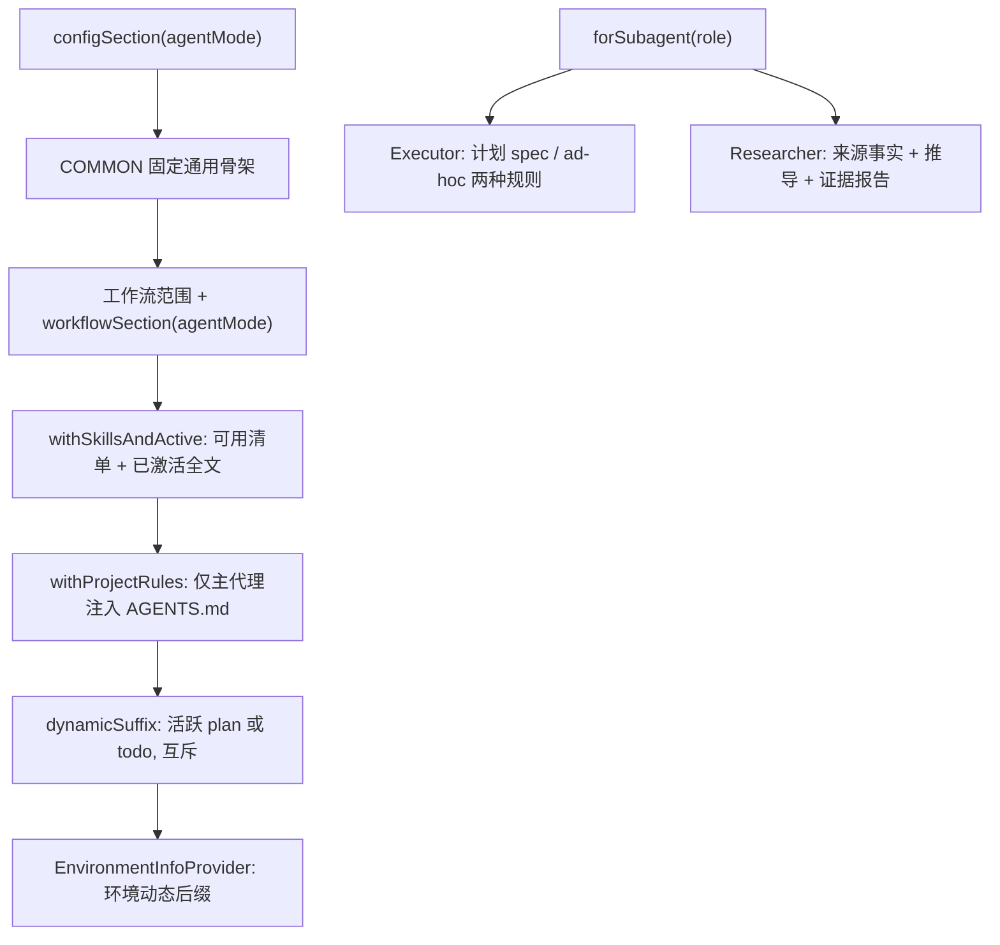
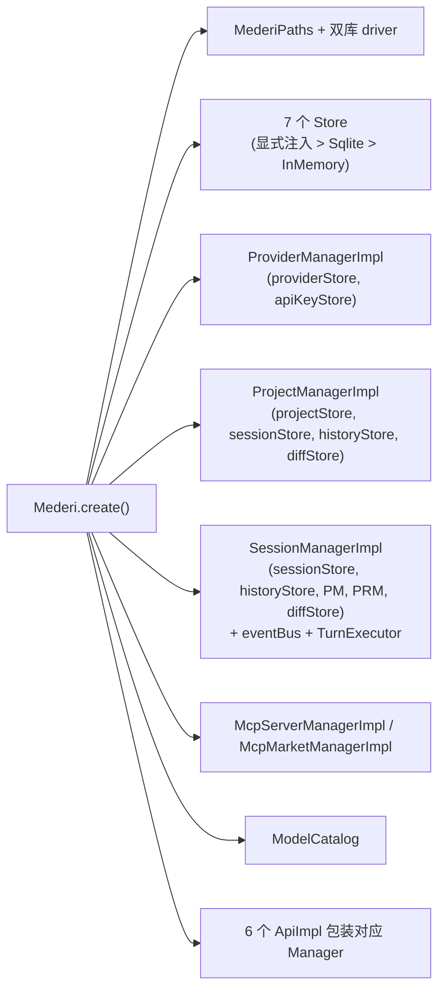

# 01 · core 模块（领域核心，:core，当前仅 JVM 目标）

> 路径约定：`…/` = `core/src/commonMain/kotlin/xyz/mederi/`。
> 注意：`model/`、`koog/` 等目录下文件的 `package` 声明可能是 `xyz.mederi.domain.model`、`xyz.mederi.infrastructure.koog` 等，与目录名不完全一致——以文件内 package 为准。

## 1. DI 装配（`…/Mederi.kt`）

`Mederi` 私有构造，3 个工厂入口：`local(config: String)`、`backend(historyStore, sessionStore, apiKeyStore, providerStore, projectStore)`、`create(block: MederiConfig.() -> Unit)`（前两者最终都调 create）。

**create() 装配顺序**：

1. `MederiConfig().apply(block)` → configDir 展开 `~` → `MederiPaths(dirPath).ensureDirectories()`；`MederiHttpClientFactory.userAgent = config.userAgent`（出站 HTTP 身份头统一注入）。
2. `handleLegacyFiles(paths, config.configMigrationRequester)`——检测 JSON 时代遗留文件（`config/providers/`、`config/projects.json`、`config/mcp-servers.json`、`config/providers.json`、`data/mederi.db(-wal/-shm)`），**必须经用户批准才删**；无审批器只打日志保留。
3. 双库 driver：`createDriver(dbPath)` = `JdbcSqliteDriver`（WAL + foreign_keys），分别对 config.db（`MederiConfigDatabase.Schema.create`）与 data.db（`MederiDataDatabase.Schema.create`）建表（.sq 全部 IF NOT EXISTS）。
4. Store 选择（优先级：**显式注入 > Sqlite > InMemory**）：
   - config.db 侧：`apiKeyStore` / `providerStore` / `projectStore` / `mcpServerStore` / `settingsStore`
   - data.db 侧：`historyStore` / `sessionStore` / `diffStore`
5. `ModelCatalog()`（内存索引，需外部调 `start()`）。
6. Manager 装配：`ProviderManagerImpl(providerStore, apiKeyStore)`；`ProjectManagerImpl(projectStore, sessionStore, historyStore, diffStore)`；`McpServerManagerImpl(mcpServerStore, mcpConnector)`；`McpMarketManagerImpl(OfficialRegistrySource())`；`SkillManagerImpl(settingsStore, defaultSkillsRoot=paths.skillsDir)`（须先于 SessionManager 构造就绪——系统提示词注入依赖它）；`SubagentConfigManager(settingsStore, providerManager, sessionStore)`（见 §3.5）；`SessionManagerImpl(sessionStore, historyStore, projectManager, providerManager, diffStore, mcpConnector, skills=skillManager, subagentConfigManager)`；`McpConnector(mcpServerStore)`（引擎，manager 与 TurnExecutor 共享）。`Mederi.create` 同时创建并暴露 `browserSettingsManager`，并构造 `browserRuntimeProvider`（`browserSettingsManager.get().browserHome` → `browserRuntimeDirs`）经 `SessionManagerImpl → TurnExecutor → BrowserTaskManager` 注入；`MederiAiCore` 复用该实例不再自建。
7. API 装配：`ProviderApiImpl(providerManager, modelCatalog)`、`ModelApiImpl(providerManager)`、`ProjectApiImpl(projectManager)`、`SessionApiImpl(sessionManager)`、`SandboxApiImpl(sandboxManager)`、`McpServerApiImpl(mcpServerManager)`、`McpMarketApiImpl(mcpMarketManager)`、`SkillApiImpl(skillManager)`、`SubagentConfigApiImpl(subagentConfigManager)`、`WorkspaceApiImpl(workspaceManager)`。

`Mederi` 公开成员：`sandbox: SandboxApi`、`sandboxManager: SandboxManager`、`historyStore: HistoryStore?`、`providers: ProviderApi`、`projects: ProjectApi`、`providerManager`、`projectManager`、`sessionManager`、`sessions: SessionApi`、`models: ModelApi`、`mcpMarket: McpMarketApi`、`mcpServers: McpServerApi`、`skills: SkillApi`、`subagentConfigs: SubagentConfigApi`、`modelCatalog: ModelCatalog`、`workspaces: WorkspaceApi`、`workspaceManager: WorkspaceManager`。

### config 包

- `MederiConfig`（`…/config/MederiConfig.kt`）：可注入容器。`configDir: String?`、`configMigrationRequester: ConfigMigrationRequester?`、`providerStore/projectStore/historyStore/apiKeyStore/sessionStore/diffStore/mcpServerStore/settingsStore`（全部可空 = 默认推导链生效）、`userAgent: String`（出站 HTTP User-Agent，装配层注入，默认 `Mederi/dev`）。**浏览器设置不经过 MederiConfig**——`Mederi` 门面新增 `settingsStore: SettingsStore` 构造字段，Camoufox 设置经 `BrowserSettingsManager` 持久化（key `browser.camoufox.settings`，见 §7.3）；浏览器选择走全局 `BrowserRegistry`。
- `MederiPaths`（`…/config/MederiPaths.kt`）：`root: File`、`dataDir = root/data`、`configDatabaseFile = root/config.db`、`dataDatabaseFile = dataDir/data.db`、`ensureDirectories()`。
- `ConfigMigrationRequester`（接口，`…/config/ConfigMigrationRequester.kt`）：`suspend fun requestDeletion(legacyFiles: List<String>): Boolean`。
- 根目录杂项：`GreetingUtil.kt`（`…/GreetingUtil.kt`）：`sayHello(to): String` 问候示例工具（无任何业务依赖）。

## 2. 领域模型（`…/model/`，package 实为 `xyz.mederi.domain.model`）

### 2.1 类图（模型关系）

```mermaid
classDiagram
    class Project { +id +name +directory +createdAt +updatedAt }
    class Session {
        +id +projectId +title +status: SessionStatus
        +agentMode: AgentMode
        +aiModel: AIModel? +reasoningLevel: ReasoningLevel? +apiKeyId: String?
        +draftText: String?
        +subagentConfigs: Map~SubagentRole, SubagentModelConfig~
        +subagentMaxConcurrent: Int?
        +env: Map +todos: List~TodoItem~ +createdAt +updatedAt
    }
    class AIModel {
        +id +providerModelId +name
        +supportsReasoning +reasoningLevel +reasoningLevels
        +contextWindow +maxTokens +supportsImages +supportsImagesOverride
        +origin: ModelOrigin +isEnabled
        +inputPricePerMillion +outputPricePerMillion
    }
    class Message {
        +id? +sessionId +role: MessageRole
        +parts: List~MessagePart~ +status: MessageStatus
        +createdAt +finishReason
        +totalTokens +inputTokens +outputTokens +cachedTokens
        +providerId +modelId +modelName +reasoningLevel +agentMode +projectId +durationMs
        +turnDiffSummary?: TurnDiffSummary  % 最后一条 assistant 消息携带本 turn 文件变更摘要
    }
    class MessagePart {
        <<sealed>>
        Text / Image / File
        ToolCall / ToolResult / Reasoning
    }
    class TodoItem { +content +status: TodoStatus }
    class Plan {
        +id +title +summary +sessionId
        +background +problemAnalysis +approach +expectedOutcome +testMethod +keyDecisions +changes +risks +successCriteria
        +userReviewRequired: List~String~（停用） +openQuestions: List~String~ +researchNotes: String
        +architecture(Mermaid) +subtasks: List~Subtask~
        +status: PlanStatus +agentMode
    }
    class Subtask {
        +index +name +status +planDetail(brief恒不变)
        +spec(generate_spec写入) +specChanges: List~SpecChange~
        +targetFiles +decisions
        +verification +verificationResult? +verificationChanges: List~VerificationChange~ +dependsOn +parallelizable
        +executorTouchedFiles: List~String~ +executorProgress?
    }
    class SpecChange { +oldSpec? +newSpec +reason +timestamp }
    class TurnDiff { +sessionId +messageId? +changes: List~FileChange~ +unifiedDiff +createdAt }
    class MederiEvent { +type: EventType +sessionId +messageId? +payload +timestamp }

    Project "1" --> "*" Session : projectId
    Session --> AIModel : aiModel(JSON)
    Session "1" --> "*" TodoItem
    Message "1" --> "*" MessagePart
    Plan "1" --> "*" Subtask
    Subtask --> SpecChange : specChanges(append-only)
    TurnDiff "1" --> "*" FileChange
```



### 2.2 枚举一览

| 枚举 | 值 | 语义 |
|---|---|---|
| `SessionStatus` | `IDLE, RUNNING, ERROR` | 会话运行状态 |
| `MessageRole` | `SYSTEM, USER, ASSISTANT, SUMMARY` | SUMMARY=压缩标记消息（UI 可见，prompt 压缩节点） |
| `MessageStatus` | `PROCESSING, COMPLETED, ERROR` | 消息状态 |
| `AgentMode` | `APPROVAL, AUTONOMOUS` | 工具集完全一致，唯一区别=计划批准者 |
| `SubagentRole` | `EXECUTOR, RESEARCHER, BROWSER_OPERATOR, BROWSER_BRAIN` | EXECUTOR=全工具（无 plan/spawn/verify/ask_user/todo）；RESEARCHER=只读 read_file/list_directory；**BROWSER_OPERATOR/BROWSER_BRAIN=浏览器操作配置专属角色（2026-09-23）**：仅用于设置页为其配独立模型/推理档（AgentConfigCard 图标 Globe），BrowserTaskManager 后台派发时按角色解析（operator/brain 各建 llmCaller）；实际执行走 BrowserTaskManager 后台，不经 turn 子代理路径（SystemPrompts.forSubagent/SubagentRunnerImpl 对这两角色抛 IllegalStateException） |
| `AgentCapabilities` | `MAIN, EXECUTOR, RESEARCHER, BROWSER`（每值含 `inheritMcp` / `inheritSkills`） | **中心化继承策略唯一表**：MAIN(true,true) / EXECUTOR(true,true) / RESEARCHER(true,false) / **BROWSER(true,true)**（2026-09-23：浏览器操作角色，of() 映射 BROWSER_OPERATOR/BROWSER_BRAIN，实际不经 turn 执行）。`of(subagentRole?)` 映射；TurnExecutor 开 MCP 会话与注入 skills 提示词都只读此表。**新增子代理=SubagentRole 加值 + 本表加一行 + of 加一个分支** |
| `ModelOrigin` | `FETCHED, MANUAL` | FETCHED=端点拉取；MANUAL=手动添加；两者均允许用户编辑 |
| `TodoStatus` | `PENDING, IN_PROGRESS, COMPLETED, CANCELLED, FAILED`（wire 小写；FAILED 预留给 Plan 验证结果语义——verify_subtask 产生于 `Subtask.status`，不投影进 todos） | |
| `PlanStatus` | `PENDING_APPROVAL, APPROVED, IN_PROGRESS, COMPLETED, VOIDED` | VOIDED = 作废（voidActivePlans，双文件移入 plans-voided/）；终态 = COMPLETED 或 VOIDED |
| `SubtaskStatus` | `PENDING, IN_PROGRESS, COMPLETED, FAILED` | |
| `VerifyStatus` | `PASS, PARTIAL, FAIL` | |
| `RootCause` | `IMPLEMENTATION, PLAN` | verify 根因轴（2026-09-24，替代旧现象轴）：IMPLEMENTATION = spec 说得清楚、执行没做到 → `converge_plan` 追加补救子任务；PLAN = 实现照 spec 做到、计划本身（逻辑/验证方法/预期）站不住 → append-only 修订（`update_verification` 改验证契约 / `generate_spec` reason= 改 spec）。判定顺序硬性：先核实现、实现无误再核计划 |
| `ProjectContextType` | `GREENFIELD, BROWNFIELD` | |
| `FileChangeStatus` | `ADDED, MODIFIED, DELETED` | diff 用 |
| `ProviderType` | `OPENAI_CHAT, OPENAI_RESPONSES, GOOGLE` | |
| `ProviderAuthentication` | `API_KEY, CHATGPT_OAUTH` | 认证方式与协议独立；旧 Provider payload 缺失时为 API_KEY |
| `ReasoningLevel` | `NONE, MINIMAL, LOW, MEDIUM, HIGH, XHIGH, MAX` | |
| `ToolName` | `READ_FILE, WRITE_FILE, EDIT_FILE, LIST_DIRECTORY, APPLY_PATCH, BASH, WEB_SEARCH, WEB_FETCH, UPDATE_TODO, ASK_USER, GET_CONTEXT_REMAINING, NEW_CONTEXT, CREATE_PLAN, WRITE_PLAN, GENERATE_SPEC, WRITE_LOG, CONVERGE_PLAN, UPDATE_VERIFICATION, VERIFY_SUBTASK, SUBAGENT, SPAWN_AGENT, SPAWN_RESEARCHER, AGENT_STATUS, STOP_AGENT, BROWSER, RUN_BROWSER_TASK, BROWSER_TASK_STATUS, STOP_BROWSER_TASK, BROWSER_INFO, OFFICE_READ, OFFICE_WRITE, LIST_PROCESSES, STOP_PROCESS, SET_TIMER` | 内置工具名称字符串枚举（`@Serializable`，wire 对应小写蛇形字符串，含 `val value: String` 与伴生 `fromValue(value)`） |

### 2.3 关键 data class 字段（穷尽）

- **`MessagePart`（sealed，`…/model/Message.kt`）**：
  - `Text(text)`；`Image(url, mimeType?)`；`File(path)`
  - `ToolCall(id?, tool, args)`；`ToolResult(id?, tool, output, isError=false, status?, durationMs?, error?)`
  - `Reasoning(content: List<String>, summary?, encrypted?, id?)`
  - `const val UI_HIDDEN_MARKER = "<<<NOT_FOR_UI>>>"`（消息文本中该标记后 UI 不渲染、AI 可见——系统环境注入块）
- **`Message`**：新增 `turnId: String?=null`（工作归属）、`isFinalAnswer: Boolean?=null`（Core 确认本轮正式回复，null 为旧历史）、`pendingSteering: Boolean=false`（接收即落库、尚未消费的用户输入）、`workStartedAt: Long?=null` / `workCompletedAt: Long?=null`（工作墙钟起终点，epoch ms）。见类图。诊断字段 totalTokens/inputTokens/outputTokens/cachedTokens/durationMs 等写入时抽取进 message_history 列。`turnDiffSummary: TurnDiffSummary?`（`…/tools/diff/TurnDiff.kt`：`files: List<FileDiffSummary>` + totalAdditions/totalDeletions）——一个 turn 的**最后一条 assistant 消息**携带本 turn 的文件变更摘要（runTurn 收尾经 historyStore.updateMessage 原子回写该消息，其余消息为 null；MESSAGE_COMPLETED payload 同步带出，见 §11）。
- **`Provider`（`…/provider/domain/model/Provider.kt`）**：`id, name, type: ProviderType, baseUrl, reasoningParameter: ReasoningParameter?, models: List<AIModel>, responseSanitization: Boolean=false, modelsDevKey: String?, @Transient apiKeys: List<ProviderApiKey>`（apiKeys 读时合并、写时剥离）；新增 `authentication: ProviderAuthentication=API_KEY`、`@Transient accessTokenProvider: (suspend () -> String)?=null`（OAuth 运行时按请求获取有效凭据，不持久化/不跨 AiCore）；派生 `defaultApiKey`、`supportsReasoning`。
- **`ProviderApiKey`**：`id, name, @Contextual maskedValue, isDefault`；companion `mask()`（前3+"..."+后4，≤7 返回 "***"）。
- **`ReasoningParameter`**：`levels: Map<ReasoningLevel, String?>, parameterName: String="", customRequestBody: Map<String,String>`。核心思想：**不对供应商参数做语义解释**，每档对应用户编写的请求体 JSON 片段，发送时根级合并。方法 `resolve(level)` / `supportsLevel` / `availableLevels` / `validate()`；companion `forOpenAIChat()/forOpenAIResponses()/forGoogle()/forType(type)`。
- **`RemoteModelInfo`（`…/provider/domain/model/RemoteModelInfo.kt`）**：`providerModelId, name, contextWindow?, maxTokens?, supportsReasoning?, inputPricePerMillion?, outputPricePerMillion?, supportsImages?, reasoningLevels`（不落库的远端中间结构，可空=远端未提供）。
- **`TodoItem`（`…/model/Todo.kt`）**：`content, status`；扩展 `List<TodoItem>.encodeTodos(): String` / `decodeTodos(raw): List<TodoItem>?`（唯一 Json 配置，失败安全降级 null）。
- **`FileDiff`（`…/model/FileDiff.kt`）**：`filePath, before, after, additions, deletions`（UI DTO）。
- **`MederiEvent`（`…/model/MederiEvent.kt`）**：`type: EventType, sessionId, messageId?, payload: Map<String,String>, timestamp`。

## 3. Manager 层（唯一真理源）

### 3.1 SessionManager（`…/session/SessionManager.kt` / `SessionManagerImpl.kt`）

```kotlin
suspend fun list(): List<Session>
suspend fun listByProject(projectId: String): List<Session>
suspend fun get(id: String): Session?
suspend fun require(id: String): Session
suspend fun create(agentConfig: AgentConfig, projectId: String, title: String, env: Map<String,String>): Session
suspend fun rename(id: String, title: String): Session
suspend fun delete(id: String)          // turnExecutor.abortAndJoin → 级联删 session/history/diff
suspend fun abort(id: String)
% turnExecutor.abort：cancel turn job → stopAllForSession 级联收割本会话 RUNNING 子代理 → 取消
% question/planApproval requesters → 异步写 IDLE + MESSAGE_ERROR(用户中止)；无活跃 turn 整体 no-op
suspend fun abortAndJoin(id: String)    // turnExecutor.abortAndJoin：cancel+join + stopAllForSession + 对残留 RUNNING 兜底复位 IDLE（cleanupStaleRunningSessions 启动清理用）
suspend fun sendMessage(id: String, request: SendMessageRequest)
suspend fun steerMessage(id: String, request: SendMessageRequest)   // Steering（turn 运行时插话引导，见 §6.2）：
% 兼容别名→统一sendMessage；Core接纳持久化后决定启动/安全边界消费
suspend fun rollbackToMessage(id: String, messageId: String)   // abortAndJoin 后 historyStore.replace(截断)
suspend fun updateComposeState(id: String, agentMode: AgentMode, aiModel: AIModel?, reasoningLevel: ReasoningLevel?, apiKeyId: String?, draftText: String)
% 全量覆盖写会话 compose state（非 COALESCE：null 写 null，清空语义），用于输入框设置统一保存
suspend fun resolveQuestion(id: String, questionId: String, answers: List<List<String>>)
suspend fun resolvePlanApproval(id: String, planId: String, approved: Boolean)
% 计划审批仅批准技术方案，绝不修改会话模型与推理档位（session.aiModel / reasoningLevel 保持不变）
% 跨 turn 批准路径（requester 已随旧 turn 消亡/进程重启，见 §6.2）：批准且计划仍 PENDING_APPROVAL 非终态时
% 落盘 APPROVED + PLAN_APPROVAL_RESOLVED + 一条 UI 隐藏内部消息（UI_HIDDEN_MARKER 开头）启动新 turn，
% AI 读到 Active Plan=APPROVED 自行走执行链；拒绝 → 直接 false，计划保持 PENDING_APPROVAL
fun getSubagentReport(agentId: String): SubagentReportData?   // 子代理汇报直读（优先落盘文件，供 Server/UI）
fun listSubagentsForSession(sessionId: String): List<BackgroundAgent>  // 会话全部子代理（RUNNING + 未丢弃终态，按 startedAt 排序）；getSnapshot 水合 subagents 用
fun listBackgroundTasksForSession(sessionId: String): List<BackgroundTaskEntry>  // 会话全部后台任务（Command / Timer，按 startedAt 倒序；TurnExecutor → BackgroundTaskManager.listForSession）
fun stopBackgroundTask(taskId: String): String?  // 停止指定后台任务（先置 STOPPED 再取消协程/杀进程组）；taskId 不存在返回 null
fun stopBrowserTask(taskId: String): String?  // 停止浏览器任务并关闭其浏览器（终态返回真实状态；taskId 不存在返回 null；取消协程后在 NonCancellable 上下文里 control.close()）
suspend fun compressHistory(id: String)
suspend fun contextUsedTokens(id: String): Int   // 当前上下文占用唯一入口 = aiViewContextUsedTokens(historyStore, id, session.aiModel?.supportsImages ?: true)
% UI 概览 / getSnapshot / listMessagesPage / GetContextRemainingTool 取「当前上下文占用」统一走这里；SessionApi 同名方法转发（SessionApiImpl → sessionManager.contextUsedTokens）
suspend fun listMessages(id: String): List<Message>
suspend fun getMessage(id: String, messageId: String): Message
suspend fun listRawMessages(id: String): List<RawMessageRecord>  // payload 原文直读，调试用
suspend fun getFileDiffs(id: String, messageId: String? = null): List<FileDiff>
fun events(sessionId: String): Flow<MederiEvent>
fun events(): Flow<MederiEvent>          // 全局事件总线（MutableSharedFlow replay=0, buffer=256, DROP_OLDEST）
```

Impl 构造参数 = `(sessionStore, historyStore, projectManager, providerManager, diffStore?, eventBus?, mcpConnector?, skills?, subagentConfigManager?)`，内部据此创建 `TurnExecutor`（完整 ctor：`..., diffStore?, mcpConnector?, skills?, scope, onFileTouched?, onTurnDiff?, subagentConfigManager?, rotationSessionId?`——`onFileTouched`/`onTurnDiff` 两个回调主路径不挂、由 `SubagentRunnerImpl` 派子代理 turn 时挂上以收集子代理文件改动并合并进父 turn；`rotationSessionId` 轮询计数器作用域：主代理不传（null→用自身 sessionId），子代理传 `parentSessionId` 与父共享轮询计数器）。`create` 生成 `sess_xxxxxxxx` 并发 SESSION_CREATED。

### 3.2 ProjectManager（`…/project/`）

```kotlin
suspend fun list(): List<Project>
suspend fun get(id: String): Project?;  suspend fun require(id: String): Project
suspend fun create(name: String, directory: String): Project   // ensureMederiDir 建 .mederi/{plans,plans-done,notebook.md}
suspend fun delete(id: String)          // 级联删 Session+History+Diff
suspend fun rename(id, name): Project
```

**项目目录模型（单目录）**：项目恰好绑定一个目录 `directory`（绝对路径，非空），承载 `.mederi/`、shell cwd、相对路径解析。引擎内部工具/沙箱仍以 `List<String>`（containment 白名单）接收，调用侧统一 `listOf(project.directory)`。
**旧数据迁移**：`SqliteProjectStore` 读取旧版 `directories: List<String>` payload 时取第一个目录迁移为单目录（内存态生效，下次保存回写新形状）。

### 3.3 ProviderManager（`…/provider/`）

Provider 组：`list()`（读时合并 keys）/ `listWithoutKeys()` / `get/require` / `create(name,type,baseUrl,reasoningParameter?,responseSanitization,modelsDevKey?)` / `update` / `delete`（级联删 keys）。

**ChatGPT OAuth（2026-11-05）**：`createChatGptProvider(): Provider` 创建独立供应商（协议 `OPENAI_RESPONSES`、认证 `CHATGPT_OAUTH`、固定 `https://api.openai.com/v1`）。`ProviderManagerImpl(providerStore,apiKeyStore,chatGptAuth: ChatGptOAuthManager?=null)` 的 get/list/listWithoutKeys 对 OAuth 附加请求级 `accessTokenProvider`；OAuth 不合并 API keys、不参与 key 轮询，拒绝 key 管理及端点修改。`getDefaultKeyValue` 仅在宿主返回有效 OAuth token；`ApiKeyResolver.resolve` 的 OAuth 分支先于普通 key 记忆链，不缓存 token。删除该供应商清理其授权生命周期及凭据。

`Mederi.chatGptAuth: ChatGptOAuthManager` 由 `Mederi.create` 构建并注入 ProviderManager；有 configDir 时凭据在其 `auth/` 子目录，纯内存模式不写默认 home。

| 类 / 文件（`core/src/commonMain/kotlin/xyz/mederi/provider/oauth/`） | 字段与方法 |
| --- | --- |
| `ChatGptOAuthManager.kt` | `start(providerId): ChatGptAuthState` / `state(providerId): ChatGptAuthState` / `cancel(providerId)` / `disconnect(providerId)` / `delete(providerId)` / `accessToken(providerId): String`（均 suspend）；`isConnected(providerId): Boolean`；`close()` |
| `ChatGptOAuthModels.kt` | 公开状态 `ChatGptAuthState(providerId,status,authUrl?,email?,error?)`；内部凭据 `ChatGptCredential(clientId,subject,email?,accessToken?,refreshToken?,idToken?,expiresAt,scopes)`、稳定宿主 `ChatGptHost(hostId)`；OIDC/token/JWKS DTO 使用 kotlinx.serialization，不出宿主 |
| `ChatGptCredentialStore.kt` | 账号凭据及稳定 host ID；POSIX owner-only 权限或 Windows owner-only ACL（提权进程产生组所有者时通过 `jdk.security.auth` 解析当前账号）；临时文件先限制权限再写入并同目录原子替换；拒绝符号链接，文件锁串行 rotating refresh；无目录时内存保存 |
| `ChatGptOAuthTransport.kt` | 内部 `ChatGptOAuthTransport.get(url)/postForm(url,fields)`；`OpenAiOAuthTransport` 使用有界非流式 HTTPS auth.openai.com 请求、禁重定向、统一 UA；错误不附 token 响应体 |
| `ChatGptIdTokenVerifier.kt` | `verify(token,jwks,issuer,clientId,nonce,nowSeconds)`：RS256/JWKS 签名、issuer、audience、expiry、nonce 验证；通过后才使用身份 |

本机 `127.0.0.1` 回调仅处理授权 code；新注册保存 issued client_id，后续复用。state/nonce/PKCE 每次新建。凭据从不加入公开 Provider payload 或 AiCore DTO。新 SIWC 与 Codex 内置登录认证不同，未确认官方直接读取订阅额度的 API；外部状态明确 unavailable，并提供官方 Usage 设置链接。

模型与请求适配：`RemoteModelParsing.kt.parseChatGptModelsResponse(raw)` 只接受账号目录 `models[]`，筛 `visibility=list`，映射 `slug/display_name` 并保持远端顺序；普通 key 继续解析 `data[].id`。`ProviderManagerImpl.fetchOpenAIModels(...,chatGptPlan=false)` 按认证方式选择解析器，元数据落库仍走 ModelMerge。`KoogClientFactory` 对 OAuth 再次校验官方固定端点与 Responses 协议。`MederiOpenAILLMClient` 增加 `chatGptPlan=false`、`accessTokenProvider?`，OAuth 每次 flow 收集/重试读取有效 token 覆盖 Authorization；请求 `store=false/stream=true`，工具声明放 `mederi` namespace，历史工具调用保留 namespace/ID，普通 key 请求结构不变。OAuth 的非流式 `execute` 在内部聚合完整 SSE（正文、推理、工具及 usage），截断不能冒充完整响应。

Key 组：`listKeys` / `addKey(providerId,name,value,isDefault)` / `deleteKey` / `setDefaultKey` / `getDefaultKeyValue(providerId): String?`（明文）/ `getKeyValue(providerId, keyId): String?`（按 id 取明文，keyId 不属于该 provider 返回 null，key 选择器/选定项取值用）。
Model 组：

```kotlin
suspend fun listModels(providerId): List<AIModel>
suspend fun addModel(providerId, ..., ): AIModel          // MANUAL 模型，用户权威
suspend fun addFetchedModel(providerId, merged: AIModel, isEnabled): AIModel  // FETCHED 落库通道
suspend fun applyRemoteMetadata(providerId, modelId, endpoint: RemoteModelInfo?, catalog: ModelMetadata?): AIModel
        // 远端合并落库入口（普通列表刷新不修改存量）；显式自动设置 endpoint=null，窗口/输出上限补空，其余按 ModelMerge
suspend fun updateUserModel(providerId, modelId, ...全可空, optimizeForRequestCount?=null): AIModel
        // 两种来源均可编辑现有字段；null 保留现值，FETCHED 图片同时写用户覆盖
suspend fun deleteModel(providerId, modelId)
suspend fun getModel(modelId): AIModel?;  suspend fun listAllModels(): List<AIModel>   // 跨供应商
suspend fun fetchRemoteModels(providerId): List<RemoteModelInfo>  // OPENAI_* Bearer / GOOGLE x-goog-api-key，Google 分页 pageSize=1000
suspend fun fetchRemoteModelIds(providerId): List<String>
```

Impl 规则：写前 `validateReasoningParameter`（`{` 开头必须是合法 JSON 对象）；HTTP 解析抽在 `RemoteModelParsing.kt`（`parseOpenAIModelsResponse` 带 vLLM 别名 / `parseGoogleModelsResponse` 分页）。

### 3.4 SkillManager（`…/skills/SkillManager.kt` / `SkillManagerImpl.kt`）

Skill 管理（UI 薄触发，文件操作全在 core）。**发现/解析兼容层（2026-09）**：Koog `discoverSkills` 的 frontmatter 解析是简化行解析，不支持 YAML 块标量（`description: >` 解析成字面 ">"）与空值+缩进块（整个 skill 被忽略）——Mederi 侧自研超集解析器兼容，不改 Koog、不改第三方 skill：

- `SkillFrontmatterParser`（`…/skills/SkillFrontmatterParser.kt`，纯 Kotlin）：状态机解析 `---` frontmatter，支持块标量 `>`/`|` 及 chomping（`>-`/`|+`）、空值+缩进块、引号、`metadata:` 子键、注释/空行；输出 `ParsedFrontmatter(name, description, license, compatibility, metadata, allowedTools, isValid)`
- `SkillDiscovery`（`…/skills/SkillDiscovery.kt`）：BFS 扫描根目录找 SKILL.md（maxDepth=4、maxDirectories=2000、跳过 `.git`/`node_modules`、按 name LAST_FOUND 去重），`SkillFrontmatterParser.parse` 解析，仅 name+description 非空产出 `SkillInfo`
- `SkillManagerImpl.list()`：`SkillDiscovery.discover(root)` 为主 + Koog `discoverSkills` union 兜底（`linkedMapOf` + `putIfAbsent`，Mederi 优先覆盖同名字段、保持发现顺序）
- `SkillManagerImpl.install()`：zip 解压后同样用 `SkillDiscovery.discover(tempDir)` 验证内容

```kotlin
suspend fun list(): List<SkillInfo>                    // SkillDiscovery 扫根目录 SKILL.md + Koog discoverSkills union 兜底（发现即安装）
suspend fun getRootDirectory(): String                 // settings 表 key=`skills.root`，默认 paths.skillsDir（~/.mederi/skills）
suspend fun setRootDirectory(path: String)             // 展开 ~ + mkdirs + 持久化
suspend fun install(url: String): SkillInfo            // Ktor 下载 zip → ZipInputStream 解压到临时目录 → SkillDiscovery 验证 → 移入根目录（同名先删再装）
suspend fun uninstall(name: String)                    // 删除根目录下对应目录（名称需匹配 ^[a-zA-Z0-9_-]+$）
```

`SkillInfo`（`…/skills/domain/SkillInfo.kt`）：`name, description, location, license?, compatibility?, allowedTools?`——与 Koog `ai.koog.skills.model.Skill` 同构（SkillFrontmatterParser 解析 SKILL.md frontmatter 产出）。zip slip 防护：解压路径必须落在临时目录内。已存在同名 skill → 先删再装（install 幂等）。

**统一异常（`…/api/exception/MederiException.kt`）**：抽象基类 `MederiException`，子类 `MederiNotFoundException / MederiValidationException / MederiStateException / MederiInternalException`；`mederiCall(block)` 映射 `NoSuchElementException→NotFound`、`IllegalArgumentException→Validation`、`IllegalStateException→State`、其他→Internal。

| API | 方法（Impl 全部薄转调 + mederiCall） | 特别逻辑 |
|---|---|---|
| `SessionApi` | list / create(CreateSessionRequest) / get / rename / delete / abort / abortAndJoin / sendMessage(SendMessageRequest) / steerMessage(SendMessageRequest) / getSubagentReport(agentId)(→SubagentReportData?) / listSubagentsForSession(sessionId)(→List<BackgroundAgent>) / stopSubagent(agentId) / **listBackgroundTasksForSession(sessionId)(→List<BackgroundTaskEntry>)** / **stopBackgroundTask(taskId)(→String?)** / **stopBrowserTask(taskId)(→String?)** / rollbackToMessage / resolveQuestion / resolvePlanApproval / compressHistory / listMessages / getMessage / listRawMessages(→RawMessageDto) / getFileDiffs / events | RawMessageRecord→Dto 转换 |
| `SessionApi`（续，输入框设置 + 会话控制） | updateAgentConfig(sessionId, agentMode?, aiModel?, reasoningLevel?, apiKeyId?)（COALESCE：null 不改） / **updateComposeState(sessionId, agentMode, aiModel?, reasoningLevel?, apiKeyId?, draftText)**（全量覆盖写含 draftText，非 COALESCE） / contextUsedTokens(sessionId) / stopSubagent(agentId) | 输入框设置统一保存；updateComposeState 为全量 SET 语义（null 写 null、清空） |
| `ProjectApi` | list / create / get / delete / rename / addDirectory / removeDirectory | |
| `SandboxApi`（`api/SandboxApi.kt`；实现 `api/impl/SandboxApiImpl.kt`） | `suspend getSettings(projectId): SandboxSettings` / `updateSettings(projectId, settings): SandboxSettings` / `getStatus(projectId): SandboxStatus` / `resolveExecutionApproval(conversationId, requestId, approved): Unit`；`fun pendingApprovals(conversationId): List<ExecutionApprovalRequest>` | 复用唯一 `SandboxManager`，不持缓存；所有方法通过 `mederiCall` 转换异常，取消透传；getStatus 在 Dispatchers.IO 用实际额外路径及 manager.protectedDirectories 探测后端 |
| `ProviderApi` | list / create / get / update / delete / addKey / listKeys / deleteKey / setDefaultKey / listModels / addModel / updateModel / deleteModel / **refreshModels** / **autoSetupModels** | refresh 只新增远端新模型（DEFAULT_VISIBLE_MODEL_LIMIT=10 补足启用）不碰存量元数据；autoSetupModels=目录元数据进存量 FETCHED 模型唯一通道；type 字符串解析失败抛 Validation |
| `ModelApi` | list / get（跨供应商聚合） | |
| `McpServerApi` | install(mcpServersJson) / list / getJson / update / setEnabled / delete / **discover(name)** / verify / **verifyAll** / verifyConfig | 无 DTO 转换；list 返回带缓存 status 的 McpServerInfo |
| `McpMarketApi` | search(query,cursor,pageSize) / detail(id) / installOptions(detail) / installConfig(detail,...) / installConfig(id,...) | |
| `SkillApi` | list / getRootDirectory / setRootDirectory(path) / install(url) / uninstall(name) | UI 薄触发；下载/解压/删除全在 core（`SkillManagerImpl`） |
| `SubagentConfigApi` | list(sessionId?) / get(role,sessionId?) → SubagentRoleConfigDto / update(role, request,sessionId?) / getGlobalSettings(sessionId?) / updateGlobalSettings(request,sessionId?) / clear(role,sessionId) / clearGlobalSettings(sessionId) | 系统设置提供默认值；EXECUTOR/RESEARCHER 支持会话覆盖与恢复默认（§3.5）。角色 DTO 包含 role/displayName/description/modelId?/modelName?/reasoningLevel?/apiKeyId?/isInheriting/usesDefault；全局 DTO 包含 maxConcurrentAgents/usesDefault；usesDefault 表示会话无覆盖。browser 角色保留系统配置。 |

SessionApi 同文件 DTO：`AgentConfig(agentMode, aiModel=null, reasoningLevel=null)`、`CreateSessionRequest(agentConfig, projectId, title="", env)`、`RenameSessionRequest(title)`、`SendMessageRequest(agentConfig, parts: List<MessagePart>, apiKeyId: String?=null, messageId: String?=null)`——`apiKeyId` 为本次消息携带的选定 key ID（null=未指定）；user/steer/rollback 轮显式携带并写入 `ApiKeyResolver` 进程级记忆，内部消息轮（计划批准执行/事件唤醒续轮）经 `apiKeyResolver.currentKeyId(providerId)` 从记忆取回；统一由 `ApiKeyResolver.resolve(providerId, apiKeyId)` 解析（显式归属通过→记忆→默认 key），消费端拿 `ResolvedApiKey.value`（详见本节 ApiKeyResolver 段）；`RawMessageRecord(seq, messageId?, role, payload, createdAt, modelId?, durationMs?, finishReason?, status?)`、`MessageSummary(seq, messageId?, role, content, createdAt)`（HistoryStore.kt 内）。

### 3.5 SubagentConfigManager（`…/tools/subagent/SubagentConfigManager.kt` / `…/model/SubagentModelConfig.kt`）

**`SubagentModelConfig`**（`…/model/SubagentModelConfig.kt`，package 实为 `xyz.mederi.domain.model`）：`modelId: String?`（null=继承父会话模型）、`reasoningLevel: ReasoningLevel?`（null=继承父档位）、`apiKeyId: String?`（子代理 API Key 策略：null=继承父会话选定 key；具体 keyId=指定 key；`API_KEY_ROTATION_ID`（`xyz.mederi.provider`，值 `"__rotate__"`）=轮询）、派生值 `isInheriting`（三者均 null）。

**`SubagentConfigManager(settingsStore, providerManager, sessionStore)`**：
- `get(role, sessionId: String?=null)` / `list(sessionId: String?=null)`：无会话时读系统默认；有会话时仅 EXECUTOR/RESEARCHER 允许覆盖。角色无覆盖 entry 时动态读取系统默认，有 entry 时完整使用该配置（null 字段继承父会话，不再次合并系统默认）。浏览器角色始终使用系统设置，不参与会话覆盖。
- `set(role, config, sessionId: String?=null)` / `clear(role, sessionId: String?=null)`：全局完全继承配置删除 settings key；会话 set 即使三字段为 null 仍保留 entry（显式继承父会话），clear 才删除 entry 恢复系统默认。会话读改写由 Mutex 串行，独立 Store 写入不覆盖 compose state。会话配置 browser 角色写入/清除抛 MederiValidationException；不存在会话抛 MederiNotFoundException。
- `resolve(role, fallbackModel, fallbackReasoning, sessionId: String?=null): (AIModel, ReasoningLevel)`：会话覆盖 > 系统默认 > 父会话；选定模型通过 ProviderManager 查询，模型被删时回落父模型。
- `getMaxConcurrentSubagents(sessionId: String?=null)` / `setMaxConcurrentSubagents(count, sessionId: String?=null)` / `clearMaxConcurrentSubagents(sessionId)`：会话可空值覆盖系统默认，clear 恢复默认；count 必须 >=1。无系统值时内置默认 2。
- `usesDefault(role, sessionId)` / `usesDefaultConcurrency(sessionId)`：会话是否缺少对应覆盖，供 API 的 usesDefault 展示；与 isInheriting（是否继承父会话）分离。
- `SubagentConfigApi.list/get/update/getGlobalSettings/updateGlobalSettings` 同步增加尾部可选 sessionId；新增 `clear(role, sessionId)` / `clearGlobalSettings(sessionId)`。角色/global DTO 增加 `usesDefault: Boolean=true`；所有 API 异常经 mederiCall 转为 MederiException。
- 常量 `KEY_PREFIX = "subagent.config."`、`KEY_MAX_CONCURRENT = "subagent.maxConcurrent"`、`DEFAULT_MAX_CONCURRENT = 2`（settings 表 keys，见 §5）。会话只存覆盖，不把全局默认复制进会话。

`Session` 新增 `subagentConfigs: Map<SubagentRole, SubagentModelConfig>=emptyMap()`、`subagentMaxConcurrent: Int?=null`；data.db v5 增量 ALTER 两列，保留已有会话/消息，旧会话不回填角色配置、自动继承当前系统默认。

**SubagentManager 并发门禁（2026-09 代码级硬限制）**：
- 构造参数 `maxConcurrentProvider: (suspend () -> Int)?` 保留兼容；TurnExecutor 注入 `sessionMaxConcurrentProvider: (suspend (String) -> Int)?`，每次 spawn 按 parentSessionId 读取会话生效上限，改配置即时生效；
- `spawn()` 入口处通过 `spawnLock` 互斥原子检查：统计同父会话当前 `status == RUNNING` 的子代理数。达上限时抛出 `SubagentLimitReachedException(running, limit)`；
- `SpawnAgentTool` 与 `SpawnResearcherTool` 捕获该异常，直接将 `modelGuidance` 作为工具 Error 返回给模型（指导模型停止派发并结束 turn，等后台运行完成自动唤醒后再派发剩余任务）；
- **与子代理类型无关**（EXECUTOR 与 RESEARCHER 共享同一限额池）；
- **浏览器任务排除在外**：浏览器任务由 `BrowserTaskManager` 驱动，天然不走 `SubagentManager`；`SubagentRole.BROWSER_OPERATOR` / `BROWSER_BRAIN` 即使经 `spawn()` 也显式豁免不设限。

消费方：`SpawnAgentTool`/`SpawnResearcherTool` 的 spawn 模型解析（独立配置优先于父会话现值，未配置=继承）、`BrowserTaskManager` 按 BROWSER_OPERATOR/BROWSER_BRAIN 解析浏览器双角色模型（§7.3）。**apiKeyId 同策略（2026-10）**：spawn 时 `config.apiKeyId` 非 null 覆盖父会话 apiKeyId 透传 `subagentManager.spawn(apiKeyId=…)`（null=继承父；`API_KEY_ROTATION_ID` 哨兵原样透传，由下游 ApiKeyResolver/RotatingLLMClient 解释）。

### 3.6 WorkspaceManager（`…/workspace/WorkspaceManager.kt`）

负责 Git Worktree 与工作区全生命周期管理：
- `createWorkspace(projectId, sourceRepoRoot, selection, sessionId)`：验证或分配工作区，建立 REQUESTED 状态及关联会话。
- `acceptUserMessage(sessionId, messageId, parts, selection, sourceRepoRoot)`：Durable-first 接纳首条或后续用户消息，防止网络重试或断线丢失，确保消息在工作区未就绪时不丢失且仅接纳一次。
- `prepareWorkspace(workspaceId, sourceRepoRoot, requestId, permissions)`：六阶段工作流（VALIDATE → QUIESCE/SNAPSHOT → CREATE_CHECKOUT → COPY_CONTENT → SETUP → COMMIT_BINDING），包含环境变量复制、包含规则应用、状态幂等去重与准备门禁。
- `isModelExecutable(sessionId)`：工作区执行门禁，仅当工作区达到 READY 状态时放行，未就绪时硬阻断且绝不隐式降级。
- 配套服务：`GitWorkspaceDriver`、`WorkspaceLeaseManager`、`WorkspaceSnapshotService`、`WorkspaceIncludeService`、`WorkspaceEnvironmentService`。
- `ExecutionWorkspaceResolver(workspaceStore, projectStore, sessionStore, gitDriver)`：执行工作区不可变解析器，解析会话绑定的 managed 工作区 → `ExecutionWorkspace(projectId, workspaceId, checkoutRoot, workingDirectory, artifactDirectory, gitCommonDirectory, generation)`（不可变快照；managed 工作区非 READY/缺失时硬阻断，绝不隐式回退 Local）。供 `TurnExecutor`、子代理继承和门禁检查统一使用。

**生产装配与执行接线（RF-02/RF-07，2026-11-02 整改）**：
- `Mederi.create` 装配唯一 `ExecutionWorkspaceResolver`（`workspaceStore/projectStore/sessionStore/gitDriver`），经 `SessionManagerImpl`→`TurnExecutor` 注入；`llmClientFactory`（`(Provider, String) -> LLMClient`，默认 `KoogClientFactory::create`）同样经 `SessionManagerImpl`→`TurnExecutor`→`SubagentRunnerImpl` 透传——子代理 TurnExecutor 构造时自带独立 `workspaceResolver` + `inheritedWorkspace`（父会话解析结果）+ `leaseManager`，共享同一解析与租约协调。
- `TurnExecutor.sendMessageInternal` 准备门禁：resolve 命中 `WORKSPACE_BUSY` 时，先按稳定 ID 将用户输入和 `Message.pendingWorkspaceInput: PendingWorkspaceInput?` 存入同一条历史记录，再由 `WorkspaceManager.prepareSessionWorkspace` 准备。待执行字段包含工作区 ID、Agent 模式、模型、推理档和选中的密钥 ID。历史回写保留待执行记录，模型历史在消费前排除该记录。准备失败保留消息和原发送配置。`WorkspaceApiImpl.retryWorkspacePreparation` 成功后通过 `SessionManager.resumeWorkspaceInput(id, workspaceId)` 在同一接纳锁内恢复原消息，启动 turn 时清除待执行字段。同一重试请求再次返回成功时不另启 turn。
- 工作区 READY 后，从解析出的 `ExecutionWorkspace` 构建 `VerifiedWorkspaceRoot` 凭证（`buildVerifiedWorkspaceRoot`），经 `ExecutionPermissions.verifiedWorkspaceRootProvider` 注入 `ShellTools`/`CommandSandbox`。每个 grant 重新校验 checkout/generation，Handoff 后旧工作区授权失效。

**第四轮工作区约束与补修**：
- **权限纯内存投影（N01）**：`buildWorkspacePermissions` 彻底移除 `manager.updateSettings` 写回，黑名单重映射由 `VerifiedWorkspaceRoot` 配合 `SandboxPaths` 纯内存自动推导；`remapDeniedForRoot` 统一辅助 `enforceReadPolicy` 与 `listWorkspaceFiles`，原项目 `config.db` 黑名单与版本永不被污染。
- **后台租约先于进程启动（N02）**：`ShellTools.startBackgroundCommand` 调整执行顺序，`acquireExecutionLease` 先于 `processBuilder.start()`，租约被拒（`WORKSPACE_BUSY`）时进程绝不启动；进程生命周期绑定租约释放，快速退出与收割均保证租约清零。
- **管理所有权与 Permit（N02）**：`ManagementPermit` 由 `withManagementIntent` 创建，离开临界区后立即失效。内部 `POST_SETUP` 凭 permit 执行。取消请求先停止并等待登记的管理或脚本协程，再在相关目录的管理意图下重读日志并恢复。仍存在的归档目录在取消时保留。
- **归档前像完整覆盖与安全原语（N03）**：`WorkspaceSnapshotService.computeFingerprint` 读取 HEAD、ref、index 摘要，并以 NOFOLLOW 遍历采集备份范围内的目录、文件摘要、执行位和符号链接目标。此范围含 ignored 与 `assume-unchanged` 条目，排除 Git 元数据及既定 D09 产物。发布 PREIMAGE 前，用已捕获条目与 index 副本计算相同指纹，与一次重新读取的工作区指纹比较，不一致则保留 checkout、拒绝发布。删除前在管理意图内再次核验，读取失败同样保留 checkout。旧格式指纹不能授权强制删除。`safeMaterializeFile`、`safeMaterializeSymlink`、`safeDeleteEntry` 统一处理 FILE/DIR/SYMLINK 转换，并检查父级链接。
- **成功历史不重放与崩溃边界（N04）**：`scanAndRecoverPendingOperations` 删除遍历已成功 Handoff 的回放逻辑，最新绑定与 generation 不受旧历史干扰；Handoff 恢复要求完整阶段记录（`CLEAN_SOURCE` / `COMMIT_BINDING`）齐备才允许判定成功；`verifyRestoreCompleteness` 核验 detached HEAD、index、墓碑及原仓库 common-dir。
- **审批归属与重试门禁（N04/N05）**：`WorkspaceActionInput.conversationId` 可显式携带发起会话，Manager 校验项目与绑定。旧调用方只在绑定唯一时推导会话，`ExecutionPermissions` 在需要审批且无会话时直接报错。准备重试验证失败的 CREATE 属于当前绑定，setup 仅在 `SUCCEEDED` 时放行 READY 门禁。
- **设置持久化与分支管理意图（N06）**：挂起的 `getWorktreeSettings` / `updateWorktreeSettings` 通过同一互斥区读取、校验版本并提交 `workspace.settings`。拒绝文件系统根、源码和快照目录的重叠路径，配置写入失败向调用方报错。建分支在管理意图内核对 Git HEAD。
- 执行租约（RF-07）：`WorkspaceLeaseManager.acquireExecutionLease(checkoutRoot)` 的生产调用方 = `TurnExecutor.runTurn`——整个 turn 持执行租约，`executionLease?.close()` 在 finally 释放（不早于工具/子代理/收尾清理）；`leaseManager` 参数经 `Mederi.kt`→`SessionManagerImpl`→`TurnExecutor`→`SubagentRunnerImpl` 串接。归档/配额经 `withManagementIntent` **实际等待**活跃执行租约归零后再快照（快照因此包含等待期间的 late writes；超时抛 `WORKSPACE_BUSY`）。
- `archiveWorkspace`（RF-04 日志）：managed 工作区在第一个 git 副作用（快照/remove）前持久化 RUNNING 操作 + 完整 `ArchivePlan`（phase=SNAPSHOT）→ 捕获 PREIMAGE 快照后回填 `snapshotId`（phase=CLEAN_SOURCE）→ `git worktree remove --force` → remove 后、数据库提交 ARCHIVED 前先持久 COMPLETE 阶段日志 → 提交 `ARCHIVED`（generation+1）+ `SUCCEEDED` 收尾。
- `executeHandoff`（RF-04 日志）：进入 `withManagementIntent` 后先持久 RUNNING + 完整 `HandoffPlan`（phase=SNAPSHOT），快照后回填 `sourceTransferSnapshotId/sourcePreimageSnapshotId/targetPreimageSnapshotId`（phase=SWITCH_TARGET），目标核验通过、CLEAN_SOURCE 完成后持久 phase=COMMIT_BINDING，最终 `SUCCEEDED`。
- `restoreWorkspace`（RF-04/RF-06）：持久 RUNNING + `RestorePlan`（phase=CREATE_CHECKOUT）后调用 `WorkspaceSnapshotService.restoreToLinkedWorktree`（原仓库 common-dir 注册 detached worktree，非独立 `git init`），成功后 `READY`（generation+1）+ `SUCCEEDED`；无 `gitCommonDirectory` 记录抛 WORKSPACE_MISSING。
- `recoverSingleOperation`（RF-04 恢复处理器）：**ARCHIVE**——checkout 已删 + snapshot → 幂等完成归档；checkout 仍在 + snapshot → 重试 remove；无 snapshot → 安全回滚 READY（零破坏性副作用）；其余 → RECOVERY_REQUIRED。**RESTORE**——目标为有效 git 仓库（`rev-parse --is-inside-work-tree` 成功）→ 完成恢复（READY+SUCCEEDED，幂等）；否则 → RECOVERY_REQUIRED。

## 5. Store 层（`…/store/`）

| Store 接口 | 方法 | Sqlite 实现 → 表（库） |
|---|---|---|
| `SessionStore` | list / get / insert / update(id, status?, title?) / updateAgentConfig(id, agentMode?, aiModel?, reasoningLevel?, apiKeyId?)（COALESCE）/ updateComposeState(id, agentMode, aiModel?, reasoningLevel?, apiKeyId?, draftText)（全量覆盖 SET，null 写 null）/ updateTodos / updateSubagentConfigs(id, Map<SubagentRole,SubagentModelConfig>) / updateSubagentMaxConcurrent(id, Int?) / delete | `SqliteSessionStore` → **sessions**（data.db） |
| `HistoryStore` | load(sessionId) / append / updateHistory(sessionId, transform) / updateMessage(sessionId, messageId, transform) / replace(sessionId, messages) / delete(sessionId) / rollbackTo(sessionId, seq) / listSummary / listRaw | `SqliteHistoryStore` → **message_history**（data.db） |
| `ProjectStore` | list / get / save(upsert) / delete | `SqliteProjectStore` → **projects**（config.db） |
| `ProviderStore` | list（不含 keys）/ get / save / delete | `SqliteProviderStore` → **providers**（config.db） |
| `ApiKeyStore` | listByProvider（脱敏）/ add / delete / setDefault / getDefaultValue（明文）/ getValue(providerId,keyId)（按 id 取明文，归属校验） | `SqliteApiKeyStore` → **api_keys**（config.db） |
| `DiffStore` | save(TurnDiff) / list(sessionId) / get(sessionId, messageId?)(null=最近) / delete | `SqliteDiffStore` → **diffs**（data.db） |
| `McpServersStore` | list / get(name) / save / saveAll（单次写盘）/ delete(name) | `SqliteMcpServersStore` → **mcp_servers**（config.db） |
| `SettingsStore` | get(key) / set(key,value) / delete(key) | `SqliteSettingsStore` → **settings**（config.db）；通用 key-value（当前 keys：`skills.root`、`subagent.config.<role>`、`subagent.maxConcurrent`） |

每接口都有 `InMemory*Store` 实现（测试/兜底）。统一模式：**payload 列存领域对象完整 JSON（存储即真相），常用查询字段提升独立列**。

### 数据库表结构（`core/src/commonMain/sqldelight/`）

**config.db**（`config/xyz/mederi/db/config/ConfigDatabase.sq`）：

```sql
providers(id PK, name, type, payload)                       -- Provider 聚合根整行 JSON，apiKeys @Transient 不入 payload
api_keys(id PK, provider_id IDX, name, key_value, is_default, created_at)
projects(id PK, name, payload, created_at)                  -- 按 created_at DESC, name ASC 排序（最新项目在最前）
mcp_servers(name PK, enabled, payload)                      -- McpServerConfig 整行 JSON
settings(key PK, value)                                     -- 通用 key-value（skills.root 等零散配置项）
```

**data.db**（`data/xyz/mederi/db/data/DataDatabase.sq`，DATA_DB_VERSION = 5）：

```sql
sessions(id PK, project_id IDX, title, status DEFAULT 'IDLE',
         agent_mode DEFAULT 'AUTONOMOUS',
         ai_model(JSON), reasoning_level, api_key_id, env DEFAULT '{}', todos DEFAULT '[]', active_skills DEFAULT '[]',
         draft_text, created_at, updated_at,
         workspace_id, associated_worktree_id, archived_at, pinned DEFAULT 0,
         subagent_configs(JSON map DEFAULT '{}'), subagent_max_concurrent NULL)
message_history(session_id+seq 复合PK, message_id, role, content,
         payload(消息 JSON 真相), created_at,
         model_id, duration_ms, finish_reason, status)      -- 诊断列直查；按 seq ASC
diffs(id AUTOINCREMENT PK, session_id IDX, message_id IDX, changes_json, unified_diff, created_at,
      workspace_id, checkout_root_at_creation, project_relative_path_at_creation, workspace_generation)
workspaces(id PK, project_id IDX, kind, state, associated_session_id IDX, updated_at, payload(完整 JSON))
workspace_operations(id PK, idempotency_key UNIQUE, project_id IDX, workspace_id IDX, state, updated_at, payload(完整 JSON))
```

## 6. Koog 执行引擎（`…/koog/`，package 实为 `xyz.mederi.infrastructure.koog`）

### 6.1 类图

```mermaid
classDiagram
    class SessionManagerImpl {
        -eventBus: MutableSharedFlow~MederiEvent~
        -turnExecutor: TurnExecutor
        +sendMessage(id, request)
        +resolveQuestion(id, qid, answers)
        +resolvePlanApproval(id, planId, approved)
        +compressHistory(id)
        +contextUsedTokens(id) Int   % 当前上下文占用唯一入口(aiViewContextUsedTokens,与压缩判定同源)
        +events() Flow
    }
    class TurnExecutor {
        -activeJobs: ConcurrentHashMap
        -questionRequesters / planApprovalRequesters
        -subagentRunner: SubagentRunnerImpl
        -subagentManager: SubagentManager   % 异步子代理生命周期管理（spawn 返回 agentId 不阻塞）
        -backgroundTaskManager: BackgroundTaskManager  % 后台任务（Command / Timer）生命周期管理：终态经 eventBus → handleBackgroundTaskTerminalEvent 组装 <event_message> 唤醒父 turn；abort/abortAndJoin/rollbackAndJoin 级联 stopAllForSession
        -apiKeyResolver: ApiKeyResolver     % API Key 统一真理源解析器（进程级共享记忆）
        -browserTaskManager: BrowserTaskService?  % 浏览器任务管理（持有 BrowserRegistry）
        -onTurnDiff: ((TurnDiff) -> Unit)?  % turn 结束 diff 回调（子代理用此把改动合并进父 turn）
        -pendingEventMessages / pendingSteerings  % 子代理终态 <event_message> 队列 / Steering 插话队列（按会话）
        +sendMessage(sessionId, request, subagentRole?)
        +steerMessage(sessionId, request) +pollSteering(sessionId) SteeringItem?  % Steering 工具边界注入（见 §6.2）
        +getSubagentReport(agentId) SubagentReportData?
        +listBackgroundTasksForSession(sessionId) List<BackgroundTaskEntry>  % 后台任务直读（→ BackgroundTaskManager.listForSession）
        +stopBackgroundTask(taskId) String?  % 后台任务主动停止（→ BackgroundTaskManager.stop）
        -sendMessageInternal()   % durable-first: 用户消息先落库
        -runTurn()               % preflight 压缩 → ToolFactory → buildTurnAgent → agent.run
        -buildTurnAgent()        % KoogClientFactory/ModelBuilder/ParamsBuilder + Strategy + ChatMemory
        -buildUserMessage()      % 注入 <<<NOT_FOR_UI>>> 环境块
        -launchStreamConsumer()  % StreamFrame → MESSAGE_DELTA
        -preflightCompressionIfNeeded()  % >70% 窗口先压缩
        +abort(id) +abortAndJoin(id)
        +resolveQuestion(...) +resolvePlanApproval(...)
        +compressHistory(id) -compressOnce()
        -retryWrapped(client)
    }
    class HistoryStoreChatHistoryProvider {
        +ctor(historyStore, diagnostics, toolTimings, includeImages=true)
        % includeImages=false = AI 视图剔除用户图片（按模型图片能力过滤）
        +load(conversationId) List~KoogMessage~    % aiViewWindow 窗口 → toKoogMessages(window, includeImages)
        +store(conversationId, messages)           % 按 id 过滤回显 → 指纹 reconcile + SUMMARY 插入
        {static} +aiViewWindow(historyStore, sessionId)
        {static} +insertMarker(historyStore, sessionId, note)
        {static} TLDR_PREFIX = "TLDR:"
    }
    class KoogMessageMapper {
        <<object>>
        +toKoogMessages/toKoogMessage(Mederi→Koog, includeImages=true)
        % includeImages=false 剔除用户 Image part（AI 视图层按模型图片能力过滤，历史存储不受影响）
        +fromKoogMessage/fromKoogUserMessage(Koog→Mederi)
        +createUserMessage(parts)
    }
    class MederiAgentStrategies {
        {static} MEDERI_INPUT_PERSISTED 哨兵输入
        +mederiSingleRunStrategy(persister?)
        +mederiSingleRunStrategyWithCompression(config, persister?)
        +compressOnlyStrategy(strategy)
    }
    class MederiCompressionStrategy(contextWindow, keepLastMessages?) {
        +compress(llmSession, memoryMessages)
        % token 预算驱动：保留段<=窗口×0.3、旧消息按窗口×0.5 分批压缩、单条超窗口×0.9 最旧优先 head-trim、多批合并单条 TLDR
        % keepLastMessages 非 null = 手动模式（recent = 最后 K 条，其余全压）；null = 自动模式（预算切分）
    }
    class CompressionPlanner {
        +planCompression(messages, contextWindow, keepLastMessages?) CompressionPlan
        +compactionSkipReason(messages, contextWindow) String?
        +manualCompactionSkipReason(messages, contextWindow) String?
        +combineBatchSummaries(summaries) String
        % 常量 COMPRESS_BATCH_BUDGET_RATIO=0.5 / RECENT_KEEP_BUDGET_RATIO=0.3 / COMPRESS_HARD_CAP_RATIO=0.9 / MIN_COMPRESSIBLE_TOKENS=16_000 / MANUAL_KEEP_LAST_MESSAGES=3
    }
    class TurnIncrementalPersister {
        +persistAssistant(response)   % turn 内增量落库防崩丢；带 MessageDiagnostics(withDiagnostics)
        +persistToolResults(results)  % + withAssistantDuration（durationMs = API 有回应→落库，footer 耗时）
    }
    class SubagentRunnerImpl {
        +run(task, briefing, plan?, role, directories, aiModel, reasoningLevel, projectId, parentSessionId, apiKeyId?, planId?, executorSubtaskIndex?, planStore?) String
        % 内存 InMemory store + 独立 TurnExecutor，等终态事件取最后 ASSISTANT
        % 注入 mcpConnector + skills（父 TurnExecutor 透传）；继承开关=AgentCapabilities 表
        % 子代理 TurnExecutor 构造时设 onTurnDiff 回调：结束时把 TurnDiff 经 ParentDiffRegistry.mergeInto 合并进父 turn 的 diffTracker
        % executorPlanId/subtaskIndex 非 null 时把 touched files flush 到 Subtask.executorTouchedFiles
        % 传入 scope=继承调用方协程上下文（CoroutineScope(coroutineContext + SupervisorJob())）——
        % 外部取消能级联取消内部 turn；CancellationException 重新抛出不吞
    }
    class SubagentManager {
        +spawn(...) String agentId   % 后台协程跑 SubagentRunner.run，立即返回 agentId
        +status(agentId) String      % RUNNING/COMPLETED/ERROR/STOPPED/NOT_FOUND + modelName/reasoningLevel 元数据
        +stop(agentId) String        % cancel job + 部分结果
        +getReport(agentId) SubagentReportData?  % 汇报直读（已落盘读文件，未落盘回内存完整 result；NOT_FOUND 经 retired 恢复记录）
        +stopAllForSession(parentSessionId) Int  % abort/abortAndJoin 级联收割本会话 RUNNING 子代理（幂等，返回取消数）
        +runningCountForSession(parentSessionId) Int  % 查询父会话 RUNNING 子代理数（纯读；STATUS 拦截/SPAWN runningCount/事件冲刷延后共用）
        % agents: ConcurrentHashMap<agentId, BackgroundAgent>；全状态收敛在此表
        % BackgroundAgent 记录 parentSessionId/aiModel/reasoningLevel/task/briefing（元数据）
        % eventBus 可选注入：spawn 发 SUBAGENT_STARTED（全量元数据），终态发 COMPLETED/ERROR/STOPPED
        % （NonCancellable 包裹 emit——STOPPED 处于取消路径，裸 emit 会被吞）；sessionId=父会话
    }
    class SubagentAsyncTools {
        % agent_status / stop_agent 两个工具，仅主代理可调（wait_agent 已删 2026-09-25）
    }
    class RetryableLLMClient {
        +execute/executeStreaming/executeMultipleChoices
        % 只重试临时故障；首帧后不重试；CancellationException 永不
        {static} +isTransientError(e)
    }
    TurnExecutor --> HistoryStoreChatHistoryProvider : ChatMemory 桥
    TurnExecutor --> MederiAgentStrategies : graphStrategy
    TurnExecutor --> TurnIncrementalPersister
    TurnExecutor --> SubagentRunnerImpl
    TurnExecutor --> SubagentManager
    SubagentManager --> SubagentRunnerImpl
    TurnExecutor --> RetryableLLMClient : retryWrapped
    TurnExecutor --> ToolFactory
    MederiAgentStrategies --> MederiCompressionStrategy
    HistoryStoreChatHistoryProvider --> KoogMessageMapper
    TurnIncrementalPersister --> KoogMessageMapper
    SessionManagerImpl --> TurnExecutor
```

### 6.2 TurnExecutor 关键语义（`…/koog/TurnExecutor.kt`）

- **sendMessage 流程**：`sendMessage` → 失败置 ERROR + 经 `ErrorCollector.collect` 收集（分类/堆栈/cause 链/诊断报告入内存历史 + DebugLog）→ 发 MESSAGE_ERROR（rich payload）再上抛 → `sendMessageInternal`：
  1. RUNNING 校验 → 读 project → `PlanStore(listOf(project.directory))` / `Notebook(listOf(project.directory))` → `planStore.loadBySession(sessionId)` 组装 activePlanContent（`Current: Subtask N` 指针 + Progress；**spec 只挂活跃子任务**：IN_PROGRESS 优先否则 nextPending）
  2. activeTodoContent（仅无活跃 Plan 时，互斥防两份进度真理源）
   3. `SystemPrompts.build(...)` 或 `SystemPrompts.forSubagent(...)`；`AgentCapabilities.of(subagentRole).inheritSkills` 为真时经 `SystemPrompts.withSkills(basePrompt, skills.list())` 追加已安装 skills 清单段（主代理 + EXECUTOR；RESEARCHER 不注入）；随后仅主代理经 `SystemPrompts.withProjectRules(prompt, agentsFileLoader.loadInstructionChain(project.directory))` 追加 AGENTS.md 指令链段（子代理由任务/spec 携带约束；读取失败不阻塞 turn，见 §7.4）
  4. 解析 effectiveModel/effectiveReasoningLevel + activeApiKeyId（= `request.apiKeyId`）→ 回写 `sessionStore.updateAgentConfig`（含会话级 apiKeyId，null = 该供应商默认 key）
  5. **durable-first**：`buildUserMessage`（在最后 Text part 追加 `<<<NOT_FOR_UI>>>` + UTC/Local 时间 + CommandSandbox.environmentNote + 项目目录 + 白名单 + `.mederi` 路径）→ `historyStore.append`（用户消息先落库）
  6. 置 RUNNING → PlanApprovalRequester 入 map → `scope.launch { runTurn(...) }`
- **runTurn**：`ParentDiffRegistry.register(sessionId, diffTracker)`（主 turn 注册 tracker，供子代理 turn 结束时把改动合并进来）→ `preflightCompressionIfNeeded`（`aiViewContextUsedTokens` > 70% 窗口先 compressOnce，与 UI 显示同源；失败不阻塞但原因回灌 streamWarning → MESSAGE_COMPLETED/MESSAGE_ERROR 的 warning 字段对用户可见）→ 建 QuestionRequester → 组装 `AgentsSubtreeDiscovery`（AgentsFileLoader.discoverSubtree + 会话级去重 registry `agentsDiscovered[sessionId]`，v1 内存态）→ `ToolFactory.build`（透传 agentsDiscovery 给 FileSystemTools 做 AGENTS.md 子树懒发现，见 §7.4）→ **llmClient 统一构建（2026-10 轮询）**：`apiKeyResolver.resolve(provider.id, apiKeyId)` 后检测 `resolvedKey.keyId == API_KEY_ROTATION_ID`（轮询哨兵）→ 全量 key 明文建 `RotatingLLMClient`（计数器 `RotatingLLMClient.getCounter(resolveRotationSessionId(sessionId))`——子代理 turn 传 `rotationSessionId` 时与父共享轮询序）再 `retryWrapped` 包 `RetryableLLMClient`；未命中 → 单 key client 包 `RetryableLLMClient`；`compressOnce` 同源检测（resolve 后命中哨兵同样 RotatingLLMClient+RetryableLLMClient，与 runTurn 共用同一计数器——压缩也轮换 key）→ `buildTurnAgent(llmClient=…)` → `agent.run(MEDERI_INPUT_PERSISTED, sessionId)`（哨兵输入：用户消息已落库，LLM 节点不再追加）→ newContextFlag 消费（insertMarker）→ 完整交付置 IDLE + MESSAGE_COMPLETED；断流先有限续写，耗尽或无完整交付发 MESSAGE_ERROR（带 ErrorRecord payload：`error/errorId/fullDiagnostic/errorSeverity=WARNING` → 客户端 ErrorBoard 展示+可展开详细报告，另带 `warning` 人类提示文本；HTTP 状态码/网络异常/提前关闭+已收帧数字符数）→ diffTracker.captureSnapshot + diffStore.save（finally 里 `ParentDiffRegistry.unregister(sessionId)`；若构造时传入 `onTurnDiff` 回调，则把最终 TurnDiff 经回调上交——子代理 turn 用此机制把改动合并进父 turn 的 diffTracker，修复"turn 改动摘要不含子代理改动"）。错误分类：`RetryableLLMClient.isTransientError` 或 `record.severity == ErrorSeverity.RECOVERABLE`（含限流/网络中断/HTTP2流重置） → IDLE + MESSAGE_ERROR（环境态可恢复，不标 ERROR）；否则 ERROR + MESSAGE_ERROR。所有错误路径统一经 `ErrorCollector.collect` 生成 MESSAGE_ERROR 的 rich payload（见 §11 事件表）。
- **buildTurnAgent**：`llmClient`（runTurn 构建传入，见上；哨兵命中=RotatingLLMClient+RetryableLLMClient，否则单 key + RetryableLLMClient）→ `KoogModelBuilder.build` → `KoogParamsBuilder.build` → `prompt(sessionId, params){ system(...) }` → AIAgentConfig（maxAgentIterations=3000 + KotlinxSerializer ignoreUnknownKeys/coerceInputValues/explicitNulls=false）→ 安装 ChatMemory.Feature（HistoryStoreChatHistoryProvider + system 前置 PreProcessor 保缓存）与 EventHandler.Feature（onLLMStreamingFrameReceived→frameChannel，End 帧经 extractUsagePayload→LLM_REQUEST_COMPLETED；onLLMCallCompleted→非流式 execute 路径 extractUsagePayload→LLM_REQUEST_COMPLETED；onToolCallStarting/Completed/Failed→TOOL_CALLED/TOOL_RESULT + toolTimings）→ graphStrategy：有 contextWindow 时 `mederiSingleRunStrategyWithCompression(HistoryCompressionConfig(isHistoryTooBig = used>70%, MederiCompressionStrategy(contextWindow)), incrementalPersister, pollSteering)`，否则 `mederiSingleRunStrategy(incrementalPersister, pollSteering)`（pollSteering = 工具边界 Steering 注入钩子，传 `{ pollSteering(sessionId) }`，见下）。
- **abort**：cancel job、cancelAll requester、置 IDLE、经 `ErrorCollector.collect(CancellationException)` 发 MESSAGE_ERROR（分类 CANCELLED / 严重级 WARNING）。**abortAndJoin**：cancelAndJoin 等旧 turn 死透（rollback 必须用，防收尾落库复活已删消息）；同时 `stopAllForSession` 级联收割子代理 + 清掉本会话的 `pendingEventMessages` / `pendingSteerings` 队列。
- **统一输入与插话（2026-10）**：`sendMessage(sessionId, request)` 按会话串行接纳，`SendMessageRequest.messageId: String?=null` 稳定 ID 去重；运行中输入先以完整 parts 落库为 `pendingSteering=true`，安全边界消费后原子改为 false。`steerMessage` 仅兼容别名。`SteeringItem` 保留完整 parts/稳定消息 ID，不再只注入 Text。等待 question/plan 走中性解除挂起，输入调度归 Core；取消/异常不静默删除持久化输入。详见 04-flows §2.1。
- **跨 turn 计划批准**（`resolvePlanApproval`）：同 turn 批准经内存 CompletableDeferred 唤醒挂起的 create_plan 协程（不落内部消息）；requester 已消亡（旧 turn 结束/进程重启）时只有"批准"有意义——校验计划仍 PENDING_APPROVAL 且会话匹配、非终态 → `updatePlan` 落盘 APPROVED + 发 PLAN_APPROVAL_RESOLVED → 经 `sendMessageInternal` 发一条以 `UI_HIDDEN_MARKER` 开头的**内部消息**（UI 不渲染、AI 可见的完整执行指令）启动新 turn，AI 读到 Active Plan=APPROVED 后自行走 execute 链（generate_spec → spawn → verify）；拒绝（approved=false）→ 直接返回 false，计划保持 PENDING_APPROVAL（由用户继续对话或下个 create_plan 作废）。
- **`injectNeutralPlanToolResult`**：计划待批准时用户直接继续对话（sendMessageInternal 检测到 hasPendingPlanApproval）——abortAndJoin 旧 turn 前，主动给悬空的 create_plan 工具调用补写一条**中性 ToolResult** 落库（`PlanTools.USER_REPLIED_NEUTRAL` 语料：非批准/非拒绝/非作废）——下一轮 AI 视图无悬空 tool call，且语义中立，绝不会被误读成"拒绝"（abort 取消的 plan 协程其真实返回不落盘，此主动落库是中性结果的唯一权威写入）。
- **launchStreamConsumer**：StreamFrame → MESSAGE_DELTA（text/reasoning/tool_call 帧；空名续片过滤；**End 无 finishReason 置断流警告——经 `ErrorCollector.collectWarning`（phase=streaming）生成 WARNING 级 ErrorRecord**（`服务器关闭连接但未发送结束标记（已收 N 帧/N 字符）`），**ErrorContext 含 providerId/providerName/modelId/modelName**（由 runTurn 传入），`failureMode=PREMATURE_CLOSE`（责任方=服务端/代理），`detail` 拼入 `StreamCloseDiagnostics.summary()`（流关闭模式/责任方判定/已收行数字节数/持续时间/最大间隔/最后 5 条原始 SSE 行/非 data: 错误信号行）——诊断来自 `MederiOpenAILLMClient.lastStreamDiagnostics`（onCompletion 写入），记录在恢复耗尽时随 MESSAGE_ERROR 的 ErrorRecord payload 传给 UI 统一错误出口（ErrorBoard）；流消费异常经 `ErrorCollector.collect`（phase=streaming，含 provider/model 上下文）统一提取 HTTP 状态码/网络异常类型后置警告，警告文案 = `流式中断：<ErrorRecord.formatShortMessage()>（已收 N 帧/N 字符）`，ErrorCollector 内部完成日志+入历史）。
- 内部 `TrackingHistoryProvider`：包装 HistoryStoreChatHistoryProvider 记录 storeCalled 观测回写时机。

### 6.3 HistoryStoreChatHistoryProvider 核心设计

**对话历史只有一套（全量保存 UI 可见），AI 视图是它的窗口**：
- `load` = `aiViewWindow(historyStore, sessionId)`（最后一条 SUMMARY 及其后的消息）→ `KoogMessageMapper.toKoogMessages(window, includeImages)`。`includeImages` 为构造参数（默认 true）；`false` 时剔除用户 Image part——AI 视图按当前模型图片能力过滤，历史存储不受影响。
- `store` = Koog 消息映射回 Mederi Message（withDiagnostics/withAssistantDuration/withToolTimings 补诊断）→ **先按 id 过滤**：已在库中的消息（AI 视图回显）直接剔除——库是含图片等全量字段的真理源，无图 AI 视图回显不得覆盖带图历史；id 过滤后 freshIncoming 与 existing 无交集，兜底 replace 用 `existing + freshIncoming` 无重复 → **reconcile 回写**：压缩场景（首条 TLDR 未落库）按内容指纹 `signature(message)` 对齐、**插入** SUMMARY 标记（不删已有消息）；常规场景对齐后只 append 新消息；对齐失败退回整体 `replace(existing + freshIncoming)`。
- `insertMarker(historyStore, sessionId, note)`：new_context 标记。

### 6.4 MederiAgentStrategies（graph 节点）

- 哨兵 `MEDERI_INPUT_PERSISTED = "\u0000mederi_input_persisted\u0000"`。
- `mederiSingleRunStrategy(persister?, pollSteering?)`：节点 `call_llm_streaming`（requestLLMStreaming → `toAssistantMessageSafe`（ToolCallComplete args 解析失败降级 `"{}"`，turn 不中断；无 Text 且无 Tool.Call 时注入空 `Text("")` 兜底防图边卡死 `AIAgentStuckInTheNodeException`）→ 手动 appendPrompt → persistAssistant）+ `nodeExecuteTools()` + `send_tool_results`（先 persistToolResults 再 requestLLMStreaming；**工具边界 Steering 检查**——`pollSteering()` 有插话队列项时包 `<user_intervention>` user 消息注入并落库）；**边注册 onToolCalls 先于 onTextMessage**（防 Text+Call 混排丢工具调用）。私有 `mergeFragmentedToolCalls` 合并 deepseek 型分片工具调用续片。`SteeringItem(sessionId, text, request, timestamp)` 为同文件顶层 data class。
- `mederiSingleRunStrategyWithCompression(config, persister?, pollSteering?)`：同上 + `nodeCompressHistory`（Koog 原版，条件 isHistoryTooBig）+ `send_compressed`。
- `compressOnlyStrategy`：单节点压缩（手动压缩 mini agent 用，maxAgentIterations=10）；`compressOnce` 构造策略时同样传入 `model.contextWindow`。

### 6.5 压缩（MederiCompressionStrategy，`…/koog/MederiCompressionStrategy.kt`）

`compress(llmSession, memoryMessages)`：压缩源 = `llmSession.prompt.messages`（ChatMemory preprocessor 在 compress 节点前已把 load 的历史装进 prompt；`memoryMessages` 参数在该 Koog 版本实测为空，不可用作压缩源）。构造函数接收 `contextWindow` 与 `keepLastMessages`——token 预算的唯一真理源，与 UI 上下文概览同源；`contextWindow` 为 null 时由规划器用防御性默认窗口兜底；`keepLastMessages` 为 null 是自动压缩模式（预算切分），非 null 是手动压缩模式（按条数切分，见下段），两者都直接透传给 `planCompression`。压缩由 `CompressionPlanner`（`…/koog/CompressionPlanner.kt`）规划：`planCompression(messages, contextWindow)` 按预算切分——保留最近原文 ≤ 窗口×0.3（至少 1 条）、更早消息按窗口×0.5 的批预算分批、单条超窗口×0.9 最旧优先丢弃（head-trim，仅影响 AI 视图，HistoryStore 全量历史不删）。逐批 `requestLLMWithoutTools()` 生成小结（批内 prompt 换为该批 + SUMMARY_PROMPT），`combineBatchSummaries(summaries)` 合并为一条以 `TLDR:` 开头的总结（多条用 `---` 分隔并剥掉重复前缀，维持单 SUMMARY 标记语义）；结果 = `system + TLDR + recent`。SUMMARY_PROMPT 要求首行 `TLDR:`，五节：关键决策/用户讨论情况/未完成讨论/当前阶段/关键记忆。预算判定与 UI 显示共用的 token 口径由 §6.6 `aiViewContextUsedTokens` 给出（内部按窗口首条是否 SUMMARY 在 `estimateTokens` / `contextUsedTokens` 间二选一）。

`planCompression(messages, contextWindow, keepLastMessages = null)` 两种切分模式：`keepLastMessages == null`（自动压缩）按 token 预算从尾部累积保留段 ≤ 窗口×0.3；非 null（手动压缩）**按条数**切分——recent = 最后 K 条原文、其余全压，不再看窗口×0.3 预算。两种模式共用工具配对守卫（recent 首条不得是孤立 tool result）、older 按窗口×0.5 分批、单条超窗口×0.9 head-trim。

两个预检纯函数（供调用方在发起压缩前判定是否空转）：`compactionSkipReason(messages, contextWindow)`（自动路径，older 为空 → `low_tokens`、older < 2 条 → `too_few`）；`manualCompactionSkipReason(messages, contextWindow)`（手动路径，额外先过与窗口无关的**绝对门槛** `MIN_COMPRESSIBLE_TOKENS=16_000`：总量低于它一律 `low_tokens`，"高于 16k 即可压"；再以 `MANUAL_KEEP_LAST_MESSAGES=3` 跑 keepLast 模式规划，`low_tokens` / `too_few` 判定同自动路径——`too_few` 防止可压缩旧内容仅剩 1 条时压完反而变大）。

### 6.6 TokenEstimator（`…/tools/TokenEstimator.kt`）

token 估算统一入口（真实值优先，估算兜底）：`estimateTokens/contextUsedTokens`（domain 消息与 Koog 消息双重载）；`weightedTokens`：ASCII 4 字符/token、CJK 1.1 字/token、图 2000、其他 50。

**`aiViewContextUsedTokens`（`…/koog/ContextUsage.kt`，package `xyz.mederi.infrastructure.koog`）=「当前上下文占用」唯一真理源**：读 `HistoryStoreChatHistoryProvider.aiViewWindow`（最后一条 SUMMARY 及其后）→ 窗口首条是 SUMMARY（已压缩）时走 `estimateTokens` 按窗口实际内容加权估算（压缩后 Assistant 消息的 inputTokens 反映的是压缩前的大上下文，拿它当基线会严重高估占用）；否则走 `contextUsedTokens`（最近一条 Assistant 的 API 报告真值）；空窗口返回 0。**压缩判定（`preflightCompressionIfNeeded`）与 UI 上下文显示（`SessionManager.contextUsedTokens`）共用这一个函数，不得另写一份**——这正是本次修复的根因（原先显示侧取全量历史最后一条 Assistant 的旧 inputTokens，压缩后不更新）。

## 7. 工具系统（`…/tools/`）

### 7.1 ToolFactory（object，`…/tools/ToolFactory.kt`）

> **工具名强类型枚举（2026-10）**：内置工具名称收敛至 `ToolName` 字符串枚举（`…/tools/ToolName.kt`），`ToolFactory.*_TOOL_NAMES` 列表与 `build` 入参 `toolNames` 均为 `List<ToolName>`。各工具实现构造时传 `ToolName.XXX.value`。

```text
FS_TOOL_NAMES      = [READ_FILE, WRITE_FILE, EDIT_FILE, APPLY_PATCH, LIST_DIRECTORY, BASH]   # 主代理/EXECUTOR 可写；RESEARCHER 无 apply_patch
AGENT_TOOL_NAMES   = [UPDATE_TODO, ASK_USER]          # get_context_remaining / new_context 已实现未开放
PLAN_TOOL_NAMES    = [CREATE_PLAN, GENERATE_SPEC, WRITE_LOG, CONVERGE_PLAN, UPDATE_VERIFICATION]
SUBAGENT_TOOL_NAMES= [SUBAGENT]   # 6→1 单一入口（2026-09），action 分流封装原 spawn_agent/spawn_researcher/agent_status/stop_agent（wait_agent 已删 2026-09-25，子代理完成自动唤醒），仅主代理
BROWSER_TASK_TOOL_NAMES= [BROWSER]   # 4→1 单一入口（2026-09），action 分流封装原 run_browser_task/browser_task_status/stop_browser_task/browser_info，仅主代理
OFFICE_TOOL_NAMES      = [OFFICE_READ, OFFICE_WRITE]  # Office 文档读写，主代理 + EXECUTOR
VERIFY_TOOL_NAMES  = [VERIFY_SUBTASK]
PROCESS_TOOL_NAMES = [LIST_PROCESSES, STOP_PROCESS]   # 宿主侧进程管理，主代理 + EXECUTOR
RESEARCHER_TOOL_NAMES= [WEB_SEARCH, WEB_FETCH]   # 仅 RESEARCHER 子代理（curl HTTP GET 只读网络搜索/抓取，isResearcher 时注册），主代理/EXECUTOR 不注册
ALL_TOOL_NAMES     = FS + AGENT + PLAN + VERIFY + SUBAGENT + BROWSER_TASK + OFFICE + PROCESS + RESEARCHER_TOOL_NAMES   # List<ToolName>，无 SUBAGENT_MGMT（已并入 subagent）
```

`build(toolNames: List<ToolName> = ALL_TOOL_NAMES, directories, sessionId, historyStore, eventBus, modelContextWindow, newContextWindowFlag, diffTracker?, subagentManager?, browserTaskService?, aiModel?, reasoningLevel?, projectId?, questionRequester?, agentMode=AUTONOMOUS, subagentRole?, planApprovalRequester?, planStore?, notebook?, commandSandbox?, sessionStore?, mcpTools, agentsDiscovery?, apiKeyId?, onFileTouched?, subagentConfigManager?, customTools): ToolRegistry`（`apiKeyId` 继承父会话选定 key；`onFileTouched` 由 SubagentRunnerImpl 挂起收集执行器文件改动；`subagentConfigManager` 供 spawn 时按角色解析独立模型）

**裁剪规则**：RESEARCHER 只给 read_file/list_directory/web_search/web_fetch（只读网络搜索/抓取）；web_search/web_fetch 注册条件 = `isResearcher || !isSubagent`（主代理 + RESEARCHER，EXECUTOR 不注册）；子代理（isSubagent）无 plan/spawn/verify/ask_user/todo 工具；主代理 canPlan/canSpawn/canAskUser/canTodo 依赖相应依赖项非空。浏览器任务工具（`browser`，action=RUN/STATUS/STOP/INFO）**仅主代理**，且 `browserTaskService != null` 才注册——子代理（含 BROWSER agent）不派发浏览器任务。

**CustomToolRegistry（全局注册表，`…/tools/CustomToolRegistry.kt`）**：全局 object 注册表（仿 `BrowserRegistry` 模式，见 §7.3），UI 层进程内自定义工具注入点。
- API：`register(name, factory: () -> ToolBase<*,*>)`（同名幂等覆盖，重连时刷新实例）/ `unregister(name)` / `buildAll(): List<ToolBase<*,*>>`（每个注册名调用工厂、每轮产出新实例）/ `clear()`（测试用）/ `names()`（排序，调试/UI 展示用）/ `isEmpty()`；实现 = `ConcurrentHashMap<String, () -> ToolBase<*,*>>`
- 语义：UI 层在启动装配阶段（`MederiAiCore.initialize` / server 启动）register 工厂闭包，闭包捕获自身服务；TurnExecutor **每轮 turn** 调 `buildAll()` 收集（`runTurn` 内，经 `ToolFactory.build(customTools=…)` 传入）；在 `ToolFactory.build` 中与 `mcpTools` **并列旁路合并**（`customTools + mcpTools` → `externalTools`，非空时 `built + ToolRegistry{...}` 包一层）——**不参与 toolNames 角色裁剪**，工具描述由 Koog 自动发给 LLM
- 用途：不改 core 代码、从 UI 层进程内注入原生工具（区别于 MCP server 的跨进程注入）

### 7.2 各工具与安全模型

| 文件 | 工具/类 | 要点 |
|---|---|---|
| `FileSystemTools.kt` | read_file(path, offset=0, max_lines=2000) / write_file / edit_file(original 唯一匹配，多处报错；replace_all 全量替换) / list_directory / apply_patch(patch: String，必填) | `resolveForRead` **除项目黑名单外全盘可读**（相对路径在项目目录解析）；`ExecutionPermissions` + `SandboxPaths` 统一canonical写边界；项目/实际临时目录/显式白名单自动放行，保护/越界路径先申请一次批准，完全访问免执行审批；无授权上下文只接受显式不可变白名单；write/edit硬链接拒绝、叶子NOFOLLOW写入→diffTracker.recordWrite；**write/edit 落盘前经 `FileWriteRegistry` try-lock**（同文件并发写硬拒绝，见 §7.2 FileWriteRegistry 行）；**read_file 支持 offset（0-based 分页）**：返回区间 `[start, end)` 前闭后开，end 即续读的下一 offset，超界/空文件有明确返回；apply_patch 委托 `PatchFileTransaction`：解析 → 全路径预检/整体写锁 → 快照/dry-run → 写入（I/O 失败尽力回滚）→ A/M/D + diff/touched；源/移动目标一并校验与锁定，拒绝符号链接和 canonical 重复目标；UTF-8 严格解码，保留源行尾。详见 `docs/apply-patch.md`；**read/list 成功后触发 `AgentsSubtreeDiscovery` 回调**（构造参数，AGENTS.md 子树懒发现，见 §7.4） |
| `ShellTools.kt` | `bash(command,cwd="",timeout_seconds=120,background=false,sandbox="default")`；`runCommand(command,timeoutSeconds,cwd,sandboxMode="default",toolName="bash")`；web_search/web_fetch | `prepareCommand` 共用前台/后台/验证授权，运行时每次从同一manager捕获配置；default受限无网络、network本次批准且保留FS、off本次批准解除沙盒；FULL仅无显式黑名单时裸执行。无context不允许提升，nullable backend不再自动裸跑。cwd相对主目录解析；启动登记ProcessRegistry，取消/超时整组回收，输出持续排空并截取4MiB。web工具独立`httpGet`→`WebHttpReader`，不拼shell，保留Bing结果/HTML清洗与maxChars截断 |
| `ProcessTools.kt` | list_processes(filter?) / stop_process(pid, force=false) | **宿主侧进程回收**（沙箱外）：list 惰性剔除已死组、输出 pid/命令/工作目录/启动时间；stop 只按 ProcessRegistry 定向 kill -- -pgid（TERM→轮询→force 时 SIGKILL），**查不到 pid 即拒绝**，只杀 mederi 自己启动的进程 |
| `AgentTools.kt` | update_todo / ask_user（+未开放 get_context_remaining / new_context） | update_todo：校验 content 非空、禁 FAILED、至多 1 个 IN_PROGRESS；落库 sessions.todos + TODO_UPDATED（与 Plan 解耦，plan 期间也可记录 plan 之外事项）。ask_user → QuestionRequester.request 挂起，拒绝返回 "User declined..." |
| `PlanTools.kt` | create_plan / generate_spec / write_log / converge_plan / update_verification | 含宽松反序列化器（LenientStringList/LenientSubtaskArg/LenientCreatePlanArgs/coerceObjectListField 容错模型错形 JSON）；create_plan：先 `voidActivePlans` 作废该会话全部非终态旧计划（逐一发 PLAN_PROGRESS(action=voided)）→ validatePlan 聚合校验（强制 approach/keyDecisions/changes/languageStack；不再强制 background/problemAnalysis/expectedOutcome/testMethod/inScope/successCriteria；businessLogic 不再必填，字段保留）→ PlanStore.save → APPROVAL 经 PlanApprovalRequester 挂起（subtasksJson 全量 Subtask JSON 随事件）（superseded/approved/rejected）→ notebook.append → emitPlanProgress（PLAN_PROGRESS：planId/action/subtasks，不携带 todos）；AUTONOMOUS 自动 APPROVED。generate_spec：**updatePlan 原子写** Subtask.spec（brief 不动）；覆盖既有 spec 必须给 reason——完整旧 spec 文本追加进 Subtask.specChanges（append-only 审计，零销毁）；发 PLAN_PROGRESS("spec-generated", subtasks)。converge_plan：append-only 追加补救子任务（同 SubtaskArg 结构，含验证契约 6 字段）；update_verification：对非 COMPLETED 子任务原子编辑**全契约**（command/cwd/timeoutSeconds/expected/expectStdoutContains/expectStdoutNotContains，null 字段=保留现值，reason 必填）+ 追加 VerificationChange（完整旧/新契约）到 Subtask.verificationChanges（审计留痕）；发 PLAN_PROGRESS("verification-updated", oldCommand/newCommand/reason）。**验证硬门禁（companion internal helper，2026-10）**：`checkLiteralRequired(st)` = 规则 1（每子任务 `verificationExpectStdoutContains` 必须 ≥1 字面量，validatePlan per-subtask 块调用，LLMDescription 已改 REQUIRED）；`checkParallelizableModuleOverlap(subtasks)` + `moduleOf(path)`（`substringBefore("/src/")` 缺省取第一级目录）= 规则 4（两 parallelizable 子任务共享 gradle 模块 → 验证编译竞争，validatePlan 末尾逐对 reject）；`isVerificationDowngrade(old, new)` + `reasonIndicatesDecisionChange(reason)` = 规则 3（update_verification 写前降级检测：新契约丢命令段 `./gradlew`/`assert`/` test ` 或字面量数量减少，且 reason 无 `decision|disposition|restated|changed`（大小写不敏感）关键词 → 拒写，append-only 审计与 updatePlan 原子性不受影响）。**Args 数据类**：`CreatePlanArgs`：`userReviewRequired`（停用） / `openQuestions`（兼容字段，新调用留空，实质决策先 ask_user） / `researchNotes` / `appendix`（可选：计划级技术上下文；传入 Plan.appendix）；`SubtaskArg`（create_plan 与 converge_plan 共用）：`name/planDetail/targetFiles/decisions/verification(命令)` + `appendix`（可选：子任务级技术附录，论证版 vs spec 执行版；传入 Subtask.appendix） + 验证契约 5 个扩展参数 `verificationCwd` / `verificationTimeoutSeconds` / `verificationExpected`（人类可读预期，必填，审批卡片可见）/ `verificationExpectStdoutContains`（**必填 ≥1 字面量**，规则 1 代码强制）/ `verificationExpectStdoutNotContains`（机器硬校验字面量，LenientStringList 容错）；`GenerateSpecArgs`：`spec` + `reason`（修正既有 spec 时必填） |
| `VerifyTools.kt` | verify_subtask(planId, subtaskIndex, status: PASS/PARTIAL/FAIL, evidence, rootCause?: IMPLEMENTATION/PLAN, remediation?) | **机器硬校验（2026-09-24）**：子任务存了 verification 命令即**无条件执行**（shellTools.runCommand，timeoutSeconds 默认 30、cwd 可配）——exit 0 且 `expectStdoutContains` 全部命中、`expectStdoutNotContains` 全未命中 = 机器 PASS；exit 非零 / 必须字面量缺失 / 命中禁止字面量 = 机器 FAIL（声明 PASS 时**拒绝存储**，把真实输出摆到桌面要求重判）；超时 = inconclusive（不存 PASS 也不硬拒，暖缓存重验）。PARTIAL/FAIL 必须给 rootCause（判定顺序硬性：先核实现再核计划）——IMPLEMENTATION → `converge_plan` 追加补救；PLAN → append-only 修订（update_verification / generate_spec reason=，见 §8）。机器 PASS 而模型坚持未通过 → 记非 PASS + `machineMismatch=true`（异常态，返回文本强制主代理如实告知用户）。真实证据落盘：`commandOutput`（截断 4000 字符）/ `commandExitCode`（超时 null）与模型自述 evidence 分开存。同时读 Subtask.executorTouchedFiles vs targetFiles 报告 scope 越界（追加 evidence，非硬拒）；PASS→COMPLETED、PARTIAL/FAIL→FAILED；**updatePlan 原子写入**验证结果+状态；全部 COMPLETED → plan 置 COMPLETED + `writeWalkthrough` + `planStore.archive`；发 PLAN_PROGRESS("verified", subtasks/lastSubtaskIndex/lastSubtaskStatus/lastSubtaskRootCause) |
| `subagent/SubagentTool.kt` | subagent(action: SPAWN/SPAWN_RESEARCHER/STATUS/STOP, task?, briefing?, planId?, subtaskIndex?, agentId?) → JSON | **6→1 单一入口（2026-09）**，action 分流：SPAWN=委托 `SpawnAgentTool`——**planId 可选**：带 planId+subtaskIndex = 计划路径（硬校验 spec 存在性→`updatePlan` 原子置计划与子任务 IN_PROGRESS→PLAN_PROGRESS("subtask-started", subtasks 投影)→派 executor 执行存储的 spec，返回 `{agentId,status,modelName}`）；**无 planId = ad-hoc 执行路径**（task+briefing 直接派 executor，无 spec 门禁、不要求 subtaskIndex，用于小改动/自包含任务）；模型/推理档位动态读 session（批准时用户可能切了模型），角色独立配置时 SubagentConfigManager 优先（§3.5）；SPAWN_RESEARCHER=委托 `SpawnResearcherTool`（只读，无计划门禁）；STATUS/STOP=委托 `SubagentManager.status/stop`（agentId 空返回 Error 文本；STOP 传 `operator = "MAIN_AGENT"` 标记为 `"已被主agent关闭"`，区别于用户手动关闭的 `"被用户关闭"`）。**返回值增强 + STATUS 轮询拦截（2026-10）**：构造函数接收 `parentSessionId`；SPAWN/SPAWN_RESEARCHER 成功（非 Error）时在 JSON 后追加 `\nSubagent dispatched. N subagent(s) running. End your turn... Do NOT call subagent(STATUS) to poll.`（N = `manager.runningCountForSession(parentSessionId)`，spawn 已注册故含刚派出的这个；Error 含并发上限拒绝原样透传不追加）；STATUS 先查 `manager.runningCountForSession(parentSessionId) > 0`——本会话仍有 RUNNING 子代理时返回合成引导文案 `"Subagents are still running. Do NOT poll — end your turn now. You will be automatically woken when all results are in."` 而非实际状态，全部终态后才返回真实 status（NOT_FOUND + AgentRecoveryInfo 逻辑不变）。无 WAIT——子代理完成经事件链自动唤醒父 turn（§13）。仅主代理注册（canSpawn） |
| `subagent/SubagentManager.kt` | spawn / status / stop(agentId, operator?=null, reason=...) / stopAllForSession / rollbackSubagents(parentSessionId, keptAgentIds) / runningCountForSession(parentSessionId) / getReport | 子代理生命周期管理：spawn 把 `SubagentRunnerImpl.run` 包进后台协程返回 agentId；`agents: ConcurrentHashMap<agentId, BackgroundAgent>` 收敛全部状态（含 parentSessionId/aiModel/reasoningLevel/task/briefing/planId/executorSubtaskIndex/planStore/stopReason/isDiscarded 元数据）；stop = cancel job（`operator` 非空如 `"MAIN_AGENT"` 时默认 `reason="已被主agent关闭"`，未传 `operator` 时默认 `reason="被用户关闭"`，在协程捕获时写入 result，发 SUBAGENT_STOPPED 汇报给主 AI）；**rollbackSubagents(parentSessionId, keptAgentIds)** = 回退历史时静默丢弃在目标回滚点时尚未创立的子代理（标记 isDiscarded 并 cancel，发 SUBAGENT_DISCARDED 通知前端移除，**坚决不发** SUBAGENT_STOPPED，不进 pendingEventMessages，不告知 AI）；**stopAllForSession(parentSessionId)** = abort/abortAndJoin 级联收割本会话 RUNNING 子代理（幂等）；**runningCountForSession(parentSessionId)** = 查询父会话当前 RUNNING 子代理数（纯读 ConcurrentHashMap 无需加锁；STATUS 轮询拦截 / SPAWN 返回值 runningCount / TurnExecutor 事件冲刷延后判断共用）；`getReport(agentId)` = SubagentReportData{agentId, role, status, reportPath?, content}；agent 已不在内存表时 status/getReport 经 `retired` 恢复部分认知；**生命周期事件**（可选注入 eventBus）：spawn 发 SUBAGENT_STARTED → 终态发 SUBAGENT_COMPLETED/ERROR/STOPPED（驱动父 turn 自动唤醒）/ SUBAGENT_DISCARDED（无感丢弃） |
| `subagent/SpawnAgentTool.kt / SubagentAsyncTools.kt` | spawn_agent/spawn_researcher/agent_status/stop_agent | 内部实现类（被 `subagent` 工具委托），不再单独对外注册；`SubagentAsyncTools` 的 AgentStatusTool/StopAgentTool 类保留未删除（工程内部引用，wait 类 2026-09-25 已删）。**SpawnAgentTool briefing 注入（2026-10 更新）**：plan 路径 `briefing = null`——不传调用方 `args.briefing`，也不传 `planDetail`（planDetail 可能含处理逻辑，与后续修订的 spec 产生两套要求）；spec 是唯一实现指令来源。ad-hoc 路径仍传调用方 `task`+`briefing`。调研结论/静态详情**不**注入——executor 需要时 `read_file .mederi/plans/{planId}/research.md` / `plan.md`（方案A，§8.1）；spec 作为 `plan` 参数单独传递（执行零漂移），不拼进 briefing。计划路径（planId+subtaskIndex）与 ad-hoc 路径（无 planId）的分流见本表 `subagent/SubagentTool.kt` 行。**apiKeyId 解析（2026-10）**：`effectiveApiKeyId = subagentConfig?.apiKeyId ?: apiKeyId`（`SubagentConfigManager.get(role, parentSessionId)` 读会话生效角色配置）——非 null 覆盖父会话 apiKeyId 透传 `subagentManager.spawn(apiKeyId=…)`，null=继承父；`API_KEY_ROTATION_ID` 哨兵原样透传，由下游 ApiKeyResolver/RotatingLLMClient 解释 |
| `subagent/SubagentRunner(Impl).kt` | 接口 + 实现 | Impl 依赖 ProviderManager+ProjectManager+**mcpConnector+skills（由父 TurnExecutor 注入，仅透传；实际开关在 runTurn 的 AgentCapabilities 表）**；内存 InMemorySessionStore/HistoryStore + 独立 eventBus(replay=64) + 临时 Session(`sub_xxxxxxxx`, AUTONOMOUS) → 独立 TurnExecutor（**scope 继承调用方协程上下文**，取消可级联）→ 按角色拼 inputText（EXECUTOR: 经 `buildExecutorInput` 纯函数组装——plan 路径只传 spec+planDetail 定位、task/args.briefing 不进输入；ad-hoc 路径传 task+briefing；5 类 SPEC_FEEDBACK 回报机制；RESEARCHER: 只读调研）→ sendMessage(subagentRole=role) → 等 MESSAGE_COMPLETED/ERROR 终态 → 取最后 ASSISTANT 文本；**CancellationException 重新抛出**（标记 STOPPED）；异常转 "[subagent error] ..."。**轮询作用域（2026-10）**：子代理 TurnExecutor 构造传 `rotationSessionId = parentSessionId`——子代理轮与父轮共享同一个轮询计数器（多 key 轮询序连续） |
| `sandbox/CommandSandbox.kt` | `CommandSandbox(projectDirs,extraWritablePaths=[],protectedDirectories=[],deniedPaths=[])` + `SandboxStatus`；internal Linux/平台注入构造供测试 | 仅负责执行 OS 边界，不决定用户授权。`wrap(command, networkAccess=false, unsandboxed=false)` → `WrappedCommand(argv, warning, processGroupLeader)`；macOS Seatbelt 通过 `-p` 直接传可信 SBPL，无可写临时策略缓存，路径字符串转义/控制字符校验；完整 profile 探测失败阻止命令；默认网络关闭，单次联网只扩网络；显式 unsandboxed 仅无黑名单时跳过后端，保留进程组。macOS perl / Linux setsid 保证宿主直接子进程为组长，缺 setsid 阻止执行；Windows 受限后端暂不可用，禁止默默裸跑。`environmentNote` 注入后端能力事实 |
| `sandbox/LinuxCommandSandbox.kt` | `internal LinuxCommandSandbox(projectDirs, extraPaths, home(仅兼容), tempDirs, probe, protectedDirectories=[],deniedPaths=[])`；`status(shell)` / `wrap(command: List<String>, networkAccess=false, fullAccess=false)` | 共享 `SandboxPaths`：根只读、批准根原路径 bind、保护路径后置只读 bind；移除家目录缓存默认白名单；bwrap 自建 `/dev`、独立 PID namespace `/proc`。默认 `--unshare-net` + seccomp：禁止 connect/sendto/sendmsg/sendmmsg/io_uring_setup，防 pathname Unix socket 通往宿主代理；x86_64/aarch64 ABI 白名单并拒绝 x32。BPF 由纯 Kotlin 生成，经固定 sh positional argv + 匿名 pipe/fd3 交给 `--seccomp 3`，不落可篡改文件且保留 payload stdin。联网授权保留文件系统挂载，去掉网络 namespace/filter。版本/完整实际配置探测各限 10 秒并截取 8KiB 输出，按网络策略分别缓存；失败不执行 payload、不裸跑。原生 Linux 验收覆盖宿主 Unix socket 和注册进程组回收；非 Linux 宿主跳过原生用例，`MEDERI_REQUIRE_LINUX_SANDBOX=1` 不允许跳过 |
| `sandbox/SandboxPaths.kt` | `SandboxPaths(projectDirs, extraWritablePaths, tempDirs=defaultTempDirs(), protectedDirectories=[],deniedPaths=[])`；`deniedCanonicalPaths: List<Path>` / `allowsRead(path): Boolean` / `writableRoots: List<Path>` / `protectedPaths: List<Path>` / `allowsWrite(path): Boolean` | 文件工具与 OS 后端共用纯路径策略，不创建宿主目录。canonical 路径级 containment，普通文件白名单不扩大到父目录；默认仅实际 `/tmp`、TMPDIR/TEMP、JVM temp，不再放开整棵 `/private/var/folders`。合并根前收集每个项目/额外根现有 `.git/.agents/.codex/.aws`，解析 gitfile 与 worktree commondir，保护实际运行时配置目录；不泛锁项目 `.mederi` 计划产物。拒绝根目录及覆盖 `/proc`、`/dev`、`/sys` 的白名单 |
| `sandbox/ProcessRegistry.kt` | object（全局单例） | **进程组注册表**：`register(pid, pgid, command, workDir)` 只在 runCommand 启动点写入；`list()` 惰性剔除已死组；`killGroup(pid, pgid, force)` 宿主侧 kill -- -pgid / Windows taskkill /T；`isAlive` = kill -0 组探测。安全边界：只杀 mederi spawn 的进程，沙箱内命令无法写注册表 |
| `PatchFileTransaction.kt` | `internal PatchFileTransaction(directories, reportChanges, extraWritablePaths=[], beforeMutation)`；`apply(hunks): String` | 多文件预检/快照/锁定、逐文件替换、尽力回滚与残余变化追踪；beforeMutation 供内部确定性故障测试；跨文件不具备崩溃原子性 |
| `patch/PatchParser.kt` | `parse(patch): List<PatchHunk>`；`PatchHunk.AddFile/DeleteFile/UpdateFile`；`UpdateChunk(changeContext?, oldLines, newLines, isEndOfFile, contextLineIndices: List<Pair<Int,Int>> = emptyList())` | 固定 Codex `23934d31` 语法；显式记录上下文在 old/new 中的索引，禁止通过相同文本推断上下文；解析错误携行号 |
| `patch/PatchApplier.kt` | `seekSequence / computeReplacements / applyReplacements / deriveNewContents` | 四级匹配，EOF 不回退游标；内部 SourceFile/SourceLine 保留每行 LF/CRLF/CR 和混合行尾、模糊命中上下文原文；新增/替换行采用首个源行尾（空文件 LF），删空输出空串 |
| `patch/ApplyPatchProtocol.kt` | `Arguments(patch)`；工具说明、固定上游 `LARK_GRAMMAR`；`encodeArguments / decodeArguments`；`StreamingArguments.open/append/close/completeArguments(finalInput: String? = null)` | 模型可见格式单一来源；OpenAI Responses custom 原始补丁 ↔ Koog JSON DTO 桥；其他供应商 function 参数同一执行器 |
| `FileWriteRegistry.kt` | object（进程级单例） | **同文件并发写注册表**（2026-09）：`tryAcquire(paths): File?` 在 synchronized 块内整体检查+登记（任一冲突则一个都不登记，返回冲突文件）；`release(paths)` 幂等释放；新增内部 `tryAcquireLease(paths): Acquisition`（`Acquired(lease)` / `Conflict(file)`），`Lease.close()` 按获取时 canonical 键释放且只关闭一次，apply_patch 用租约避免祖先路径变化后释放错键。键 = canonical absolute path；语义 = try-lock + 拒绝（不排队）——占用中的文件直接返回 Error，AI 下轮自行重排。write_file/edit_file/apply_patch 落盘全程持锁（try/finally，异常必释放）；跨 turn/跨子代理/跨 session 生效（实例级锁防不住并行子代理）。bash 与 MCP 工具是外部进程，不在管辖内 |
| `diff/TurnDiffTracker.kt` | trackPatch / recordWrite / recordDelete / captureSnapshot / buildDiff / **mergeChanges** | MAX_FILE_SIZE=512KB + skipDirs(.git/.gradle/build/node_modules…)；captureSnapshot 刷新已追踪文件磁盘内容兜底；**全部公开方法加 @Synchronized**；`mergeChanges(changes)` 合并外部 FileChange 列表进 tracker（子代理 turn 改动合并入口） |
| `diff/TurnDiffTracker.kt`（含 `ParentDiffRegistry`） | `ParentDiffRegistry`（object，进程级注册表）：register(sessionId, tracker) / unregister(sessionId) / mergeInto(parentSessionId, changes)；主 turn runTurn 开头 register、finally 里 unregister；子代理 turn 结束时经此把文件改动合并进父 turn 的 diffTracker，修复"turn 改动摘要不含子代理改动"的 bug |
| `diff/DiffRenderer.kt` | unifiedDiff / countChanges | 行级 LCS（MAX_LCS_CELLS=5,000,000 超限 fallback replace-all），contextRadius=3 |
| `diff/`模型 | `TurnDiff(sessionId, messageId?, changes: List<FileChange>, unifiedDiff, createdAt)`；`FileChange(path, status, before?, after?)`；`PatchChange(path, status, before?, after?)` | |
| `patch/PatchParser.kt` | parse(patch): List<PatchHunk> | Codex 风格补丁状态机（`*** Begin Patch / Add File / Delete File / Update File / Move to / @@ / End of File / End Patch`），heredoc 剥离兜底；`PatchHunk = AddFile / DeleteFile / UpdateFile(path, movePath?, chunks)`；`UpdateChunk(changeContext?, oldLines, newLines, isEndOfFile)`；异常 `PatchParseException{InvalidPatch; InvalidHunk}` |
| `patch/PatchApplier.kt` | seekSequence / computeReplacements / applyReplacements / deriveNewContents | seekSequence 四级放宽匹配（精确→trimEnd→trim→Unicode 标点归一化）；Replacement 游标只增不减；applyReplacements 倒序应用 |
| `office/OfficeTools.kt` | `OfficeTools(allowedDirectories,executionPermissions?)`；office_read(path) / office_write(path,content) | 读全盘；写与FileSystemTools共用canonical权限策略，越界先批准再创建父目录；FileWriteRegistry锁、批准后代次/路径复核、硬链接拒绝，取消透传；转换仍委托OfficeConverter，不承担权限配置 |

## 7.3 浏览器自动化模块（`…/browser/`，2026-09-14 新增）

**架构**：从 BrowserPilot 取架构经验（4-phase 循环 / AI 自总结记忆 / drill / skill），适配 mederi 的 Koog + 项目体系。浏览器控制抽象在 core：2026-10 起 JCEF/KBrowser 自动化实现 `JcefBrowserControl`（薄适配 KBPage）替代 Camoufox 成为主力引擎并已注册进 BrowserRegistry（MederiAiCore 在 KBrowser 可用时条件注册）；Camoufox（BiDi）降级为可选 backup。desktopApp 的 UI 浏览器宿主 `JcefBrowserHost`（多 Tab KBPage 可见浏览器）重建，由 main.kt 在 `MederiAiCore.kBrowser` 非空时创建注入（旧 tab 容器 / control / locator 三件套仍移除，`BrowserKind.JCEF` 枚举保留）。

**分层**（commonMain = 核心能力，jvmMain = 平台实现）：

| 层 | 位置 | 内容 |
|---|---|---|
| commonMain | `…/browser/BrowserControl.kt` | 浏览器控制抽象接口（navigate/click/type/scroll/scrollPage/press/snapshot/screenshot；scrollPage 页面级滚动、无 refid）+ `PageSnapshot(yaml, rawTree)`。**定位器契约（2026-10）**：新增 `LocatorKind` 枚举（CSS/XPATH/TEXT/ROLE/LABEL/PLACEHOLDER/ALT_TEXT/TITLE/TEST_ID）与 `locator(kind, value, name, exact)` 语义定位重载（default 抛 Unsupported）；`BrowserLocator` 增加元素级 `press/check/scroll/type`；新增 `uploadFileBySelector(selector, filePaths)`（default 抛 Unsupported，三后端实现）。**refid 定位**（KBrowser 与 BiDi 同为 refid，API 对齐）；start/close 语义：Camoufox 真拉起/关闭；JCEF 版 2026-10 恢复（`JcefBrowserControl`，见 jvmMain 表） |
| commonMain | `…/browser/BrowserRegistry.kt` | **浏览器注册中心**：core 注册 camoufox（可选 backup）+ **条件注册 jcef**（KBrowser 可用时，主力引擎）；`BrowserKind(JCEF/CAMOUFOX)`；resolve/default/list/availableNames；**默认策略：defaultName 优先 → 内置 JCEF 优先 → 第一个注册的**（headless server 无 JCEF 时即用 camoufox）；**工厂 suspend**（JCEF 工厂挂 Main 线程 newPage、带 taskId 记 tab；Camoufox 工厂仅构造对象，进程启动在 start()） |
| commonMain | `…/browser/BrowserOperator.kt` | 浏览器操作员（BrowserOperator，手和眼）：遵循 4-phase 循环（perceive → decide → execute → postprocess）。**纯 axtree 感知**（单步快照走 `SnapshotMode.CLEAN` YAML，暂时不传截图以节省 Token），原生 Koog tool-calling 驱动单步决策，页面操作经通用工具集 `buildBrowserOperatorTools(control)` 装配（core/commonMain 的 BrowserOperatorTools.kt，基于 BrowserControl 抽象，jcef/camoufox 后端自动适配），Core 装配内部工具（done/update_memory/judge/execute_drill/collect_info），删除无用工具（sleep/back/noop/close/screenshot）；原生 Koog tool-calling 为唯一路径（已删文本回退）；自管理 memory（滑动 stepHistory + update_memory 工具同步至 taskObj.memory，不累积页面快照）；配备 `BrowserCollector` 临时存储器，支持 `collect_info`；judge 工具联动 BrowserBrain、execute_drill 委托 DrillExecutor；LLM 调用全部走 `BrowserLLMCaller`（`BrowserLLMHelper` 默认实现），支持 `callWithTools` |
| commonMain | `…/browser/BrowserCollector.kt` | **临时信息存储器（2026-10）**：`BrowserCollectedItem(url, siteName, content, timestamp)` + `BrowserCollector`（线程安全，生命周期跟随 taskId）。多网站多页面检索时暂存 Markdown 内容（含图片链接），解耦单步对话 Token 膨胀；任务终态与 Brain 判定时统一读取汇总 |
| commonMain | `…/browser/BrowserConstants.kt` | 集中收敛浏览器自动化全部常量（DEFAULT_MAX_STEPS, MAX_HISTORY_ITEMS, ToolNames（NAVIGATE/CLICK/TYPE/SCROLL/WAIT_FOR/TABS/DONE/JUDGE/DRILL/UPDATE_MEMORY/COLLECT_INFO）, ProtocolTags, EventPayloadKeys），杜绝魔法数字与魔法字符串 |
| commonMain | `…/browser/BrowserOperatorTools.kt` | 通用浏览器操作工具集（`NavigateTool`/`ClickTool`/`TypeTool`/`ScrollTool`（两种模式：空 refid 走页面级 scrollPage、非空走元素级 scroll）/`WaitForTool`/`TabsTool` + `buildBrowserOperatorTools(control)`），基于 BrowserControl 抽象，jcef/camoufox 两后端共享同一套，不再 per-browser 注册 |
| commonMain | `…/browser/BrowserOperatorInternalTools.kt` | 浏览器操作员内部工具集（DoneTool / UpdateMemoryTool / CollectInfoTool / JudgeTool / ExecuteDrillTool），DrillArgs 采用 LenientJsonStringSerializer 规避模式生成兼容问题。**ExecuteDrillTool 支持挂载脚本（2026-10）**：`args.script` 非空优先执行，否则执行 recipe 挂载脚本（`mountedScript`），都空返回明确失败（`drill=FAIL: no drill script provided and none mounted`）；工具描述动态提示已挂载脚本（空参即执行挂载脚本） |
| commonMain | `…/browser/BrowserBrain.kt` | 浏览器判定脑（BrowserBrain，大脑）：内容分析、规则判定（judge）、终态一句话简报与详细报告生成（generateFinalReport），**完全无状态——每次调用均为独立单发，大脑本身不记忆**；支持接收 `collectedItems: List<BrowserCollectedItem>` 并在用户提示词注入已收集资料参考；**2026-09-22（ST2）**：构造改为 `(llmCaller: BrowserLLMCaller, workingDir: File? = null)`，不再持有 provider/client（无 close）；workingDir 非 null 时 generateFinalReport 真写 `workingDir/reports/task_<ts>.md`（filesWritten 回填） |
| commonMain | `…/browser/BrowserRecipe.kt` | 自动化配方（Recipe，对应 BrowserPilot Skill）：包含任务目标说明、判定准则（judgeRules）与确定性自动化脚本（drillScript） |
| commonMain | `…/browser/BrowserLLMHelper.kt` | 浏览器模块统一 LLM 调用抽象：`BrowserLLMCaller` 接口（`call` / `callWithTools`，供注入/Fake；**2026-10 新增流式** `callWithToolsStreaming(...): Flow<BrowserLLMStreamEvent>`，sealed 事件 `ReasoningDelta/TextDelta/Completed`，默认实现委托非流式发单帧 Completed 保 Fake 兼容）；默认实现 `BrowserLLMHelper : BrowserLLMCaller`（Koog client，client 懒缓存，解析失败返回 "Failed to resolve LLM client" 不抛）；**流式真实现**：`executeStreaming` 收集 `StreamFrame`（TextDelta/ReasoningDelta→emit 对应 delta，120ms 窗口聚合；ToolCall* 攒 args；End→`toAssistantMessageSafe` 重建 `BrowserLLMResponse` 发 Completed）；**vision 门控**：`image != null && aiModel.supportsImages` 时 user 消息拼 data URL 图片 part，否则纯文本；companion `extractText` |
| commonMain | `…/browser/BrowserActions.kt` | 仅含 `ActionResult`（tool result + 事件 payload；文本回退的 BrowserAction 体系已随 ST1 删除） |
| commonMain | `…/browser/BrowserTaskManager.kt` | 浏览器任务管理（唯一入口）：异步派发/查状态/停止，装配 Operator 与 Brain 协同（**2026-09-23 双角色接线**：构造 `(providerManager, scope, eventBus, workingDir: File? = null, recipeStore: RecipeStore? = null, llmCallerProvider: ((AIModel, ReasoningLevel, String?) -> BrowserLLMCaller)? = null, subagentConfigManager: SubagentConfigManager? = null, runtimeProvider: (suspend () -> BrowserRuntimeDirs?)? = null)`——runTask 内按角色解析独立模型；**2026-10 运行目录接线**：`data class BrowserRuntimeDirs(workingDir, skillsDir)` + 顶层 `browserRuntimeDirs(browserHomePath)`（reports→Drill/Brain，skills→RecipeStore）；`resolveRecipeFrom(recipe, store)` 顶层 internal（供测试/复用）；runTask 每任务懒解析 runtimeProvider，用户改 browserHome 后下一任务生效（失败安全回退构造参数）；**2026-10 终态汇报与生命周期**：两路汇报（普通任务由 BrowserOperator 直接汇报；需判定内容时经 `needsBrainJudgment` 留口调用 Brain 判定并将结果反馈给操作员统一汇报），事件 payload 携带 `role: BROWSER_OPERATOR`、`reportPath`；任务终态生命周期：完成/失败/停止一律在 `withContext(NonCancellable)` 里 `control.close()` 真正关闭浏览器（JCEF 销毁会话 Tab、Camoufox 杀进程）；`stopTask` 同步置 STOPPED+发事件再 cancel，终态任务返回真实状态而非伪装 STOPPED。）；浏览器选择走 BrowserRegistry，状态收敛在 `tasks` 表，事件发全局 eventBus（BROWSER_TASK_*） |
| commonMain | `…/browser/BrowserTaskService.kt` | 主代理工具依赖的服务接口（runTask(task,aiModel,reasoning,project,parent,browser?,apiKeyId?,recipe?)/taskStatus/stopTask(taskId)(→String? 状态名/null)/availableBrowsers/defaultBrowser） |
| commonMain | `…/browser/BrowserTaskTools.kt` | **主代理单一入口 `browser`（2026-09 合并 4→1）**：BrowserTaskAction=RUN/STATUS/STOP/INFO 分流，委托原工具类；RunBrowserTaskArgs 支持 `recipe` 透传；动态描述列出已注册浏览器；独立模型解析下沉到 BrowserTaskManager.runTask 按角色进行 |
| commonMain | `…/browser/BrowserStatus.kt` | 浏览器状态数据模型：`BrowserStatusInfo` / `BrowserStatusEntry` / `BrowserInstanceInfo` + `BrowserStatusSource`（fun interface，实例状态来源） |
| commonMain | `…/browser/BrainResult.kt` | `BrainResult`（BrowserBrain 判定/终态简报结果，经 getTaskDetails/BrowserTaskDetails 暴露） |
| commonMain | `…/browser/BrowserPrompt.kt` / `BrowserBrainPrompt.kt` | `BrowserPrompt` / `BrowserBrainPrompt`（object）——operator/brain 每步重建的 prompt 组装 |
| commonMain | `…/browser/drill/{DrillScriptExtractor,DrillExecutor}.kt` + `drill/models/DrillModels.kt` | **确定性自动化脚本（Drill）层**：`DrillScript/DrillStep/DrillBranch/DrillResult/ImageAsset` 数据模型（`DrillModels` 实际在 `browser/drill/models/`，含 LooseMapStringSerializer/ContentFromSerializer 容错反序列化）；`DrillScriptExtractor` 从技能 markdown 抠 `## Drill` 的 ```json 代码块；`DrillExecutor(control: BrowserControl, workingDir: File?)` 执行器——**只依赖 BrowserControl 抽象（无 BiDiPage/BrowserSession/owner）**，两阶段（page 级 steps + item_steps，AbortItemException/MAX_CONSECUTIVE_ITEM_FAILURES）/legacy loop（loop_count + nth + record_result）/repeat 轮询；action：navigate/click/fill/hover/press/scroll/extract_list/infinite_scroll/fetch_content/ask_ai（onJudgeContent 回调→BrainResult，字段 filesWritten）/abort_item/branch/write_file/append_file（相对 workingDir，null 跳过）/open_tab/click_new_tab/close_tab/wait_for/wait/type_slowly（fill 近似）。**语义定位器（2026-10）**：定位器按 `playwright_api` 映射到 `LocatorKind`（getByRole 的 role 取 selector_type、name 取 selector_options，exact 缺省 false），语义定位器真正生效；press/check/uncheck/scroll/type_slowly 走元素级定位器动作（press/scroll 无定位器时退回页面级；body/html 走页面滚动）；`extract_chat_history` 单次 JS 抓取（my_class/friend_class 分类 + filter_contains 过滤）；`upload_file` 经 `uploadFileBySelector` + `image_assets` 名称映射；legacy loop 只支持 locator 类动作，navigate 等只在 item_steps 路径 |
| commonMain | `…/browser/RecipeStore.kt` | 配方存取：Recipe 加载/保存（drillScript 的 skill 文件系统加载在此层，DrillExecutor 不查文件系统） |
| commonMain | `…/browser/bidi/{BiDiModels,OperationResult,BiDiException}.kt` | BiDi 数据模型（AxTreeData/SnapshotMode/KeyboardKey 等，纯 Kotlin） |
| jvmMain | `…/browser/BiDiBrowserControl.kt` | BrowserControl 的 Camoufox 实现（包装 BiDiBrowser）：override 全部 BrowserControl 契约（21 个 suspend 方法，含 waitFor/openTab/closeTab/listTabs/selectTab/locator/evaluateJavascript 等扩展契约），与 jcef 能力对等、可自由切换 |
| jvmMain | `…/browser/JcefBrowserControl.kt` | BrowserControl 的 JCEF/KBrowser 实现（2026-10 新建，替代 Camoufox 成为主力引擎）：薄适配 `KBPage`/KBWebView（KBPage 已有坐标点击+验证 / 逐字符输入 / 滚动 / 按键 / JS / 快照 / 截图 / 上传 / waitFor）。**a11y snapshot 走 `KBPage.snapshot(SnapshotMode.CLEAN)`（refid 定位，与 BiDi 对齐）**；`start()` 建 1280x720 viewport 后台自动化页（无 UI 挂载，适合 headless/server）；**多 tab 管理**（tabs: uuid→KBPage，page=当前激活 tab，openTab/closeTab/listTabs/selectTab）；`locator()` 适配 KBLocator（元素未找到→`OperationResult.Failure` 不抛）；类型映射 `OperationResult.toCore()` / `KeyboardKey.toKBrowser()`（同名 enum，valueOf 直转）。职责边界：KBrowser 初始化属 `KBrowserRuntime`，inkcompose 注入属 main.kt |
| jvmMain | `…/browser/KBrowserRuntime.kt` | **KBrowser 全局单例运行时**（object；从 desktopApp `DesktopBrowserRuntime` 搬迁，剥离 inkcompose 注入）：`ensureInitialized()` 幂等线程安全——`JcefChecker.isJcefAvailable` 检查 → `KBrowser.initializeConfig(storageDir=tmp/mederi-jcef, useOsr=true)` + `initializeKBrowser()`，**try-catch 覆盖 Throwable（JCEF native 初始化可能抛 Error）→ 失败返回 null 降级**；对外 `browser: KBrowser?`（未初始化/不支持/失败 = null）；`shutdown()` 退出清理。**职责边界：不负责 inkcompose 注入（main.kt）与 BrowserRegistry 注册（MederiAiCore）** |
| commonMain | `…/browser/BrowserSettings.kt` | **Camoufox 设置模型**（纯数据）：`CamoufoxSettings`（browserHome/binaryPath/autoCheckUpdate/headless/humanize(+humanizeMaxSeconds)/blockImages/blockWebgl/blockWebrtc/disableCoop/extraArgs + 指纹覆盖全可空 + 代理/高级组）+ `ProxyConfig`（type=`none`\|`http`\|`socks`，host/port/bypass/username/password）；持久化 SettingsStore key `browser.camoufox.settings`（JSON blob）。**默认值 = Camoufox 官方推荐实践（2026-09 核对，KDoc 写有依据：headless=true/humanize=true/disableCoop=true/blockWebrtc=true/blockImages=false/blockWebgl=false、指纹全 null 自动生成、不固定窗口尺寸、enable_cache 关——不照抄 python 库交互默认）**；**路径组不设默认**：browserHome/binaryPath 必须手动配置至少其一（二进制体积大不自动下载） |
| commonMain | `…/browser/BrowserSettingsManager.kt` | **浏览器设置管理器**：`get()/save()` 读写 SettingsStore（JSON blob），`current()` 返回内存缓存（启动 `get()` 预热，供工厂即时读）；`validate()` 保存前校验——允许空路径草稿保存（仅非法 proxy 端口等抛校验异常） + `getDefaultBrowser()`/`setDefaultBrowser()` 存取 `browser.default` |
| commonMain | `…/api/BrowserSettingsApi.kt` + `…/api/impl/BrowserSettingsApiImpl.kt`(jvmMain) | **浏览器设置 API**：getSettings/updateSettings/getStatus/checkUpdate/install/listInstalledVersions；install/checkUpdate 经 `installerProvider` 注入（默认 `BrowserHome.of(current().browserHome)` + `CamoufoxInstaller`），core 实现落 `api/impl/`（jvmMain） |
| jvmMain | `…/browser/CamoufoxSettingsMapping.kt` | **设置→引擎映射**：`CamoufoxSettings.toCamoufoxConfig()`（core 设置逐字段映射到 `CamoufoxConfig`）+ `ProxyConfig.toFirefoxPrefs()`（代理展开为 Firefox user_pref 键值对，供 `BiDiBrowser.writeUserJs()`）+ **`resolveProfileDir()`**（profile 保存目录跟随 camoufox 路径：browserHome 非空 → `{browserHome}/profiles`；否则 binaryPath 非空 → `{binaryPath 父目录}/profiles`；都空 → null。**永不落系统临时目录**，返回前 mkdirs） |
| jvmMain | `…/browser/bidi/{BiDiBrowser,BiDiPage,BiDiTransport,BiDiSnapshot,BiDiLocator,BiDiJsScripts,HumanMouse,BiDiLog}.kt` | BiDi 协议层（从 BrowserPilot 直接 copy 改造：包名 + AILogger→BiDiLog）。**`CamoufoxConfig`（BiDiBrowser.kt，@Serializable）**：指纹覆盖字段**全可空**（null = 不注入，交 Camoufox 自动生成；已删 `os` 字段、不再无条件注入 navigator.platform/locale——写死的 platform 会与自动 UA 冲突致泄漏）；新增 `humanize`(+humanizeMaxSeconds) / `blockImages` / `proxyPrefs: Map<String,Any>`（BiDiBrowserControl 透传，`writeUserJs()` 写 Firefox prefs）/ `advancedConfig` 原样透传；BiDiPage 人类化接线（performHumanClick/Hover 分支） |
| commonMain | `…/browser/install/BrowserHome.kt` | 浏览器工作目录（**强制设置**）：camoufox/version.json/skills/drills/reports/records/profiles/config。2026-10 从 jvmMain 移入（仅依赖 java.io.File），供 Mederi 复用目录布局真源 |
| jvmMain | `…/browser/install/CamoufoxPlatform.kt` | 平台检测：os(mac/lin/win) + arch(arm64/x86_64/i686)；win.arm64 等官方无 asset → supported=false |
| jvmMain | `…/browser/install/CamoufoxInstaller.kt` | 下载/安装/更新：默认查询 GitHub 官方 releases，内部构造可注入测试用 release 地址；命名 `camoufox-{ver}-{os}.{arch}.zip`；`findLatestForPlatform` 从最新往回找本平台 asset（跨平台发布不同步）；`installFromRelease(release, asset)` 读取 asset 下载地址→解压→找二进制→写 version.json |
| jvmMain | `…/browser/install/CamoufoxModels.kt` | release/version.json 数据模型 + 更新检查结果 |

**关键设计决策**：
- **两路汇报与自动唤醒主 Agent（2026-10）**：`browser`(RUN) 异步派发返回 taskId。任务完成时复用子 Agent 汇报机制：无需判定内容时，BrowserOperator 直接将任务结果汇报给主 Agent；需要判定内容时（通过 `needsBrainJudgment` 留口识别，如带 judgeRules 配方），BrowserOperator 先将提取信息交给 BrowserBrain 判定，Brain 反馈后由操作员统一向主 Agent 汇报。任务终态发 `BROWSER_TASK_COMPLETED/ERROR/STOPPED` 事件（携带 `role=BROWSER_OPERATOR`、`reportPath`），`TurnExecutor` 订阅并组装 `<event_message type="browser_task_completed">` 自动唤醒主 Agent！
- **BrowserOperator + BrowserBrain 双子协同，全自治黑盒**：内部手眼分离。BrowserOperator 负责操作与感知，通过 `judge` action 向 BrowserBrain 索取内容判断与分支决策；任务终态可由 BrowserBrain 辅助输出简报与总结文件。
- **生命周期（终态一律关闭）**：`BrowserTaskManager` 统一把关底层浏览器生命周期——任务终态（完成/失败/停止）一律在协程 `finally` 的 `withContext(NonCancellable)` 里 `control.close()` 真正关闭浏览器，避免取消路径下挂起式 close 被跳过（历史 bug：JCEF tab 留挂）。`stopTask` 同步置 STOPPED + 发 `BROWSER_TASK_STOPPED` 再 cancel，幂等；终态任务如实返回真实状态。已删除基于任务文本关键词猜测 isTest 的旧逻辑。
- **工具隔离**：浏览器操作走 Koog tool-calling（独立工具集 `buildBrowserOperatorTools(control)`，不经主代理 ToolFactory，不污染主代理工具集）。主代理只看到 `browser` 一个编排工具（RUN/STATUS/STOP/INFO）。
- **LLM 调用**：Operator decide 走 Koog AIAgent tool-calling（LLMClient 经 `BrowserLLMHelper.resolveClient` 取），Brain judge/report 仍用 BrowserLLMCaller 单次调用；axtree 当步注入不进 ChatMemory 持久累积。vision：nodePerceive 注入截图，helper 按 `aiModel.supportsImages` 门控决定是否拼图片 part。**2026-10 流式**：Operator DECIDE 改调 `callWithToolsStreaming`，reasoning/text 逐 token 经 `onStream` 回调 → BrowserTaskManager emit `BROWSER_TASK_REASONING_DELTA`（120ms 窗口聚合）→ UI 浮动条顶部推理框流式蹦字；非流式 `callWithTools` 保留供 Brain/旧测试。
- **记忆与临时信息存储器（BrowserCollector，2026-10）**：`update_memory` 工具写 operator 运行记忆（onMemoryUpdate 回调同步 BrowserTaskManager taskObj.memory）；axtree 每步新鲜取，当步注入用完即丢、不进 ChatMemory 持久累积。针对跨网站、多页面信息检索场景，为避免长文本和图片数据撑爆单步决策 Token，提供 `BrowserCollector` 临时存储器（生命周期跟随 taskId），配备内部工具 `collect_info(url, site_name, content)`（Markdown 格式，含图片链接）；BrowserBrain 判定（`judge`）与终态报告（`generateFinalReport`）可无缝读取已采集列表进行参考与统一汇总，最终结果挂载在 `BrowserTaskResult` / `BrowserTaskDetails`。
- **装配与浏览器选择**：全局 `BrowserRegistry`——MederiAiCore（jvmMain）initialize 内三步：① `_kBrowser = KBrowserRuntime.ensureInitialized()`（KBrowser 单例，JCEF 可用且初始化成功才非 null；headless 无 Xvfb 时为 null）；② 注册 `camoufox`（BiDiBrowserControl，**工厂读 `browserSettingsManager.current()`**：二进制 = browserHome 已下载版本 > `settings.binaryPath`，config 由 `CamoufoxSettingsMapping` 组装——`toCamoufoxConfig()` + proxy 展开 `toFirefoxPrefs()`）作为**可选 backup**；③ `_kBrowser` 非空时**条件注册 `jcef`**（`JcefBrowserControl`，主力引擎）。desktopApp 的 UI 浏览器宿主 `JcefBrowserHost`（可见多 Tab 浏览器）由 main.kt 在 `aiCore.kBrowser` 非空时创建注入；`DesktopBrowserRuntime` 已删除，KBrowser 单例归 core `KBrowserRuntime`（供 inkcompose mermaid 渲染 / Markdown 导出 + JCEF 自动化 + 可见浏览器共用）。注册表默认策略：**defaultName 优先 → 内置 JCEF 优先 → 第一个注册的**（headless server 无 JCEF 时即用 camoufox）。TurnExecutor 直接引用注册中心创建 BrowserTaskManager（注册表为空时 browser 工具返回引导错误）。**ST3 注入口（workingDir=reportsDir / recipeStore=skillsDir / llmCallerProvider）**：BrowserTaskManager 构造已提供，真实 browserHome 接线属 app 层装配职责——在 MederiAiCore 装配处从 browserSettingsManager.current()/settings 解析后传参；TurnExecutor 当前保持默认 null（= BrowserLLMHelper 真路径、无 recipe/drill 面板装配），见 TODO 注释。AI 通过 `browser(action=RUN, browser=name)` 选择，工具描述动态列出可用浏览器。工厂 suspend：`BrowserRegistry.register` 工厂接收 `(taskId: String, sessionId: String) -> BrowserControl`（保留单参兼容），由 `BrowserTaskManager.runTask` 透传 `parentSessionId`；desktopApp 在所属会话的 `BrowserSessionState` 中管理多 Tab 并通过 `JcefSessionBrowserControl` 赋予子 Agent 自主关 Tab 与会话隔离能力；Camoufox 工厂仅构造对象，进程启动在 start()。
- **Camoufox 设置与下载**：设置页 **BROWSER** tab 配置（经 `BrowserSettingsManager` 持久化 `browser.camoufox.settings`）——支持空路径保存偏好草稿，真正启动 Camoufox 时若未配置 `browserHome` 或 `binaryPath` 则报错引导；`CamoufoxInstaller` 从 GitHub 官方拉取当前平台版本（跨平台不同步→往回找）；安装信息写 version.json；**启动时 MederiAiCore 静默 `checkForUpdate` 比对最新（尊重 `autoCheckUpdate` 设置；未配置 browserHome 或平台不支持则跳过）**，结果打日志，设置页可手动触发检查/安装（`checkCamoufoxUpdate`/`installCamoufox`）。**profile 保存目录跟随 camoufox 路径（`CamoufoxSettingsMapping.resolveProfileDir()`，永不落系统临时目录）**：`browserHome/profiles`；binaryPath 模式 → `{二进制父目录}/profiles`（缓存/登录态归置受管目录，跨重启存活）。

## 7.4 AGENTS.md 能力（读取/注入/懒发现/生成，2026-09-17 新增）

**代码级自动读取注入**（不是给 AI 写读 AGENTS.md 的工具）：对照 opencode v2 路径链模型——不读平级、不全读，平级/深层子目录的 AGENTS.md 靠懒发现。

| 组件 | 位置 | 职责 |
|---|---|---|
| `AgentsFileLoader` | `…/project/AgentsFileLoader.kt` | ①指令链（向上 + 向下）：**向上**——项目目录探测 `.git` 得 git 根（无 .git 则项目目录自身），读取链上（git 根→项目目录，含两端）全部 AGENTS.md；**向下**——再扫项目目录的**直接子目录（一层）**里的 AGENTS.md（AGENTS.md 不保证在项目根/git 根，可能在下一级子目录如 `mederi/AGENTS.md`、或平级多目录如 `A/{B,C}/AGENTS.md`），跳过隐藏目录（`.git/.gradle/.idea/.mederi` 等，按 `.` 前缀）与生成/依赖目录（`build/node_modules/dist/out/coverage`，常量 `GENERATED_DIR_NAMES`）——防第三方依赖海量 AGENTS.md 爆上下文；更深子树交给懒发现。整体浅→深排列（深层细化覆盖浅层）；②子树发现：从工具访问路径向上到项目目录（不含）最近优先；③读取带大小上限（默认 64KB，超限截断；对标 Codex `project_doc_max_bytes` 但按**每文件**计，不做链共享预算）。读取失败静默跳过（增强项非硬依赖）。`AgentsFile(path, relativePath, content)` |
| `AgentsSubtreeDiscovery` | `…/tools/FileSystemTools.kt` 顶层 fun interface | 懒发现回调：`suspend onAccessed(accessedPath) → AgentsFile?`（只返回"本次新发现"的）。TurnExecutor 组合 loader + 当前项目读取策略 + 会话级去重 registry 提供；先过滤黑名单再登记去重，拒绝过的内容不会因后续解除黑名单而永久漏注入 |
| 注入 | `SystemPrompts.withProjectRules(prompt, files)` + TurnExecutor.sendMessageInternal | 每轮 turn 读指令链 → 系统提示词追加 `# Project Instructions (AGENTS.md)` 段（每文件带 relativePath 标题）；仅主代理注入；子代理由主代理将适用规则写入 task/briefing/spec；读取失败不阻塞 turn |
| 懒发现 | ReadFileTool/ListDirectoryTool.execute 成功后 | `appendDiscoveredAgents`：新发现的 AGENTS.md 以 `--- AGENTS.md (relativePath) ---` 块追加到工具返回文本末尾；会话级 registry 去重（v1 内存态，重启后首次访问会重复注入一次，可接受） |
| `AgentsFileGenerator` | `…/koog/AgentsFileGenerator.kt` | **生成服务**（API 形态，暂无命令/UI 入口）：mini agent 模式（对照 compressOnce）——read_file/list_directory 限定项目目录扫仓库 + `mederiSingleRunStrategy`（maxAgentIterations=100），最终回复即完整 markdown（`stripCodeFence` 防御剥围栏）→ 代码写盘项目根 AGENTS.md；已存在则原地改进（现有内容喂模型）。模型解析：显式 modelId → 项目最近会话的 aiModel，都没有 failure。经 AiCore 契约 `generateAgentsFile(projectId, modelId?)` 暴露（见 02-app-shared.md） |

**注入链路**（TurnExecutor 字段）：`agentsFileLoader`（复用实例）+ `agentsDiscovered: ConcurrentHashMap<sessionId, MutableSet<String>>`（懒发现去重 registry）。

## 8. Plan 系统（`…/plan/`）

### 8.1 类图

```mermaid
classDiagram
    class Plan {
        +id +title +summary +sessionId
        +projectContext: ProjectContextType
        +languageStack +businessLogic +background +problemAnalysis +approach +expectedOutcome +testMethod
        +inScope +outScope +keyDecisions: List~Decision~
        +changes: List~PlannedChange~ +dataAndParams +risks +successCriteria
        +userReviewRequired: List~String~（停用） +openQuestions: List~String~ +researchNotes: String
        +architecture: String?  % Mermaid 代码，InkCompose 渲染
        +subtasks: List~Subtask~ +status: PlanStatus
        +createdAt +agentMode
        +isAllCompleted +needsConvergence +currentSubtask +nextPending
    }
    class Subtask {
        +index +name +status +planDetail
        +spec: String? +specChanges: List~SpecChange~  % append-only spec 修正审计（完整旧 spec 保存，信息零销毁）
        +targetFiles +decisions
        +verification: VerificationSpec +verificationResult: VerificationResult?
        +verificationChanges: List~VerificationChange~  % append-only 验证契约修正审计（完整旧/新契约）
        +executorTouchedFiles +executorProgress? +dependsOn +parallelizable
    }
    class SpecChange {
        +oldSpec? +newSpec +reason +timestamp
        % 覆盖既有 spec（修正）时 reason 必填
    }
    class VerificationSpec {
        +command +cwd? +timeoutSeconds?
        +expected  % 人类可读预期（批准时用户可见）
        +expectStdoutContains +expectStdoutNotContains  % 机器硬校验字面量
    }
    class VerificationResult {
        +status +evidence +rootCause?: RootCause +remediation?
        +commandOutput? +commandExitCode?  % 机器即写即真（截断存储，不经模型转述）
        +machineMismatch  % 机器判定与模型判定矛盾 = 异常态
    }
    class VerificationChange { +oldSpec: VerificationSpec +newSpec: VerificationSpec +reason +timestamp }
    class PlanStore {
        +save(plan)  % .mederi/plans/{id}/ 目录：plan.json + plan.md
        +load(planId) +loadBySession(sessionId) +loadActive()
        +listBySession(sessionId) List~Plan~  % plans/ + plans-done/ + plans-voided/ 全量（createdAt 降序）
        +voidActivePlans(sessionId) List~String~  % 作废该会话全部非终态计划（置 VOIDED 落盘 + 整目录移入 plans-voided/），调用方逐一发 PLAN_PROGRESS(action=voided)
        +archive(planId)  % 复制整个 {planId}/ 目录到 plans-done/{planId}/，删原目录
        +getPlanRelativePath(planId) String?  % 如 ".mederi/plans/{id}/plan.md"（主代理静态详情路径指针）
        +getPlanAbsolutePath(planId) String?  % 事件 payload / 事件消费方直读（跨 plans/plans-done/plans-voided 三段查找）
        +getPlanDirAbsolutePath(planId) String?  % 计划目录（不存在则创建，写语义）
        +update(plan)
        +updatePlan(planId, transform)  % 原子读改写(进程级锁)：并行工具下的 IN_PROGRESS/spec/验证结果写入必须走它
        +writeWalkthrough(plan)  % 装配 → plans/{planId}/walkthrough.md（archive 随之移到 plans-done/{planId}/walkthrough.md）
        +writeResearchReport(planId, text)  % researcher 报告（有活跃 plan 时）→ plans/{planId}/research.md
        +writeStandaloneResearchReport(text)  % 无活跃 plan 的 researcher 报告 → .mederi/research/{timestamp}.md（研究报告一律落盘）
        +writeExecutorReport(planId, subtaskIndex, text)  % executor 报告 → plans/{planId}/reports/NN-executor.md（per-subtask）
        +buildWalkthrough(plan)  % 组装 walkthrough 内容（聚合 plan/subtask/spec/verification/changes）
    }
    class PlanApprovalRequester {
        -pendingId + CompletableDeferred
        +request(planId, planPath, title, summary, planContent, subtaskCount, subtasksJson) PlanApprovalResult
        % subtasksJson = 全量 Subtask JSON 数组（PLAN_APPROVAL_REQUESTED payload 的 subtasks key，UI 审批卡片子任务视图）
        % planContent = 发射侧确保在 payload：调用方未传则 java.io.File(planPath).readText() 盘读（读失败空串，UI 降级显示 summary）
        +resolve(planId, approved) Boolean
        +hasPending() Boolean
        +cancelAll()
    }
    class Notebook {
        +append(entry): Boolean  % .mederi/notebook.md，写路径自愈；false=无可写目录
    }
    Plan "1" --> "*" Subtask
    Subtask --> SpecChange : specChanges
    Subtask --> VerificationSpec : verification
    Subtask --> VerificationResult : verificationResult
    Subtask --> VerificationChange : verificationChanges
    PlanStore --> Plan
    PlanApprovalRequester --> Plan : 审批事件桥
```

- **PlanStore 存储**（`…/plan/PlanStore.kt`，2026-09-24 目录重组）：项目主目录 `.mederi/plans/{planId}/` 一个计划一个目录，下挂 `plan.json`（机器真理源）+ `plan.md`（人读 Markdown，`buildMarkdown` 渲染含 `#### Verification` 段——验证标准在批准时即对用户可见）+ 可选 `research.md`（researcher 报告）+ 可选 `reports/NN-executor.md`（executor 报告 per-subtask）+ 完成时 `walkthrough.md`。归档到 `.mederi/plans-done/{planId}/`（整目录复制），作废到 `.mederi/plans-voided/{planId}/`（整目录移动，`copyRecursively`+`deleteRecursively`）。模块级函数 `findMederiDir`（只读）/`ensureMederiDir`（自愈建 plans/plans-done/notebook.md）。**`buildMarkdown` 渲染段名改中文+英文括注**（如 `## 目标（Goal）`、`## 实现方案（Approach）`、`## 验证计划（Verification Plan）`、`## 关键决策（Key Decisions）`）。**Part 1 人读区（2026-10）**：第一个 `---` 分隔符之前 = 人读区（项目背景/summary/默认决策（Open Questions，旧数据兼容；新调用留空）/`## 目标（Goal）`（background+problemAnalysis+expectedOutcome 合并单段叙事，任一非空才渲染）/`## 实现方案（Approach）`（必填，无条件渲染，业务逻辑硬核）/`## 验证计划（Verification Plan）`（可选，testMethod 非空才渲染）/范围/风险/成功标准（均条件渲染））。**User Review 段已移除**——需用户拍板的破坏性决策走 pre-plan ask_user，计划只反映已定结果。子任务段每项在 `Brief` 与 `Spec` 之间插入 `#### 技术附录（Technical Appendix）`（渲染 Subtask.appendix，非空才渲染）；第二个 `---` 之后 = 计划级附录区域（`## 计划级附录（Plan Appendix）` 渲染 Plan.appendix，随后 `业务逻辑（Business Logic）`/`关键决策（Key Decisions）`/`改动清单（Changes）`/`数据与参数（Data & Parameters）`/`架构（Architecture）`，均非空才渲染）。**`writeWalkthrough(plan)`**：计划完成（全子任务 COMPLETED）时自动装配 Walkthrough 文档 → 写 `plans/{planId}/walkthrough.md`（archive 随之移动）；`buildWalkthrough(plan)` 负责组装内容（聚合 plan/subtask/spec/verification/changes 等）。
- **方案A 落盘策略（2026-09-24）**：主↔子代理交互只传简介+路径，全量内容落盘到 `.mederi/plans/{planId}/` 下，谁需要谁 `read_file` 全。
  - `researcher` 报告**一律落盘**：有活跃 plan → `{planId}/research.md`（`writeResearchReport`）；无活跃 plan（分诊阶段）→ `.mederi/research/{timestamp}.md`（`writeStandaloneResearchReport`）——父上下文两种情况都只收**头部 800 字符 + 路径**，全量报告不再进父上下文（需要详情时 `read_file`）
  - `executor` 报告 → `{planId}/reports/NN-executor.md`；父上下文只收尾部 1500 字符 + 路径（捕获 SPEC_FEEDBACK）；无 plan 上下文/写盘失败时兜底全文回灌
  - 主代理 activePlan 段只挂**动态状态**（status/进度计数/指针行/状态速览/活跃子任务 spec/验证结果）；静态详情（brief/targetFiles/verification 命令/decisions）落 `plan.md`，按需 `read_file`
  - **删除** Subtask 摘录列表字段（及 `AppendixEntry` / `AppendixEntryArg` 数据类、GenerateSpecArgs 对应参数）——executor 自己 `read_file` 原文件，不再要求 generate_spec 手工转录文件摘录
- **分层规则**：create_plan = WHAT（中层技术方案，用户批准对象）；批准后 generate_spec 逐子任务派生 HOW（行级规范，写 Subtask.spec，**brief 恒不覆盖**）；subagent(SPAWN, planId, subtaskIndex) 硬绑定执行存储的 spec（无 planId 的 ad-hoc 执行路径不受本条约束，§7.2）。
- **verify 两分支（根因轴，先验实现、实现无误再验计划）**：PASS（机器判定——验证命令无条件执行，exit 0 + `expectStdoutContains` 全命中 + `expectStdoutNotContains` 未命中）→ 下一个子任务；PARTIAL/FAIL → 必须给 rootCause：**IMPLEMENTATION**（spec 说得清楚、执行没做到）→ `converge_plan` 追加补救子任务后重执行；**PLAN**（实现照 spec 做到、计划本身错）→ append-only 修订——验证契约错用 `update_verification`（reason 必填，完整旧/新契约进 verificationChanges）、spec 错用 `generate_spec` reason=（完整旧 spec 进 specChanges）→ 重执行。机器 PASS 而模型坚持未通过 → 记非 PASS + `machineMismatch=true`（异常态，主代理必须如实告知用户，见 §7.2 VerifyTools 行）。
- **并行与原子写（2026-09）**：工具执行节点 `parallel=true`——同消息多工具并行、无并发上限（信任 AI 调度）。约束：create_plan 单独发；禁止同消息混发 generate_spec 与 spawn_agent（并行无序）；独立子任务先全量生成 spec 再同消息并行 spawn。plan 状态写入一律走 `PlanStore.updatePlan`（原子读改写，进程级锁），裸 load→copy→save 在并行下会互相覆盖。
- **Decision**：`question, choice, rationale, alternatives`；**PlannedChange**：`module, action(MODIFY/NEW/DELETE), filePath, description, rationale`；**VerificationSpec**（验证契约，`@Serializable(with = VerificationSpecSerializer)` 双形态序列化器——序列化恒输出 Object 且新增字段非空才输出，反序列化遇 JsonPrimitive 纯字符串兼容旧形态 = `VerificationSpec(command=string)`）：`command`（单条可执行命令，机器主判据 exit 0）、`cwd?`、`timeoutSeconds?`、`expected`（人类可读预期，批准时可见）、`expectStdoutContains` / `expectStdoutNotContains`（机器硬校验字面量——exit 0 但必须项缺失或命中禁止项 = 机器 FAIL）；**VerificationResult**：`status, evidence（模型人工解读）, rootCause?, remediation?, commandOutput?（真实输出截断 4000 字符）, commandExitCode?（超时 null）, machineMismatch（默认 false，机器/模型判定矛盾 = 异常态）`——机器证据与模型解读分开存，审计不经模型转述；**VerificationChange**：`oldSpec: VerificationSpec, newSpec: VerificationSpec, reason, timestamp`（完整旧/新契约，信息零销毁，update_verification 每次修订追加一条）；**SpecChange**：`oldSpec?, newSpec, reason, timestamp`（spec 修正审计，generate_spec 覆盖既有 spec 时追加一条，首次生成 oldSpec=null）。

## 9. Provider / Koog 适配（`…/provider/`）

### 9.1 Koog 适配类图

```mermaid
classDiagram
    class KoogClientFactory {
        <<object>>
        +create(provider, apiKey) LLMClient
        -createOpenAIClient(provider, apiKey)
        % 始终 MederiOpenAILLMClient（超集：解析 reasoning_content/reasoning）
        % 标准 Koog OpenAILLMClient 无 reasoningContent 字段会静默丢弃推理内容
        -createGoogleClient(provider, apiKey) GoogleLLMClient
    }
    class KoogModelBuilder {
        <<object>>
        +build(model: AIModel, type): LLModel
        -buildCapabilities(model, type)
        % OPENAI_CHAT→Completions, RESPONSES→Responses
        % supportsReasoning→Thinking, supportsImages→Vision.Image(能力必须传导到引擎)
    }
    class KoogParamsBuilder {
        <<object>>
        +build(type, reasoningLevel, reasoningParameter?, temperature?, maxTokens?): LLMParams
        % 级别 JSON 片段根级合并 additionalProperties（用户填什么发什么）
        % Google: thinkingConfig 数字→thinkingBudget, low/high→thinkingLevel, includeThoughts=true
    }
    class MederiOpenAILLMClient {
        % 覆盖 Koog 默认 client 的兼容性修复
        % reasoning_content + vLLM `reasoning` 别名; Ktor SSE 自建解析
        % Responses API 全套自实现(delta 事件→StreamFrame)
        % SSE 自计空闲超时: SSE_IDLE_TIMEOUT=10min 无任何行(含 keep-alive)才判死连接
    }
    class RetryableLLMClient {
        +minDelayMs=0s, maxDelayMs=30s
        % 临时故障无限重试；ProviderRetryPolicy先判可重试性及服务端等待
        % 无指令每次独立随机0~30s；有指令遵守下限+0~1s抖动，无指数递增
        % STATUS(scope=provider, RETRYING/RETRY_FINISHED)推UI；首帧恢复/退出清提示
        % 每次请求局部Long计数，从1开始；零等待每轮ensureActive，停止立即取消
    }
    class ProviderRetryPolicy {
        <<object>>
        +inspect(error: Throwable, nowMillis: Long) ProviderRetryAdvice
        % 毫秒头 → 秒/HTTP-date头 → Google RetryInfo → 随机兜底
        % 余额/消费限额与明确PerDay配额先停；x-should-retry=false先停
        % 不使用任何reset头；不按供应商名称复制解析器
    }
    class ProviderRetryAdvice {
        +retryable: Boolean?
        +delayMs: Long?
        +source: String?
    }
    class ProviderHttpException {
        +statusCode: Int
        +responseHeaders: Map~String,String~
        +responseBody: String?
        % cause保留KoogHttpClientException，沿本次异常链传递，不用全局last-response
    }
    class RotatingLLMClient {
        % LLMClient 装饰器 — 轮询模式: 每次 execute/executeStreaming 换下一个 key 的底层 client
        +provider: Provider
        +apiKeys: List<String>  % 全部 key 明文, 有序(轮询顺序=列表顺序)
        +rotationCounter: AtomicInteger
        +nextIndex() Int  % getAndIncrement mod keys.size (round-robin)
        +currentClient() LLMClient  % 懒创建 + 缓存复用 (double-checked locking)
        % companion: getCounter(sessionId) 进程级计数器注册表 → 会话内共享轮询序
        % 外层由 RetryableLLMClient 包: 流式 key 选择发生在 executeStreaming 返回 Flow 之前,
        %   重试时重新取下一个 key(轮换+重试叠加)
    }
    class LlmRetryConfig {
        <<object>> @Volatile minDelayMs/maxDelayMs
        % server 可用 MEDERI_LLM_RETRY_MIN_MS/MAX_MS 配置等待边界；不再支持次数上限
    }
    class OneShotCompletion {
        <<object>>
        +execute(provider, model, apiKey, tag, prompt, maxTokens) String?
        % 轻量一次性补全（会话自动命名等）
        % 不注入任何推理参数(reasoningParameter=null, 服务器默认) — 推理型模型关思考普遍报错
    }
    class UrlNormalizer {
        <<object>> +normalize(url): NormalizedUrl(base, versionPath)
        % 拆 https://host/v1 → base + versionPath，不纠错
    }
    class ModelMerge {
        <<object>>
        +mergeFetched(existing, endpoint?, catalog?): AIModel  % FETCHED 唯一合并实现(表驱动)
        +createFetched(providerModelId, endpoint, catalog): AIModel
        % endpoint!=null=refresh 全量权威; null=回填只补空
        % 用户权威恒保留: isEnabled/reasoningLevel/origin/id
        % supportsImagesOverride 存在时压过一切
    }
    class ModelCatalog {
        % models.dev 目录 api.json 内存索引, 每小时刷新
        +start()(幂等) +refresh() +get(baseUrl, modelId) +getFor(...)
        +version: StateFlow~Int~
    }
    class MederiHttpClientFactory {
        <<object, KoogHttpClient.Factory>>
        +create(clientName, baseUrl, headers, ...) KoogHttpClient
        +userAgent: String  % @Volatile, 装配层注入(MederiConfig.userAgent)
        % 出站 HTTP 唯一工厂: 统一注入 User-Agent 身份头(权威覆盖同名头)
        % 禁用 Koog/Ktor requestTimeout+socketTimeout(0): 超长推理不被总时限切断
        % 连接死亡超时由 MederiOpenAILLMClient.SSE_IDLE_TIMEOUT 自计
        % 禁止在其他位置直接 HttpClientFactoryResolver.resolve()
    }
    class ApiKeyResolver {
        -sharedCurrentKeyByProvider: ConcurrentHashMap  % 静态共享记忆（按 ProviderManager 分组）
        +resolve(providerId, requestedKeyId?): ResolvedApiKey
        +currentKeyId(providerId): String?
        % 兜底链(2026-10): 轮询哨兵(取第一个key+写记忆) → 显式归属通过(并写记忆)
        %   → 记忆(哨兵按轮询语义重取第一个key) → 供应商默认key → 抛IllegalStateException
        % 轮询哨兵 API_KEY_ROTATION_ID="__rotate__"(同文件组件级 const): 不校验归属,
        %   存入记忆让内部消息轮也继承, 返回第一个 key 明文(实际轮换由 TurnExecutor 建 RotatingLLMClient)
        % 负载均衡单一变化点: 未来仅改 resolve 内部(记忆单值→key池选择器), 消费端零改动
    }
    class ResolvedApiKey {
        +providerId: String
        +keyId: String?
        +name: String
        +value: String  % 明文密钥，消费端直接用于 LLMClient 构造
    }
    ApiKeyResolver --> ResolvedApiKey
    ApiKeyResolver --> ProviderManager
    KoogClientFactory --> MederiHttpClientFactory
    KoogClientFactory --> MederiOpenAILLMClient
    KoogClientFactory --> UrlNormalizer
    RetryableLLMClient --> ProviderRetryPolicy
    ProviderRetryPolicy --> ProviderRetryAdvice
    ProviderRetryPolicy --> ProviderHttpException
    MederiHttpClientFactory --> ProviderHttpException : 失败响应元数据
    RetryableLLMClient --> LlmRetryConfig
    RetryableLLMClient --> RotatingLLMClient : delegate(轮询模式)
    RotatingLLMClient --> KoogClientFactory : 底层 client 懒创建
    MederiHttpClientFactory --> KoogHttpClient
    ProviderManagerImpl --> MederiHttpClientFactory
    ModelCatalog --> MederiHttpClientFactory
    OfficialRegistrySource --> MederiHttpClientFactory
```



**API Key 唯一真理源（`…/provider/ApiKeyResolver.kt`，2026-09）**：
- **`ResolvedApiKey` 实体化**：携带明文密钥（`.value`）、`providerId`、`keyId` 与 `name`，消费端拿到即可直接用于构建 LLM 客户端，绝不回传 UI。
- **进程级静态共享记忆**：`ApiKeyResolver` companion object 维护按 `ProviderManager` 分组的 `sharedCurrentKeyByProvider` 映射，确保主 `TurnExecutor`、子代理 `TurnExecutor`、`BrowserLLMHelper`、`AgentsFileGenerator` 共享同一份选定 key 记忆。
- **轮询哨兵（2026-10）**：`API_KEY_ROTATION_ID = "__rotate__"`（`ApiKeyResolver.kt` 组件级 const）——作为特殊 apiKeyId 值流经现有管道（Session → ChatPromptInput → SendMessageRequest → TurnExecutor → 子代理），无需新增库列或契约字段。`resolve` 对哨兵的处理：**不校验归属**，取该供应商第一个 key 明文并写入记忆（记录实体 `keyId=哨兵`，让内部消息轮也继承轮询）；记忆分支同样哨兵感知——记忆为哨兵时按轮询语义重取当前第一个 key 明文（明文以当前取值为准），key 删光则清除记忆继续往下。哨兵解析出的明文仅满足 resolve 契约（返回一个有效 key），实际轮换由 TurnExecutor 检测 `resolvedKey.keyId == API_KEY_ROTATION_ID` 后创建 `RotatingLLMClient`（§9.1）完成。
- **解析兜底链**：
  0. `requestedKeyId == API_KEY_ROTATION_ID`（轮询哨兵）→ 取第一个 key 明文并写入记忆；
  1. 显式请求且归属校验通过 → 用它，并写入记忆；
  2. 否则回落记忆中的 key（校验依然有效；记忆为哨兵按轮询语义重取；若被删则清除记忆继续往下）；
  3. 否则回落供应商默认 key；
  4. 均无可用 key 时抛 `IllegalStateException`（不静默伪装成功）。
- **内部消息轮去硬编码**：计划批准自动执行轮与事件唤醒续轮构造 `SendMessageRequest` 时，通过 `effectiveModel` 查询 `ProviderManager` 获取所属 `providerId`，再取 `apiKeyResolver.currentKeyId(providerId)` 携带记忆 key，消灭了 `apiKeyId = null` 硬编码导致误用默认 key（进而 token 耗尽）的 bug。
- **负载均衡预留**：`resolve(providerId, requestedKeyId?)` 为未来 key 池负载均衡的单一变化点，未来仅需在 resolver 内部将单值记忆改为 key 池调度器，所有消费端（Turn/Browser/Agents）零改动。**2026-10 轮询实际落地**：采用了"哨兵 + 消费端装饰器"路线（`RotatingLLMClient`，见上）而非改 resolver 内部——resolve 保持单值语义，轮换逻辑下沉到 LLM client 层（TurnExecutor 检测哨兵后装饰），消费端仅需感知哨兵值。

**sanitize 包**（`…/provider/infrastructure/koog/sanitize/`）：`MederiOpenAILLMClient`（非流式/流式 Chat Completions 用 SanitizedModels 解析；`executeResponsesAPI/buildResponsesRequestJson/executeStreamingResponsesAPI/processResponsesStreamingFlow` 自实现 Responses；`processStreamingFlow` Chat 流式帧 toolCall index 归一化）、`SanitizeJson`（Json: ignoreUnknownKeys+isLenient+explicitNulls=false+SnakeCase）、`SanitizedModels`（`SanitizedChatCompletionResponse/.../SanitizedResponsesAPI*`，`effectiveReasoning = reasoningContent ?: reasoningAlias`）。

**apply_patch wire 协议（2026-10）**：`MederiOpenAILLMClient` 在官方 `https://api.openai.com` Responses 请求里把 `apply_patch` 声明为 `type=custom` + 固定 Codex Lark grammar，其他工具仍 function；兼容端点与 Chat Completions 保持普通 function `{patch:string}`。`SanitizedResponsesOutputItem.input` / `SanitizedResponsesStreamEvent.input` 承接 custom 输入，`SanitizedResponsesAPIResponse.status` 检查非流式完整性；非流式整 DTO 编码，流式 custom input delta 经 serializer 编码桥逐片发 Koog 工具参数，按 output index 独立聚合 custom/function 参数，正文或另一工具交错不会提前截断；UTF-16 高代理半字暂存至下一片，确保逐帧 UTF-8 安全；done 时收尾/检查一致性。后续请求从 Koog 统一 JSON 参数恢复 `custom_tool_call.input`，工具结果写 `custom_tool_call_output`；普通工具结果写 `function_call_output`，不丢弃工具反馈；assistant 历史正文用 `output_text`。调用 ID 保持一致。详见 `docs/apply-patch.md`。

**出站 HTTP 唯一工厂**（`…/http/MederiHttpClientFactory.kt`）：`MederiHttpClientFactory`（object，实现 `KoogHttpClient.Factory`）是所有 Koog 链路出站请求（LLM 对话 / models.dev 目录 / MCP registry / 模型列表拉取）的唯一创建入口，`create()` 统一注入 `User-Agent` 身份头（`Mederi/<version> (<os> <os-version>; <arch>)`，值来自 `MederiConfig.userAgent`，由装配层注入）。**硬性规则：禁止在其他位置直接 `HttpClientFactoryResolver.resolve()`**——KoogClientFactory（LLM 三客户端）、ProviderManagerImpl.fetchRemoteModels、ModelCatalog.fetch、OfficialRegistrySource.withClient 均已切换。**超时策略（2026-09）**：Koog/Ktor 默认 requestTimeout=15min / socketTimeout=15min 是"从发请求/首帧起算的总时限"，超长推理（30min+）会被切断（本质在约束 AI 处理时长）。本工厂将两者置 0（禁用），连接"死亡"判定完全交由 `MederiOpenAILLMClient` 自计：SSE 只要还在收到任何一行（含 keep-alive 注释行）就不超时，连续 `SSE_IDLE_TIMEOUT`（10 分钟）无数据才抛超时。

**传输异常识别（2026-11）**：`RetryableLLMClient.isTransientError` 在既有网络类型/词标之外，沿 Koog/LLMClientException 的 cause 链识别 `EOFException` 与 `ClosedChannelException`（含异步关闭子类）；首帧前读取提前结束/通道关闭按临时传输失败退避重试，主/子代理共用。明确的 HTTP 鉴权/参数/余额拒绝仍优先，不能因内层 IO 异常被覆盖。首帧后仍原样抛出并保留已消费输出，不重放请求或整项子任务。

**服务端重试提示（2026-11）**：`…/http/ProviderHttpException.kt` 保留本次 HTTP 状态、白名单响应头（`retry-after-ms/retry-after/x-should-retry/date`，另外保留但不解释 `x-ms-retry-after-ms`）与响应体，cause 链保留 Koog HTTP 异常供 ErrorCollector 使用。`MederiHttpClientFactory` 的 Ktor 失败响应钩子在 Koog 丢弃 headers 前抛出该异常，覆盖 get/post/lines/sse（Chat/Responses/Google 共用）；失败体在钩子中读 `rawContent`（局部 opt-in Ktor InternalAPI，避免 `bodyAsText` 再入 SSE 变换器丢失错误体）；成功 SSE 不提前读取。底层显式使用 `KtorKoogHttpClient.Factory(baseClient=HttpClient { … })`，保留上游默认引擎选择、UA、timeout 与序列化行为。

`…/provider/infrastructure/koog/retry/ProviderRetryPolicy.kt`：内部 `ProviderRetryPolicy.inspect(Throwable, nowMillis=System.currentTimeMillis()) → ProviderRetryAdvice(retryable:Boolean?,delayMs:Long?,source:String?)`。私有 `@Serializable` DTO `ErrorEnvelope(error?)` / `ProviderError(code/type/status/details:JsonElement?)` / `ProviderErrorDetail(@type,retryDelay?,violations)` / `QuotaViolation(quotaId?)` 分层解码（详情逐项失败隔离，避免畸形详情丢失永久错误码或其他有效RetryInfo），不抓取自由文案。依次取有效 `retry-after-ms` 毫秒、`Retry-After` 秒（兼容小数）或 三种 RFC HTTP 日期（IMF-fixdate/RFC850/asctime）、Google `google.rpc.RetryInfo.retryDelay` Protobuf duration（最多9位小数、亚毫秒向上取整）。负数、非数值、溢出、错误JSON安全降级；HTTP日期可用响应Date消除本机时钟偏移；多条RetryInfo取最大下限。服务端下限不以30/60秒截短，加0～1000ms抖动；没有合法提示才使用配置随机区间。所有reset头与未经证实的私有同义字段不作等待依据。已知余额/消费限额码、结构化QuotaFailure的PerDay标志（产品长期配额策略）、明确鉴权/参数失败、`x-should-retry=false` 先拒绝；未知429保留重试。`insufficient_quota` 在兼容服务可表示 TPM/RPM 限流，不单独作为停重试依据（无论出现在 error.code 还是 error.type）；仍优先处理明确余额码及显式服务端拒绝。402仅带有效明确重试头或显式许可才恢复。调研证据与边界见 `docs/retry-delay-research.md`。


**硬性规则**：
- 推理机制不对供应商参数做语义解释：用户填什么发什么，机制不纠错；内置供应商参数按官方文档预填且 UI 不可编辑，仅自定义供应商可配。
- 任何路径不允许假流式（禁止"非流式拿全量再转帧"）。
- 系统永不自动写存量模型元数据（refresh 只同步列表）；两处同步（refresh 与 autoSetup）只能喂不同输入（endpoint 有无），合并规则改 ModelMerge 一处 + ModelMergeTest 穷举组合。

**跨包相关类**：`…/http/SseIdleTimeoutException`（SSE 空闲超时异常类型，`MederiOpenAILLMClient` 自计 10 分钟无数据时抛出）；`…/metadata/ModelCatalogParser.kt`（models.dev 目录解析：`parseModelsDevResponse` → CatalogIndex、`toModelMetadata` / `toReasoningLevelOrNull` 等，供 ModelCatalog 刷新）；`…/provider/domain/model/ReasoningEffort`（常量对象 NONE/MINIMAL/LOW/MEDIUM/HIGH/XHIGH/MAX——推理档位 wire 值字符串常量）。

## 10. MCP（`…/mcp/`）

```mermaid
classDiagram
    subgraph servers["mcp/servers/ 配置管理"]
        class McpServerManager {
            +install(mcpServersJson) +list() +getJson(name) +update(name, json)
            +setEnabled(name, enabled) +delete(name)
            +discover(name) McpDiscoveryResult +verify(name) +verifyAll() +verifyConfig(json)
            % statusCache: name→(status, toolCount, lastError, lastCheckedAt)
            % install/update/enable 后自动 verify 写缓存
        }
        class McpServerConfig {
            +name +enabled +raw: JsonElement
            +connection: McpConnection
        }
        class McpConnection {
            <<sealed>>
            Stdio(command, args, env)
            Remote(url, headers, transportType?)
        }
        class McpServersParser {
            <<object>> +parse(json): Result
            % 接受 {"mcpServers":{...}} 标准形态与裸条目兼容
        }
        class McpServersStore
    end
    subgraph engine["mcp/engine/ 内核引擎（Koog agents-mcp）"]
        class McpConnector {
            +discover(config) McpDiscoveryResult
            +verify(connection) McpVerifyResult
            +openSession() McpSession
            % transport 映射: stdio→jvmMain起进程+defaultStdioTransport
            % remote sse→SseClientTransport / 默认→mcpStreamableHttpTransport
            % 工具名加 server 前缀(serverName_toolName)防撞名
        }
        class McpSession {
            +tools: List~ToolBase~
            +close()
        }
        class PrefixedMcpToolDescriptorParser
        class MederiMcpTool {
            % 定制 McpTool：LLM 侧带前缀名，server 调用回落原始名(ToolId)
        }
        class McpStdioTransport {
            <<expect/actual>>
        }
    end
    subgraph market["mcp/market/ 市场"]
        class McpMarketManager {
            +search(query, cursor, pageSize) +detail(id)
            +installOptions(detail) +buildInstallConfig(detail, optionId?, inputs)
            +installConfig(id, optionId?, inputs)
        }
        class OfficialRegistrySource {
            % registry.modelcontextprotocol.io v0.1
            % 即用即毁 KoogHttpClient, cursor 翻页
        }
        class McpClientConfigBuilder {
            <<object>> % 变量替换编译器
            % runtime 推导: npm→npx -y, pypi→uvx, oci→docker, nuget→dnx, cargo→二进制
            % {token} 代入链: 预填→用户输入→default→空串
            % 发射 {"mcpServers": {短名: 条目}}
        }
        class McpMarketSource
    end
    McpServerManagerImpl --> McpServersStore
    McpServerManagerImpl --> McpConnector
    McpServerManagerImpl --> McpServersParser
    McpServerConfig --> McpConnection
    McpConnector --> McpServersStore
    McpConnector --> McpSession
    McpConnector --> PrefixedMcpToolDescriptorParser
    McpConnector --> McpStdioTransport
    McpMarketManagerImpl --> McpMarketSource
    McpMarketManagerImpl --> McpClientConfigBuilder
    McpMarketManagerImpl --> OfficialRegistrySource
```

**关系**：市场产出标准 mcpServers JSON → `McpServerApi.install` 消费入库 McpServersStore；两者零耦合。`McpConnector`（引擎）读 McpServersStore 的已启用配置 → 经 Koog `agents-mcp` + MCP Kotlin SDK 连 server、listTools、把工具转成 Koog `Tool`（`PrefixedMcpToolDescriptorParser` 加 `serverName_` 前缀防撞名；Koog 原版 `McpTool` 用 `descriptor.name` 调 server，前缀后 server 找不到工具——故用 `MederiMcpTool` 定制，server 调用回落 metadata[ToolId] 的原始名）。可用性 = 真连接（initialize + listTools 计数），替代了早期手写握手 `McpVerifier`（已删）。

**本地运行时**（`core/src/jvmMain/kotlin/xyz/mederi/mcp/runtime/McpRuntime.kt`）：`missing(): Set<Component>` 实际执行 Node.js 22+、npm/npx、Python 3.10+ 与 uv/uvx 探针。MCP stdio 与探针使用同一套命令解析；默认优先发现 `~/.mederi/runtime` 下的托管程序，之后查继承的 PATH 和常见安装目录。MCP 配置显式提供的 PATH 优先。Windows 上 Node.js 自带的 npm/npx 批处理入口通过 `node.exe` 直接执行对应的 JavaScript，参数按原样传给进程。

**状态缓存**（`McpServerManagerImpl.statusCache`，内存，非配置）：install/update/setEnabled(true)/verify/verifyAll 时更新；`list()` 合并进 `McpServerInfo`。core 重启归零为 UNCHECKED。

domain 模型（market）：`McpSearchResult/McpServerSummary/McpServerDetail/McpPackage/McpRemote/McpTransport/McpKeyValue/McpArgument/McpInputSpec/McpInstallOption(kind: LOCAL/REMOTE, id="package-N"/"remote-N")/McpInputField`；servers：`McpInstallResult(installed, errors)`、`McpServerInfo(name, enabled, kind, summary, status=UNCHECKED, toolCount?, lastError?, lastCheckedAt?)`、`McpVerifyResult(ok, latencyMs, serverInfo?, toolCount?, error?)`、`McpToolInfo(name, description?)`、`McpDiscoveryResult(ok, tools, error?)`、`McpServerStatus(UNCHECKED/OK/FAILED)`。

**接线**：`McpConnector` 由 `Mederi.create` 装配 → `McpServerManagerImpl`（verify/discover）+ `SessionManagerImpl → TurnExecutor`（每个 turn 按 `AgentCapabilities.of(role).inheritMcp` 决定是否 `openSession()` 合并 MCP tools 进 `ToolFactory.build(mcpTools=...)`——主代理 + 两种子代理都继承 MCP（每子代理 turn 独立现连现断），turn 结束 `McpSession.close()`；无 MCP 工具时旁路合并省略）。依赖：`ai.koog:agents-mcp:1.2.0-beta` + `ktor-client-core/cio` + `ktor-sse`（core 新增）。

## 11. 事件系统（`…/model/MederiEvent.kt`）

总线 = `SessionManagerImpl` 内 `MutableSharedFlow<MederiEvent>`（replay=0、extraBufferCapacity=256、DROP_OLDEST）。TurnExecutor/工具/RetryableLLMClient/Requester 均 emit。

| EventType（全部 31 个） | payload 约定 |
|---|---|
| `SESSION_CREATED` / `SESSION_UPDATED` | 无 / 状态变化 |
| `MESSAGE_DELTA` | `type`(text/reasoning/tool_call)、`content`；tool_call 另有 `name`、`state`(running/completed) |
| `MESSAGE_COMPLETED` | 正常交付携 `finalMessageId`，取消/异常/截断不确认交付；等待子代理可确认本轮阶段回复，但没有 workCompletedAt；本 turn 有 diffTracker 时携带 `turnDiffSummary`（TurnDiffSummary JSON = 本 turn 文件变更摘要，同时经 historyStore.replace 写进最后一条 assistant 消息的 Message.turnDiffSummary 字段）+ `diffMessageId`（摘要挂靠的 assistant 消息 id）；**旧兼容事件的断流诊断可携带 ErrorRecord payload**（`error`=formatShortMessage、`errorId`、`fullDiagnostic`、`errorCategory`=NETWORK、`errorSeverity`=WARNING、`failureMode`=PREMATURE_CLOSE、`providerName`/`modelName`，另带 `warning` 人类提示文本）。两类来源——① End 帧无 finishReason（`collectWarning`，无异常）：`流式连接提前中断：服务器关闭连接但未发送结束标记（已接收 N 帧 / N 字符）`② 流消费异常（`collect`）：`流式中断：<ErrorRecord.formatShortMessage()>（已接收 N 帧 / N 字符）`。当前 TurnExecutor 对断流先有限续写，耗尽或未形成完整交付时发 MESSAGE_ERROR（见 04-flows「推理中断恢复与失败终态」）；客户端兼容旧 MESSAGE_COMPLETED 分支把 `error/errorId/fullDiagnostic` 写入快照 errorMessage/errorId/errorDiagnostic（severity=WARNING 不进 Error 状态，会话保持 Idle），`failureMode==PREMATURE_CLOSE` 时置 `errorIsStreamInterrupted=true` → ErrorBoard 显示"继续"按钮（重发 Continue 走正常 send 流程，历史里的半截回复让模型自然续写）→ ErrorBoard 展示 |
| `MESSAGE_ERROR` | rich payload（由 `ErrorRecord.toPayload()` 生成）：`error`(简报。**有 `serverMessage` 时 = `[分类] 供应商真实报错(HTTP xxx)`**（如 `[RATE_LIMIT] Insufficient Balance (HTTP 429)`，从 errorBody JSON 提取）；否则 `[分类] 异常类型: 消息(HTTP xxx)`，向后兼容)、`errorId`、`errorCategory`、`errorSeverity`、`errorType`(完整类名)、`errorPhase`、`httpStatus`、`errorBody`、`serverMessage`(errorBody 解析出的真实报错)、`networkErrorType`、`providerName`、`modelName`、`toolName`、`recoverySuggestion`、`fullDiagnostic`(完整分层诊断报告)、`causeChain` |
| `TOOL_CALLED` | `tool`、`toolCallId`、`args` |
| `TOOL_RESULT` | `tool`、`toolCallId`、`output`、`isError` |
| `LLM_REQUEST_COMPLETED` | 单次 LLM HTTP 请求完成的用量事件（`TurnExecutor` 在流式 End 帧 / 非流式 `onLLMCallCompleted` 时经 `extractUsagePayload(ResponseMetaInfo)` 发射；门禁 = `inputTokensCount` 为 null 即不发射）：`inputTokens`、`outputTokens?`、`cachedTokens?`（均字符串化，缺省即省略 key）。**快照层（SnapshotReducer）实时累加 `requestCount`、更新 `lastRequestUsage`，不走 refreshPage**；历史会话经 `MederiModelMapper.toUsageBackfill`（assistant 消息数 / 最后一条带 usage 的 assistant）在 getSnapshot / 初始快照 / refreshPage 回填对齐 |
| `QUESTION_REQUESTED` | `questionId`、`questions`(JSON) |
| `QUESTION_RESOLVED` | `questionId`、`answers`(JSON) |
| `PLAN_APPROVAL_REQUESTED` | `planId`、`planPath`、`title`、`summary`、`subtaskCount`、`planContent`、`subtasks?`（全量 Subtask JSON 数组，subtasksJson 非空才发——UI 审批卡片子任务视图） |
| `PLAN_APPROVAL_RESOLVED` | `planId`、`approved` |
| `PLAN_PROGRESS` | `planId`、`action`(created/approved/subtask-started/spec-generated/verified/converged/completed/**voided**/verification-updated；voided = 新 create_plan 作废旧非终态计划时逐计划发，verification-updated = update_verification 修订契约)、计数（passed/failed/pending）、`subtasks`（全量 Subtask JSON 数组；verify 时另带 `lastSubtaskIndex`/`lastSubtaskStatus`/`lastSubtaskRootCause`）。**不再携带 `todos`**——todo 唯一来源 = session.todos（TODO_UPDATED） |
| `TODO_UPDATED` | `todos`(JSON)、可选 `explanation` |
| `STATUS` | 环境态（不落库不改状态机）：①LLM 重试——`scope=provider`、`code=RETRYING`、`message`、`attempt`、`maxAttempts`、`delayMs?`(重试延迟毫秒，可选)；插话接收不再发 STATUS，使用 SESSION_UPDATED{inputAccepted=true} |
| `BROWSER_TASK_STARTED/STEP/COMPLETED/ERROR/STOPPED` | 浏览器任务生命周期（异步，UI 浏览器任务面板消费）：`taskId`、`status`(STARTED/RUNNING/COMPLETED/ERROR/STOPPED)、`step?`、`thought?`、`results?`、`message?`。终态事件另带 `role=BROWSER_OPERATOR`、`reportPath?`。sessionId = 派发会话的 parentSessionId。**终态驱动自动唤醒**：`TurnExecutor` init 订阅 COMPLETED/ERROR/STOPPED → `handleBrowserTaskTerminalEvent` 组装 `<event_message type="browser_task_completed">` 放入 `pendingEventMessages`，在父会话空闲时启新 turn 汇报！UI 可据 taskId 经 `AiCore.stopBrowserTask(taskId)` 真停。 |
| `BROWSER_TASK_REASONING_DELTA` | 浏览器 decide 阶段 LLM 流式增量（2026-10）：Operator DECIDE 改走 `BrowserLLMCaller.callWithToolsStreaming`（Koog `executeStreaming` Flow<StreamFrame>，120ms 窗口聚合），reasoning/text 逐 token 推送。payload：`taskId`、`step?`、`kind`("reasoning"\|"text")、`content`(增量文本)。UI 浮动条顶部推理框流式蹦字；`BROWSER_TASK_STEP`（新步）与三终态复位 `liveReasoning/liveText`。不复用 `MESSAGE_DELTA`（会污染主聊天流） |
| `SUBAGENT_STARTED` | 子代理启动（SubagentManager 发，UI 子代理面板消费）：`agentId`、`role`(EXECUTOR/RESEARCHER)、`modelId`、`modelName`、`reasoningLevel`、`task`(主代理派发的命令)、`briefing?`。sessionId = 父会话 ID |
| `SUBAGENT_PROGRESS` | 标准事件信封：`agentId`、`role`、`eventJson`（@Serializable MederiEvent 原始事件）、`sequence`（每子代理从 1 递增）。SUBAGENT_PROGRESS.sessionId 为父会话；原始响应 ID、推理/正文类型、工具 ID/参数/结果、终态和工作时间保留于 eventJson。客户端以相同 reducer 聚合主/子代理，序号用于快照重放对账与去重。 |
| `SUBAGENT_COMPLETED/ERROR/STOPPED` | 子代理终态：`agentId`、`role`、`status`、`reportPath?`（报告落盘路径）、`result?`（摘要/部分结果）、`planId?`、`subtaskIndex?`、`completedAt?`（终态时间戳，用于耗时统计）。STOPPED 覆盖 stop（用户主动关闭带 reason="被用户关闭"）与 abort 级联收割两条路径。汇报全文不进事件。**终态事件驱动父 turn 自动唤醒**：TurnExecutor init 订阅这三个终态事件 → `handleSubagentTerminalEvent` 组装 `<event_message>` 内部消息（含 Note 提示验证真实完成性）入 `pendingEventMessages` → 在父会话空闲时启新 turn 向 AI 汇报 |
| `SUBAGENT_DISCARDED` | 子代理无感丢弃（回滚到某句对话时，丢弃该句时尚未创立的子代理）：`agentId`、`role?`。**坚决不进** `pendingEventMessages`、不通知 AI、不触发新 turn；仅通知前端 `SubagentTracker` 将其从状态缓存中移除（`states - agentId`） |

## 12. QuestionRequester（`…/question/QuestionRequester.kt`）

挂起-恢复机制：`Question(id, prompt, options=[], multiSelect=false)`；`QuestionResult(answers: List<List<String>>, rejected=false)`（answers 与 questions 顺序一致，多选内层多个）。
- `request(questions)`：生成 `q_xxxxxxxx` → 注册 CompletableDeferred → 发 QUESTION_REQUESTED → await。
- `resolve(questionId, answers)`：complete → 发 QUESTION_RESOLVED。`reject(questionId)`（rejected=true）。`cancelAll()`（turn 中止时 TurnExecutor 调，全部以 rejected 完成）。

## 13. 提示词组装（`…/prompt/`）

文件：`core/src/commonMain/kotlin/xyz/mederi/prompt/{SystemPrompts,GeneralPrompts,CodingPrompts,PromptGuides,EnvironmentInfoProvider,SteeringPrompt}.kt`。



- `build(agentMode)` 固定拼接配置声明、COMMON、工作流适用范围与模式说明；不接受 `hasBrowser`，主代理与 turn 子代理通用提示词不包含浏览器说明或可用性声明。能力来自实际注册的工具及其 schema；专用 Operator/Brain 提示词仍由各自模块提供。编码原则固定挂载但明确条件适用。`dynamicSuffix(activePlan, activeTodo)` 单独提供动态状态，始终在 skills/项目规则之后，保持连续静态前缀。
- COMMON = 简短宿主事实（无泛化角色扮演）+ GeneralPrompts + 意图理解/冲突处理/输入核验 + 沟通风格 + 条件编码原则 + 工具指南 + 计划/Spec/报告核验/研究委派指南 + 工作目录/沙箱 + 讨论与执行/可选委派/软件 Plan Loop + 交付与 Markdown/Mermaid 渲染规则。篇幅不再沿用旧版 3.8k/1.3k token 估值；字符数不等于实际模型 tokenizer token 数。
- 主代理沟通规则：每次收到用户消息（含执行中插话），在下一次工具调用前先输出面向用户的正文。能回答就先答，需要调查就说清待确认事项和第一步。上次告知用户的步骤完成、得出结论或受阻时，先反馈结果，再进入下一步。一个步骤可包含多次工具调用。这条规则由主代理提示词承载。
- `GeneralPrompts.EVIDENCE_AND_CAUSAL_REASONING` 在通用原则后挂载，主代理、EXECUTOR、RESEARCHER 均完整复用一次：以可靠证据建立因果解释，必要时通过可复现实验检验假设；方案解释如何消除产生问题的机制，验证原始失败及相关行为。不规定读取/搜索次数、替代解释数量或调查工作量，不把推测写成事实，不新增运行时代码门禁。委派成本只用于选择由谁调查，不省略必要证据。
- 通用协作：只读调查可先行；执行前讨论具体方案，实质决策用 ask_user 选择题确认，已确认的不重复问。讨论和计划鼓励在有助理解时使用 Mermaid。正式计划不包含开放问题或未确认默认；`WritePlanArgs.openQuestions` 为旧数据兼容保留，新调用留空（提示词/工具描述约定，无新增代码门禁）。
- Plan Loop 仅用于以软件为交付物的复杂开发；研究、浏览器操作、Office/文档工作无论复杂度均走讨论确认 → 执行 → 实际结果验收，可用 todo。临时脚本不触发软件 Plan；混合任务只对独立软件开发部分使用 Plan。
- 委派可选：综合上下文增长及后续价值、并行收益、交接/重复读取/等待/核验成本。简短查询通常主线完成；大量一次性收集/交叉核对优先考虑委派；持续讨论和决策保留主线。任务类型、文件数、进入 Plan 均不强制 spawn。`generate_spec` 成功结果及工具描述也允许直接执行。
- `forSubagentExecutor()` 独立提示词：计划路径遵守存储 spec、范围与五类 SPEC_FEEDBACK，执行适用 build/compile 检查（不适用时 spec 说明原因并给替代非测试检查），计划测试交父代理；ad-hoc 路径按 task+briefing 执行任意交付并做适当检查，不套必编译/禁测试约束。两条路径均不自行计划、派发或询问终端用户。
- `forSubagentResearcher()` = 只读配置 + 研究任务边界 + GeneralPrompts + 研究工具 + RESEARCH_DISCIPLINE + OUTPUT_FORMAT + MERMAID_GUIDELINES。事实有已读来源；允许专业推理但区分事实/推导/假设，证据可纠正父代理前提。按时效相关性检查日期，报告提供结论、推理、出处和必要原文，避免全量摘抄。
- `PromptGuides` 保留工具依赖顺序、机器验收契约、计划概览/附录、软件 Spec、委派核验、研究 briefing、沙箱与渲染事实。移除过时 JSON 计划范例，输出字面量示例明确需要实际打印且不能代替行为断言。工具 schema 为参数真理源。
- `PLAN_OVERVIEW_GUIDE` 的实现方案说明已核实现状、原因/需求缺口、目标行为、数据/控制流与验收依据，不能以目标、文件列表或空泛一句话代替；复杂依据按 `PLAN_APPENDIX_GUIDE` 放详情/附录。`SPEC_WRITING_GUIDE` 派发前自检真实路径/签名、前序实际结果、调用点与跨端对应、边界语义、构建/行为验证及停止边界。父代理负责 spec 正确性，不把未核实判断作为事实下发；执行器核对引用源码，发现事实冲突或无法解决原问题则上报，不能照错执行或擅改 spec。主代理核对影响修复的子代理结论的关键来源；研究员报告未找到/未证实与搜索局限，保留关键原文证据。
- 主代理/研究员的 `read_file` 指南与 `FileSystemTools` 一致：offset 从 1 开始，默认 1；max_lines=0 为不限制行数，返回行号仅供引用，分页按工具给出的 next offset 继续。
- `withSkillsAndActive(basePrompt, available, active)`：每个清单项独立成行，清单和激活正文以空行分段；load_skill 激活后下一 turn 的系统段挂全文，不读进历史。Skill 在当前角色权限、用户约定范围内细化通用工具指南，不能覆盖这些边界。主代理与 EXECUTOR 继承 skills；Researcher 不继承（由 AgentCapabilities 控制）。
- `withProjectRules(basePrompt, files)` 按浅→深追加 AGENTS.md，由 TurnExecutor 仅对主代理调用。静态规则与环境信息不逐条复制进用户历史；EnvironmentInfoProvider 每轮刷新时间、shell/沙箱、项目路径和停止任务。
- 子代理派发后下一响应必须是无工具的阶段回复，说明等待什么且不冒称整体完成；终态事件自动聚合唤醒，不轮询。完成时正式交付自足，与过程记录区分。

### 报告与计划状态落盘

- Plan executor 输入只传存储 spec；task/briefing 不追加实现要求。ad-hoc 输入为 task+briefing。`SubagentRunnerImpl.buildExecutorInput` 只组装内容，纪律由系统提示词定义。
- Executor 报告写 `{planId}/reports/NN-executor.md`，父上下文收尾部 1500 字符 + 路径；无 plan/存储或写盘失败时回退全文。Researcher 始终写报告：有活跃计划写 `{planId}/research.md`，否则 `.mederi/research/{timestamp}.md`，父上下文仅收头部约 800 字符 + 路径。
- 主代理活跃计划段只挂状态、进度、活跃 spec 和最近验证结果，静态详情按需读 `.mederi/plans/{planId}/plan.md`。完整落盘布局见 §8。
- 子代理终态经 eventBus → TurnExecutor.pendingEventMessages → 批量唤醒主代理；同会话仍有运行子代理则延后到全部终态，无 WAIT 拉取。详见 §11 和 `04-flows.md`。

## 14. debug 包（`…/debug/`）

- `DebugLog`（object）：`Level{DEBUG,INFO,ERROR}`；`@Volatile enabled`（JVM 属性 `mederi.debug`，缺省 true）、`minLevel`、`layers: Set<String>?`；inline 展开零开销关闭、调用点位置 `(类.方法 文件:行号)`。
- `ErrorCollector`（object）：**全项目错误唯一收集点**。`collect(throwable, ErrorContext(phase/sessionId/providerId/providerName/modelId/modelName/toolName))` → `ErrorRecord`（id/timestamp/category[NETWORK,API,AUTH,RATE_LIMIT,TOOL,CONFIG,SERIALIZATION,STATE,CANCELLED,INTERNAL]/severity[FATAL,RECOVERABLE,WARNING]/exceptionType/exceptionMessage/causeChain/stackTrace/httpStatusCode/errorBody/serverMessage/networkErrorType/failureMode/fullDiagnostic/上下文/recoverySuggestion）。内部自动完成：诊断提取（HTTP 状态码优先来自异常链中携带状态码的 `KoogHttpClientException`，避免外层无状态 SSE 包装遮蔽、网络类型超时/重置/TLS/DNS，原 `SseDiagnostics` 逻辑已吸收）+ 分类 + 严重级别 + 恢复建议 + `DebugLog.error` 全量日志 + 写入内存 ring 历史（MAX_HISTORY=50）。**`extractServerMessage(errorBody/throwable)`**：宽容解析错误体 JSON（`error.message`/`message`/`detail`，支持 OpenAI/Anthropic/Gemini/FastAPI 形状，非 JSON 回退首行文本），提取供应商真实报错；`collect()` 存入 `serverMessage`，`formatShortMessage()` 优先展示（429 时区分欠费 vs 限流，不再只有干瘪异常名）。查询：`recent()` / `recentForSession(sessionId)` / `get(errorId)`。事件载体 `ErrorRecord.toPayload()` = MESSAGE_ERROR rich payload（含 `failureMode`/`serverMessage`）。**`collectWarning(message, detail?, ErrorContext)`**：无异常上下文（断流静默失败）生成 WARNING 级 ErrorRecord（category=NETWORK、exceptionType=StreamInterrupted、**failureMode=PREMATURE_CLOSE**、`detail` 拼入 fullDiagnostic），随 MESSAGE_COMPLETED 走统一错误出口。
- `StreamCloseDiagnostics`（debug）：SSE 流关闭的结构化诊断。`MederiOpenAILLMClient.executeStreaming/executeStreamingResponsesAPI` 的 `onCompletion` 块写入 `lastStreamDiagnostics` 字段（mode=done/premature-close/exception、lines/bytes/durationMs/maxGapMs/ttfbMs/lastRawLines[最后 5 条原始 SSE 行、data: 过滤前]、errorSseLines[非 data: 疑似错误行]、errorType/errorMessage）；`TurnExecutor` 断流时经 `diagnosticsProvider`（穿 clientRef→RetryableLLMClient.delegate()→MederiOpenAILLMClient.lastStreamDiagnostics）读取并拼入 `collectWarning` 的 detail。**核心判读：premature-close 无异常 = 服务端/代理关闭连接（客户端网络问题会抛异常）→ 责任方 SERVER/PROXY**。
- `ProcessStatsMonitor`（object，JVM）：`snapshot(): ProcessStats`——CPU（OperatingSystemMXBean）/堆/RSS（Linux /proc/self/statm、macOS `ps -o rss=`、Windows null 不造假值）；无后台线程，调用方 ≥500ms 轮询。
- `StreamTimingLog`：流式速率统计（ttfb/duration/maxGap/avgGap + 每秒 progress）；每次 flow 收集须新建实例。
- `StreamTrace`（object）：结构化内存 ring（CAPACITY=2048/layer、MAX_SESSIONS=8）；`StreamSession`（deltaCount/charCount/minDeltaLen/maxGapMs + type-interleave/tiny-delta 判定）；`exportJson()/summary()`。

## 15. 一页速查：core 对象创建链



### 2026-10 统一消息生命周期补充

- `HistoryStore.updateHistory(sessionId, transform)` 是与 append 原子隔离的历史读改写契约，`updateMessage(sessionId, messageId, transform)` 更新单条消息且保留序号；内存实现用同步锁，SQLite 实现用事务并增加 payload 更新查询。ChatMemory 的 reconcile/压缩回写也使用同一原子契约，避免并发接纳的 pending 输入被旧历史覆盖。只增加 SQL 查询，不新增表/列，无需数据库迁移。
- `TurnIncrementalPersister` 负责每次模型响应的稳定 ID、`turnId` 和初始 `isFinalAnswer=false`；图安全结束后由运行时确认交付，持久化最终标记。
- `MESSAGE_DELTA` 的 `type=response_started/response_completed` 及正文/推理/工具增量统一携 `messageId`、`turnId`，保持响应边界。
- `HistoryStoreChatHistoryProvider.aiViewWindow` 排除未消费的 pending 输入；历史回写保留已有消息的工作与交付字段。
- 主代理提示词增加输出纪律：过程说明可折叠，最终回答必须自足、完整交付结论/分析/方案，不能要求用户展开过程才能理解；不依赖供应商 phase 或正文类型标签。

- `TurnExecutor` 构造新增 `llmClientFactory: (Provider, String) -> LLMClient = KoogClientFactory::create` 注入点；生产默认行为不变，回归测试以 Fake 流式客户端运行真实 Koog 图，覆盖工具循环/插话/最终交付而无需启动宿主或联网。

- 本轮正式回复检查排除空文本、工具调用和 length/content_filter/未知结束原因；不完整响应经 ErrorBoard 返回原因。正常收尾与新输入接纳使用同一会话锁，晚到输入继续运行而不先提交旧候选答案。
- 子代理状态终结到终态事件入队之间也属于未完成工作：`hasPendingSubagentWork` 同时检查运行态、终态事件是否已被观察和待唤醒消息，避免终态事件到达前提前结束工作；等待与事件续跑保留同一 turnId。显式停止/回滚抑制旧子代理晚到终态再次唤醒。

- `TurnIncrementalPersister.persistBeforePending(message)` 原子保存当前响应/工具结果到未消费输入之前：接收时间早于响应落库不代表模型已消费插话，历史重放必须保持模型因果顺序。接收即落库与因果顺序通过 pending 标记共同维护。
- 提问/审批事件若发生时已有 pending 输入，Core 自动重新接纳该输入并中性解除挂起，避免等待用户再发一次；同 ID 已消费重试不会解除其他挂起。
- 自定义 `HistoryStore` 实现需要提供 `updateHistory` 的原子语义；不存在 load→replace 的默认伪原子实现。


### 工作时钟与子代理事件契约（2026-10-28）

`Message` / `MessageDiagnostics` 新增可空 epoch ms `workStartedAt`、`workCompletedAt`；`TurnIncrementalPersister` 持久化起点，`TurnExecutor.WorkClock` / workClocks 为同一工作保留起点，中心事件出口透传锚点，真正完成/异常/取消时落库终点。工具执行、子代理等待及终态唤醒均计入；安全挂起后继续保留原工作，不伪造结束。无旧数据时不回填假时间。

`finalMessageId/isFinalAnswer` 表示本次主 turn 完整正式回复，与整项工作的 `workCompletedAt` 分离。派发子代理后可交付简短阶段回复；pending 子代理/终态事件仍保留同一 work ID、无结束时间，唤醒后可产生后续完整回复。先前已确认的阶段回复不撤销。提示词要求阶段说明自足、明确等待事项，不冒称全任务完成。

`SubagentRunner.run` 的 onProgress 改为 `suspend (MederiEvent) -> Unit`，`MederiEvent/EventType` 可序列化。SubagentProgressBatch 120ms 仅合并同类同响应文本；边界、工具参数/结果不可混型，单消费者保证终态前冲刷尾帧。`BackgroundAgent` 新增 `completedAt: String?`、`progressEvents: MutableList<MederiEvent>`；在同一同步区追加事件并生成信封序号，供 MederiAiCore 重放。不再通过“下一个工具开始”猜测上一个工具成功。


### 2026-11：执行权限 API 边界

`Mederi.sandbox: SandboxApi` 由 `SandboxApiImpl(sandboxManager)` 装配，与 runtime 使用同一个 manager；桥只做 DTO 映射并转调此 API。旧全局权限及设备偏好不迁移为项目权限，旧数据保持原样。`SandboxApiTest` 验证 IO 故障转为 MederiInternalException、领域异常不重复包装、取消透传以及 API/runtime 同源。共用 `mederiCall` 对 CancellationException 直接重抛，不把协程取消当成内部业务失败。

### 7.2.1 宿主权限模型与执行授权（2026-11-01）

文件路径：`core/src/commonMain/kotlin/xyz/mederi/tools/sandbox/SandboxManager.kt`、`ExecutionPermissions.kt`；对外薄API见 `api/SandboxApi.kt` / `api/impl/SandboxApiImpl.kt`。

- `ExecutionPermissionMode { NEEDS_APPROVAL, FULL_ACCESS }`；`SandboxSettings(mode=NEEDS_APPROVAL,extraWritablePaths=[],version=0,deniedPaths=[],allowedCommands=[],deniedCommands=[])` 为持久化完整配置，SettingsStore key=`sandbox.projects.{projectId}.settings`。
- `ExecutionApprovalRequest(id,conversationId,executionSessionId,toolName,command?,paths=[],cwd?,access,reason?)`：不可变单次申请；`access=outside/network/unsandboxed`。
- `SandboxManager(settingsStore,eventBus,protectedDirectories=[],projectManager?)`：`getSettings(projectId)` / `updateSettings(projectId,settings,expectedVersion?)`；`pendingApprovals(conversationId)` / `requestApproval(projectId,request,expectedGeneration?)` / `resolve(conversationId,id,approved)` / `cancelExecution(executionSessionId)` / `cancelConversation(conversationId)`。manager由Mederi单实例装配，各项目配置代次/待批表受同一互斥保护，await不持锁；存储失败不放权，取消不能切断已开始的配置提交。
- `ExecutionPermissions(manager,directories,conversationId,executionSessionId=conversationId,projectId)`：`resolvePath(raw)` / `authorizeWrite(tool,paths)` / `authorizeCommand(command,cwd,sandbox,tool="bash")` / `readPolicy()` / `checkRead(path)` / `checkGrant(grant)` / `validateGrant(grant)`；Grant持配置代次及精确canonical目标，落盘/启动前重新核验。FULL仍校验显式路径黑名单。
- DI：Mederi 创建 sessionEvents 与 manager → SessionManagerImpl → TurnExecutor → ToolFactory → 文件/Office/Shell工具；SubagentRunnerImpl复用manager，申请归父conversationId，自己的executionSessionId用于清理。主turn阶段完成不取消子代理待批请求。
- 三事件：`EXECUTION_APPROVAL_REQUESTED` payload.request=DTO JSON；`EXECUTION_APPROVAL_RESOLVED` payload.requestId/status（APPROVED/DENIED/CANCELLED/SETTINGS_CHANGED）；`SANDBOX_SETTINGS_CHANGED` payload.projectId/ settings=JSON，sessionId为空，按projectId失效UI投影。待批仅内存，重启/取消后历史不能重新授权。
- `VerifySubtaskArgs.sandbox="default"` 仅选择本次存储验证命令的授权方式，不更改VerificationSpec及其append-only审计；无法执行不能静默略过机器验收。
- `http/WebHttpReader.kt`：`suspend get(url,timeoutSeconds,userAgent):String`，http(s) GET、最多5次重定向、总时长及2MiB响应上限，独立于命令网络，不携带本机凭据。

`SandboxApi.updateSettings` 将输入 version 传给 manager 进行原子版本校验；保存后递增并返回版本，防旧客户端表单覆盖新权限。事件通知先同步tryEmit，存在背压时由单发布任务按FIFO排空，状态锁不等待订阅者；`SandboxManager.close()`拒绝待批并取消发布任务。

apply_patch每次实际mutation前核对目标属于授权前捕获的canonical目标集合，避免等待批准期间多项目相对路径查找改变而把批准用于另一文件。


### 项目权限规则补充（2026-11-01）

`tools/sandbox/CommandRules.kt`：internal `validate(patterns)` / `allowsEscalation(command, settings): Boolean` / `arguments(command): List<String>?`。静态 argv 前缀匹配、拒绝优先；允许仅免提升请求的批准，不改变 default 后端边界。有拒绝规则时复杂 shell 拒绝，否则复杂 shell 不能匹配自动允许。词法规则不判断任意程序的等效行为。

每项目以 `settingsKey(projectId)` 持久化，配置版本和运行时代次按项目独立；A 更新不取消 B 请求/授权。生产 manager 注入 ProjectManager 验证真实项目。旧全局权限不迁移。项目路径黑名单读写均拒绝，优先于 FULL/单次批准；FileSystemTools read/list、Office read、AGENTS 自动注入过滤，ShellTools 传 deniedPaths 给 OS 后端。FULL/off 有黑名单时采用黑名单后端，Windows 不支持则失败即停；Linux 缺失拒绝目标失败即停。

### 7.3 工作区子系统 Workspace Subsystem（2026-11-02）

对应 Worktree Spec（WT-2026-11-02.1）。支持基于 Git worktree 与独立 checkout 的多工作区并发隔离、快照保护与权限收敛。

- **领域模型与持久化**（`core/src/commonMain/kotlin/xyz/mederi/workspace/WorkspaceModels.kt`）：
  - 核心实体：`WorkspaceInfo`（工作区元数据，含 `workspaceRoot`、`projectRelativePath`、`gitCommonDirectory`、`branch`、`baseCommit` 等）、`WorkspaceBinding`（`workspaceId`、`sessionId`、`generation`、`active`）、`WorkspaceOperationRecord`（审计操作流水）、`SnapshotManifest`（快照清单）、`SnapshotEntry`、`SnapshotIndexBlob`。
  - 数据表迁移（DataDatabase v4）：`workspaces`、`workspace_bindings`、`workspace_operations`，`sessions` 表扩充 `workspaceId`、`originWorkspaceId`、`workspaceArchiveStatus`、`workspacePinned`，`turn_diff_summaries` 扩充 `workspaceId`。
- **Store 契约与实现**（`core/src/commonMain/kotlin/xyz/mederi/store/WorkspaceStore.kt`）：
  - `WorkspaceStore` 提供 `getWorkspace` / `saveWorkspace` / `getActiveBinding` / `commitBinding`（原子 CAS + 审计落盘） / `listOperations` 等。
  - 实现：`InMemoryWorkspaceStore`（并发互斥与 CAS 检查）与 `SqliteWorkspaceStore`（事务原子提交与外键级联保护）。
- **Git 驱动与仓库锁**（`core/src/commonMain/kotlin/xyz/mederi/workspace/GitWorkspaceDriver.kt`）：
  - `GitWorkspaceDriver`：纯参数化执行 Git，强制 `-c core.hooksPath=/dev/null` 与禁用 fsmonitor，安全隔离仓库 hook；NUL (`\0`) 解析 porcelain v2 与 ls-files。
  - `WorkspaceLeaseManager`：按 `gitCommonDirectory` 进行跨项目/工作区协调，支持共享执行租约（多读/非独占）与独占管理意图（管理操作独占，**实际等待活跃执行租约归零**——`withManagementIntent` 轮询 `getExecutionCounter` 归零后进入临界、超时抛 `WORKSPACE_BUSY`），避免并发 Git 索引或工作树竞争损坏。执行租约生产调用方 = `TurnExecutor.runTurn`（RF-07，整个 turn 持租约、finally 释放），归档/配额快照因此包含等待期间的 late writes。
  - 超时管理与进程组清理：基于 `ProcessRegistry` 按进程组安全收割。
- **快照与恢复**（`core/src/commonMain/kotlin/xyz/mederi/workspace/WorkspaceSnapshotService.kt`）：
  - `captureSnapshot`：生成 `head.bundle`、暂存区 `index.bin`、blob 原始数据与清单 `manifest.json`，支持 `TRANSFER` 与 `PREIMAGE` 模式。清单使用 Git 的 `/` 分隔路径，既有日志的 v2 指纹保留宿主分隔符计算方式；恢复时按 canonical 路径核对 worktree 注册。
  - `restoreToCleanCheckout`：在干净目录初始化仓库、解包 bundle、还原 stage0 blob、暂存区 index 与工作区未提交/忽略文件及符号链接（仅限自包含快照验证/明确导出，不用于正式受管恢复）。
  - `restoreToLinkedWorktree(snapshotId, targetCheckoutRoot, gitCommonDir)`（RF-06）：正式受管恢复路径——在**原仓库 common-dir** 以 `git worktree add --detach <target> <headOid>` 注册 detached linked worktree（原仓库缺少快照提交对象时，从 bundle 补齐对象），再调 `materializeSnapshotIntoCheckout` 物化快照；原 common-dir 缺失抛 WORKSPACE_MISSING，注册失败转 RECOVERY_REQUIRED。`WorkspaceManager.restoreWorkspace` 和 `executeRecovery(RESTORE_TO_NEW_MANAGED)` 均使用该方法并核验恢复结果。
  - `materializeSnapshotIntoCheckout(snapshotDir, manifest, targetRoot)`（RF-06）：快照物化共享方法——`hash-object -w --stdin` 写暂存区 blobs、物化条目（文件/目录/软链接/墓碑）、原子恢复 index.bin；目标须已是 git 仓库（linked worktree 或独立 init），不改变仓库注册/元数据。
  - `rollbackCheckout`：仅回滚当前 journal 所拥有的 postimage 路径——第一遍全量核对受影响路径当前 exists/type/hash 与 journal postimage，任一未知变化（用户/IDE 事后改动）→ RECOVERY_REQUIRED 零覆盖；第二遍仅处理本操作路径（操作新建且后像仍匹配 → 删除；preimage 存在 → 恢复原内容）。保留外部与用户新产生文件。
  - 安全防御：校验路径 traversal、拒绝 `.git` 目录注入，并保持符号链接目标不被穿透跟踪。**NOFOLLOW 枚举（RF-03）**：`walkNoFollow` 树遍历把符号链接作为叶子记录 link 文本、不递归 target；`validateManifest` 拒绝重复路径/父文件/父符号链接与子路径冲突/类型不一致；物化前逐组件 `noSymlinkAncestor` 祖先检查，任一祖先是符号链接则拒绝写盘（不写穿链接目标）。
- **工作区权限策略与沙盒隔离**（`core/src/commonMain/kotlin/xyz/mederi/workspace/VerifiedWorkspaceRoot.kt`、`SandboxPaths.kt`、`ExecutionPermissions.kt`）：
  - `VerifiedWorkspaceRoot`：内部不可序列化凭证，仅能由 Manager/Driver 核验后构造；持有 `checkoutRoot`、`workingDirectory`、`artifactDirectory`、`verifiedArtifactWritablePaths`（精确限制为 `plans/`、`plans-done/`、`plans-voided/`、`research/`、`notebook.md`，不扩大到原项目整体）、`generation` 与 `gitCommonDirectory`；严格拒绝符号链接替换与身份篡改。
  - `SandboxPaths`：当装配 `VerifiedWorkspaceRoot` 时，有效写根收敛为当前工作区 `workingDirectory` + 精确产物根 + 临时目录 + 额外白名单；原项目黑名单动态重映射至工作区相对路径，不改写底层 `SettingsStore`；宿主 `controlRoot` 覆盖 `worktrees` 时对当前 `checkoutRoot` 提供精确例外，兄弟工作区、数据库、快照及 `.git` 依然保护。
  - `ExecutionPermissions.Grant`：同时绑定项目权限代次与工作区代次/ID；在等待审批后、文件落盘前、命令执行前双重校验，Handoff 后旧工作区授权即刻失效。
  - OS 沙盒：macOS Seatbelt 采用 `require-all(subpath controlRoot, require-not(subpath verifiedCheckoutRoot))` 精确放行工作区；Linux bubblewrap 遵循 controlRoot 只读在前、verified workingDirectory 与 artifact 产物可写在后、保护目录 ro-bind 再后、显式黑名单遮罩最后的挂载堆叠顺序；黑名单内的额外根不得在准备阶段 mkdir。
- **包含规则与指令覆盖**（`core/src/commonMain/kotlin/xyz/mederi/workspace/WorkspaceIncludeService.kt`、`xyz/mederi/project/AgentsFileLoader.kt`）：
  - `WorkspaceIncludeService`：依据 `.worktreeinclude` 规则，利用 Git 两次只读枚举求交集（`ls-files --others --ignored --exclude-standard` ∩ `ls-files --others --ignored --exclude-from=<include>`），严格保证仅复制被 `.gitignore` 忽略且命中 include 规则的文件；普通未跟踪文件绝不因 include 被复制；忽略的 `AGENTS.override.md` 与选定环境配置文件作为显式独立候选；复制时严格检查符号链接祖先与目标存在性（不覆盖现有目标）。
  - `AgentsFileLoader`：每一级目录支持 `AGENTS.override.md` 优先于同目录 `AGENTS.md`（只加载其中一个）；指令链与懒发现均遵循黑名单先过滤再去重的确定性原则。
- **环境脚本与操作日志**（`core/src/commonMain/kotlin/xyz/mederi/workspace/WorkspaceEnvironmentService.kt`）：
  - SETUP/ACTION 操作记录的 `sessionId` 取实际审批会话。写入首条非终态记录前登记操作自己的子协程，`stopOperationExecution(operationId)` 取消并等待其审批与脚本清理结束。取消后持久化 `CANCELLED`，同一会话的其他审批不受影响。
  - `WorkspaceEnvironmentService`：管理工作区环境配置（`.mederi/environments/<id>.json`，允许 Git 跟踪，支持 CAS 版本递增）；支持多平台脚本覆盖（平台显式 `""` 空字符串表示该平台不执行且不回退 `default`，`null` 回退 `default`）；执行 setup/action 请求按 `(kind, requestId)` 与 `requestHash` 幂等去重；在需要审批时阻断模型执行门禁（保持 `PREPARING`）；配置指纹变更时立即使待批与执行失效；基于 `ProcessRegistry` 注册并收割进程组。
  - `WorkspaceOperationLogBuffer`：8MiB 循环滚动 UTF-8 操作日志缓冲，分块读取时在 UTF-8 字符边界智能对齐，绝不拆断多字节码点，准确维护 `nextOffset`、`eof` 与 `truncated`。

### 子代理完整错误诊断（2026-11-04）

`tools/subagent/SubagentErrorReport.kt` 的 internal `subagentErrorReport(payload: Map<String,String>): String` 保留协议前缀 `[subagent error]`，返回一行问题摘要（最多 300 字符）并附完整 `errorBody`（标记为不可信供应商数据）；不将 errorId、完整堆栈或 fullDiagnostic 写进给模型的返回汇报。`subagentDiagnosticReport(payload): String` 单独格式化面向人的完整诊断。`SubagentRunnerImpl` 的正常 MESSAGE_ERROR 分支使用该格式；未被 TurnExecutor 转换的异常也经 ErrorCollector 收集，并转发标准 MESSAGE_ERROR。取消仍原样上抛。

`SubagentManager` 的 runner 异常分支同样收集完整 ErrorRecord、将标准 MESSAGE_ERROR 记录进 progressEvents 并发出 SUBAGENT_PROGRESS；SUBAGENT_ERROR 同时携带原始诊断字段。`BackgroundAgent.result` / `AgentRecoveryInfo.result` 保存模型摘要及可用的原始供应商错误体；`getReport` 从 progressEvents 的 MESSAGE_ERROR 返回面向人的完整诊断，`AgentRecoveryInfo.diagnosticReport: String?=null` 保留人用报告供归档回落，不进入 STATUS 的 result。快照重放也读取同一组进度事件。父 TurnExecutor 的 formatSubagentEventMessage 对 ERROR 再次从结构化 payload 组装摘要及原始 errorBody，即使旧调用方把诊断混入 result，也不会将它持久化为模型对话或发给 LLM。ErrorCollector 对 EOFException / ClosedChannelException 标记 NETWORK，网络简报在多层包装时显示底层 cause，完整诊断仍保留包装链、堆栈和上下文；重试提示复用底层网络诊断摘要。

### 推理中断恢复与失败判定（2026-11-05）

- `TurnExecutor.hasEmittedTokens` 同时识别非空 Text、Reasoning.content/summary；主/子 turn 的 PREMATURE_CLOSE、NETWORK_ERROR 与静默缺 finishReason 的流关闭共用最多一次 Continue 恢复。首帧前请求级重试由 RetryableLLMClient 负责，但本地 SseIdleTimeoutException 委托 turn 追加 Continue，即使无输出也允许一次恢复；不直接重放已消费流。
- `MederiAgentStrategies.toAssistantMessageSafe` 为未完成的推理 delta 补建 ReasoningComplete，仅用于保留已收输出；私有 `collectAssistantPreservingPartial` 在流抛错时持久化已生成正文/推理后重抛原异常，不保留可执行的中断工具调用。三个流式请求节点共用此入口。
- `runTurn` 没有完整交付候选时发 MESSAGE_ERROR 并返回 null；length/incomplete/空响应不伪装 MESSAGE_COMPLETED。静默断流诊断经 TurnContinuationSignal 原样传递；恢复耗尽仍为错误终态。
- `SubagentRunnerImpl` 兼容旧完成事件中的原始错误诊断；`SubagentManager` 同时检查 progressEvents 中 MESSAGE_ERROR 与返回摘要失败前缀，任一失败均为 ERROR / SUBAGENT_ERROR。

### 批量读取与架构地图提示词（2026-11-05）

`SystemPrompts.READING_AND_ARCHITECTURE_GUIDANCE` 共用在主代理 COMMON、EXECUTOR、RESEARCHER 各一次：正确性前提下优先减少模型请求，接受少量直接相关内容的额外读取；已知独立读取/搜索集中发出，仅真正的信息依赖串行。优先现有架构地图定位源码，不重复读取上下文中的未变证据。无约定时地图入口默认 `docs/architecture/README.md`，按当前调查范围增量创建，不强制全仓扫描。写代理在交付前维护受影响模块/路径/职责/调用流；研究员只返回缺失或过期条目与建议，执行器不得越过 spec 范围，父代理协调公共地图写入。本机制为产品提示词约定，不是运行时代码门禁，不生成或改写项目 AGENTS.md。

### 供应商错误原文保真（2026-11-05）

`sanitize/SanitizedModels.kt` 新增内部 `@Serializable` DTO：`SanitizedChatErrorEnvelope(error: JsonObject?, choices: List<SanitizedChatErrorChoice>)`、`SanitizedChatErrorChoice(error: JsonObject?, finishReason: String?)`、`SanitizedResponsesErrorEnvelope(type: String?, status: String?, error: JsonObject?, response: SanitizedResponsesErrorEnvelope?)`。错误对象使用 JsonObject 保留供应商未知扩展字段。

`MederiOpenAILLMClient.checkChatResponseError(rawResponse: String): Unit` 在非流式 Chat 及每个 SSE data 解码成功 DTO 前检查顶层/choice.error、finish_reason=error；`checkResponsesResponseError(rawResponse: String): Unit` 同样覆盖 Responses 非流式失败、response.failed、独立 error 事件。私有 `throwProviderResponseError(rawResponse: String, error: JsonObject?): Nothing` 抛出带 `KoogHttpClientException` cause 的 LLMClientException，原文放 errorBody，数字错误码仅在真实 400..599 时保留，不伪造未知状态。

ErrorCollector 对含错误体但无数字状态的供应商异常也保留 errorBody 并归 API（可识别鉴权/限流仍优先），完整错误体不再截到 500 字符，fullDiagnostic 与 MESSAGE_ERROR payload 均可取原文。子代理汇报及父模型事件保留原始 errorBody，堆栈留在人用报告。首帧前瞬态错误可进入既有请求重试；已输出后的重放限制保持原策略，不承诺所有供应商错误自动重试。

### 单轮批量工具（2026-11-05）

`tools/ToolName.kt` 新增 `BATCH("batch")`。`BatchTool(operations: Map<String, suspend (JsonObject) -> String>)` 为内部 SimpleTool；`Args(calls: List<Call>)`、`Call(tool: String, parameters: Parameters)`、`Result(index: Int, tool: String, output: String?=null, error: String?=null)` 均为 @Serializable DTO；`Parameters(path?, offset?, max_lines?, command?, cwd?, timeout_seconds?, background?, compilation?, sandbox?)` 为受支持成员参数超集，避免 JsonElement 在工具 schema 生成时的递归多态问题；`execute(args): String` 返回结构化 JSON 结果列表。每项独立 async(Dispatchers.IO) 并行执行，awaitAll 按输入顺序收齐；普通异常单项返回，取消原样传播，不丢失其他结果，不截断未执行项目或另设并发闸门。

ToolFactory 将 BATCH 加入 FS_TOOL_NAMES，按本角色和本次 toolNames 构建只包含 read_file/list_directory/bash 的成员映射；工具选择为空时保留“全部当前可用”语义。研究员批量入口不包含 bash，工具列表裁剪同样限制批量能力。成员直接调用已有工具 execute，继续经过相同路径黑名单、AGENTS 懒发现、沙盒/逐操作审批、进程管理和编译协调，不新增执行授权入口。bash background=true 在 batch 内拒绝，后台任务继续独立派发。批量工具本身是一次顶层 TOOL_CALLED/TOOL_RESULT，子项参数在调用入参、结果在索引化 JSON 中保留，无额外模型请求；本版不为子项生成独立顶层工具事件。

三个 turn 角色先列齐当前已知操作。有两项及以上受支持的独立操作时优先一次 batch，收齐后再推理；其他独立操作用同一响应中的原生工具调用。相邻小范围合读，批次部分失败只补缺失项。只依赖前一步退出码的已知前台命令可经一次 bash 串接，需根据结果决策的步骤仍分轮。主代理使用原生计划工具集中提交已就绪的独立 generate_spec 和互不争用资源的 verify_subtask。write_plan 单发，spec 保存后才可派工。执行器不引入固定延迟或供应商请求限流。

`AIModel.optimizeForRequestCount: Boolean = false` 存在供应商模型的 JSON payload 中，用户通过 `UpdateModelRequest.optimizeForRequestCount: Boolean?` 修改，省略时保留原值，模型同步保留用户设置。TurnExecutor 解析本轮目录模型后将该字段传入 `SystemPrompts.build(agentMode, optimizeForRequestCount)` 或 `SystemPrompts.forSubagent(role, optimizeForRequestCount)`。开启时替换批量读取策略，明确按请求计成本、输入与输出 token 无计费成本，优先同轮整文件读取所有已知的可能相关材料。两档共用工具、架构地图和项目边界。

### Google 原生生成适配（2026-11-06）

`provider/infrastructure/koog/google/MederiGoogleLLMClient.kt` 复用 Koog 的请求模型及 `MederiHttpClientFactory`。KoogParamsBuilder 将显式 `minimal` 交给适配器放入 `generationConfig.thinkingConfig`，流式和非流式请求一致。Google SSE 工具调用的原始 thoughtSignature 按调用匹配为 Koog 的加密推理标记，消息合并保留标记边界，下一轮由 Koog 将签名与对应工具调用一起回送。Google 的 promptFeedback 拦截及流内 error 保留原始响应体。缺结束帧保留可用的分块计数、responseId 与原异常，归为可恢复断流，责任方未知。

### 本地 SSE 等待超时的 Continue 恢复（2026-11-05）

`RetryableLLMClient.isSseIdleTimeout(error: Throwable): Boolean`（internal companion）沿 cause 链最多 8 层识别本地 SseIdleTimeoutException。executeStreaming 不在请求层重放这种超时，即使首帧前发生也上抛给 turn；其他限流/传输故障沿用既有策略。TurnExecutor 收到 TurnContinuationSignal 后，本地空闲超时不再要求 hasEmittedTokens，按既有最多一次恢复预算追加英文 `Continue` 并从已持久化历史重建执行；正文/推理及已完成工具结果继续保留，不重新派发子代理、不回放已完成工具。恢复再次失败仍保留原始错误并通知用户。ErrorCollector 的 SSE 空闲超时建议明确是本地停止等待，不把它断言为网络断开。90 秒阈值未改。

### 正常停止但无交付正文的续写（2026-11-05）

`TurnExecutor.kt` 新增 internal `Message.needsEmptyResponseContinuation(): Boolean`：finishReason 为 stop/completed/end_turn 且没有非空 Text、没有 ToolCall 时为真。此类“生成正常停止但无正文”与 length/error/过滤/待执行工具分别处理：runTurn 抛私有 `TurnContinuationSignal(errorPayload, cause, continueWithoutOutput=false)`（原 PrematureCloseSignal 更名），空交付分支设置 continueWithoutOutput=true，允许无任何输出时也追加英文 Continue。与本地空闲超时、其他断流恢复共用既有一次预算，主/子代理一致；再次失败仍 MESSAGE_ERROR，不确认交付。response_completion 诊断记录 finishReason、textChars、reasoningChars、toolCalls，并区分“供应商已停止生成，但没有有效正文”。这些是本地接收/持久化后的统计，不将其当作原始 wire 数据，也不推断供应商动机。

### 结构化验收与证据

- `plan/AcceptanceEvidence.kt` 定义 `AcceptanceCase`、`AcceptanceRun`、`AcceptanceObservation` 与 `AcceptanceVerdict`。任务用例有稳定 ID、目的、前置状态、具体输入、真实入口步骤、取证位置、期望值和可发现问题。最终整体验收任务依赖所有前序任务。
- `write_plan` 将用例和取证命令纳入批准版本，对声明的脚本、断言文件和 fixture 记录 SHA-256。新版计划使用新 ID，替换活跃的已批准计划时即使 AUTONOMOUS 也等用户批准。结构化计划的既有验收契约不能通过 `update_verify` 改写，修实现后可直接重试。
- `verify_subtask` 运行批准的取证命令，前后校验声明文件的摘要。命令提供以用例 ID 为键的单个 JSON 对象，由 Core 逐条比较实际标量和预期值，追加 `AcceptanceRun`。无观察、环境失败和观察不符均不能完成子任务。整体用例在前序任务通过后运行。旧计划保留原工具兼容，验收报告把缺少结构化观测的任务列为证据不足。
- `PlanStore` 为结构化计划优先读取宿主受保护目录的计划快照（持久配置启用时），工作区 Markdown/JSON 供查看。独立 `acceptance-report.md` 由 Core 从状态和运行记录生成，`SessionApi.getPlanAcceptanceReport(sessionId, planId)` 可按会话读取活跃或归档计划的当前报告。运行输出有长度上限，保留历次运行。
- 人工用例以 `AcceptanceCase.manual` 标识，单独成任务。仅通过会话 API 提交实测值、证据与签认人；模型验收工具拒绝代签。Core 比较观测值并保留签认历史。自动记录保存计划声明的实现文件指纹；验证期间这些文件发生变化时应重验。
