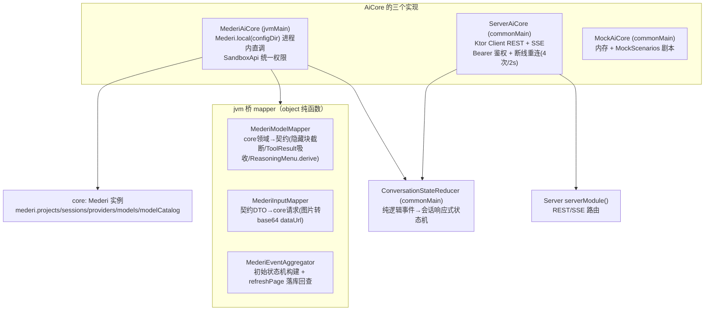
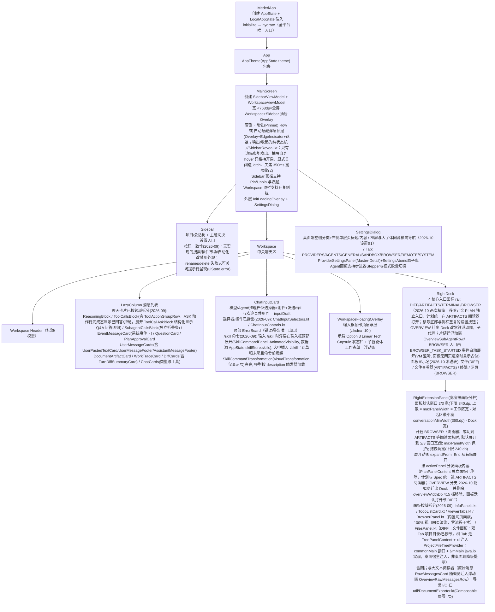
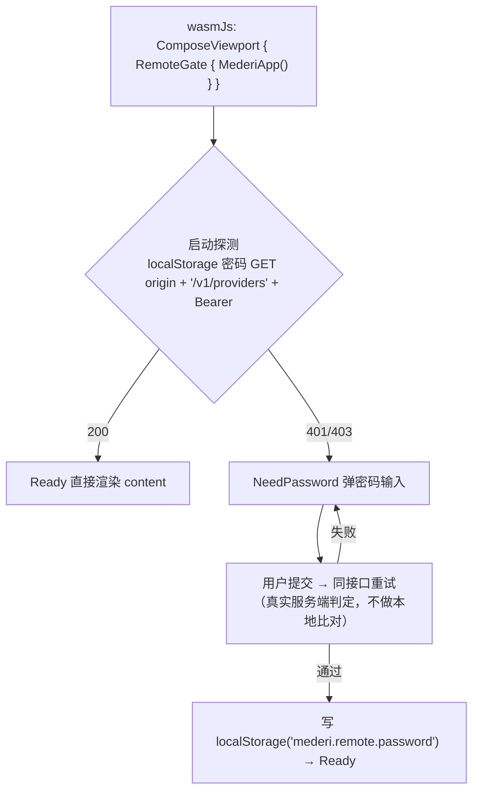

# 02 · app/shared（契约桥 + UI）与 server 模块

> 路径约定：`…/contract/` = `app/shared/src/commonMain/kotlin/xyz/mederi/core/contract/`；`…/jvm/` = `app/shared/src/jvmMain/kotlin/xyz/mederi/`。

## 1. AiCore 契约（`…/contract/AiCore.kt`）

对外唯一契约接口（KMP commonMain）。三实现：`MederiAiCore`（jvm 进程内直调 core）、`ServerAiCore`（commonMain，REST+SSE 遥控）、`MockAiCore`（UI 开发/预览）。

```kotlin
interface AiCore {
    val isReady: StateFlow<Boolean>
    suspend fun initialize(): Result<Unit>
    val projects: StateFlow<List<Project>>
    val providers: StateFlow<List<ProviderConfig>>
    val availableModels: StateFlow<List<ModelOption>>
    val availableAgents: StateFlow<List<AgentOption>>
    val builtinPresets: List<String>              // 内置供应商预设名（BuiltinProviders.allEntries）
    val configDir: String? get() = null           // 宿主配置/缓存基路径；纯 Web 返回 null

    // Project（单目录模型：一个项目恰好一个 directory）
    suspend fun createProject(input: CreateProjectInput): Result<Project>
    suspend fun renameProject(projectId: String, name: String): Result<Unit>
    suspend fun deleteProject(projectId: String): Result<Unit>       // 遍历会话统一走 deleteConversation

    // Conversation
    suspend fun createConversation(projectId: String, agent: AgentOption? = null): Result<Conversation>
    suspend fun deleteConversation(conversationId: String): Result<Unit>
        // 唯一删除封装入口: abortAndJoin → 删 session/history/diff → 删 .mederi 下 Mermaid png → 清本地缓存
    suspend fun renameConversation(conversationId: String, title: String): Result<Unit>
    fun observeConversation(conversationId: String): Flow<ConversationState>
    suspend fun getSnapshot(conversationId: String): Result<ConversationState>

    // Provider / Model / Key
    suspend fun configureProvider(providerId: String, input: ProviderUpdateInput): Result<Unit>
    suspend fun addBuiltinProvider(name: String, apiKey: String): Result<ProviderConfig>
    suspend fun deleteProvider(providerId: String): Result<Unit>
    suspend fun addProviderModel(providerId, providerModelId, name, supportsThinking=false,
        supportsImages=false, contextWindow: Int?=null, maxTokens: Int?=null,
        reasoningLevels: List<String>=emptyList(), isEnabled=true): Result<Unit>
    suspend fun updateProviderModel(providerId, modelId, /*全可空*/ ..., optimizeForRequestCount: Boolean? = null): Result<Unit>
    suspend fun deleteProviderModel(providerId, modelId): Result<Unit>
    suspend fun setModelEnabled(providerId, modelId, enabled): Result<Unit>
    suspend fun refreshProviderModels(providerId): Result<List<String>>   // 只新增不碰存量
    suspend fun autoSetupProviderModels(providerId): Result<Int>          // 目录数据进存量模型唯一通道
    suspend fun createCustomProvider(input: CreateCustomProviderInput): Result<ProviderConfig>
    suspend fun addProviderApiKey(providerId, name, key, isDefault=false): Result<ApiKeyOption>
    suspend fun deleteProviderApiKey(providerId, keyId): Result<Unit>
    suspend fun setDefaultProviderApiKey(providerId, keyId): Result<Unit>

    // Message
    suspend fun sendMessage(conversationId: String, input: ChatPromptInput): Result<Unit>
    suspend fun steerMessage(conversationId: String, input: ChatPromptInput): Result<Unit>
        // 旧客户端兼容别名，委托统一 sendMessage；接纳与调度全部由 Core 决定
    suspend fun abort(conversationId: String): Result<Unit>
    suspend fun rollbackToMessage(conversationId: String, messageId: String): Result<Unit>
    suspend fun resolveQuestion(conversationId, questionId, answers: List<List<String>>): Result<Unit>
    suspend fun updateConversationSettings(conversationId, input: UpdateConversationSettingsInput): Result<Unit>
     % 输入框设置会话级持久化（不依赖发送即落库）：选择器改动且已绑定会话时立即写 model/agent/apiKeyId/thinkingLevel/draftText 到该会话；
     % 全量覆盖写（非 COALESCE）：调用方每次传所有字段当前值，null/空值直接写入（清空语义），core 侧 updateComposeState 做 SET。切换会话后恢复该会话设置。DTO=UpdateConversationSettingsInput(model,agent,apiKeyId,thinkingLevel,draftText="")
    suspend fun getSandboxSettings(projectId: String): Result<SandboxSettings>
    suspend fun updateSandboxSettings(projectId: String, settings: SandboxSettings): Result<SandboxSettings>
    suspend fun getSandboxStatus(projectId: String): Result<SandboxStatusInfo>
    suspend fun resolveExecutionApproval(conversationId: String, requestId: String, approved: Boolean): Result<Unit>
    suspend fun resolvePlanApproval(conversationId: String, planId: String, approved: Boolean): Result<Unit>
    suspend fun getPlanAcceptanceReport(conversationId: String, planId: String): Result<String>
    % 计划审批仅批准技术方案，绝不修改会话模型与推理档位（session.aiModel / reasoningLevel 保持不变）
    suspend fun compressHistory(conversationId: String): Result<Unit>
        // 手动压缩。core 在翻状态机（RUNNING/IDLE）之前先空转预检：量不足时（olderBatches 为空 / 可压旧消息 < 2 条）
        // 只发 STATUS{scope=compaction, code=SKIPPED, reason=low_tokens|too_few} 事实后直接返回——不翻状态机、不发
        // SESSION_UPDATED / MESSAGE_COMPLETED（UI 不闪屏）；UI 裸事件旁路消费后弹「无需压缩」模态
        //（UiEffect.ShowCompactionNotice，见 §7.2；链路细节见 04-flows.md §5）
    suspend fun listMessages(conversationId): Result<List<ChatMessage>>
    suspend fun listMessagesPage(conversationId): Result<MessagesPage>   // 消息+token统计(快照对齐落库)
    suspend fun getMessage(conversationId, messageId): Result<ChatMessage>
    suspend fun listRawMessages(conversationId): Result<List<RawMessageDto>>  // 调试: payload 原文
    suspend fun getProcessStats(): Result<ProcessStats>   // 被监控端 = AiCore 所在宿主进程
    suspend fun getFileDiffs(conversationId, messageId: String? = null): Result<List<FileDiff>>

    fun events(): Flow<CoreEvent>

    // Skill 管理（UI 薄触发，文件操作全在 core）
    suspend fun listSkills(): Result<List<SkillItem>>
    suspend fun getSkillsRoot(): Result<String>
    suspend fun setSkillsRoot(path: String): Result<Unit>
    suspend fun installSkill(url: String): Result<SkillItem>
    suspend fun uninstallSkill(name: String): Result<Unit>

    // AGENTS.md 生成（API 形态，暂无命令/UI 入口；读取/注入在 core 代码级自动完成，见 01-core.md §7.4）
    suspend fun generateAgentsFile(projectId, modelId: String? = null): Result<String>  // 返回写入内容；modelId 缺省用项目最近会话模型

    // Office 文档预览（.docx/.xlsx/.pptx → HTML，经 MederiAiCore.kBrowser 渲染 / Server REST 获取）
    suspend fun previewOffice(conversationId: String, path: String): Result<String>  // 返回 HTML 字符串

    // MCP Server 管理（7 方法契约层带默认实现——成功空值：listMcpServers=emptyList / setMcpServerEnabled、
    // installMcpServer、updateMcpServer、deleteMcpServer、verifyMcpServer=Unit / getMcpServerJson="{}"；
    // MockAiCore 不覆写，走默认实现；MederiAiCore/ServerAiCore 覆写为真实转调）
    suspend fun listMcpServers(): Result<List<McpServerItem>>
    suspend fun setMcpServerEnabled(name: String, enabled: Boolean): Result<Unit>
    suspend fun installMcpServer(json: String): Result<Unit>
    suspend fun updateMcpServer(name: String, json: String): Result<Unit>
    suspend fun deleteMcpServer(name: String): Result<Unit>
    suspend fun verifyMcpServer(name: String): Result<Unit>
    suspend fun getMcpServerJson(name: String): Result<String>

    // SubagentConfig（子代理角色独立模型/推理档/API Key 配置，设置页 Agents 面板）
    suspend fun listSubagentConfigs(): Result<List<SubagentConfigItem>>
    suspend fun updateSubagentConfig(role: String, input: UpdateSubagentConfigInput): Result<Unit>
    suspend fun getSubagentGlobalSettings(): Result<SubagentGlobalSettings>
    suspend fun updateSubagentGlobalSettings(input: UpdateSubagentGlobalSettingsInput): Result<Unit>
    // 会话覆盖仅 EXECUTOR / RESEARCHER；nullable input=null 删除覆盖，恢复系统默认。
    suspend fun listSessionSubagentConfigs(conversationId: String): Result<List<SubagentConfigItem>>
    suspend fun updateSessionSubagentConfig(conversationId: String, role: String, input: UpdateSubagentConfigInput?): Result<Unit>
    suspend fun getSessionSubagentGlobalSettings(conversationId: String): Result<SubagentGlobalSettings>
    suspend fun updateSessionSubagentGlobalSettings(conversationId: String, input: UpdateSubagentGlobalSettingsInput?): Result<Unit>

    // Browser 设置管理（Camoufox + 默认浏览器，契约 9 方法——默认实现 = 空设置/回显/空状态/空更新/install 拒绝/空列表/
    // availableBrowsers 空列表/getDefaultBrowser null/setDefaultBrowser Unit；MederiAiCore 直调 core BrowserSettingsApi，
    // ServerAiCore 走 REST /v1/browser/*）
    suspend fun getCamoufoxSettings(): Result<CamoufoxSettings>
    suspend fun updateCamoufoxSettings(input: UpdateCamoufoxSettingsInput): Result<CamoufoxSettings>
    suspend fun getCamoufoxStatus(): Result<BrowserStatus>
    suspend fun checkCamoufoxUpdate(): Result<CamoufoxUpdate>
    suspend fun installCamoufox(versionTag: String?): Result<Unit>
    suspend fun listInstalledCamoufoxVersions(): Result<List<String>>
    suspend fun availableBrowsers(): Result<List<BrowserOption>>
    suspend fun getDefaultBrowser(): Result<String?>
    suspend fun setDefaultBrowser(input: SetDefaultBrowserInput): Result<Unit>
    // 子代理汇报取数（契约带默认失败实现 failure(MederiNotFoundException)，MederiAiCore/ServerAiCore 覆写）：
    // core SubagentManager.getReport 磁盘读 .mederi/plans/{planId}/reports/NN-executor.md / research.md，
    // 未落盘回退内存 result，agent 丢失/归档走 retired 恢复记录
    suspend fun getSubagentReport(agentId: String): Result<SubagentManager.SubagentReportData>
    suspend fun stopSubagent(agentId: String): Result<Unit>
    suspend fun stopBrowserTask(taskId: String): Result<Unit>  // 停止浏览器任务并关闭其浏览器（MederiAiCore→SessionApi.stopBrowserTask，null 视为失败）
}
```

**契约同步硬性规则**：`AiCore.kt → MederiAiCore → ServerAiCore → Server 路由` 任何变动四处同步，缺一即编译失败或运行期 404；新增 DTO 放 `contract/dto` / `contract/models`（kotlinx-serialization，commonMain）。

**配套契约接口**（与 AiCore 并列的平台能力注入）：
- `Terminal.kt`：`TerminalManager(getOrCreate/find/all)` + `TerminalSession(key/title/isRunning/exitCode/output()/write/resize/kill)` —— 仅本机 jvmMain 实现（PtyTerminalHub），遥控端 null。
- `SandboxStatusInfo.kt` 定义 `@Serializable SandboxStatusInfo(backend, available, shell, detail)` 后端能力 DTO；桌面专用 hooks 接口已移除。沙盒配置和执行审批统一走 AiCore，遥控端操作的是执行宿主。
- `AiCoreProvider.kt`：`object AiCoreProvider { fun default(): AiCore }`（委托顶层 `internal expect fun defaultAiCore(): AiCore`）。
- `UiBrowserHost.kt`：`UiBrowserHost`（`BrowserContent(sessionId: String, modifier: Modifier)`、`loadHtml(sessionId: String, html: String)`、`closeSession(sessionId: String)`、`shutdown()`）—— 桌面宿主（JcefBrowserHost）注入，提供基于 sessionId 隔离的多 Tab 浏览器视图与后台常驻能力；会话删除/项目删除时级联调用 `closeSession` 释放底层 CEF 页面。

## 2. 契约模型（`…/contract/models/` + `dto/`）

### 2.1 ChatModels.kt

- `enum ConversationStatus { Idle, Working, WaitingUser, Error }` —— 挂起态映射：`QUESTION_REQUESTED` / `PLAN_APPROVAL_REQUESTED` / `EXECUTION_APPROVAL_REQUESTED` → WaitingUser；仅在其余交互均解除后退出 WaitingUser（`SnapshotReducer` 与 `MederiAiCore.startSessionStatusSync` / `ServerAiCore.startSessionStatusSync` 同映射，驱动侧边栏状态点）
- `Conversation(id, projectId?, title, status, createdAt: Long, updatedAt: Long, parentConversationId?=null, modelId?=null, modelProvider?=null, thinkingLevel: String?=null(仅回显 core 诊断值,非 UI 真理源), agent?=null, apiKeyId?=null(会话绑定的 API Key ID，点开会话回填输入框 key 选择), draftText: String?=null(会话草稿文本，切换会话时回填输入框), directory?=null)`
- `enum ChatRole { User, Assistant, System, Summary }`
- `ChatMessage(id, conversationId, role, blocks: List<ChatBlock>, createdAt, completedAt?, parentMessageId?, model?, agent?, isStreaming=false, error?=null, modelName?(assistant footer 模型显示名), agentMode?(APPROVAL/AUTONOMOUS), thinkingLevel?(实际推理档位), durationMs?(LLM 耗时), turnDiffSummary: TurnDiffSummaryUi?(本轮文件变更摘要,assistant 消息底部展示))` —— footer 诊断字段由 `MederiModelMapper.toChatMessage` 从 core Message 诊断字段填充（completedAt ≈ createdAt + durationMs 下界估计）；`turnDiffSummary` 由 MESSAGE_COMPLETED 的 `turnDiffSummary`/`diffMessageId` payload 回填（UI `TurnDiffCard` 单轮"N files changed"卡）
- `FileDiffSummaryUi(path, status, additions, deletions)`（单文件变更统计）；`TurnDiffSummaryUi(files: List<FileDiffSummaryUi>=[], totalAdditions=0, totalDeletions=0)`（单轮全部文件变更聚合摘要）
- `sealed class ChatBlock(id)`（type 判别多态序列化）：`Text(id, text)` / `Reasoning(id, text)` / `ToolCall(id, name, state: ToolCallState)` / `File(id, name, url, mimeType?)` / `Diff(id, filePath, before, after)` / `Unknown(id, type)`
- `sealed class ToolCallState`：`Pending(input: Map<String,String>)` / `Running(input: Map<String,String>)` / `Completed(input, output)` / `Failed(input, error)`
- `ToolCallUi(id, name, state, target?=null, isFailed=false)` —— VM 预计算展平展示模型；target = 命令原文 / 文件路径（会话目录内→相对路径，目录外→绝对路径）/ apply_patch 提取的文件清单；工具行展开区显示执行结果（Completed.output / Failed.error）
- `enum CoreEventType`（与 core EventType 同名一一对应，当前 31 个；含 `LLM_REQUEST_COMPLETED`（单次 LLM 请求完成用量事件）、`SUBAGENT_PROGRESS`/`SUBAGENT_DISCARDED`、`BACKGROUND_TASK_STARTED`/`BACKGROUND_TASK_COMPLETED`/`BACKGROUND_TASK_ERROR`/`BACKGROUND_TASK_STOPPED`（后台命令/定时器终态事件，UI 侧经 `ChatItemsBuilder.parseEventMessage` 双正则解析为 `EventMessageCard`）、`BROWSER_TASK_REASONING_DELTA`（2026-10 浏览器 decide 流式增量，UI 浮动条消费）；`MederiModelMapper.toCoreEvent` 按 `valueOf(name)` 映射，两侧枚举名集合由 jvmTest `EnumMirrorContractTest` 锁死）
- `CoreEvent(type, sessionId, messageId?=null, payload: Map<String,String>, timestamp="")`
- `PastedTextAttachment(id, index, text, lineCount, charCount)`；`ImageAttachment(id, name, mimeType, bytes, base64DataUrl, width=0, height=0)`
- `QueuedMessage` 已删除：UI 不保留待发队列。`ChatPromptInput.messageId: String?=null` 为客户端稳定输入 ID，发送桥透传 Core；未指定时由 Core 生成。`ChatMessage` 新增 `turnId: String?=null`、`isFinalAnswer: Boolean?=null`、`pendingSteering: Boolean=false`，分别表示工作归属、本轮正式回复（null 为旧历史）、已接收待消费输入；另有 `workStartedAt: Long?` / `workCompletedAt: Long?` 工作墙钟锚点（epoch ms）。

### 2.2 其他 models

- **ConfigModels.kt**：`ModelOrigin{FETCHED, MANUAL}`；`ModelOption(id, name, provider, supportsThinking, supportsImages=false, supportsImagesOverride: Boolean?=null(用户覆盖,同步永不覆盖), reasoningLevels=[], providerModelId=id, origin=FETCHED, contextWindow?, maxTokens?, inputPricePerMillion?, outputPricePerMillion?, isEnabled=true, optimizeForRequestCount=false)`；`AgentMode{APPROVAL, AUTONOMOUS}`；`AgentOption(id, name, description?, mode, model: ModelOption?=null, reasoningLevel?, systemPrompt?, tools=[])`
- **ProviderModels.kt**：`ProtocolType{OPENAI_CHAT("OpenAI 兼容"), OPENAI_RESPONSES, GOOGLE}`（displayName+placeholderUrl；`CREATABLE=[OPENAI_CHAT, OPENAI_RESPONSES]`）；`ReasoningLevels.ORDER=["NONE","MINIMAL","LOW","MEDIUM","HIGH","XHIGH","MAX"]`（档位顺序唯一真理源；`SELECTABLE` 由 ORDER 去 NONE 派生）；`ProviderType{Builtin, Custom}`；`CustomModelEntry(id, name, supportsThinking=false, supportsImages=false, contextWindow?, maxTokens?, reasoningLevels=[], isEnabled=true)`；`ApiKeyOption(id, name, maskedValue, isDefault)`；`ProviderConfig(id, name, type, baseUrl?, isConnected, models: List<ModelOption>, customModels=[], supportsApiKey, supportsBaseUrl, protocolType=DEFAULT, apiKeys=[], reasoningLevels: Map<String,String?>=空(级别名→请求体JSON片段/null), responseSanitization=false)`
- **ReasoningMenu.kt（纯函数唯一真理源）**：`derive(providerLevels, modelLevels): List<String>`（推导聊天菜单档位，NONE 恒第一；显示条件=模型勾选了级别或供应商任一档有值）；`resolve(modelMemoryLevel, modelLevels): String?`（**唯一推导链：模型记忆 > 默认档(MEDIUM 优先否则首档)**；菜单空=不支持返回 null）
- **ProjectModels.kt**：`Project(id, name, directory: String, conversations: List<Conversation>)`
- **FilesystemModels.kt**：`FileChangeStatus{Added, Modified, Deleted}`；`FileChange(filePath, status)`；`FileDiff(filePath, before, after, additions, deletions)`
- **SandboxPermissionModels.kt**：`ExecutionPermissionMode { NEEDS_APPROVAL, FULL_ACCESS }`；`SandboxSettings(mode=NEEDS_APPROVAL, extraWritablePaths=[], version=0, deniedPaths=[], allowedCommands=[], deniedCommands=[])`；`ExecutionApprovalRequest(id, conversationId, executionSessionId, toolName, command?=null, paths=[], cwd?=null, access, reason?=null)`；`ResolveExecutionApprovalInput(approved)`。core 镜像通过显式字段映射及 JSON 契约测试锁定。
- **PermissionModels.kt**：`QuestionRequest(id, conversationId, questions: List<Question>)`；`Question(id, prompt, options, multiSelect=false)`；`PlanSubtaskItem(index, name, status="PENDING", spec?, planDetail="")`（计划审批卡子任务行模型，PLAN_APPROVAL_REQUESTED / PLAN_PROGRESS 的 `subtasks` payload 解码目标）；`PlanApprovalRequest(id, conversationId, planPath, title, summary="", subtaskCount=0, planContent?=null, status="PENDING", subtasks: List<PlanSubtaskItem>=[]（全生命周期子任务投影，由 SnapshotReducer 驱动更新）)`（审批卡片只展示标题+子任务数，详细内容经 planPath 读取）
- **TodoModels.kt**：`TodoStatus`（wire 小写 pending/in_progress/completed/cancelled/failed）；`TodoItem(id, content, status, priority?=null)`；`internal TodoWireItem(content, status)`（事件 payload wire DTO，与 core encodeTodos 严格对齐，id/priority 不上 wire）
- **SkillModels.kt**：`SkillItem(name, description, location="", license?, compatibility?, allowedTools?)`——由 core `SkillInfo` 映射（UI 列表展示）
- **StatisticsModels.kt**：`TokenUsage(input=0, output=0, reasoning=0, cacheRead=0, cacheWrite=0)`（`total = input+output+reasoning`）；`CostSummary(total=0.0, currency="USD")`；`LastRequestUsage(inputTokens=0, outputTokens=0, cachedTokens?=null)`（**最近一次** LLM 请求用量，非累加；诚实原则沿用 TokenUsage：`cachedTokens`=null 表供应商未报缓存数、不用 0 伪装；`inputTokens`/`outputTokens` 有真实源默认 0）
- **CompactionModels.kt**：`CompactionConfig(auto?, tailTurns?, preserveRecentTokens?, reserved?, prune?)`
- **ProcessStatsModels.kt**：`ProcessStats(cpuUsage?, cpuCores=1, heapUsedBytes=0, heapCommittedBytes=0, heapMaxBytes?, rssBytes?, timestampMillis=0)`
- **McpModels.kt**：`McpServerStatus{UNCHECKED, OK, FAILED}`；`McpServerItem(name, enabled, kind="stdio", summary="", status=UNCHECKED, toolCount?, lastError?)`（MCP 列表展示条目，AppState.mcpStore 管理）
- **SubagentModels.kt**：`SubagentState(agentId, parentSessionId, role, modelId, modelName, reasoningLevel?, task, briefing?, status, startedAt, completedAt?=null, currentActivity?=null, currentTool?=null, outputText?=null)`（子代理 UI 缓存对象，§3.1；支持实时流输出视窗与耗时统计）；`SubagentToolResult`（subagent(STATUS) 结果镜像，§3.1）；`SubagentConfigItem(role, displayName, description, modelId?, modelName?, reasoningLevel?, apiKeyId?=null, isInheriting=true, usesDefault=true)`；`UpdateSubagentConfigInput(modelId?, reasoningLevel?, apiKeyId?=null)`（`apiKeyId` 子代理 API Key 策略：null=继承父会话选定 key / 具体 keyId=指定 key / `"__rotate__"`（core `API_KEY_ROTATION_ID` 常量）=轮询）
- **BrowserModels.kt**：`CamoufoxSettings`（browserHome/binaryPath/autoCheckUpdate/headless/humanize(+humanizeMaxSeconds)/blockImages/blockWebgl/blockWebrtc/disableCoop/extraArgs + 指纹覆盖全可空 + proxy/advancedConfig——与 core `browser.CamoufoxSettings` 一一对应同默认值，app/shared 不依赖 core 故自成一份，不带 *Dto 后缀避免 MederiAiCore import 冲突；同 core：默认值 = Camoufox 官方推荐实践，路径不设默认必须手动配置至少其一）；`ProxyConfig(type="none"\|"http"\|"socks", host, port, bypass, username?, password?)`；`UpdateCamoufoxSettingsInput(settings)`（整体替换）；`BrowserStatus(configured, installedVersion?, latestVersion?, hasUpdate, supported, reason)`（不访问网络）；`CamoufoxUpdate`（字段同 BrowserStatus，latestVersion/hasUpdate 由网络查询填充）；`BrowserOption(name, label)`（已注册浏览器选项，label 来自 BrowserKind.label 协议层描述——默认浏览器开关/列表数据源）；`SetDefaultBrowserInput(name?=null)`（设置默认浏览器请求，name=null=清除、回退默认策略）；`DefaultBrowserResponse(name?=null)`（默认浏览器响应，REST 边界包装裸 String? 便于 JSON 往返，对齐 SkillsRootResponse 模式）

### 2.3 dto/

- `ChatPromptInput(text, model: ModelOption?, agent: AgentOption?, thinkingLevel: String?, attachments: List<FileAttachment>, apiKeyId: String?=null, messageId: String?=null)`；`apiKeyId` = 本次发送选定 key 的 ID（null=默认 key，从 AppState.selectedApiKeyIds 读当前模型供应商的选定 key）；`FileAttachment(name, mimeType, bytes)`
- `ConversationState(conversation, messages, tokenUsage, contextUsedTokens: Long=0(AI 视图窗口口径:窗口首条是 SUMMARY 走估算、否则用最近一条 Assistant inputTokens;与自动压缩同源,经 SessionManager.contextUsedTokens → aiViewContextUsedTokens 计算), cost, pendingQuestion?, pendingPlanApproval?, pendingExecutionApprovals=[]（仅存活执行申请，支持并发）, planApprovals=[], todos=[], subagents=[](2026-10 收敛:会话全部子代理运行态(RUNNING + 未丢弃终态),getSnapshot 从 SubagentManager.agents 内存表水合;ConversationStateReducer 直接聚合增量事件,彻底取代散落 VM 内存 Map), activeDockPanel: RightDockPanel?=null(会话独立右侧 Dock 展开面板,各会话独立隔离), browserAutomation: BrowserAutomationUiState?=null(网页自动化操作流程面板会话专属状态), childConversations=[], errorMessage?(错误/警告简报,ErrorBoard 输入框顶部一行展示), errorId?(ErrorCollector 生成的错误 ID,JVM 端可 ErrorCollector.get(id) 取完整 ErrorRecord), errorDiagnostic?(完整分层诊断报告纯文本,点"详细报告"展开;server→wasmJs 的详情唯一载体), statusHint?(仅限流重试过程提示,内存态——不再承载断流警告,警告走 errorMessage/ErrorBoard), errorIsStreamInterrupted=false(failureMode==PREMATURE_CLOSE 时置 true,MESSAGE_DELTA 复位;UI 据此在 ErrorBoard 显示"继续"按钮), requestCount=0(主会话 LLM HTTP 请求累计:LLM_REQUEST_COMPLETED 事件逐次累加 + refreshPage/初始状态机从 assistant 消息数回填), lastRequestUsage?=null(最近一次 LLM 请求用量:LLM_REQUEST_COMPLETED 更新,refreshPage/初始状态机回填;null=尚无请求))` —— 保留向后兼容别名 `typealias ConversationSnapshot = ConversationState`
- `MessagesPage(messages, tokenUsage, contextUsedTokens, requestCount=0, lastRequestUsage?=null)` —— MESSAGE_COMPLETED/ERROR 后对齐落库数据用；`requestCount`/`lastRequestUsage` 由 `MederiModelMapper.toUsageBackfill(messages)`（assistant 消息数 + 最后一条带 usage 的 assistant）现算回填
- `RawMessageDto(seq, messageId?, role, payload(原始 JSON), createdAt)`
- `CreateProjectInput(name, directory)`；`ReasoningConfigInput(levels: Map<String,String?>)`；`ProviderUpdateInput(name?, apiKey?, baseUrl?, enabled?, customModels?, reasoningParameter?)`；`CreateCustomProviderInput(name, baseUrl, apiKey?, customModels, type=DEFAULT, responseSanitization=false, reasoningParameter?)`
- wire 请求 DTO：`CreateConversationInput(projectId, agent)`、`RenameConversationInput(title)`、`RenameProjectInput(name)`、`BuiltinProviderInput(name, apiKey)`、`AddModelInput/UpdateModelInput/SetModelEnabledInput`、`AddApiKeyInput(name, key, isDefault=false)`、`ResolveQuestionInput(answers)`、`RollbackMessageInput(messageId)`（`dto/ChatPromptInput.kt`，rollback 路由实际请求体）、`ResolvePlanApprovalInput(approved, model: ModelOption?=null, thinkingLevel: String?=null)`（批准时刻选中模型随批准手势传 core，写入 session 供同 turn spawn 动态读）、`ApiError(error)`、`ReadyInfo(ready, configDir)`、`PlanContent(content?)`
- 「按请求次数计费」在编辑模型中显示，经 `ModelItemUiState.optimizeForRequestCount` 和 `ModelOption.optimizeForRequestCount` 回显，默认关闭。`UpdateModelInput.optimizeForRequestCount: Boolean?` 走既有模型 PATCH，省略时保留设置。桌面和遥控使用同一 AiCore 保存路径。
- Skill 组 DTO（`dto/SkillInput.kt`）：`SetSkillsRootInput(path)`、`InstallSkillInput(url)`、`SkillsRootResponse(path)`（String 直出 JSON 带引号，包一层类型安全）
- MCP 组 DTO（`dto/McpServerInput.kt`）：`InstallMcpServerInput(json)`（用户粘贴的标准 mcpServers JSON 原样传入，core 解析 UI 不解析）、`UpdateMcpServerInput(json)`（编辑回写，条目键须与 path 中 name 一致）、`SetMcpServerEnabledInput(enabled)`、`McpServerJsonResponse(json)`（getMcpServerJson 响应包装，String 直出 JSON 带引号，包一层类型安全）
- AGENTS.md 生成 2 件套（`dto/AgentsFileInput.kt`）：`GenerateAgentsFileInput(modelId?=null)`（缺省用项目最近会话的模型）、`GenerateAgentsFileResponse(content)`（写入内容响应包装）

## 3. ConversationStateReducer（`…/contract/ConversationStateReducer.kt`）

契约层 `CoreEvent` → `ConversationState` 的**纯逻辑状态机**（跨平台，JVM 桥与 wasmJs 共用同一状态机；保留向后兼容别名 `typealias SnapshotReducer = ConversationStateReducer`）。

| 事件 | 聚合效果 |
|---|---|
| SESSION_CREATED | 原样返回 |
| SESSION_UPDATED | 普通事件表示新工作开始；`inputAccepted=true` 仅表示输入接收/消费确认，不重置挂起交互。两者回查落库；接收确认刷新保留尚未落库的实时响应，避免插话把流覆盖掉 |
| MESSAGE_DELTA | `applyWithRefresh` 在未知响应 ID 的首个 MESSAGE_DELTA / TOOL_CALLED / TOOL_RESULT 外显前回查已落库的真实、已消费用户输入，通过 `restoreInputOrder(live, persisted)` 按持久化邻接消息补齐；不导入响应正文、不覆盖实时块、不提前展示 pendingSteering，避免初始快照与订阅间丢 SESSION_UPDATED 后用户气泡落在响应后面。已有响应后续增量不重复回查。`response_started/response_completed` 明确每次模型响应边界；所有增量按 event.messageId 定位响应，payload.turnId 标记工作归属，不跨响应合并。text/reasoning/tool/image 聚合到所属响应，status=Working，清 statusHint 与断流标记 |
| MESSAGE_COMPLETED | `finalMessageId` 显式确认交付响应（截断/异常不确认）；status=Idle、isStreaming=false、清 statusHint；支持从 `turnDiffSummary`/`diffMessageId` 回填单轮文件变更摘要到 assistant 消息（UI `TurnDiffCard`）；断流警告以 **ErrorRecord payload**（error/errorId/fullDiagnostic, errorSeverity=WARNING, failureMode=PREMATURE_CLOSE）写入 errorMessage/errorId/errorDiagnostic，**failureMode==PREMATURE_CLOSE → errorIsStreamInterrupted=true** → **ErrorBoard 展示 + 可展开详细报告 + "继续"按钮**（`WorkspaceViewModel.continueAfterInterruption()` 重发 `"Continue"` 走正常 send 流程续写），会话保持 Idle（turn 真实完成）。正常收尾无这些 key → 三者保持原值；MESSAGE_DELTA 复位 errorIsStreamInterrupted |
| MESSAGE_ERROR | status=Error、errorMessage=payload["error"]（简报）、errorId=payload["errorId"]、errorDiagnostic=payload["fullDiagnostic"]、清 statusHint。**侧边栏红点语义**：状态点按 sessionStore 权威状态判定而非事件本身——ERROR→红点，IDLE（transient 可恢复，如限流重试耗尽）→蓝点，映射纯函数 `mapMessageErrorToStatus`（`…/jvm/core/bridge/MederiModelMapper.kt`） |
| STATUS | 仅 scope=provider 且 code=RETRYING 时写 statusHint="attempt/max"（带 `message` 时追加 "|serverMsg"，serverMsg=ErrorCollector.extractServerMessage 提取的供应商真实报错；带 `delayMs` 时再追加第三段 "|retryAt"，retryAt=delayMs+当前时间），不碰状态机；新事件不再提供 maxAttempts（内部旧格式 max 为 ?，不展示）；`code=RETRY_FINISHED` 在首帧恢复、非流式请求结束或异常/取消退出时清 statusHint。UI StatusBar 重试态第二行渲染 serverMsg，每次请求独立从 1 计数。输入接收/消费确认走 SESSION_UPDATED{inputAccepted=true}，不借用 STATUS。另有一条 **compaction scope**：`scope=compaction, code=SKIPPED, reason=low_tokens\|too_few` 由 `TurnExecutor.compressHistory` 的**空转预检**（翻状态机之前，判定口径与压缩策略共用 `planCompression`）发出；**`code=RUNNING/IDLE` 由 `MederiCompressionStrategy.compress` 发出**——三种触发（手动 / 自动 preflight / 节点内 isHistoryTooBig）的共同终点，进入 compress 发 RUNNING、try-finally 结束（含异常/早退）发 IDLE（构造经 `TurnExecutor` 两处注入 eventBus + sessionId，见 04-flows.md §5）。全部非 provider scope，故 **reducer 不写状态机**（返回状态机不变，既不写 statusHint 也不碰状态，零污染）；UI 走**裸事件旁路**：`WorkspaceViewModel` 订阅 `events()` 按 sessionId 过滤 → **RUNNING→置本地 `isCompacting=true`（压缩本地态，不再覆盖重试条）、IDLE→false（压缩结束复位）**；**SKIPPED→清 `turnStartByConv` 锚点 + `UiEffect.ShowCompactionNotice(code, reason)`** → `MainScreen` 本地化模态（见 §7.2 与 04-flows.md §5） |
| TOOL_CALLED | 完整 args 更新 ToolCall block(input)，状态 Running |
| TOOL_RESULT | 优先在已有消息中倒序查找匹配 block（按 toolCallId 精确匹配，回退：最后 Running/Pending 同名），状态 Completed/Failed 并保留 input；绝不产生空占位消息 |
| LLM_REQUEST_COMPLETED | **实时累加** `requestCount = state.requestCount + 1` 并更新 `lastRequestUsage`（私有扩展 `toLastRequestUsage()`：payload `inputTokens`/`outputTokens` 缺省 0、`cachedTokens` 缺省 null 诚实表"无缓存数据"）；**不走 refreshPage**（落 `else -> listOf(apply(...))` 分支），落库对齐仍由 MESSAGE_COMPLETED/SESSION_UPDATED/MESSAGE_ERROR 的 refreshPage 回查分支负责——这些回查分支的 `copy` 会带上 `page.requestCount`/`page.lastRequestUsage` 与 DB 对齐 |

工具参数解析走 `ToolArgParser.parse`（commonMain，`ConversationStateReducer` 与 `MederiModelMapper` 共用）：以 `JsonObject` 宽容解析为 `Map<String,String>`，数字/布尔转字面量、嵌套结构保留 JSON 文本——避免 `read_file.max_lines` / `bash.timeout_seconds` 等非字符串参数让整条 args 解析失败导致路径/命令丢失。
| QUESTION_REQUESTED / RESOLVED | 写/清 pendingQuestion（REQUESTED 置 status=WaitingUser + 流式消息复位，RESOLVED 回 Working 并恢复最后一条 Assistant 消息 isStreaming=true） |
| PLAN_APPROVAL_REQUESTED / RESOLVED | **planApprovals 是全生命周期投影表**：REQUESTED 解码 `subtasks` payload（List<PlanSubtaskItem>）写入 PENDING 条目（按 id 去重置顶）+ 写/清 pendingPlanApproval + status=WaitingUser；RESOLVED 清 pendingPlanApproval、条目 status 迁 APPROVED/REJECTED + status 回 Working（approved 时恢复最后一条 Assistant 消息 isStreaming=true）。`PLAN_PROGRESS` 按 `action` 驱动同一张表的 status 迁移（voided→VOIDED / completed→COMPLETED / approved→APPROVED / subtask-started→IN_PROGRESS，且 payload `subtasks` 全量最新子任务同步替换）——概览面板"实施计划卡"（planOverviewList）的真理源 |
| TODO_UPDATED | 解码 payload["todos"] 整体替换 todos；解码失败丢弃事件保留先前状态 |
| PLAN_PROGRESS | 只驱动 planApprovals 投影表（status 迁移 + `subtasks` 替换），**不改变 todos** |
| EXECUTION_APPROVAL_REQUESTED | 从 `payload.request` 解码执行申请，按 id 去重加入 `pendingExecutionApprovals`；跨会话/非法 JSON 忽略 |
| EXECUTION_APPROVAL_RESOLVED | 按 `payload.requestId` 只移除匹配申请；status=APPROVED/DENIED/CANCELLED/SETTINGS_CHANGED；不影响其他申请 |
| SANDBOX_SETTINGS_CHANGED | 项目设置通知（sessionId为空，payload.projectId 定位项目，payload.settings=JSON）；设置 VM 只刷新匹配项目，非会话业务状态 |
| SUBAGENT_*（STARTED/PROGRESS/COMPLETED/ERROR/STOPPED/DISCARDED） | **全生命周期收敛入 `state.subagents`**：STARTED 创建或更新子代理对象（元数据全量来自 payload）；PROGRESS 增量维护 currentActivity、currentTool 及流式 outputText；终态更新 status 并记录 completedAt；DISCARDED 移出对应 agentId 条目；乱序终态安全忽略。彻底杜绝 VM 私有 Map 与主状态机割裂导致的子代理丢失 |


入口：`applyWithRefresh(state, event, refreshPage)`（MESSAGE_COMPLETED 先发"完成状态"再回查落库对齐发第二个；SESSION_UPDATED 触发 refreshPage 回查对齐刚落库消息后发一个；MESSAGE_ERROR 回查后只发最终一个；LLM_REQUEST_COMPLETED 走 `else` 分支**实时累加 requestCount/lastRequestUsage、不回查**）；及不含回查的 `apply(state, event)`。三个回查分支（MESSAGE_COMPLETED / SESSION_UPDATED / MESSAGE_ERROR）的 `copy` 均携带 `page.requestCount` / `page.lastRequestUsage`，使落库对齐后计数与 DB 一致。

### 3.1 SubagentState 状态机收敛与 MVVM 接线（`…/contract/models/SubagentModels.kt`）

子代理状态全面收敛入 `ConversationState.subagents`（由 `ConversationStateReducer` 驱动更新，跨平台纯逻辑）：

- `SubagentState(agentId, parentSessionId, role, modelId, modelName, reasoningLevel?, task, briefing?, status, startedAt, completedAt?=null, currentActivity?=null, currentTool?=null, outputText?=null)` —— 每个子代理一个 UI 响应式对象（MVVM Model）；"工作中" = status==RUNNING（真实 job 状态；详情弹窗提供秒级计时器与实时流展示）
- `SubagentToolResult` —— core `SubagentManager.StatusResult` JSON 的契约镜像（宽松解码），subagent(STATUS) 落库 tool result 的解析用（WAIT 已删 2026-09-25）
- `ui/SubagentLifecycleNotification.kt`（2026-10 新增）—— 子代理通知/浮条谓词的**纯函数真理源**：`SubagentNotificationState`、`deriveActiveSubagentNotifications`、`hasRunningSubagents`、`shouldShowSubagentRunningBanner`；`WorkspaceViewModel.hasRunningSubagents` 复用这里的 `hasRunningSubagents(subagents)` 再叠加 chatItems 层「流式/运行中工具调用」判定，不得另写一份状态判定

**VM 接线**（WorkspaceViewModel）：
- `conversationState`（原 `snapshot`，由 StateFlow 驱动）成为**唯一真理源**；
- `allSubagents`（所有已加载会话状态机池 `sessionCache.conversationStates` 中的子代理拍平）+ `subagents`（`conversationState?.subagents ?: emptyList()`，当前会话专有）+ `subagent(agentId)`（跨池只读索引）；
- 移除了 VM 中私有的 `subagentStates` Map 以及 `init` 协程中的旁路事件监听器；
- 切换会话时直接从 `sessionCache.conversationStates` 恢复完整状态（包括其 `subagents`、`activeDockPanel` 与 `browserAutomation`），从根源杜绝切会话丢失子代理或状态错位。**applySnapshot 本地状态合并（`mergeLocalUiState` 纯函数，2026-10）**：写侧输入（modelId/provider/agent/apiKeyId/thinkingLevel/draftText）以 prevSnap 优先防 Core 空值冲刷；`activeDockPanel` 合并规则——快照携带 `browserAutomation`（aggregator 归约快照，显式管理浏览器/dock 状态）时信任其值（null 也算，使 `BROWSER_TASK_COMPLETED` 置的 null 生效关 dock），仅当快照无 `browserAutomation`（store 初始快照）时才回退 prevSnap（保护用户已开的 Dock 面板）。
- **工作区操作完整 UI 与代次失效（N06，2026-11-06 全量整改已验证）**（N07 全量验收已记录）：
  - `WorkspaceViewModel` 维护 `_environmentEditorState`（`Editing`/`Error`/`None`）与环境动作行状态；提供 `openEnvironmentEditor`、`saveEnvironment`、`runEnvironmentAction`、`updateWorktreeSettings`、`createWorkspaceBranch`、`dismissEnvironmentEditor` 等统一方法。
  - **请求代次失效**：异步操作（Handoff 预览、环境保存、宿主设置、建分支、恢复）发起时捕获 `(ownerSessionId, projectId, dialogKind, dialogRequestGeneration)`，完成回调仅匹配当前代次，会话切换或面板关闭/刷新使旧请求即刻失效，杜绝串会话或脏状态写入。
  - **生产弹窗挂载**：`WorkspaceDialogs(viewModel)` 统一收敛 Handoff、Management、ArchiveList、Recovery、WorktreeSettings、CreateBranch 面板；全部面板在 320dp/280dp 窄屏与 1.6x 字体缩放下触达高度 $\ge 44\text{dp}$，文本自动折行无横向溢出。

## 4. 三实现架构图



### 4.1 MederiAiCore（`…/jvm/core/bridge/MederiAiCore.kt`）

`class MederiAiCore(configDir: String, dispatcher = Dispatchers.Default) : AiCore`。

**initialize() 流程（顺序）**：
1. `mederi = Mederi.create { configDir; userAgent = AppInfo.userAgent }`（出站 HTTP User-Agent 唯一注入点：所有 Koog 链路请求带 Mederi 身份头）→ **KBrowser 初始化**：`_kBrowser = KBrowserRuntime.ensureInitialized()`（core jvmMain KBrowser 单例，`useOsr=true`；幂等线程安全 + try-catch 覆盖 Throwable，JCEF 不可用/初始化失败 → **null 降级**；headless 无 Xvfb 时即 null）→ **浏览器设置装配（Camoufox 注册已移出 create{} 内联块，紧随其后在 initialize 内完成）**：`browserSettingsManager = BrowserSettingsManager(mederi.settingsStore)`（SettingsStore key `browser.camoufox.settings`，JSON blob）→ `BrowserSettingsApiImpl(browserSettingsManager, installerProvider = { BrowserHome.of(current().browserHome)?.let { CamoufoxInstaller(it) } })` → `get()` 预热缓存 → `BrowserRegistry.register("camoufox", kind=CAMOUFOX, factory={...})`——**工厂读 `browserSettingsManager.current()`**：binary = browserHome 已下载版本 > `settings.binaryPath`（都不存在 → 引导错误"请在设置页 BROWSER 配置…"）、**profileDir = `settings.resolveProfileDir()`（core `CamoufoxSettingsMapping`：browserHome 非空 → `{browserHome}/profiles`；binaryPath 模式 → `{二进制父目录}/profiles` 跟随二进制同级；都空 → error"未配置浏览器路径：请先设置 browserHome 或 binaryPath"。已删除系统临时目录兜底——永不落临时目录）**、`config = settings.toCamoufoxConfig()`、`proxyPrefs = settings.proxy?.toFirefoxPrefs() ?: emptyMap()`。保存路径校验：`BrowserSettingsManager.validate()` 允许空路径草稿保存（草稿/开关独立即时持久化）；UI 设置面板全面转向「修改即保存」（Switch 即时、文本防抖 500ms），彻底移除底部保存大按钮。**JCEF 条件注册**：`_kBrowser` 非空时 `BrowserRegistry.register("jcef", kind=JCEF, factory={ JcefBrowserControl() })`（**主力引擎**；desktop 与 headless server 同源，不经契约），**Camoufox 降级为可选 backup**。**默认浏览器偏好装配**：`browserSettingsManager.getDefaultBrowser()` 读持久化值（SettingsStore key `browser.default`），非 blank 即设 `BrowserRegistry.defaultName`（null 保持现有 JCEF 优先策略），启动即时生效。AI 经 `browser(action=RUN, browser=...)` 选择（默认浏览器 = `BrowserRegistry.defaultName` 指定；未设置时优先内置 JCEF——desktop 注册后默认即 jcef；jcef 不可用时默认 camoufox，未安装/未配置时选它得到引导错误）
2. `cleanupLegacyBuiltinProviders()` —— 删"无 API Key 且名字命中内置预设"的历史垃圾 Provider
3. `cleanupStaleRunningSessions()` —— 上次崩溃残留的 RUNNING session 逐个 `abortAndJoin` 复位（**必须走 abortAndJoin 而非 abort**：abort 对"无活跃 turn 的残留 RUNNING"整体 no-op，activeJobs 是内存态新建进程后为空，状态永远卡住；abortAndJoin 对陈旧 RUNNING 兜底复位 IDLE）
4. `syncBuiltinProviders()` —— 内置供应商 baseUrl/reasoningParameter/responseSanitization/modelsDevKey 与代码预设校验、不一致则更新
5. `refreshGlobalState()` —— 填充 projects/providers/availableModels/availableAgents 四个 StateFlow
6. `_isReady = true`
7. `mederi.modelCatalog.start()` —— models.dev 目录启动即拉 + 每小时刷新
8. `autoRefreshBuiltinGoogleModels()` —— 后台刷新已配 Key 的内置 Google 供应商模型（只新增不碰存量）
9. `autotitleService.start()` —— **会话自动命名挂在此处（谁初始化谁生效，desktop/server 天然一致）**
10. `startSessionStatusSync()` —— 订阅 core 会话事件流，实时把会话状态同步进 `_projects` StateFlow（驱动侧边栏状态点；映射 = SESSION_UPDATED→Working、MESSAGE_COMPLETED→Idle、MESSAGE_ERROR→sessionStore 权威终态经 `mapMessageErrorToStatus`、QUESTION/PLAN_APPROVAL REQUESTED→WaitingUser、RESOLVED→Working；同时维护 lastErrorBySessionId 终态错误注册表）。**子代理事件跟踪**（2026-10）：`SUBAGENT_STARTED` → agentId 记入 `runningSubagentIds[sessionId]` 并置 Working；`SUBAGENT_COMPLETED/ERROR/STOPPED/DISCARDED` → 移出集合，集合清空且 `mainTurnActive[sessionId] != true` 时回 Idle。`mainTurnActive` 由 SESSION_UPDATED 置 true、MESSAGE_COMPLETED/MESSAGE_ERROR 置 false；**MESSAGE_COMPLETED 时若子代理集合非空则保持 Working 不回 Idle**
11. `startCamoufoxUpdateCheck()` —— 启动时静默检查 Camoufox 是否有更新（**尊重 `browserSettingsManager.current().autoCheckUpdate`**——关闭则直接跳过；未配置 browserHome 或平台不支持同样跳过；不自动下载——浏览器体积大，结果打日志，设置页 BROWSER tab 可手动检查/安装）

**浏览器设置 9 方法**：Camoufox 6 方法（`getCamoufoxSettings`/`updateCamoufoxSettings`/`getCamoufoxStatus`/`checkCamoufoxUpdate`/`installCamoufox`/`listInstalledCamoufoxVersions`）直调 `browserSettingsApi`（core `BrowserSettingsApiImpl`，进程内不经 REST），契约 DTO 经 `toContract()/toCoreDto()` 映射到 `contract/models/BrowserModels.kt`；默认浏览器 3 方法——`availableBrowsers()` = `BrowserRegistry.list()` 映射 `BrowserOption(name, kind.label)`，`getDefaultBrowser()`/`setDefaultBrowser(input)` 直调 `browserSettingsApi`（core SettingsStore key `browser.default`），`setDefaultBrowser` 成功后同步 `BrowserRegistry.defaultName = input.name?.takeIf { 非 blank }`（blank/null=清除），切换即时生效。

`events()` = `mederi.sessions.events().map { MederiModelMapper.toCoreEvent(it) }`；`observeConversation()` 委托 MederiEventAggregator（初始快照 + SnapshotReducer.applyWithRefresh + refreshPage 回查 + initialTodos hydration：todo 唯一来源 = session.todos，与 plan 子任务展示解耦）。**LLM 用量回填**：初始快照（`MederiEventAggregator.observe` 的 `base`）与 `refreshPage`、以及 `MederiAiCore.getSnapshot` / `listMessagesPage` 都用 `MederiModelMapper.toUsageBackfill(messages)`（assistant 消息数 → `requestCount`；最后一条带 usage 的 assistant → `lastRequestUsage`，无则 null）现算回填，使历史会话的 requestCount/lastRequestUsage 与事件实时累加值在落库对齐点一致。

**错误水合机制**：store 重建快照（getSnapshot / observe 初始快照）从 `MederiAiCore` 的 `lastErrorBySessionId` 内存注册表水合 errorMessage/errorDiagnostic/errorId/errorIsStreamInterrupted（MESSAGE_ERROR 写入、MESSAGE_COMPLETED 带断流警告写入、新 turn SESSION_UPDATED 清除），使「切回 Error 会话」能看到失败原因——流式中的错误经事件流实时写入，但 store 重建初始快照时需从内存注册表补回（落库消息不含错误字段）。

**BuiltinProviders**（object，`…/jvm/core/bridge/BuiltinProviders.kt`）：内置供应商预设唯一真理源（Google Gemini / Agnes SG+CN / Hetzner / Empero / OpenCode Zen / OpenRouter / 商汤 SenseNova），`allEntries()` 按端点展开、`isBuiltinName()` 判定；预设含 baseUrl/协议/响应清洗/推理参数(modelsDevKey)。
**BuiltinAgents**（object，commonMain）：内置 Agent 唯一真理源 = AgentMode 双预设（autonomous 自动审批 / approval 人工审批），`byId(id)`；不再区分编程/通用工作用途。

### 4.2 ServerAiCore（`…/commonMain/core/bridge/ServerAiCore.kt`）

`class ServerAiCore(baseUrl, passwordProvider: suspend () -> String? = {null}) : AiCore`。
- Ktor client 配置：`defaultRequest` 统一带 `User-Agent: AppInfo.userAgent`（身份头唯一真理源 = `AppInfo.userAgent`，见 §4.3）。
- 鉴权：passwordProvider 非空时所有 REST + SSE 带 `Authorization: Bearer <password>`。
- initialize：校验 baseUrl → 轮询 `GET /v1/ready`（20s 上限、250ms 间隔）→ 拉 presets/agents/models/providers/projects → isReady → `startSessionStatusSync()`（订阅全局 SSE `events()` 流，实时把会话状态同步进 `_projects` StateFlow 驱动侧边栏状态点；映射与 jvm 桥一致：SESSION_UPDATED→Working、MESSAGE_COMPLETED→Idle、MESSAGE_ERROR→Error、QUESTION/PLAN_APPROVAL REQUESTED→WaitingUser、RESOLVED→Working）。
- SSE：官方 SSE 插件，incoming data 段反序列化为 CoreEvent（失败丢弃），心跳注释帧不投递；**全局单流热共享**：`sseEvents("/v1/events")` 冷流经 `shareIn(scope, SharingStarted.WhileSubscribed(), replay=0)` 转 SharedFlow（`sharedEvents`），所有 `events()` 订阅者（startSessionStatusSync、ViewModel 等）共享 **1 条 SSE 连接**（替代每订阅者 1 条冷流连接）；replay=0：全局事件总线不缓存历史事件，避免新订阅者收到无关残留事件；`sseEvents` 外层 `while (isActive)` 重连循环——SSE 连接正常结束或 Ktor 客户端 4 次自动重连耗尽抛异常时，`delay(5s)` 后重试整条连接，防事件流永久死亡（CancellationException 重抛不吞）。`observeConversation(id)` 不再开独立会话流，改为 `events().filter { it.sessionId == id }` 客户端过滤。server 端 `/v1/sessions/{id}/events` 端点保留但 ServerAiCore 不再消费。
- 新增契约方法的 REST 路径：`steerMessage` → `POST /v1/sessions/{id}/steer`（body=ChatPromptInput）；`getSubagentReport` → `GET /v1/subagents/{agentId}/report`（→ SubagentReportData）；`stopSubagent` → `POST /v1/subagents/{agentId}/stop`；`stopBrowserTask` → `POST /v1/browser-tasks/{taskId}/stop`。
- 错误：非 2xx 抛异常（优先 ApiError.error 文本），方法边界包 Result 失败。

### 4.3 AppInfo（`…/commonMain/AppInfo.kt`，应用身份唯一真理源）

- `VERSION`：应用版本常量，**源码不写版本字面量**。唯一出处 = Gradle 工程根 `version.json`（CI 基于 git tag 写入）；构建脚本（app/shared 的 `generateVersionSource` 任务）读取后生成 `AppVersion.kt`（`MEDERI_APP_VERSION`）注入这里。
- `userAgent`（lazy）：`Mederi/<version> (<os> <os-version>; <arch>)` —— 组合 `VERSION` + `platformInfo()`，所有出站 HTTP 请求（Koog 链路经 `MederiConfig.userAgent` → `MederiHttpClientFactory`；Ktor 客户端经 `defaultRequest`）只从这里取值。
- `platformInfo(): PlatformInfo(osName, osVersion, arch)`：`expect` 声明，jvm/android/ios/wasmJs 各一个 `actual`（见 00-overview 平台注入矩阵）；`normalizeOsName`/`normalizeArch` 为标准 UA 粒度映射（Windows NT / Mac OS X / Linux / Android / iOS；aarch64→arm64、amd64→x86_64）。
- 硬性规则：禁止在调用处自行获取版本号 / os / arch 再拼 UA。

## 5. Server 路由表（`…/jvm/server/Server.kt`）

`Server.start(aiCore: MederiAiCore, requestedPort=8081, password?, webappDir?): RemoteStartResult`（幂等；**端口策略**=先按请求端口 bind，被占 → port=0 OS 挑空闲，`resolvedConnectors()` 读回实际端口并标记 portFallback）；`stop()` 幂等。
- install：ContentNegotiation(json)/SSE/CORS(anyHost + Authorization 等)；password 非空 → Authentication(bearer "mederi-remote")。
- webapp：webappDir 非空 → staticFiles("/")；否则 classpath `staticResources("/","static")`（内置 wasm 产物）；SPA fallback + preCompressed(GZIP) + .wasm Content-Type；`/` 与 `/v1/ready` 豁免鉴权。
- SSE：`respondEventStream(events)` —— 15s 心跳注释帧防代理断连；客户端断开结构化并发取消。

**路由清单**（`v1Routes(aiCore)` 内，可被鉴权包裹）：

| 方法+路径 | 转调 |
|---|---|
| GET `/info` | 纯文本 `"Mederi Server"`（`respondText` 健康探测，豁免鉴权） |
| GET `/v1/ready` | ReadyInfo（豁免鉴权） |
| GET `/v1/presets` / `/v1/agents` / `/v1/models` / `/v1/providers` / `/v1/projects` | 直接 respondData StateFlow 值 |
| GET `/v1/system/stats` | getProcessStats |
| POST `/v1/projects`；PATCH/DELETE `/v1/projects/{id}` | Project 组（单目录，无目录增删端点） |
| POST `/v1/sessions`；DELETE/PATCH `/v1/sessions/{id}` | Conversation 组 |
| GET `/v1/sessions/{id}/snapshot` \| `messages` \| `messages/raw` \| `messages/{messageId}` \| `diffs[?messageId=]` | 查询组 |
| GET `/v1/sessions/{id}/plans/{planId}/acceptance-report` | 读取所属计划的 Markdown 验收报告（`text/markdown`，MederiAiCore 转调 Core，支持活跃和归档计划） |
| POST `/v1/sessions/{id}/plans/{planId}/manual-acceptance`（`ManualPlanAcceptanceInput`） | 提交人工实测值、证据与签认人，Core 判定并保存运行记录 |
| POST `/v1/sessions/{id}/messages` \| `abort` \| `rollback` \| `questions/{questionId}` \| `plans/{planId}/approve`（body=`ResolvePlanApprovalInput(approved, model?, thinkingLevel?)`——批准时刻选中模型随批准传 core） \| `compress` | 动作组 |
| PATCH `/v1/sessions/{id}/settings`（body=`UpdateConversationSettingsInput(model?, agent?, apiKeyId?, thinkingLevel?, draftText="")`——全量覆盖写：null/空值直接写入清空，非 COALESCE） | 输入框设置会话级持久化：选择器改动且已绑定会话时立即落库（不依赖发送）；切换会话恢复该会话设置 |
| GET `/v1/projects/{projectId}/sandbox/settings`；POST 同路径（body=`SandboxSettings`）；GET `/v1/projects/{projectId}/sandbox/status` | getSandboxSettings(projectId) / updateSandboxSettings(projectId, settings) / getSandboxStatus(projectId)；按项目隔离，宿主持久化及验证项目存在 |
| POST `/v1/sessions/{id}/execution-approvals/{requestId}`（body=`ResolveExecutionApprovalInput(approved)`） | resolveExecutionApproval；只解析当前仍存活且归属匹配的申请，过期/重复回复失败 |
| POST `/v1/sessions/{id}/steer`（body=ChatPromptInput） | steerMessage：旧客户端兼容别名，转统一 sendMessage |
| SSE GET `/v1/events`（全局，ServerAiCore 唯一消费的流——`sharedEvents` 热流多订阅者共享 1 条连接，`observeConversation` 客户端按 sessionId filter）；GET `/v1/sessions/{id}/events`（保留端点，ServerAiCore 不再消费） | 事件流 |
| POST `/v1/providers`；POST `/v1/providers/builtin`；PATCH/DELETE `/v1/providers/{id}` | Provider 组 |
| POST `/v1/providers/{id}/models`；POST `.../models/refresh`；POST `.../models/auto-setup`；PATCH/DELETE `.../models/{modelId}`；POST `.../models/{modelId}/enabled` | Model 组 |
| POST `/v1/providers/{id}/keys`；DELETE `.../keys/{keyId}`；POST `.../keys/{keyId}/set-default` | Key 组 |
| GET `/v1/mcp/servers`；POST `/v1/mcp/servers`（InstallMcpServerInput）；PATCH/DELETE `/v1/mcp/servers/{name}`；POST `.../enabled`；POST `.../verify`；GET `.../json`（→McpServerJsonResponse） | MCP 组（ServerAiCore 遥控桥，desktop 直调不经过） |
| GET `/v1/skills`；GET `/v1/skills/root`（→SkillsRootResponse）；POST `/v1/skills/root`（SetSkillsRootInput）；POST `/v1/skills/install`（InstallSkillInput → SkillItem）；DELETE `/v1/skills/{name}` | Skill 组（UI 薄触发：列表/根目录/安装/卸载，文件操作全在 core） |
| POST `/v1/projects/{id}/agents-file/generate`（GenerateAgentsFileInput → GenerateAgentsFileResponse） | AGENTS.md 生成：扫描项目生成（已存在则原地改进）项目根 AGENTS.md（暂无 UI 入口，纯 API 形态） |
| GET `/v1/sessions/{id}/office-preview[?path=]` | Office 文档预览：`.docx/.xlsx/.pptx` → HTML 字符串（供浏览器面板渲染） |
| GET `/v1/subagents/{agentId}/report` | 子代理汇报取数：`aiCore.getSubagentReport` → `SubagentReportData`（磁盘读 `reports/NN-executor.md`/`research.md`，缺失回退内存/retired 记录，agent 不存在 → 404） |
| POST `/v1/subagents/{agentId}/stop` | 停止子代理：`aiCore.stopSubagent(agentId)`（向运行中子代理发送取消并标记「被用户关闭」；终态事件正常向上汇报给 AI） |
| POST `/v1/browser-tasks/{taskId}/stop` | 停止浏览器任务并关闭浏览器：`aiCore.stopBrowserTask(taskId)`（经 SessionApi→BrowserTaskManager.stopTask，关闭后发 BROWSER_TASK_STOPPED） |
| GET `/v1/subagent-configs`；PUT `/v1/subagent-configs/{role}`（UpdateSubagentConfigInput）；GET `/v1/subagent-configs/global`；PUT `/v1/subagent-configs/global`（UpdateSubagentGlobalSettingsInput） | SubagentConfig 组：子代理角色（EXECUTOR/RESEARCHER/BROWSER_OPERATOR/BROWSER_BRAIN）独立模型/推理档配置 CRUD 与全局设置（单会话并发上限） |
| GET `/v1/sessions/{id}/subagent-configs`；PUT/DELETE `/v1/sessions/{id}/subagent-configs/{role}`；GET/PUT/DELETE `/v1/sessions/{id}/subagent-configs/global` | 会话子代理配置：仅执行器与研究员。GET 返回有效配置与 `usesDefault`；PUT 写会话覆盖（角色 DTO 各字段为 null 表示继承父会话），DELETE 删除覆盖并恢复系统默认；global 为本会话并发上限。MederiAiCore 转调 core SubagentConfigApi(sessionId)，ServerAiCore 四方法按会话路径访问，未知会话失败。浏览器仍读系统配置。 |
| GET `/v1/browser/settings`；POST `/v1/browser/settings`（UpdateCamoufoxSettingsInput）；GET `/v1/browser/status`；POST `/v1/browser/check-update`；POST `/v1/browser/install[?version=]`；GET `/v1/browser/versions`；GET `/v1/browser/list`（availableBrowsers）；GET `/v1/browser/default`（getDefaultBrowser → DefaultBrowserResponse）；POST `/v1/browser/default`（setDefaultBrowser，body=SetDefaultBrowserInput） | Browser 组（Camoufox 设置/状态/更新检查/安装/已装版本 + 默认浏览器列表/读取/设置，转调 MederiAiCore 9 方法——`getCamoufoxSettings`/`availableBrowsers` 等；desktop 直调 core 不经 ServerAiCore） |
| GET `/v1/projects/{id}/repository`；GET `/v1/projects/{id}/workspaces`；GET `/v1/sessions/{id}/workspace`；POST `/v1/sessions/{id}/workspace/handoff/preview`；POST `/v1/sessions/{id}/workspace/handoff`；POST `/v1/workspaces/{id}/restore`；POST `/v1/workspaces/{id}/archive`；POST `/v1/workspaces/{id}/branch`；GET `/v1/workspace-operations/{id}`；POST `/v1/workspace-operations/{id}/cancel`；GET `/v1/projects/{id}/workspace-operations`；POST `/v1/sessions/{id}/archive`；POST `/v1/sessions/{id}/pin`；GET `/v1/projects/{id}/archived-sessions`；GET/POST `/v1/worktree-settings`；GET/POST `/v1/projects/{id}/environments`；POST `/v1/workspaces/{id}/actions`；GET `/v1/workspace-operations/{id}/log`；GET `/v1/workspaces/{id}/files`；GET `/v1/workspaces/{id}/file`；POST `/v1/sessions/{id}/workspace/retry`；POST `/v1/workspaces/{id}/setup/retry`；POST `/v1/workspace-operations/{id}/recovery/preview`；POST `/v1/workspace-operations/{id}/recovery` | Workspace / Worktree 组（端到端对齐 D05/D08 契约：仓库信息、工作区管理、跨工作区交接 Handoff 预览与执行、归档/还原、分支创建、设置、环境脚本与动作、日志分块流、文件树与文件读取、重试与灾难恢复预览/执行） |

响应助手：`respondResult(Result)`（Unit 成功返回 `{}`，失败按 MederiException 子类映射 404/400/409/500 + ApiError）、`respondData(裸值)`、`respondError`。

**PtyTerminalHub**（`…/jvm/server/terminal/PtyTerminalHub.kt`）：终端会话注册表（TerminalManager 实现，desktop 与 server 共用）——一个 key=一个常驻 shell（pty4j，`$SHELL`→bash→sh、Windows cmd.exe，登录 shell，TERM=xterm-256color）；服务端 64KB scrollback 环形缓冲（attach 先回放再续流）；会话随宿主进程生命周期（进程退出→OS 关 pty master→SIGHUP）；`PtyTerminalSession` 提供 output 流/write/resize/kill。JVM-only（pty4j 无 KMP 替代品）。

## 6. server 模块（`server/src/main/kotlin/xyz/mederi/Application.kt`）

独立 JVM 进程 headless 部署薄启动器：
1. 读环境变量：`MEDERI_SERVER_PORT`(默认 8081)、`MEDERI_CONFIG_DIR`(默认 ~/.mederi)、`MEDERI_SERVER_PASSWORD`(非空则 /v1 Bearer 鉴权)、`MEDERI_WEBAPP_DIR`(可选外部 wasm UI)、`MEDERI_LLM_RETRY_MIN_MS/MAX_MS`（写 `LlmRetryConfig`，默认 0/30000 毫秒；无限重试，移除 `MEDERI_LLM_RETRY_MAX` 与构造参数 `retryMaxRetries`）。
2. `MederiAiCore(configDir)` + `runBlocking { initialize() }`（失败记录 initError 不阻断启动）。
3. `embeddedServer(Netty, port, host="0.0.0.0") { serverModule(aiCore, ReadyInfo(ready = initError==null, configDir), password, webappDir) }.start(wait = true)` —— 复用 shared 的 serverModule，**路由代码零重复**。

## 7. AppState 与 ViewModel 层

### 7.1 AppState（`…/commonMain/ui/appstate/AppState.kt`）

`class AppState(aiCore, preferences: PreferencesStore, scope)`；宿主注入点 = `remoteControl: RemoteControlHooks?`、`terminalManager: TerminalManager?`、`uiBrowserHost: UiBrowserHost?`（`by mutableStateOf(null)`，确保 JCEF 初始化完成后自动触发 Compose 重组；desktopApp `browser/JcefBrowserHost.kt` 实现标准简化版多 Tab JCEF 浏览器宿主——弹窗拦截转新 Tab `onNewPage`、横向可滚动 Tab 栏 + 固定 `+`、智能地址栏 Omnibox 含协议补全与 Bing 搜索、刷新/停止合一 + 2dp 顶部进度条、页面加载错误页与重试、JS 对话框 `alert`/`confirm`/`prompt` 与 `<input type="file">` 原生文件选择、50%~200% 页面缩放；`main.kt` 在 `MederiAiCore.kBrowser` 非空时注入 `appState.uiBrowserHost = JcefBrowserHost(kBrowser)`）与 `fileTreeProvider: ProjectFileTreeProvider?`（desktop 宿主 `onAppStateReady` 注入 `ProjectFileTreeProviderJvm`，**VM 层读取用**——`WorkspaceViewModel.openFile` 读盘；`LocalProjectFileTreeProvider` CompositionLocal 保留给树面板，与本字段同源实例；遥控端/wasm 恒 null）；`canRenderJcef = uiBrowserHost != null`；`LocalAppState` CompositionLocal。

**持久化字段**：

| 字段 | 持久化 key | 说明 |
|---|---|---|
| theme: AppThemeMode | `app.theme` | DARK 默认 |
| remoteControlEnabled / remoteControlPassword / remotePort | `remote.enabled` / `remote.password` / `remote.port`（默认 8081，成功后回写实际端口） | 遥控 |
| remoteServerState | —（内存） | Idle/Starting/Running(port, portFallback)/Failed |
| tunnelState | —（内存） | Idle/Starting/Running(url)/Failed(notInstalled) |
| tunnelToken / tunnelDomain | `tunnel.token` / `tunnel.domain`（空白即清除） | 隧道连接器 token / 公网域名（token 模式，2026-10 起不再解析 config.yml） |
| selectedProjectId / selectedConversationId | `workspace.lastProjectId` / `workspace.lastConversationId` | 选中态 |
| selectedModel | —（内存，2026-10 起不再持久化） | 当前活跃会话设置的模型**内存镜像**；带自愈：列表重建后重指向同款新实例；新/空会话默认由 `WorkspaceViewModel.applyRecentConversationDefaults` 从最近会话推导 |
| selectedAgentId | —（内存） | 当前活跃会话设置的 Agent 内存镜像；同 selectedModel（applyRecentConversationDefaults 推导） |
| modelReasoningLevels: Map\<modelId, level\> | —（内存） | **当前会话档位载体**（ReasoningMenu.resolve 的第一优先输入）；切换会话时按会话快照重填，不再跨重启持久化 |
| selectedApiKeyIds: Map\<providerId, apiKeyId\> | —（内存） | **当前会话供应商 API Key 记忆**（缺省=用默认 key；会话发送经 `getApiKeyId(provider.id)` 注入 ChatPromptInput.apiKeyId）；由会话快照 applyConversationSettings 设置，不再跨重启持久化 |
| language: AppLanguage | `app.language` | i18n 语言设置（SYSTEM/ZH/ZH_TW/EN/JA/KO/FR/DE/ES/PT_BR/ID/MNC，缺省 SYSTEM；`setLanguage` 写穿持久化） |

i18n 资源（2026-10 定稿）：`composeResources` 下共 10 个 `values*/strings.xml`（values/ 默认中文 + values-en/ 英文为硬性双份 + zh-rTW/de/es/fr/id/ja/ko/pt-rBR 8 个翻译目录），**键集必须与 values/ 完全一致**（新增文案须同时补 10 份，由校验命令锁键集 md5 唯一）；传统中文只保留 `values-zh-rTW`（`values-b+zh+Hant` 与其逐字节重复，2026-10 已删除）
| leftSidebarPinned | `ui.sidebar.pinned`（缺省 false） | 左侧边栏固定开合态 |

派生：`selectedAgentMode`（selectedAgentId × availableAgents combine）；`processStats`（后台 1s 轮询）。
扩展 Store（唯一真理源，生命周期绑定 AppState，供概览快捷卡片与后续市场双向同步）：
- `skillStore: SkillStore`：管理 `skills: StateFlow<List<SkillItem>>`、`skillsRoot: StateFlow<String>`，提供 `refresh()`、`install(url)`、`uninstall(name)`、`setRootDirectory(path)`。
- `mcpStore: McpStore`：管理 `mcpServers: StateFlow<List<McpServerItem>>`，提供 `refresh()`、`toggleEnabled(name, enabled)`、`install(json)`、`update(name, json)`、`delete(name)`、`verify(name)`、`getJson(name)`。
- `browserSettingsStore: BrowserSettingsStore`（`ui/appstate/BrowserSettingsStore.kt`，AppState 构造即建，挂 aiCore 契约 9 方法）：管理 `settings: StateFlow<CamoufoxSettings>`、`status: StateFlow<BrowserStatus?>`、`installedVersions: StateFlow<List<String>>`、`availableBrowsers: StateFlow<List<BrowserOption>>`（已注册浏览器列表，默认浏览器开关数据源）、`defaultBrowser: StateFlow<String?>`（默认浏览器 name，null=未设置），提供 `refresh()`（设置+状态+版本+浏览器列表+默认浏览器并发拉取）、`save(settings)`（整体替换）、`install(versionTag?)`、`checkUpdate()`、`setDefaultBrowser(name)`（写穿 contract 后**乐观更新** `defaultBrowser` flow，失败落 `errorMessage`，不阻塞 UI）——设置页 BROWSER tab 数据源。

方法：`persist(key, value)`（异步写、pendingWriteCount 计数）、`flushPreferences()`（退出前同步等待归零，2s 兜底）、`applyConversationSettings(model, agent, apiKeyId, thinkingLevel, hasSessionModel)`（真理源翻转 2026-10：会话已绑定模型时按快照覆盖四项设置，否则补位——供其余调用方兜底，ViewModel 新/空会话默认改走 `applyRecentConversationDefaults`；只改内存不写偏好，详见 04-flows.md §1.1）、`setRemoteControl/startRemoteControl/stopRemoteControl`、`setTunnelToken/setTunnelDomain`（持久化 `tunnel.token`/`tunnel.domain`）、`startTunnel/stopTunnel`、`handleProjectDeleted/handleConversationDeleted`（唯一允许偏好与引擎状态对齐的地方）、`hydrate()`（启动恢复：导航偏好/主题/语言/remote/sandbox 等；模型/Agent 仅 first-available 兜底——列表就绪后限时 3s 填首个可用项，四项设置模板已移除）。


### 7.2 ViewModel 类图

```mermaid
classDiagram
    class AppState {
        +aiCore +preferences
        +theme/selectedModel/selectedAgentId/...
        +modelReasoningLevels(模型记忆)
        +startRemoteControl()/setTunnelToken()/startTunnel()
        +handleProjectDeleted()/handleConversationDeleted()
    }
    class WorkspaceViewModel {
        +conversationId +snapshot: ConversationSnapshot?
        -sessionCache: SessionUiCache  % 会话级缓存族(2026-09 收敛,替代散落 map): snapshotCache/observeJobs/pendingUserMessages/turnStartByConv/autoContinueCountByConv（无本地待发队列）
        -feedbackPresenter: WorkspaceFeedbackPresenter  % session/draft归属，Core投影与本地操作/关闭/详情意图分离，兼容属性只读
        -diffPresenter: DiffPresenter  % 会话级查询/选择/反馈；diffPanelState只读，showDiffPanel派生自Dock
        -isCompacting: Boolean  % compaction RUNNING/IDLE STATUS 事件维护的本地态(不写快照/不动契约); 供压缩操作状态消费，不覆盖重试 status bar; 切会话(attach)/snapshot 已 Idle/Error 兜底复位
        % 错误族与 diff 族已收敛为分组状态(2026-09 UI 规范化)
        +inputDraft: TextFieldValue  % 输入草稿唯一真理源
        -activeDockPanel: RightDockPanel?  % 保守保留平铺(同时服务全部 dock 面板)
        +uiBrowserHost: UiBrowserHost?  % 窄访问器 get() = appState.uiBrowserHost; desktopApp 实现 JcefBrowserHost（browser/JcefBrowserHost.kt 多 Tab KBPage 宿主）
        +browserAutomationState: BrowserAutomationUiState  % 网页自动化操作流程面板 MVVM 唯一真理源(taskId/isAutomating/isPanelOpen/panelWidthDp/taskSummary/steps/previewScreenshot/liveReasoning/liveText；taskId=当前自动化任务真实 taskId，停止按钮据此真停 2026-10)
        +isBrowserAutomationFloatingExpanded: Boolean     % 主会话输入框浮动详情卡片展开态
        +startBrowserAutomation/finishBrowserAutomation/appendBrowserFlowStep/updateBrowserFlowAction/updateBrowserAutomationState
        +toggleBrowserAutomationPanel/openBrowserAutomationPanel/closeBrowserAutomationPanel/resizeBrowserAutomationPanel
        +toggleBrowserAutomationFloating/openBrowserAutomationFloating/closeBrowserAutomationFloating/stopBrowserAutomation
        +openBrowserScreenshotPreview/closeBrowserScreenshotPreview
        +pendingFileOpen: PendingFileOpen?  % 文件/目录打开确认态单一真理源(OpenExternally(path, appName)/RevealInFolder(path)/OpenDirectory(path))；非 null 时 Workspace 根部渲染 ConfirmDialog
        +openFile(path)  % 对话流文件/目录点击唯一路由：resolvePath 补全相对路径 → isDirectory(桌面端弹 OpenDirectory/移动与Web忽略) → classifyFilePath(INTERNAL_IMAGE/INTERNAL_TEXT 候选探测 NUL 字节内置打开/EXTERNAL 明确外部格式) → 桌面端 defaultAppNameFor 有应用弹 OpenExternally 无应用弹 RevealInFolder；移动与Web端外部格式静默忽略
        +confirmPendingFileOpen() / +cancelPendingFileOpen()  % 确认走 PlatformUtils.openFile(别名 openFileInOs,防与路由 openFile 递归)或 revealInFolder；两者都清态
        +chatItems: List~ChatListItem~  % derivedStateOf 展平
        +effectiveThinkingLevel: StateFlow  % 推理档位唯一真理源(ReasoningMenu.resolve)
        +effects: Flow~UiEffect~  % 一次性命令通道(Channel 派发: openSettings/openProjectMenu/ShowCompactionNotice)
        +openSettings() / openProjectMenu()  % 一次性命令, UI collect 消费落本地状态
        +attach(id) / detach() / send(text) / abort() / stopSubagent(agentId)
        +stopBrowserAutomation()  % 经 aiCore.stopBrowserTask(taskId) 真停，不再 abort 主 turn
        +rollbackMessage(convId, msgId, text)  % 本地切片 + 即时从 subagentStates 剔除被回退子代理
        +approvePlan(planId, approved) / replyQuestion(...) 
        +tryAttachImage(...) Boolean  % 图片能力门禁
        +openDiff/closeDiff + toggleDockPanel...
        % 全局事件监听：BROWSER_TASK_STARTED → 自动展开 BROWSER 面板并触发 startBrowserAutomation()（打开右侧不可关闭的自动化流程分栏）
        % STATUS{scope=compaction} 裸事件旁路（按 conversationId 过滤）：code=RUNNING→isCompacting=true / IDLE→false（压缩本地态，不写快照）；code=SKIPPED→清 sessionCache.turnStartByConv 锚点 + 派发 UiEffect.ShowCompactionNotice(code,reason)（core 侧只发事实，本 VM 只旁路不改状态机）
    }
    class SidebarViewModel {
        +uiState(expandedProjectIds, isBusy, error)
        +filteredProjects: StateFlow  % 全量项目树（不再按工作用途过滤）
        +theme: StateFlow~AppThemeMode~ / +language: StateFlow~AppLanguage~  % 窄状态转发 AppState(2026-09 规范化, Sidebar 不直操全局单例)
        +setTheme(mode) / setLanguage(lang)  % 转发 AppState.setTheme/setLanguage
        +createProject/renameProject/deleteProject
        +createProjectFromDirectory(dir)  % 目录查重：该目录已有项目则直接选中并展开，不重复创建
        +ensureConversationVisible(conversationId)  % 程序化选中会话前展开其所属项目
        +createConversation/deleteConversation/renameConversation
        +toggleProjectExpanded/selectProject/selectConversation/newSession
    % createConversation = 本地占位不落库（展开+选中项目、清空会话选中，同 newSession）；
    %  会话真实创建唯一入口 = WorkspaceViewModel.send 无会话自动 createConversation（convId==null 且项目已选）
    }
    class TerminalViewModel {
        % 依赖 AppState.terminalManager, 不依赖 AiCore
        +uiState: TerminalUiState(tabs: List~TerminalTab(key/error/unread/ended)~, activeKey)  % 对外唯一状态入口（2026-09 收敛，替代原 5 个平铺状态）
        +projects: StateFlow~List~Project~~ / +selectedProjectId: StateFlow~String?~  % 窄状态转发 appState 同源流(2026-09)
        -sessions: Map~key, TerminalSession~  % 会话对象容器（独立于 uiState，避免 data class 相等性噪声）
        +sessionOf/sessionTitleOf
        +selectTab/closeTab/addTab/restartTab/retryTab
        +bootstrapIfNeeded(project)  % 幂等自动开首个 tab
    }
    class RawMessagesViewModel {
        +rawMessages +isLoading
        +bind(conversationId)  % 拉取+订阅 events 过滤刷新
        +prettyPrintJson / +extractSummaryLabel / +extractTokens / +formatMessageTimestamp  % 委托至 TimeFormatter.formatMonthDayTime（强制用户系统本地时区）
    }
    AppState --> WorkspaceViewModel
    AppState --> SidebarViewModel
    AppState --> RawMessagesViewModel
    AppState --> TerminalViewModel : terminalManager
    AppState --> UiBrowserHost : uiBrowserHost（desktopApp JcefBrowserHost 实现）
```

- **时间格式化真理源（`util/TimeFormatter.kt`，2026-10 规范化）**：所有面向用户展示时间的地方统一由 `TimeFormatter` 处理，强制转换为用户系统所属时区（`TimeZone.currentSystemDefault()`）；提供 `formatShortTime`（"HH:mm"）、`formatTimeWithSeconds`（"HH:mm:ss"）、`formatMonthDayTime`（"M/d HH:mm"）、`formatFullDateTime`（"yyyy-MM-dd HH:mm:ss"）；`TimeUtils.formatMessageTime` 为 thin wrapper 统一委托；`SubAgentComponents`（启动时刻/列表）与 `RawMessagesCard` 杜绝组件私有截串与平台原生实现分叉。

- **UiEffect 一次性命令族（`ui/UiEffect.kt`）**：sealed interface，`Channel<UiEffect>` 派发、UI 侧 collect 消费落本地状态（发送即消费，不持久化；与"常驻展示状态"分工见 UiEffect.kt 头部注释）。`OpenSettings` / `OpenProjectMenu` = 导航类一次性命令；**`ShowCompactionNotice(code, reason?)`** = **手动压缩预检空转时的一次性提示**——core `TurnExecutor.compressHistory` 判定没有可压缩内容（token 不足 / 可压轮次太少）时不翻状态机、只经 `STATUS{scope=compaction, code=SKIPPED, reason}` 报机器码事实，由 VM 的裸事件旁路收集器转成本 effect（按 sessionId 过滤；**同一收集器对 `code=RUNNING/IDLE` 只置/复位本地 `isCompacting`**——压缩本地态不覆盖重试 StatusBar，见 §8；**命中 SKIPPED 才先清 `turnStartByConv` 锚点**）；`MainScreen.effects.collect` 收下落本地状态弹**本地化模态**（`compaction_skipped_title` + 按 `reason` 选 `compaction_skipped_low_tokens` / `compaction_skipped_too_few`，values/ 与 values-en/ 双份），关闭是纯本地 UI 动作。core 不需要知道 UI 有没有模态——**core 发事实 / UI 渲染，不耦合**。
- **子 VM 生命周期（2026-09 规范化）**：`RawMessagesViewModel` 与 `TerminalViewModel` 由 `Workspace()`（Route/Screen 层）`viewModel {}` 创建，经 `Workspace` → `FloatingOverviewWindow`（`OverviewRawMessagesRow`，rawVm）/ `RightExtensionPanel` → `TerminalPanelContent`（terminalVm）注入——组件不再自建 VM、不再经 `WorkspaceViewModel.appStateRef` 摸全局单例（该出口已删除，浏览器 host 改 `uiBrowserHost` 窄访问器）。
- **WorkspaceViewModel 要点**：`attach(id)` = **按会话常驻观察流 + 缓存渲染**：每个被 attach 过的会话有一条 `observeConversation` 观察流持续把最新快照写入 `snapshotCache`（即使 UI 已切到别的会话也不取消），切换会话只改 `conversationId`、立即用缓存渲染（无缓存时从 `projects` 会话列表直接同步恢复设置，再由 `observeConversation` 首帧快照渲染；已彻底删除冗余 `getSnapshot` 与切走反向盲写；输入框设置严格跟随会话，仅在切换进入会话时读取水合一次设置，快照更新自动保留已有写侧设置，彻底杜绝倒灌覆盖）；`send(text)` = 校验就绪/模型/图片门禁 guardImageSupport（send 与 rollbackMessage 共用唯一实现）→ PromptComposer.compose → 乐观更新 → 无会话自动 createConversation → 有待审批先 resolvePlanApproval(false) → sendMessage（thinkingLevel 只发 computeEffectiveThinkingLevel()）；`rollbackMessage` = 先验后切（restoreInputFromMessage 反解主指令/大段文本/图片 → 本地切片 → rollbackToMessage）→ **成功后才把内容粘贴回输入框重建待发态**（inputDraft + pendingPastedTexts + pendingImages，用户切模型/模式/改内容后自行发送），失败走 ErrorBoard；`restoreInputFromMessage(targetMsg?, fallbackText)` 为纯函数（PromptComposer.parse 拆主指令与大段文本、data: File block base64 还原图片）；`chatItems` 预计算 toolSummary/target/headerSummary/isReasoningActive。**新/空会话默认（2026-10）**：`applyRecentConversationDefaults()` 把 `appState.projects` 拍平 → 筛 `modelId != null` 的会话 → `maxByOrNull { it.updatedAt }` 取跨项目最近修改会话，复用 `hydrateSelectionFromConversation` 恢复其设置（真理源单一化为会话，全局偏好模板已移除；无任何已发送会话则由 AppState.hydrate first-available 兜底）。`hydrateSelectionFromConversation` 分叉：`modelId != null` → `applyConversationSettings(..., hasSessionModel=true)` 覆盖；`modelId == null`（新/空会话）→ `applyRecentConversationDefaults()`。**会话切换不再闪烁（2026-09）**：历史上切换回 Working 会话时从 store 重建初始快照，而流式中的 assistant 消息尚未落库（`TurnIncrementalPersister.persistAssistant` 只在 LLM 响应结束后写入），导致快照缺 streaming 数据、StatusBar 短暂显示"排队较长"警告。现改为常驻观察流 + 缓存，切回即渲染最新缓存、流式增量不丢。
- **统一输入（2026-10）**：`WorkspaceViewModel.send(text)` 是 UI 唯一发送路径；生成稳定 UUID，构造同 ID 乐观消息并调用 `AiCore.sendMessage`，空闲/执行中/等待交互/压缩的调度交给 Core。`applySnapshot` 仅按消息 ID 对账，不比较正文。已删除 `enqueueCurrentInput/removeQueuedMessage/steerQueuedMessage/sendQueuedMessage/currentQueuedMessages`、`QueuedMessagesBanner` 和 `SessionUiCache.queuedMessagesByConv`。输入框工作中有内容时仍可发送，无内容时可停止；压缩期间可以提交输入但不提供停止压缩按钮。
- **统一文件与产物打开（`openDocument` 与 `DocumentTarget`，2026-10 新增）**：`WorkspaceViewModel` 声明 `sealed interface DocumentTarget`（`Path(path)`、`Content(title, content, format)`、`Image(name, bytes)`），提供唯一统一分发方法 `openDocument(target)`，将对话流卡片、输入附件、计划/规范查看以及文件树的文件/产物预览全量统一至内置阅读器 `RightDockPanel.ARTIFACTS`：
  - `Path`：转调 `openFile(path)` 走原有文件分类与代码高亮路由；
  - `Content`：直接挂载文本并调用 `openTextInExtension(target.title, target.content, target.format)` 打开 ARTIFACTS 阅读器；
  - `Image`：直接挂载图片数据并调用 `openImageInExtension(target.name, target.bytes)`；
  - 全局 8+ 个点击入口全部收敛于此：`EventMessageCard`（汇报全文）、`PlanApprovalCard`（计划与规范）、`DocumentArtifactCard`（产物卡片点击）、`TurnDiffCard`（变更文件行点击）、`UserPastedTextCard`（粘贴长文本）、`ChatInputCard`（图片与长文本附件点击）、`TreePanelContent`（文件树节点）。
- **计划概览族（统一文件阅读器接入）**：`planOverviewList`（派生 = snapshot.planApprovals + pendingPlanApproval 去重合并，映射四个生命周期阶段 PendingApproval/InProgress/Completed/Voided，**概览面板"实施计划卡"真理源**）；计划与 Spec 查看统一由内置文件阅读器（ARTIFACTS）承接：`openPlanFile(item)`（读 plan.md 全文——planContent 优先、缺失经 planPath 读盘，转调 `openDocument(DocumentTarget.Content(...))`）、`openPlanInExtension(planId, title, content)` 与 `openSpecInExtension(planId, planTitle, subtaskIndex, subtaskName, specContent)`（转调 `openDocument` 写入文本并打开 ARTIFACTS 面板）；已提交执行的计划在同一概览行提供「查看验收报告」。`openPlanAcceptanceReport(planId, title)` 以会话 ID + 计划 ID 通过 AiCore 取 Core 生成的报告，使用内置报告阅读器的加载、错误和重试状态。Desktop 与遥控端均读取同一报告正文。审批展示从 Core 的权威计划状态渲染，概览优先打开该内容；自主批准计划通过 `PLAN_PROGRESS(created)` 直接加入概览。独立 PLAN 面板与 `PlanPanelContent` 已废除。
- 内置 Markdown 阅读器 `TextReaderTabContent` 使用 InkCompose `RenderStyle.Document`，正文栏最大 680dp，窄面板收窄页边距。深浅配色继承 Mederi token，代码块沿用当前语法高亮，调整文档内背景以匹配阅读面板。
- **网页自动化操作流程族（2026-10 新增，主对话浮动栏重构）**：MVVM 模型在 `ui/browser/BrowserAutomationModels.kt`（`BrowserAutomationUiState`、`BrowserFlowStep` 密封族含 `Narration`（AI 旁白，如"我看看网页"）、`Action`（浏览器动作，如"正在点击"+`BrowserActionKind`+`BrowserStepStatus`+耗时）、`Screenshot`（内联截图卡片，直接渲染画面并支持点击放大））；View 由两部分构成：
  1. **主对话浮动通知栏（BrowserAutomationFloatingBar.kt）**：挂载在 `WorkspaceFloatingOverlay`，包含折叠态 `BrowserAutomationCapsule`（36dp 流光胶囊，BorderBeam 动效，显示当前实时步骤、耗时、(已完成/总数)进度与中止按钮 `[⏹]`）与向上弹出浮层 `BrowserAutomationPopover`（**2026-10 重构**：顶栏不再重复计时（计时只在折叠胶囊）；推理框固定顶部、移出 LazyColumn，流式显示 `liveReasoning`（上，"推理思考"）+`liveText`（下，"输出"），新步覆盖旧内容（reducer 复位实现）；步骤时间线区单独滚动 `LazyColumn(weight 1f)`，提供中止任务与收起功能）；
  2. **网页侧彻底纯粹化（2026-10）**：彻底删除原右侧浏览器窗口内的流程分栏（`BrowserAutomationFlowPanel`）与导航栏「流程」切换按钮，`KBWebView` 永久独占 100% 视口，浏览器面板保持纯粹；流程执行步骤与截图预览移至主对话区浮动通知条（`BrowserAutomationFloatingBar`）与 `BrowserScreenshotLightbox` 全屏弹窗。
  3. **中止任务**：`WorkspaceViewModel.stopBrowserAutomation()` 终止关联的浏览器子代理或当前 Turn，并复位自动化流程。`WorkspaceViewModel` 暴露 `browserAutomationState` 及完整写方法（`startBrowserAutomation` / `finishBrowserAutomation` / `appendBrowserFlowStep` / `updateBrowserFlowAction` / `updateBrowserAutomationState` / `toggleBrowserAutomationFloating` / `closeBrowserAutomationFloating` / `openBrowserAutomationFloating` / `stopBrowserAutomation`）。不可关闭门禁：自动化进行中不可直接 dismiss，必须点 `[⏹ 停止任务]` 才能退出任务。
- **断流自动补发**：`checkAndTriggerAutoContinue(id, snap)`（attach 快照时评估：`errorIsStreamInterrupted` 且非 Working 且模型已吐出部分内容（text/reasoning/tool_call 块任一非空）→ **自动补发一次 `"Continue"`**（走 continueAfterInterruption 正常 send 流程），严格每会话每次断流最多补 1 次，`SessionUiCache.autoContinueCountByConv` 计数、手动 send 后清零——与 §8 ErrorBoard 手动"继续"按钮互补：自动只发一次，用户仍可从 ErrorBoard 手动续发）。
- **文件打开路由族（2026-10 强化）**：`openFile(path)` = **对话流与文件树文件/目录点击的唯一路由**：
  - **路径补齐与自愈**：经 `appState.fileTreeProvider.resolvePath(path)` 基于项目根目录规范化，自动补全相对路径，解决 Diff 卡片与相对链接找不到文件误触发弹窗问题；
  - **目录点击分流（Directory Target）**：经 `appState.fileTreeProvider.isDirectory(resolvedPath)` 判定，若为目录且在桌面端，触发 `PendingFileOpen.OpenDirectory(resolvedPath)`（弹窗「打开该目录？」确认后在系统文件管理器中打开该目录）；非桌面端静默忽略；
  - **跨平台隔离（Platform Scope）**：Android、iOS、Web（wasmJs）仅保留内部阅读器能力（代码/Markdown/图片），对于不支持的二进制文件或目录直接静默忽略，绝不弹外部提示框；
  - **内置阅读器格式放宽**：除已知图片（`INTERNAL_IMAGE`）与明确外部二进制/Office/PDF/压缩包/音视频（`EXTERNAL`）外，其余一切（无后缀 Makefile/Dockerfile、.sq、.proto、.env、未知后缀等）一律作为 `INTERNAL_TEXT` 候选尝试读取；非空且不含 `\0` 字节直接在 UI 内置查看器打开并按 `codeFenceLanguageFor` 高亮；包含 `\0` 或明确外部格式降级到外部决策；
  - **智能外部打开决策（桌面端）**：外部文件异步查询系统默认关联软件名 `defaultAppNameFor(path)`：
    - macOS 原生 JXA：调用 `osascript -l JavaScript` 执行 `NSWorkspace.sharedWorkspace.URLForApplicationToOpenURL` 与 `NSFileManager.displayNameAtPath`，获取系统本地化名称（如 "Xcode"、"预览"、"Microsoft Word" 等），未关联则返回 null；
    - 查到关联软件（`appName != null`）：弹窗提示「用 [appName] 打开？」；
    - 查不到关联软件（`appName == null`）：弹窗提示「打开文件所在目录？」（在文件管理器中高亮定位）。
  - **打开确认与执行**：确认时 `OpenExternally` 调 `openFileInOs(path)` 唤起应用；`RevealInFolder` 调 `revealInFolder(path)` 高亮定位；`OpenDirectory` 调 `openFileInOs(path)` 打开目录窗口。各分支均清空状态。
- 次级方法：`requestCompaction()`（手动压缩历史，概览面板 ContextMetricsCard 入口）/ `previewOffice(path)`（office-preview HTML 生成）/ `showErrorDetail()`（展开详细报告）。
- **TerminalViewModel key 约定**：`"project:<id>"`、`"project:<id>#<n>"`、`"tmp:<n>"`。

## 8. UI 组合结构（commonMain）



- `ChatLayout.kt`（`ui/ChatLayout.kt`）不是 Composable，是**布局常量 object**（全部为 Dp 字面量）：`contentMaxWidth=820.dp`（消息列/输入框内容最大宽）、`userBubbleMaxWidth=680.dp`（用户气泡最大宽）、**`userBubbleCompactMaxWidth=320.dp`（移动端用户气泡最大宽）**、`actionCardMaxWidth=560.dp`（高危授权/计划审批/问询卡最大宽）、**`conversationMinWidth=360.dp`（对话区最小宽=手机宽度，右侧面板+Dock 不得压缩至此宽度以下）**、`rightDockWidth=46.dp`、`itemSpacing=4.dp`（消息条目基础间距）、**`thoughtBottomSpacing=4.dp`（思考折叠条与正文间距）**、`turnSpacing=14.dp`（轮次间距）等。注意：**header 40.dp 不在 ChatLayout，是 `Workspace.kt` 的布局字面量**（Workspace Header `.height(40.dp)` 对齐顶栏线条）。
- 三个职责分离的条栏：**StatusBar**（WorkspaceFloatingOverlay内主轮次轻量行，无卡框或计时徽标；仅重试时显示次数、倒计时、供应商重试原因；与footer API响应耗时不同）、**ErrorBoard**（输入区上方错误/警告简报；复用WorkspaceActionSurface中性底+低对比danger边界，错误文案主文字色、图标语义红；详情/可选继续/关闭分别保留独立回调，操作FlowRow适应窄屏；本地化恢复与关闭始终可达）、**SystemInfoBar**（2026-10第五批：资源诊断默认收起，一行入口及CPU摘要；展开CPU/核数、RSS、堆，采集不变，视图本地expanded）。
- **TurnStatus 枚举与展示规则（`ui/TurnStatus.kt`）**：`Idle / Sending / Preparing / Thinking / CallingTool / Generating / WaitingAnswer / Retrying / Compacting / Aborted`。`deriveTurnStatus(snapshot)` 由快照派生；`shouldDisplayInStatusBar` 仅 `Retrying` 为 true。`StatusBar(status, statusHint?, modifier)` 只显示“第 X 次重试”、等待倒计时与供应商原因，无次数上限及正常等待/压缩状态行。`RetryHint.max` 与旧 `attempt/max` 解析仅为旧格式兼容，不参与展示。
- **AssistantMessageFooter**：assistant 消息轮次底部操作与诊断区（2026-10-29首批减重：复制/完整复制/回复详情操作常显；模型名 · 审批/自主 · 推理档 · 耗时 · 完成时间由组件本地 detailsExpanded 按需展开，不新建业务状态），数据来自 core Message 诊断字段（modelName/agentMode/reasoningLevel/durationMs）经契约 ChatMessage 透传，`computeChatItems` 只挂在轮次最后一个文本块（AssistantFooterInfo）。诊断字段由 `TurnIncrementalPersister.persistAssistant` 增量落库时注入（否则 reconcile 时 assistant 消息被"已存在"识别、字段永不补上）；**durationMs = API 有回应（响应创建）→ 落库**（`withAssistantDuration`），非"从发请求起算"。
- **输入框顶部顶层浮动层（2026-10）**：`WorkspaceFloatingOverlay`（`ui/components/WorkspaceFloatingOverlay.kt`）位于输入框正上方，只承载主 AI 请求重试 `StatusBar`、压缩完成（3 秒）与文件打开失败（5 秒）提示，以及独立的截图 Lightbox。重复的子 Agent 运行浮条已删除，VM 的 `isSubagentBannerDismissed` / `showSubagentRunningBanner` / `dismissSubagentRunningBanner` 同步删除；派发记录由对话流展示，持续运行状态由概览承接。截图预览不依赖其它提示是否可见。概览 `OverviewSubAgentRow` 将 `WorkingAnimationStyle.BreathingPulse` 套在整个 `OverviewAccordionRow`（行头 + 展开内容）上：RUNNING 数量 > 0 时用单色紫色 1.5dp 边框、2400ms 周期，折叠与展开都可见；停止/完成后自动停止动画，单任务只保留静态状态图标，行头圆点不再独立呼吸；后台命令/定时器同用整栏呼吸，文字保持稳定。**压缩进行中**：不再覆盖 turnStatus；压缩请求真实重试时仍显示重试提示，正常压缩不显示状态条。
- **第二批过程/交互表现（2026-10-29）**：`WorkspaceActionSurface(modifier,tone,content)`与`WorkspaceActionTone{Neutral,Accent,Danger}`为提问/审批/错误共用纯视图壳（中性surface、低对比语义边界）；`WorkspaceActionButton(text,onClick,modifier,enabled,primary,icon?,contentColor?,colors)`为三处共用可换行按钮，13sp/20sp、最小30dp、120ms反馈，不持有业务状态。QuestionCard保留外部selectedAnswers，选项以selectable/toggleable表达语义，操作FlowRow；PlanApprovalCard使用ChatLayout.actionCardMaxWidth，查看与批准分开，仅pending呈现批准，非pending显示真实生命周期文案，移除未绑定快捷键。`Modifier.expansionSemantics(expanded,onExpandedChange)`统一stateDescription与标准expand/collapse；不可展开空态不添加动作。`ProcessHeightToggle`复用同一ProcessRow供推理/工作过程的限高开关使用，计时/滚动边界保持。Reasoning文字不再呼吸，仅真实活动显示指标。
- **第四批辅助面板表现（2026-10-29）**：`atoms/WorkspacePanel.kt`新增internal纯视图：`WorkspaceIconButton(icon,onClick,contentDescription,modifier,enabled,colors)`（30dp最小热区、16dp图标、120ms hover/focus）；`WorkspacePanelHeader(title,icon,onClose,modifier,subtitle?,colors,actions:RowScope)`（身份可省略、关闭固定、次级身份单独排）；`WorkspacePanelEmptyState(icon,title,hint?,modifier,colors,action?)`用于无能力/空态/恢复，动作由调用方提供，不创建假能力或任务状态。
  - `RightExtensionPanel.kt`保留原布局宽度/拖拽/内容分发，header复用WorkspacePanelHeader、去重复四边描边，拖拽区保留单线；进出改WorkspaceStyle.ExpandMillis=180ms tween。Workspace里的Dock移动抽屉/子代理桌面及移动进出同步180ms，不改互斥或关闭行为。
  - `SubagentConversationPanel.kt`保留按agentId列表状态与ChatListContent接线，新增internal `SubagentPanelContent(subagent,onDismiss,onStop,modifier,content)`纯视图。身份/状态/停止分层、关闭不停止；确认状态按agentId重建，切换目标复位，确认时仅RUNNING调用onStop(agentId)，同目标进入终态时关闭并清理待确认状态。已知状态本地化，未知状态/角色显示真实值；停止按钮中文纠正为“停止子任务”。
  - `TerminalPanelContent.kt`保留Route注入TerminalVM与原bootstrap/ensureSession key和TerminalView接线。新增internal `TerminalTabs(uiState,titles,colors,onSelectTab,onCloseTab,onNewTab,modifier)`，选择与关闭为并列目标；Tab沿用WorkspaceNavigationTab，未读静态点与ended标签仍保留；新增按钮固定在滚动区外。internal `TerminalErrorView(message,colors,onRetry,modifier)`、`TerminalEndedView(colors,onRestart,modifier)`、`TerminalCenterHint(title,subtitle,colors,modifier)`、`TerminalUnsupportedPlaceholder(colors,modifier)`复用共同空态/动作。关Dock不销毁shell；closeTab仍按VM终止对应会话，语义不改。
  - `BrowserPanel.kt`仍有BROWSER活动路由，移除错误dead-code注释，宿主BrowserContent(sessionId,colors)接线不改；新增internal `BrowserUnsupportedPlaceholder(colors,modifier)`复用共同能力说明。自动化面板与此宿主网页能力分开。
  - `BrowserAutomationDockPanel.kt`直接将VM状态/stop/preview接至internal `BrowserAutomationPanelContent(state,colors,onStopTask,onPreviewScreenshot,modifier)`，不读取浮动展开态。内容包括真实任务摘要、可用起止耗时、动作完成数、liveReasoning/liveText独立限高滚动与全部steps（含Narration/Memory）的LazyColumn；空数据复用共同空态，不以非运行伪称成功。列表仅在跟随底部时跟随新增记录，历史阅读不被强制拉走。
  - `BrowserAutomationFloatingBar.kt`显隐/展开/收起与VM路径保留，Popover复用同一PanelContent（保持380dp限制）；摘要去扫光/装饰旋转，使用共同动作/图标/展开语义和180ms tween。internal `rememberBrowserAutomationElapsed(state):String?`只由真实开始与运行时钟/终态终点派生，终态缺completedAt不伪造结束时间。
  - `BrowserFlowTimeline.kt`四种原step分发不改；记录去多层底色/外框，13/20正文、12/18时间/状态、16dp指示。Action类别/目标/真实状态/耗时、Narration/Memory全文、截图及分辨率/时间均保留；截图仍转发原Screenshot对象并增加Button/键盘焦点提示。未改浏览器reducer/任务与宿主生命周期。
- **第三批文件/diff/阅读器表现（2026-10-29）**：`atoms/WorkspaceNavigationTab(text,selected,onClick,modifier,icon?,detail?)`是文件导航、diff文件与阅读器文档共用纯Tab（selected语义、单一软底、hover/focus120ms、最小30dp），分组容器提供selectableGroup，WorkspaceStyle.NavigationTabMaxWidth=240dp确保横向滚动约束下标签有可见宽度。`DiffCards.kt`的FileDiffRow保留完整path回调/可选择复制路径及增删数；文件名识别两种路径分隔，长名受剩余宽度约束，TurnDiffSummaryCard使用ChatLayout.actionCardMaxWidth和共同动作按钮。
  - `FilesPanel.kt`：internal `FilesTab{Tree,Diff}`、`FilesPanelTabs(selectedTab,diffCount,onSelectTab,modifier)`为可换行纯导航；FilesPanelContent保留原VM接线与本地导航态。
  - `TreePanelContent.kt`：VM包装继续选择项目根/provider并调用openDocument；internal `ProjectTreeContent(root,provider,colors,onOpen,modifier)`持有展开/搜索/选中等表现态，过滤保留命中后代父路径、名称命中目录展示后代的语义不变；`refreshTick`纳入树内容key，刷新重读原provider且保留查询/展开/选择。树行13/20、最小30dp、16dp图标、目录标准expand/collapse语义，选中仅单一软底；私有TreeToolbar/TreeToolbarButton处理搜索与动作。
  - `InfoPanels.kt`：`DiffPanelContent`只转发至internal `DiffFilesContent(diffs,selectedFilePath,onSelect,onRefresh,colors)`；`ArtifactTabs(items,activeId,onSelect,colors)`只渲染选择。现有缺选中项时diff取首项、文档取末项规则保留；文档多tab时向内容传showTitle=false，单文档保留标题。
  - `ViewerTabs.kt`：`ImageViewerTabContent`与`TextReaderTabContent`末尾增加可选showTitle=true；共用internal `ReaderToolbar(title?,icon,colors,metadata,actions)`，可换行且无嵌套外框，身份与次级元数据只在需要时显示。`TextReaderToolbar(title?,lineCount,charCount,isStreaming,copied,onCopy,colors,exportActions)`与`ImageReaderToolbar(title?,isOriginalScale,onToggleScale,colors)`为纯表现入口，`ReaderActionButton`委托共同WorkspaceActionButton（支持可选icon/contentColor/colors），不重复一套按钮样式。复制反馈统一1500ms；图片原比例双轴滚动/适应、Markdown全文、HTML/PDF参数和互斥流程不变。`ExportOutcome(status,error?)`与`ExportActionButton(icon,idleLabel,exportingLabel,doneLabel,enabled,colors,onExport,onError)`改internal，可注入假导出验证；仍沿用本地ExportRunState，导出成功2500ms/错误3500ms，导出协作者迁移另列主计划R11。
- **消息/输入/概览首批表现样板（2026-10-29）**：`theme/WorkspaceStyle.kt` 只在这些已迁移调用点提供 MessageBody14sp/22sp、Body13sp/20sp、Caption12sp/18sp、Title、30dp控件/热区、16dp图标、120ms hover、180ms展开、2400ms任务组呼吸、1500ms复制反馈。`ChatListContent` 用户气泡去外框，助手正文通过局部 `RenderStyle.Chat.copy(bodyStyle=...)` 桥接，不全局改阅读器。`UserMessageCards` 新 `MessageActionButton` 仅收显示值/回调，诊断展开属于组件本地态。输入新增 `Modifier.inputControlSurface(onClick,highlight)` 统一hover/focus，`InputSelectorMenuItem(text,onClick,modifier,selected,twoLines)`统一菜单行和选中语义；控件使用最小高度以适应缩放。`IconToolButton` 可选contentDescription，附件操作补资源标签。Wasm DOM输入保留16px防iOS自动缩放，lineHeight读取WorkspaceStyle，与Canvas同源。
- **概览首批外壳（2026-10-29）**：Workspace中央区为 `BoxWithConstraints`，传真实可用宽高给FloatingOverviewWindow；内部纯视图 `OverviewWindowSurface(onClose, modifier, content)` 固定42dp标题、限高可滚动内容，只有一层低对比边界、无阴影。`OverviewAccordionRow` 默认无顶部分隔线，40dp行头、轻选中背景、统一180ms箭头/内容动画与展开状态语义。`Modifier.overviewTaskIndicator(running)`为任务栏共享组级动效入口，不影响Core执行和轮询业务。此批未迁移effect/轮询/contract等架构债务。
- **对话流卡片四层模型（2026-10）**：对话流里的卡片按**外壳轻重 = 用户关注度**分四层——越需要用户停下来操作的层，外壳越实、颜色越重。层与层的分工是硬约定：**每个外壳只归一层**，新卡片先判它属于哪层，再选对应的壳，不得临时新写第四种外观。
  - **正文层（无外壳）**：答案正文（走 inkcompose `MarkdownView`，字号由 markdown 主题决定，不在此处约束）、步骤过渡语（12.sp textMuted，**已去伪斜体**——中文 italic 是假斜体，观感发斜）、`AssistantMessageFooter`（常显30dp轻量操作，诊断以12sp/18sp按需展开，段间 `" · "` 连接）。
  - **过程层（无外框折叠行）**：`atoms/ProcessRow.kt`继续作为思考/工作过程/工具动作公共壳，第二批统一到WorkspaceStyle：13sp/20sp标题、12sp/18sp摘要、16dp图标、最小30dp热区、hover/focus120ms、内容/箭头180ms、1dp左导轨；leading/summary/clickable接口保留，空态无假展开。工具参数和输出12sp/18sp，报告与ASK正文13sp/20sp，内容仍可选择复制。
  - **对象与通知层**：DocumentArtifactCard为首批无描边轻量对象行；派发/终态记录无重框；输入框短通知第二批使用简化StatusStrip，无卡框、旋转或流光参数，文字12sp/18sp，语义色只在图标，详情/关闭等动作沿原回调。
  - **待办层（明确操作、中性卡底）**：QuestionCard/PlanApprovalCard/ErrorBoard统一WorkspaceActionSurface；颜色仅在必要边界/状态图标与主动作出现，不整卡染紫或染红。答案/批准/恢复仍由外部回调提交，不新建业务状态副本。
- **对话流子代理轻量微条与事件卡（2026-09）**：`SubagentCallsBlock` 成功派发通知采用无底色/无外框/无持续动效的轻量两层排版（2dp 强调色细竖线、Check 图标 + 13sp Medium 标题、12sp/19sp 行高说明）；标题为“已启动子 Agent”（支持数量），说明固定告知概览详情入口及可继续与主 AI 对话、不影响子代理执行。仅 `subagent` 的 SPAWN/SPAWN_RESEARCHER 调用 Completed 且非 `Error:` 协议结果时生成，Pending/Running/Failed/STATUS/STOP 留在普通工具过程；通知独立于 WorkTraceBlock，模型没有正文、turn 结束后仍保留派发记录，不充当实时运行状态。`EventMessageCard`（2026-10-29首批）改为无外框轻量终态行，保留三档终态文案、状态图标和常显「查看详情 + 箭头」入口，整条支持点击直接滑开右侧阅读器（`RightDockPanel.ARTIFACTS` / Reader）渲染完整 Markdown 报告；右侧常驻 Dock 栏本有 Activity 图标与 `hasRunningSubagents` 联动的呼吸脉冲微光紫点（Pulse Badge），**已随 2026-10 概览迁出 Dock 一并移除**（`RightDock.kt` 无角标，子代理运行状态由概览上方独立常驻面板 `OverviewSubAgentRow` 常显（2026-11 会话配置入口见文末））。
  - **一次性反馈公共行 `atoms/StatusStrip.kt`**：第二批仅保留 `text/icon/modifier/iconTint/iconContentDescription/actionLabel/onAction`；异常重试活动由StatusBar负责，静态提示不再接收无用途的borderColor/spinning/animated。现有两个WorkspaceFloatingOverlay调用同步简化，提示的3秒/5秒业务显示时长不变。
  - **终态判定唯一真理源 `ui/components/SubagentLabels.kt`（2026-09 新增）**：`SubagentTerminalKind` 枚举（COMPLETED / ERROR / STOPPED / OTHER）+ 纯函数 `subagentTerminalKind(status: String)`（大小写不敏感、忽略首尾空白；COMPLETED→COMPLETED，ERROR/FAILED→ERROR，STOPPED→STOPPED，其余→OTHER）+ `@Composable roleLabelOf(role)`（EXECUTOR/RESEARCHER/BROWSER_* 走本地化资源，其他非空值首字母大写，空串兜底 `subagent_role_generic`）+ `hasSpecificRole(role)`。终态卡继续使用上述角色映射；首批终态与派发记录均不再使用StatusStrip卡片壳。
  - **EventMessageCard 三档终态文案与角色解耦**：无具体角色时统一展示「子智能体任务已完成 / 失败 / 已取消」，有具体角色时展示「子智能体（角色）任务已完成 / 失败 / 已取消」，彻底消除「子智能体 子代理」与「子代理 子代理」等叠字语病。**报告摘要不再塞进单行状态行**——单行只承载「状态 + 角色」，摘要只在点击后的「查看详情」阅读器里看。配色语义：COMPLETED 成功绿对勾 / STOPPED 次要中性色 Info 图标（被取消不是成功）/ ERROR+OTHER 错误红 AlertCircle。
  - **后台任务事件卡片（2026-10）**：`EventMessageCard` 按 `item.eventType.startsWith("background_task_")` 分流——后台任务走独立文案/图标分支：command 型用 `Terminal` 图标、timer 型用 `Clock` 图标，终态色复用 `subagentTerminalKind`（COMPLETED 绿 / ERROR 红 / STOPPED 中性）；文案用 `event_message_bg_task_*` 系列键（"后台命令已完成"/"后台任务失败"/"后台任务已取消"/"定时器已触发"）；详情内容 = `<event_message>` body 原文（command + exit code + output，core 侧已截断 ~4000 字符）。解析层 `ChatItemsBuilder.parseEventMessage` 改为双正则分发：先试子代理形态（`agentId=` 属性），不命中再试后台任务形态（`taskId=`/`taskType=` 属性）。`ChatListItem.EventMessageCard` 新增 `taskType: String?` 字段（子代理事件为 null）。子代理路径逻辑完全不变。
  - **报告按需异步读取（2026-10-30 R03c）**：EventMessageCard不再使用LocalProjectFileTreeProvider或remember读文件，只回调本地化title；ChatListContent转交WorkspaceViewModel.openEventReport(item,title)，报告走DocumentTarget.Report/ArtifactItem.Report与ReportLoadPresenter，完整结构和生命周期见本文R03c节。后台命令/定时器无报告路径时继续打开原事件正文，不显示文件缺失。commonMain不碰java.io，原摘要带来源标识，不冒充报告全文。ChatListItem不持有fullContent。
- **对话流过程与交付（2026-10）**：`ChatItemsBuilder.computeChatItems` 不再按最后文本块/最后工具位置推测答案，也不再运行中平铺或为无工具回复开例外。推理、工具调用、所有非交付正文/文档进入 `WorkTraceBlock`；`isRunning` 驱动“工作中”标签，按用户消息切分显示段，即使同 `turnId` 也不跨用户气泡合并。只有 `ChatMessage.isFinalAnswer=true` 的完整响应正文、图片和文档作为交付外显，推理仍折叠。正常主 turn 的阶段回复（例如派发后等待子代理）同样由 Core 确认交付，不要求整项工作已经完成；后续回复不得清除前一阶段交付。SubagentCalls 派发条与 Question/Plan 卡独立展示、可操作；旧历史（标记为 null）仅在非活跃且非事件续跑的尾段保留最后完整 Assistant 消息，整条保留，不取最后文本块。Footer 复制整条交付正文。PlanApproval 的 Proceed 仍只允许 PENDING/PENDING_APPROVAL。
- **过程详情空态（2026-10）**：`ReasoningBlock` 在 text 为空而仍处于思考态时，仅渲染不可点击、无箭头的状态行；正文到达后才允许展开。`ToolCallsBlock.ToolActionGroupRow` 默认折叠，Pending/Running（含子代理）均可展开查看已有输入；通用 `ToolCallExecutionDetails` 按原始 input 逐项显示参数、按需显示 target，非空 Completed.output / Failed.error 使用输出框，空白输出按真实状态分别显示「等待执行，尚无输出 / 执行中，尚无输出 / 执行完成，无输出 / 执行失败，未提供错误详情」（中英资源 `tool_detail_pending/running/empty_output/empty_error`）。空白报告不生成 REPORT 折叠，回归通用详情；ASK 仍走结构化问答明细。失败判定同时读取 `ToolCallUi.isFailed` 与 `ToolCallState.Failed`。
- **消息视口底部锚定（2026-10）**：`ui/chat/ChatScrollLayout.kt`（包 `xyz.mederi.ui`）新增内部 Composable `ChatScrollLayout<T>(items, state, modifier, contentPadding, itemKey, content(index,item))`，供 `ChatListContent` 统一使用：领域 items 保持时间正序，布局投影 `asReversed()` + `LazyColumn(reverseLayout=true)`，index 0 为固定 key `chat_bottom_anchor` 的 12dp 底部留白；短会话 `Arrangement.spacedBy(itemSpacing, Alignment.Top)` 保持顶部对齐。贴底时推理增长/展开和输入区高度变化均在本次测量中自底向上布局，后续消息接续后自然上推旧推理；用户上翻后依消息 key 保持阅读锚点。`Workspace.MessageList` 按 conversationId 重建列表状态，仅发送乐观消息时 `requestScrollToItem(0)`；已删除 layoutInfo 监听与 `snapToBottom()` 事后修正。`SubagentConversationPanel` 按 agentId 独立列表状态，同用此布局，删除追加消息时强制滚底。
- **QuestionCard 内联化（2026-10）**：`ChatListItem` 新增 `QuestionCard(key, request: QuestionRequest, isTurnStart=false)` 变体。ask_user 挂起（工具 Running/Pending 且 `snapshot.pendingQuestion` 非空）时 `computeChatItems` 不发该 ask 工具的 `ToolCalls` 行，改在其原位内联发 `QuestionCard`（key = `{msgId}_{blockId}_q`，request = pendingQuestion）——对齐 PlanApproval 内联模式，消除"等待用户回答…"+ 末尾卡的重复标签；回答后（工具 Completed、pendingQuestion 清空）工具行回归 `ToolCalls`（ASK 动作行完成态显示已回答/拒绝/未回答）。LazyColumn 末尾的独立 QuestionCard item 已删除，`viewModel.pendingQuestion` 保留为顶部 `LaunchedEffect` 的滚底触发键；答题/翻页状态机（WorkspaceViewModel 的 questionPage / questionAnswers）不变。**已回答显示修复（2026-10）**：ask_user 工具出参在 TurnExecutor 侧经 `formatToolResultOutput` 提取（Koog `JSONLiteral.toString()` 对字符串包引号且不转义=非法 JSON，改为 `toKotlinxJsonElement()` 对称处理，与 toolArgs 修复同源）；`parseAskItems` 硬化（支持裸数组形态、合法 JSON 无 answer 时不再把原始 JSON 回退塞进 Q1、多问 questionId 不匹配按序 1:1 回退），已回答卡片按 questionId 正确归位到各提问。**状态恢复修复（2026-10）**：store 重建快照（`getSnapshot` / `observe` 初始快照）经 `MederiEventAggregator.hydratePendingQuestion` 从 ask_user Pending 工具入参解析 questions 恢复 `pendingQuestion` + 设会话 `WaitingUser`（仅 session RUNNING 时）；`ChatItemsBuilder` 对 `Pending` 状态也渲染 `QuestionCard`；`applySnapshot` 缓存清除排除 `WaitingUser`；`ChatInputCard.isStreaming` 排除 `pendingQuestion`；用户绕过提问时 `injectAskUserDeclinedToolResult` 补写 declined 结果；`ToolCallsBlock` 对 `Pending` 显示 `tool_action_ask_unanswered`（"未回答"），详见 `04-flows.md` §6。
- **概览面板与概览浮动窗（2026-09 原型还原 + 2026-10 集成迁址）**：**2026-10 起 OVERVIEW 迁出右侧扩展面板与 Dock**——概览内容改由 `Workspace()` `BoxWithConstraints` 层叠加的 `FloatingOverviewWindow`（`ui/overview/FloatingOverviewWindow.kt`，非模态 zIndex 顶层，工作区级 overlay 不遮罩；9 个手风琴行：`OverviewRunningTaskRow`（后台命令与定时器）/`OverviewContextRow`（上下文占用+压缩）/`OverviewUsageRow`/`OverviewPlanRow`（plans 空整行不渲染）/`OverviewSubAgentRow`/`OverviewMcpRow`/`OverviewSkillRow`/`OverviewTodoRow`（空不渲染）/`OverviewRawMessagesRow`（rawVm），单展开互斥由 `OverviewWindowState.expandedRowIndex` 管理，仅显示/隐藏，不再有胶囊或拖动；`Workspace` 持有 `OverviewWindowState`（visible 默认 true / expandedRowIndex），传入 `FloatingOverviewWindow(viewModel, rawVm, state, maxHeight, maxWidth, modifier)`；标题栏 Grid 图标开关读取同一 visible，显示时 accentBg 底 + accentText 图标并带 selected 语义，窗口 X 关闭也只改同一 visible。显隐持久化 preferences.json 的 overview.window.visible，新键缺失时兼容旧 overview.window.minimized 的反值；隐藏保留展开行并停止内容组合和后台任务轮询；移动端同样使用显隐模式）。`RightDockPanel.OVERVIEW` 枚举与 `RightDock` 概览入口、`RightExtensionPanel` OVERVIEW 分支、`WorkspaceFloatingOverlay`「查看概览」跳转均已删除，`toggleRightPanel` 默认打开改 DIFF；`OverviewTabContent` @ InfoPanels.kt 等旧卡片代码保留不删，但已不再被活动入口引用。以下为旧卡片结构说明（2026-09 原型还原）：按 mederi_ui_prototype 分节 inspector 布局（padding 20/20/12/20，gap 16）：概览标题 + `OverviewSectionHeader` 分节头（会话状态/实施计划/原始消息，右侧状态文字）。自上而下 = 会话状态节（`ContextUsageCard`：上下文占用 + Compact 手动压缩（卡片名与文案已纠偏：原名 `TokensOverviewCard`/「Token 用量」语义错——显示的是上下文窗口占用而非累计 token 消耗） + 24sp 主值 + 4dp 进度，`requestCompaction()`；`LastRequestUsageCard`（最近请求用量卡，独立一卡位于 ContextUsageCard 与用量 2 列之间：input/output 两列 +（cachedTokens!=null 时）cached/缓存率两列，缓存率=cached/input 防除零，lastRequestUsage==null 整卡不渲染，不兜底造假数据；`MetricCell` 小单元）；`UsageMetricCard` ×2：请求次数/参考费用）；**请求次数（2026-10）改读 `snapshot.requestCount`**（主会话 LLM HTTP 请求累计，事件累加 + refreshPage 历史回填，经 `WorkspaceViewModel.requestCount` / `lastRequestUsage` 暴露），不再用 `userMessageCount`（用户消息条数，getter 已删）/ 实施计划节（`PlansOverviewCard`，见下）/ 三张管理卡 `SubAgentManagementCard` / `McpManagementCard`（唯一真理源 mcpStore）/ `SkillManagementCard`（唯一真理源 skillStore）/ `TodoListCard`（仅 todos 非空时，原型未定义但保留防丢功能）/ 原始消息节（`RawMessagesCard` 默认折叠手风琴，RawMessagesViewModel 驱动）。**`PlansOverviewCard`（实施计划卡）**：数据源 = `planOverviewList`（全生命周期：待批准/执行中/已完成/已作废）；每个计划一张原型式计划卡（名称 13.5sp/500 + 待批准时 soft iris `MederiPrimaryDecisionButton` 批准钮 + plan.md 全文链接 + 步骤状态图形列表 `MederiStepStatusIcon`（Done=绿勾划线/Active=accent 实心/Todo=空心）+ Spec 链接 + 默认 3 步展开全部）；批准走 `approvePlan(id)` 正常审批链。
- **第五批诊断/概览步骤（2026-10-29，表现层）**：`SystemInfoBar(stats,modifier)`只持有本地expanded，委托`internal SystemInfoContent(stats:ProcessStats?,expanded:Boolean,onExpandedChange:(Boolean)->Unit,modifier)`；共享ProcessRow默认收起、CPU摘要，展开FlowRow通过私有`ResourceMetric(label:String,value:String)`展示原指标，不改采集。`OverviewAccordionRow`头最小40dp，自适应字体；hover/focus同源，提供标准Expand/Collapse语义。`OverviewRawMessagesRow`保留bind/倒序/按会话展开集合，按会话+seq锚定；`RawMessageItemRow`保持VM字段/JSON格式化缓存和复制prettyJson，新增`internal RawMessageItemContent(label,timeText,tokensText?,prettyJson,isExpanded,onToggleExpand,onCopy,copied=false,modifier)`纯视图，ExpandableRow头固定箭头、独立复制工具栏，共享CopyFeedbackScope 1500ms；JSON280dp限高后双轴滚动。`OverviewTodoContent(todos,expanded,onToggle,modifier,colors)`与`OverviewPlanContent(plans,expanded,onToggle,onApprove,onOpenPlan,onOpenSpec,modifier,colors)`为internal纯入口，VM包装层只发原目标回调；`OverviewPlanItemContent(item,onApprove,onOpenPlan,onOpenSpec,modifier,colors)`按item.id保存步骤展开，前三项常显，其余共享ExpandableContent；仅PendingApproval可批准。新增`atoms/WorkspaceTaskStep.kt`的`internal WorkspaceTaskStepState { Pending,Running,Completed,Failed,Cancelled }`与`WorkspaceTaskStep(text,statusLabel,state,modifier,colors,actions:RowScope)`，只为图形表现分类，Todo五态和计划原状态各自适配、真理源不合并；计划未知步骤状态显示原值。旧InfoPanels非活动卡、全局Dialog/Menu/Tooltip未迁移。
- **供应商S2b（2026-10-30）**：ProviderDetailWorkspace保留原签名/VM绑定，弹窗开关按provider.id记忆，编辑项从最新models按ID读取、移除即清理，不用陈旧model兜底。新增`ProviderDetailActions(manageKeys,editCredentials,disconnect,search,filter,setAllEnabled,refresh,autoSetup,addModel,toggleModel,editModel,deleteModel,deleteProvider)`回调组；`ProviderDetailContent(provider,models,query,filter,actions,modifier,successMessage?,isCompact,colors)`与`ProviderModelToolbar(provider,query,filter,actions)`纯展示，Header/凭据/工具栏/模型同一LazyColumn，静态key为header:、模型为model:，滚动按provider.id归属；宽窄共用，不再维护两份工具栏。身份标题与删除Row中心对齐，协议单独Caption；端点/掩码值完整可选。原成功反馈4秒/批量过滤对象/刷新/自动设置确认/添加及逐模型动作不变。ModelsSyncStatus.Error（即使保留旧模型）使用同一ErrorBoard，新增可选onDismiss默认null、continueLabel默认null；无可用动作不伪造关闭或详情，刷新可恢复。ModelItemRow保留签名，标题/模型ID/上下文/能力/启用文字分层，隐藏模型保持可读，Eye/Edit/Delete复用WorkspaceIconButton最小30dp；按宽/字体自适应操作行。CredentialFieldItem完整换行选择，CountBadge委托MetaBadge。ProviderSettingsAtoms的PrimaryActionBtn/GhostActionBtn兼容委托WorkspaceActionButton；LabeledTextField末尾可选enabled=true（标签contentDescription）、ProtocolSelectorBar共用NavigationTab(RadioButton)/FlowRow。ProviderTokens只转发WorkspaceStyle/MederiSpacing/MederiRadius，不再持有竞争刻度。
  ProviderKeyDialogs新增`ProviderCredentialsContent(provider,colors,onDismiss,onSave(name,url,key,levels),modifier)`、`ApiKeyManagementContent(provider,colors,onDismiss,onAdd(name,key,default),onSetDefault(keyId),onDelete(keyId),modifier)`，原Dialog作组装；Key旋转哨兵过滤、别名/掩码/默认状态与精确ID不变，动作回流。凭据编辑Key草稿初始空，掩码只作placeholder，新增提示说明留空保留；原VM把空Key映射null，避免DTO掩码回写，名称/端点/JSON仍原值提交。ProviderModelDialogs新增`ModelConfigurationContent(model?,title,submitLabel,colors,onDismiss,onSave(id,name,images,thinking,cw,mt,levels,optimizeForRequestCount),modifier)`：model=null新增；MANUAL/FETCHED均可完整编辑名称、上下文/输出上限、图片/思考能力及推理档位，保留trim、数字过滤与档位排序，已有模型的空档位保持为空而不静默填满；Route统一调用updateModelConfig完整提交。FETCHED提示说明列表刷新保留存量设置、显式自动设置可更新目录能力/档位并补空窗口/输出上限。CustomProviderForm新增`CustomProviderFormContent(saving,colors,onCancel,onSave(name,protocol,url,key,levels),modifier)`，VM包装/原值提交/忙态/取消目标不变。预设Key步骤同样复用LabeledTextField(enabled)。所有实现commonMain，无Core/契约/保存机制重写。
- **供应商S2a（2026-10-29）**：`ProviderNavigation.kt`新增`ProviderPage` sealed界面（Manage/Detail/Catalog/Custom/Preset(name)）与`ProviderPresetItem(name,configuredIds)`，纯`providerPresetItems(presets,providers,query)`按真实预设名称去重/查询/稳定排序，仅isBuiltin+忽略大小写原名匹配已有ID。ProviderSettingsUiState删除存储字段isCreatingCustom，改为page派生兼容getter；新增page、providerQuery、presetQuery、providerIdsFilter?与filteredProviders（名称/baseUrl+可选ID集合），模型searchQuery/filteredModels原逻辑独立。VM新增openProviderCatalog()/returnToProviderManagement()/updateProviderQuery(query)/updatePresetQuery(query)/selectProviderPreset(name)/clearSuccessMessage()；选预设0匹配进凭据、1匹配精确selectProvider、多匹配只显示ID集合不随机选择。selectProvider进入Detail，添加/新建成功进Detail且清管理过滤；startCreateCustomProvider保留当前选择/模型查询，取消通过Route明确返回；添加/凭据保存先同步置saving再launch防重复，忙态阻止流程跳转，失败保留当前page。原AiCore API/模型自动同步保持。`ProviderSettingsPanel`只装配原VM/Detail/Custom与新凭据纯Content；`ProviderSettingsContent(state,presets,onProviderQuery,onPresetQuery,onOpenCatalog,onManage,onCustom,onSelectProvider,onSelectPreset,onDismissError,modifier,detail,custom,preset)`共用宽窄布局，Manage/Detail宽屏管理+原详情，窄屏下钻；query固定、LazyColumn按ID，目录/管理LazyListState在同一Content上保存；查询变化LaunchedEffect滚至首项，步骤返回query未变不重置。新增`ProviderManagementHeader(count,onAdd,enabled,modifier)`属于管理列表内部，TextMeasurer按实际Caption/Body与按钮内距测量后选择Row居中/Column垂直，不把工具栏悬在详情区上方；右侧详情与左栏头顶部并列。BuiltinPresetsSection.kt移除旧BuiltinPresetsSection/AddBuiltinProviderDialog/AddProviderSidebarButton/ProviderSidebarRow，改共享ProviderSearchField(query,label,onChange,enabled)、ProviderChoiceRow(name,subtitle?,detail?,selected?,onClick,modifier,enabled,baseUrl?)、ProviderCatalogContent(items,query,onQueryChange,onSelect,onCustom,onBack,listState,modifier,enabled)、ProviderPresetCredentials(name,saving,onSubmit,onBack,modifier)。目录LazyColumn按名称，已配置不隐藏，自定义固定入口；Key仅remember(name)本地、掩码、原trim/空白禁用，返回目录保留query/scroll。错误在ProviderSettingsContent统一ErrorBoard，ErrorBoard.onShowDetail改可空默认null，无诊断不伪造详情按钮/整行点击；无详情时完整显示错误。原详情只保留4秒成功反馈，clearSuccessMessage不清新的错误。S2b详情/模型外观仍待后续。
- **设置S1（2026-10-29）**：SettingsScreen.kt保留`SettingsDialog(isVisible,onClose)`默认AGENTS与七类原Route；新增`internal SettingsOverlay(onClose,content:(Modifier)->Unit)`将backdrop与内容点击命中分开，内容空白不关闭；`internal SettingsTab`七枚举不变（原private提升以便纯入口测试，图标在导航适配）；`settingsTabLabel`改internal。`SettingsWorkspaceContent(selectedTab,onSelectTab,onClose,modifier,content:(SettingsTab,Boolean)->Unit)`驱动宽窄同源导航，宽屏184dp分类栏，大字体适应宽度，窄屏横向；私有`SettingsNavigation(selectedTab,onSelectTab,compact)`/`SettingsPage(tab,compact,onClose,modifier,showClose,content)`只布局，关闭独立并支持已聚焦子项Escape。非供应商内容上限780dp，供应商仍宽主从。GeneralSettingsPanel仍读AppState.theme/language并调用原setter；`internal GeneralSettingsContent(theme,language,onThemeChange,onLanguageChange,modifier)`无业务副本，全部主题/语言FlowRow自然换行。WorkspaceNavigationTab末尾新增`role:Role=Tab`兼容原调用，主题/语言用RadioButton语义。SystemSettingsPanel保留原版本/路径值与共享复制状态，`internal SystemSettingsContent(items:List<Pair<String,String>>,onCopy,modifier,copiedValue?)`保持完整选择/复制。SettingsSection改Title/Caption，SettingsCard8dp无框中性分组；SettingsRow按可用宽/字体上下或左右排列、16dp无托盘图标；其余SettingsInputField/Stepper/模式选择随领域批次后续迁移。WorkspaceStyle新增PageTitle16/24 Medium。
- **第六批公共弹层（2026-10-29）**：`MederiDialog`保留公共签名与平台Dialog，内容委托`internal MederiDialogContent(modifier,width=320.dp,title?,content:ColumnScope)`，16dp外距/20dp内距、中性surfaceCard/12dp圆角、560dp上限后纵向滚动；Confirm/Input使用WorkspaceStyle与FlowRow/WorkspaceActionButton，WorkspaceActionButton新增可选tone:WorkspaceActionTone=Accent（末尾默认参数兼容既有调用），危险primary用语义淡红底/文字，不混用iris底；输入非空门槛和值传递不变，Sidebar/Provider设置复用同壳。新增`atoms/WorkspacePopup.kt`：`WorkspaceDropdownMenu(expanded,onDismissRequest,modifier,content:ColumnScope)`保留Material平台菜单，补Escape键按下dismiss且消费避免重复；`WorkspaceMenuItem(text,onClick,modifier,selected,twoLines)`提供选中语义/30dp或48dp最小高度，输入区四菜单复用；`WorkspaceTooltipPlacement { Above,Before }`、`WorkspaceTooltipPopup(text,note?,placement,onDismiss,modifier,focusable=false)`、`WorkspaceTooltipContent(text,note?,modifier)`与`WorkspaceTooltipPositionProvider(spacingPx,placement).calculatePosition(...)`共享轻量提示/有界定位，支持RTL和超大内容不崩溃；hover提示不抢焦点，点击帮助以可聚焦popover接收Escape，显式关闭后抑制自动回焦重开。`RightDock`保持目标列表/回调，去四边框与不可达死角标，`internal DockIconButton(icon,label,isActive,onClick)`提供选中语义/hover与focus120ms、200ms提示、Escape关闭；旧hasRunningSubagents公开参数为兼容保留，无行为。HelpCircleTooltip默认16dp图标/最小30dp热区，保留点击开关、外部dismiss，增加focus和Escape；共享200ms显示/150ms离开延迟。`ErrorDetailDialog`保持报告构造/复制与GitHub预填URI，复用MederiDialog与`internal ErrorDetailContent(category?,summary,suggestion?,diagnostic,copyHint?,onCopy,onSubmitBug,onDismiss,modifier)`，中性正文、280dp日志、独立FlowRow动作，复制反馈1500ms。
- **共享原子组件库 `ui/components/atoms/`（2026-09 新建）**：ExpandableRow.kt（`ExpandableContent`/`ExpandChevron`/`ExpandableRow` 折叠交互）、Dialogs.kt（`MederiDialog` 基底 + `ConfirmDialog` + `InputDialog`）、MederiCards.kt（`MederiCard` 通用卡片壳——Surface 卡片壳收敛的唯一出口，新卡片一律基于它组装 + `MederiMetricCard` 度量卡）、PanelCard.kt（`PanelCard`/`CardHeader`/`PanelEmptyState`，PanelCard 已基于 MederiCard 组装）、MederiIconButton.kt、CopyButton.kt（`CopyFeedbackState`/`rememberCopyFeedback`/`CopyButton`）、MederiMarkdown.kt（MarkdownView 包裹样板）、MederiButtons.kt（按钮 8 变体：`MederiPrimaryDecisionButton`（soft iris：accentBg 底 + accentText 字 + accentBorder 描边，含 danger 参数）/`MederiSurfaceButton`/`MederiGhostButton`/`MederiCompactStrokeButton`/`MederiMinimalIconButton`/`MederiIconSquareButton`（含 active 参数）/`MederiPanelHeaderIconButton`/`MederiSendRoundButton`）、MederiBadges.kt（chip/badge/status：`MederiTabBadge`/`MederiRunningPulseBadge`/`MederiRoleTag`/`MederiCompatBadge`/`MederiProjectPill`/`MederiPlanIdTag`/`MederiStatusDot`/`MederiGitBadge`/`MederiFileTypeIconSquare`）、MederiSwitch.kt（`MederiMiniSwitch`：28×16 mini 开关，MCP 行与输入卡迷你开关共用；2026-09 新增）、StatusStrip.kt（`StatusStrip`：对象层状态条唯一实底卡片壳——8dp 圆角/surfaceCard 底/1dp 描边（hover→borderStrong，120ms）/可选 BorderBeam 流光/前置图标（可选旋转）/单行省略文本（固定 textPrimary，状态不染色，`textColor` 参数已删）/右侧「文字 + ChevronRight」入口（无底色胶囊）/整行点击，输入框一次性提示使用，成功派发与终态记录使用无卡片排版；2026-10 新增）、ProcessRow.kt（`ProcessRow`：过程层一行折叠头唯一壳，思考行 / 工作过程栏 / 工具动作行共用——6dp 圆角/静止透明无描边/hover surfaceHover（120ms）/14dp 前置图标/12.sp Medium 主文案 + 12.sp textMuted meta/12dp chevron（展开旋转 90°）/展开区 2dp 左导轨线，另含 `clickable=false` 与 `leading` 插槽两个参数；2026-10 新建）。全局设计 token 另置 `theme/Tokens.kt`（`MederiSpacing`/`MederiRadius`/`MederiTypeScale`，与主题无关 dark/light 共用，取值真理源 = docs/design/standard/01-tokens.md）。回填了 Sidebar 4 对话框、InfoPanels/Skill/Mcp 空态、Skill/Mcp/Metrics/RawMessages 卡片外壳与 Header、ProviderKeyDialogs 确认框等 10+ 处重复；折叠交互统一（ToolCallsBlock/UserMessageCards/WorkTraceCard/ReasoningBlock 7 处）。
- **层归位（2026-09）**：`TurnStatus`/`RetryHint`/`deriveTurnStatus`/`parseRetryHint` 从 ui/components 移入 `ui/TurnStatus.kt`（VM 不再反向依赖视图层）；`ToolActionKind`/`classifyToolAction`/`ToolActionGroup`/`groupToolCallsByAction` 从 ChatCards.kt 移入 `ui/chat/ToolActions.kt`（数据投影层单一来源）；新增 `ui/ErrorDetailFormatter.kt`（extractErrorCategory/cleanErrorSummary/extractErrorSuggestion/buildBugReportMarkdown 纯函数，ErrorDetailDialog 组合期解析下沉）；`RightDockPanel` 枚举从 ChatListItems.kt 移入 `ui/RightDockPanel.kt`。
- **重文件拆分（2026-09）**：Sidebar.kt 拆出 `ConversationStatusDot.kt`；ChatInputCard.kt 拆出 `command/SlashCommandTransformation.kt` + `ChatInputAttachments.kt`（附件行）；ChatCards.kt 拆出 `icons.kt`（BrainIcon/TerminalPromptIcon）与 `scroll.kt`（shouldEnableReasoningScroll/ContainNestedScrollConnection/containScroll），ChatCards 只留 format 工具；ChatInputSelectors.kt 抽 `ModelPickerList`（ModelSelectorMenu 与 MobileModelBottomSheet 共用）；ViewerTabs.kt 新增 `ExportActionButton` 原子（导出 5 Boolean 状态机收敛为 Idle/Exporting/Done）；SettingsScreen.kt 拆出 `AgentSettingsPanel` / `GeneralSettingsPanel` / `SandboxSettingsPanel` / `RemoteSettingsPanel` / `SystemSettingsPanel` / **`BrowserSettingsPanel`**（Agents 面板已于2026-10-30迁移为 AgentSettingsViewModel + AgentSettingsContent/AgentRoleSettings，见下节；模型/推理/Key共用菜单）（各面板独立高内聚；**设置页新增 BROWSER tab**（`SettingsTab.BROWSER`，图标 Globe）= 浏览器设置面板，6 分区：默认浏览器（分区 0 顶部采用 `SegmentedPillToggle` 胶囊切换控件，提供「内置浏览器 (JCEF)」与「独立反爬浏览器 (Camoufox)」明确双选切换；切换即时经 `store.setDefaultBrowser` 持久化至 core `SettingsStore`（key=`browser.default`）并同步 `BrowserRegistry.defaultName`，启动与切换即时生效；null 未设置时走 BrowserRegistry 现有 JCEF 优先策略；激活内置浏览器时展示主窗口渲染就绪说明并折叠下方 Camoufox 专属配置区（提供「展开 Camoufox 备用配置」入口，避免误触发 Camoufox 路径必填校验）；激活 Camoufox 时全量展开路径与指纹配置）、路径/安装（browserHome/binaryPath/自动检查更新/已装版本/检查更新/安装）、启动行为（headless/humanize(+maxSec)/blockImages/blockWebgl/blockWebrtc/disableCoop/extraArgs）、指纹覆盖（UA/locale/timezone/geo/webgl/webrtc/屏幕/并发/字体等，全可空）、代理（type/host/port/bypass/username/password）、高级（advancedConfig JSON 原样透传）），设置公共原子沉淀于 `SettingsAtoms.kt`（SettingsCard/Section/Row/Stepper/PillToggle）。**修改即保存（2026-10）**：彻底移除底部保存按钮及路径拦截红字，Switch 开关与目录选择即时保存，文本输入框防抖 500ms 自动保存，外部数据流通过草稿比对防止打字冲刷光标。
- **自动隐藏侧边栏唤出/收起（2026-09 重构）**：自动隐藏抽屉的唤出/收起不再是散落在各处、互相打架的守卫旗标，而是纯逻辑 `xyz.mederi.ui.SidebarReveal`（`shouldReveal` / `shouldRearm` / `HIDE_DELAY_MILLIS`，jvmTest 覆盖真值表）。不变量 = 只有边缘条能唤出抽屉、抽屉自身 hover 只维持开启（不主动唤出）、显式关闭进 latch；`SidebarEdgeIndicator` 与抽屉改用 `Modifier.hoverable`。原子层补充：`MederiMinimalIconButton` 新增 `active` 参数，Sidebar 顶栏按钮不再手写副本。
- 渲染 AI 回复使用 `:inkcompose` 的 `MarkdownView`（见 03-inkcompose.md）。 选区菜单使用公共 `xyz.emuci.inkcompose.SelectionMenuAction` 强类型数组；`Workspace` 的搜索、粘贴到输入框、添加到输入框等宿主动作使用 `Custom` 回调，库默认菜单为 Copy/Paste，传入数组完整替换默认项。

## 9. 平台入口与特性

### 9.1 RemoteGate（`…/wasmJsMain/server/RemoteGate.kt`）



**硬性禁止 `?password=` URL 参数**（会留浏览器历史）。密码未验证不创建 AiCore。

### 9.2 SessionTitleService（`…/jvm/core/autotitle/SessionTitleService.kt`）

- 挂载：`MederiAiCore.initialize()` 内 `autotitleService.start()`（lazy 构造，注入 `Mederi`，构造时传 `{ refreshProjects() }`，改名成功后回调刷新侧边栏），订阅 `mederi.sessionManager.events()`。
- 触发：收到 `SESSION_UPDATED` 且该会话**首次**进入处理（内存 processedSessions）时判定；条件 = 标题仍为 "New Session" 且**恰好一条** user 消息（core durable-first 保证回查可见）。
- 选模型（所有层：**当前供应商优先 → 其他已连接供应商**；扫描范围 = 供应商**全部**模型，**不过滤 isEnabled**）：
  1. 免费模型：`mederi.modelCatalog.getFor(providerKey, baseUrl, modelId)` 价格 input==0 && output==0
  2. 小模型：名字含 `flash` / `lite`（大小写不敏感），排除含 `mini` 的
- 请求：走 `OneShotCompletion.execute(provider, model, key, "autotitle", ...)`（**不注入任何推理参数**，服务器默认）→ `mederi.sessionManager.rename(id, title)`；候选逐个试，请求报错推下一个。
- 兜底：候选耗尽 → 直接用用户发信息用的模型（`session.aiModel` 快照 id → provider 现值）再请求一次；仍失败 → `session_yyyy-MM-ddTHH:mm:ss`（本地时间）。
- 旧的 OpenCode Zen 免费模型链 / X-Session-ID / 自建 HttpClient / timestamp 命名已整体删除。

### 9.3 desktopApp（`app/desktopApp/src/main/kotlin/xyz/mederi/`）

- `main.kt` 注入：进程级 `PtyTerminalHub()` 单例 → `appState.terminalManager`；`onAppStateReady` 中若 aiCore 是 MederiAiCore → `appState.remoteControl = DesktopRemoteControlHooks(aiCore, webappDir)` + **从 `aiCore.kBrowser` 读取 KBrowser**（KBrowser 已在 `MederiAiCore.initialize()` 内经 `KBrowserRuntime.ensureInitialized()` 初始化，main.kt 不再自行预热）——非空时注入 inkcompose（`SingleMermaidWorker.attachBrowser(kb)` + `MarkdownExporter.setBrowser(kb)`）并注入 `appState.uiBrowserHost = JcefBrowserHost(kb)`，同时向 `BrowserRegistry` 注册工厂 `factory = { taskId, sessionId -> host.createControl(taskId, sessionId) }`；`kb == null`（JCEF 不支持/headless 无 Xvfb）→ inkcompose 降级源码展示、无浏览器面板。camoufox + jcef 在 MederiAiCore 注册（jcef 主力、camoufox backup，AI 工具注册源）。desktopApp 的 JCEF 浏览器宿主类 `JcefBrowserHost`（`browser/` 拆分：`JcefBrowserHost.kt` 类本体+BrowserContent 视图绑定、`BrowserSessionState.kt` 会话容器、`JcefSessionBrowserControl.kt` 会话绑定控制端、`BrowserTabState.kt` 模型（`BrowserTabState`/`BrowserJsDialog`/`ZOOM_STEPS`/`CEF_ERR_ABORTED`）、`BrowserUrlResolver.kt` URL 解析纯逻辑、`BrowserUtils.kt` JVM 工具、`BrowserComposables.kt` @Composable 子组件）实现**按会话硬隔离的多 Tab 浏览器**：底层 CEF `KBPage` 全生命周期在后台常驻运行；`JcefBrowserHost` 维护 `ConcurrentHashMap<String, BrowserSessionState>` 映射；UI 挂载 `BrowserContent(sessionId)` 时无缝换绑所属会话的激活 Tab；子 Agent 获取 `JcefSessionBrowserControl`（通过 `JcefTabsTool` / `tabs` 工具）实现本会话内新建、切换、列举与自主关闭 Tab（`CLOSE`）；任务完成调用 `control.close()` 时**完全关闭浏览器（销毁并释放本会话中的全部 Tab，含初始 Tab 与 new tab）**；`scrollPage` 页面级滚动用视口中心文档坐标调 `KBPage.scrollByCoordinates`（无 refid 模式）；会话或项目被删除时级联调用 `closeSession(sessionId)` 释放该会话全部底层 Chromium 页面与资源。同时支持弹窗转新 Tab（`KBPage.onNewPage`）、智能地址栏 Omnibox、后退/前进/刷新、2dp 加载条、错误页重试、JS 对话框与原生文件上传、50%~200% 页面缩放、以及内容区左右并排自动化操作流程视图。`LaunchedEffect` 观察 `remoteControlEnabled` 自动启停内嵌 server；`webappDir` = 环境变量 `MEDERI_WEBAPP_DIR` 或探测三个常见 wasm 产物路径；`onCloseRequest` 顺序收尾：`Server.stop()` → `terminalHub.shutdown()` → `uiBrowserHost?.shutdown()` → `KBrowserRuntime.shutdown()` → `stopTunnel()` → `flushPreferences()` → 退出。
- **`KBrowserRuntime`（core jvmMain `browser/KBrowserRuntime.kt`，object 全局单例；从 desktopApp `DesktopBrowserRuntime` 搬迁并剥离 inkcompose 注入）**：统一管理 KBrowser（JCEF/Chromium）的生命周期——`ensureInitialized()` 幂等线程安全：`JcefChecker.isJcefAvailable` 检查 → `KBrowser.initializeConfig(storageDir=tmp/mederi-jcef, useOsr=true)` + `initializeKBrowser()`，**try-catch 覆盖 Throwable（JCEF native 初始化可能抛 Error）→ 失败返回 null 降级**；对外 `browser: KBrowser?`（未初始化/不支持/失败 = null）；`shutdown()` 回收 KBrowser。**职责 = KBrowser 全局单例**（供 inkcompose mermaid 离屏渲染 / Markdown→PDF 导出 + `JcefBrowserControl` 自动化 + `JcefBrowserHost` 可见浏览器共用）。**不负责 inkcompose 注入（main.kt 职责）与 BrowserRegistry 注册（MederiAiCore 职责）**。desktopApp 依赖 `libs.kbrowser`（与 inkcompose 同版本同源）。**`DesktopBrowserRuntime` 已删除**——main.kt 从 `MederiAiCore.kBrowser` 读取，不再自行预热。
- `DesktopRemoteControlHooks.kt`：`start(port, password) = Server.start(...)`；`localAddress` = 枚举 site-local IPv4（10/8、172.16/12、192.168/16）；`isCloudflaredInstalled()` = `cloudflared --version` 探测（未装 UI 提示自行安装，不代装）；`startTunnel(port, token, domain)` = **pty4j** 真实 pty 拉起 `cloudflared tunnel run --token <token>`（连接器 token 模式；token 空白直接 Failed），幂等；**生命周期** = 本进程退出 → OS 关 pty master → SIGHUP → cloudflared 退出（无需看门狗）；`formatTunnelUrl(domain)` = 用户填的域名去 scheme 后拼 `https://<host>`（空返回 null）——`parseTunnelDomain()`（读 config.yml）已删除。

### 9.4 其他入口

- **androidApp**（`MainActivity.kt`）：`MermaidCacheConfig.setBaseDirectory(cacheDir)` + 注入 `AndroidAppContext.applicationContext`（SharedPrefs 工厂）→ `setContent { App() }`；AiCoreProvider.android = ServerAiCore（100% 遥控端）。
- **webApp**（wasmJs `main.kt`）：`ComposeViewport { RemoteGate { MederiApp() } }`。
- **iosApp**：SwiftUI `WindowGroup → ContentView → ComposeView(MainViewControllerKt.MainViewController())`；shared 的 `MainViewController() = ComposeUIViewController { App() }`；AiCoreProvider.ios = ServerAiCore（暂硬编码 127.0.0.1:8081）。

### 9.5 WasmImeBridge（`…/commonMain/ui/components/WasmImeBridge.kt` expect + wasmJs/jvm/android/ios actual）

- **背景（上游 bug）**：Compose Multiplatform wasmJs 画布渲染的 material3 `TextField` 在 iOS Safari / 移动 Chrome 点按不唤起软键盘——Canvas 非可编辑 DOM 元素，iOS 只在 focus 真实可编辑元素时才弹键盘；上游未修（CMP-10858 / compose-multiplatform#4836）。本桥接为 **workaround**。
- **桥接方案（wasmJs actual，single-engine 单引擎）**：在 DOM 创建 `<textarea>` 作为**唯一可见文字面**（Compose Canvas 文字透明、placeholder null，由 `isDomTextInput` 条件驱动——见下），用 ChatInputCard 的 TextField `Modifier.onGloballyPositioned` 拿到的布局矩形（Compose px，`LocalDensity.density` → CSS px）`position: fixed` 实时定位/缩放覆盖文本区；用户点按直接命中真实可编辑元素 → 原生 focus → iOS 键盘弹出（规避 trusted-gesture 同步性问题）。样式：`color: textColorHex`（文字可见 = 主题 textPrimary）+ `caret-color: cursorColorHex`（主题强调色）+ `line-height: 20px`（对齐 Canvas 行高）+ `font-size:16px`（防 iOS 自动缩放）+ `z-index` 高于 canvas；`autocapitalize/autocomplete/autocorrect/spellcheck` 关闭。**单引擎动机**：此前 textarea 文字透明 + Canvas 文字可见的双引擎方案导致光标与文字不在一行（两个文本引擎行盒/基线不同）且 Enter 事件给 textarea、send 逻辑挂 Compose（够不到）→ 回车变换行；砍掉 Canvas 文字渲染、只留 textarea 一个引擎，对齐问题和事件分裂同时消失。
- **事件回灌**：textarea 的 `input` / `compositionstart` / `compositionend` 事件 → 构造 `TextFieldValue(text, TextRange(selStart, selEnd))` → `onValueChange`（走原 `onSlashCommandTextChange` → `viewModel.updateInputDraft` 链路，slash 菜单检测照常触发）。**组合期（compositionstart..compositionend）`isComposing` 标记**：期间 input 事件不回灌、VM 值不反写 textarea（避免打断 CJK IME 候选），compositionend 一次性回灌最终文本——硬约束（勿改）。
- **VM → textarea 反向同步**：非组合期 `textValue` 变化（slash 自动补全 / 原子 token 删除 / 粘贴等）时同步 `textarea.value` 与 `selectionStart/End`（设 value 会把光标重置到末尾，必须同一块内紧随设置选区）。
- **enabled 语义**：ChatInputCard 传 `enabled = !isCompacting`；false（压缩进行中禁用输入）时不挂覆盖层（`display:none`）。
- **单引擎渲染（textarea 独占可见文字 + 光标）**：textarea `color: textColorHex`（`mederiColorToCssHex(colors.textPrimary)`，文字可见）、`caret-color: cursorColorHex`（`mederiColorToCssHex(colors.accentPrimary)`，深/浅主题自适应）。Canvas 文字颜色 = `Color.Transparent`（`isDomTextInput` 条件），`visualTransformation = SlashCommandTransformation` 仍运行但输出不可见——**代价：wasmJs 上 slash 命令色块高亮消失**（功能全在：菜单弹/补全/token 解析均不受影响，仅丢颜色）。placeholder 由 textarea `placeholder` 属性 + CSS `::placeholder` 规则（注入 `<style class="mederi-ime-placeholder">`）着色 = `placeholderColorHex`（`mederiColorToCssHex(colors.textSecondary)`）；Compose 侧 placeholder 在 `isDomTextInput` 时设 null。**禁止**用 `FocusRequester` 给 Compose TextField 发 Compose 焦点——那会让 Compose 画布抢 DOM 焦点、顶掉 textarea 焦点，导致键盘一弹即关（已验证事故）。
- **平台隔离**：commonMain `expect @Composable fun WasmImeBridge(textValue, enabled, onValueChange, cursorColorHex, textColorHex, placeholderText, placeholderColorHex, onSend, rectPx, density, onPasteImage = null, onPasteLargeText = null)`（+ `internal fun mederiColorToCssHex(Color): String`）；jvm/android/ios 为 **no-op actual**（iOS native UIKit 键盘正常、Android View 系统正常、desktop 直调 core 不走 wasm）。`expect val isDomTextInput: Boolean`（wasmJs=true，其他=false）驱动 ChatInputCard 的条件分支（textStyle 透明色 + placeholder null）。这是继 `TerminalView` 之后第二个 UI 组件级 expect/actual、第一个由平台限制驱动的 UI 桥接。`isDomTextInput` 定义见 `…/commonMain/Platform.kt` expect + 各平台 actual（wasmJs=true，其余=false）。
- **Enter 发送（keydown）**：textarea `addEventListener("keydown")` 监听纯 Enter（无 Shift/Ctrl/Meta）→ `latestOnSend.value?.let { preventDefault(); it() }`；`onSend` 由 ChatInputCard 计算 = `canSend && !slashMenuOpen ? { submit() } : null`（null 时不拦截、textarea 保留 Enter 默认换行）。Shift/Ctrl/Cmd+Enter 保留默认换行。Compose `onPreviewKeyEvent` 在 wasmJs 不触发（DOM 焦点在 textarea），Enter 逻辑只能在 textarea keydown 层处理。
- **粘贴拦截（paste）**：textarea `addEventListener("paste")` 监听浏览器原生粘贴事件：
  - 拦截图片文件：遍历 `clipboardData.items` 提取 `image/*` 文件，经 `FileReader` 异步转为 Base64 并由 Kotlin `Base64.Default.decode` 转为 `ByteArray` 回调 `onPasteImage`，实现输入框内聚焦按 Ctrl+V 直接粘贴截图附件（零权限弹窗）；
  - 拦截长文本：判定 `PromptComposer.isLargeText`，超限时 `preventDefault` 并回调 `onPasteLargeText` 实现折叠卡片化；普通文本放行给 textarea 默认粘贴并经 input 回灌。
- **范围**：仅聊天主输入框（ChatInputCard 的 TextField，约 552 行处）接入；其他文本框暂未接入。slash 菜单键盘导航（Enter 选命令）在 wasmJs 不工作——移动端走点按选择，桌面浏览器是次要场景，暂不处理。

## 10. preferences 契约（`…/contract/preferences/`）

- `PreferencesStore`：`suspend getString(key): String?` / `putString(key, value)` / `remove(key)`；默认 `getBoolean/putBoolean`（字符串编解码）。
- `PreferencesFactory`：`expect fun defaultPreferencesStore(): PreferencesStore`。
- 实现：`InMemoryPreferencesStore`（测试/兜底）；`JsonFilePreferencesStore(file, fileSystem)`（jvm/android/ios 共用：Mutex 串行化、临时文件+原子 rename、解析失败先备份 `.corrupt-*.bak` 再继续，绝不静默覆盖）；android `SharedPrefsPreferencesStore`；wasmJs `WasmJsPreferencesStore`（localStorage 键前缀 `mederi.pref.`，禁用时降级内存）。

## 11. util/ 与 Mock/

- **PromptComposer**：粘贴大文本判定（`isLargeText` ≥800 字符或 ≥15 行）+ Prompt 组装/解析（compose 主指令在前、粘贴文本以编号 XML `<pasted_text>` 标签追加在后；parse 反向拆分）。
- **GitUtils**：`expect fun getGitBranch(directoryPath): String?`。
- **PlatformUtils**：`expect openUrl(url): Boolean`（仅 HTTP(S)，成功 true、失败 false；macOS `open`，Windows 检查 AWT BROWSE，Linux AWT/xdg-open；wasm 检查 window.open 结果，移动端未实现返回 false） + `expect openFile(path): Boolean`（成功 true 失败 false——2026-10 由 Unit 改为 Boolean；macOS 用 `open` 命令（LaunchServices，与双击行为一致，exit 0 = 成功），Windows/Linux 用 `Desktop.open` 包 try-catch）+ `expect defaultAppNameFor(path): String?`（查系统默认打开程序的人类可读名；macOS 恒 null 走泛称，Linux 走 `xdg-mime`→`.desktop` 的 `Name`，Windows 走 `assoc`+`ftype`→exe 友好名表）+ `expect revealInFolder(path): Boolean`（mac `open -R` / Windows `explorer /select,"path"` 单参数 / Linux KDE `dolphin --select` 失败回落 `xdg-open` 父目录）+ 纯函数 `formatContextWindow`(token→"x.x万/K")、`formatBytes`、`formatCpuUsage`。jvm actual 全部走 `ProcessBuilder(List)` 数组传参 + `runCatching` 兜底（宿主 OS I/O，免 JNI/JNA，其余平台 stub 返回 null/false）；遥控端文件不在本地，均返回 null/false。
- **ClipboardHelper**：`object PlatformClipboard { getImage()/getText() / suspend getImageAsync()/getTextAsync() }`（委托顶层 `expect` 读系统剪贴板图片/文本；wasmJs 端 `getImageAsync` 走 W3C `navigator.clipboard.read()` 异步提取图片 Blob 经 Base64 解码，`getTextAsync` 走 `readText()`）+ `expect fun plainTextClipEntry(text): ClipEntry` / `expect suspend fun readPlainTextFromClip(clipEntry): String?` / `Clipboard.copyText` / `rememberClipboardCopy()`（基于 `LocalClipboard` 的跨平台剪贴板读写）。ChatInputCard 工具栏点按附件走异步挂起调用；快捷键 Ctrl+V 拦截仅在确实提取到图片时附加，绝不误弹权限缺失警告。
- **DirectoryPicker**：`expect suspend fun pickDirectory(title: String): String?`（title 为原生对话框标题，UI 层 stringResource 后传入）。
- **FilePickerUtils**：`expect suspend fun pickSaveFile(defaultName: String, extension: String, title: String, filterLabel: String): String?`（title/filterLabel 由 UI 层本地化后传入）；`expect suspend fun writeTextToFile(filePath: String, text: String): Boolean`。
- **DocumentExporter**（`util/DocumentExporter.kt`）：`suspend fun exportDocumentToHtml / exportDocumentToPdf`——内部 `pickSaveFile → MarkdownExporter.toHtml/toPdf → writeTextToFile → openFile`，返回 `ExportResult(status, error)`（`ExportStatus{EXPORTED, CANCELLED, WRITE_FAILED, EXPORT_FAILED}`；2026-09 自 TextReaderTabContent 移出，Composable 层零 I/O）。
- **Mock 体系**（`…/core/mock/`）：`MockAiCore`（实现全部 AiCore；initialize 装 MockSeedData 后 500ms 就绪；sendMessage 起协程跑 MockScenarios 剧本；resolveQuestion 用 CompletableDeferred）+ `MockIdGenerator` + `MockScenarios`（三个可复现剧本：流式 reasoning、tool call Pending→Running→Completed、问询卡片等）+ `MockSeedData`（2 供应商/5 preset/3 项目/若干会话含子会话与错误会话）。用途：未接真实 core 的平台兜底 + UI 开发预览。

## 12. theme/Theme.kt

主题机制：`AppThemeMode`（仅 `DARK`, `LIGHT`；属性 `isDark`；AppState 持久化 `app.theme`；`GLASS_DARK/GLASS_LIGHT` 已于 2026-09-27 移除，`fromString` 未知值回落 DARK）→ `AppTheme(theme)` Composable 统一注入 Material3 ColorScheme 与 `LocalMederiColors`；`MedicalColors` 取值域 = Radix 色阶（docs/design/standard/01-tokens.md §1.1/§1.2 语义别名层，Dark/Light 双套），`bgInverted/bgInvertedHover` 为 send 按钮等反色控件专用；DiagramTheme/CodeTheme/LatexTheme 由 inkcompose 侧从 colorScheme 派生（`DiagramTheme.material3(colorScheme)`）。

- **MederiColors 状态语义 token（2026-09 新增 4 枚）**：`statusWorking`（0xFFF59E0B 琥珀，工作中/流转指示）、`statusWaiting`（0xFF10B981 翠绿，等待用户/空闲）、`statusIdle`（0xFF38BDF8 晴空蓝，正常结束）、`statusError`（0xFFEF4444 玫瑰红，报错）——Dark/Light 双份同值，消费端 = Sidebar ConversationStatusDot、ToolCallsBlock 运行 spinner、DocumentArtifactCard 流式指示。
- **MederiColors 迁值 Radix + 语义别名（2026-09-27）**：32 字段按 01-tokens §1.4 映射表迁到 Radix 取值，并新增语义别名字段：`accentHover/accentBg/accentText/accentBorder(iris-6)/accentFocus(iris-7)`、`borderStrong(gray-7)`、`successBg/successText`、`warningBg/warningText`、`dangerBg/dangerText`、`bgInverted/onInverted/bgInvertedHover`——组件只消费别名层，禁止直接读写基础色阶（gray-N/iris-N）。
- 颜色硬编码收口（2026-09）：ToolCallsBlock 淡灰三元→textSecondary/textMuted、EDIT/SUBAGENT 紫→thoughtAccent、终端输出块→surfaceCode/onSurfaceCode/surfaceCardBorder/accentDanger；SettingsScreen previewBg→surfaceWorkspace 等，ui/ 下断言 hex 零残留（`atoms/MederiBadges.kt` 的 KotlinGradient 为唯一登记例外）。

### 2026-10 输入传输与草稿恢复

`WorkspaceViewModel` 私有 `ConversationCreation(projectId, contextVersion, result)` 只共享创建会话的在途请求，连续首发独立按消息 ID 提交；配置在发送时捕获，创建完成仅在原输入上下文仍选中时导航。`UnacceptedInput(text, pasted, images)` 与 `restoreUnacceptedInputs(key)` 保存传输失败的可编辑输入：同会话恢复时与较新草稿合并，切走后仅在切回原会话/项目时恢复，不自动发送，不构成业务待发队列。创建期间继续输入的草稿在首次水合时保留。


### 工作过程反馈与子代理流保真（2026-10-28）

- `ui/chat/WorkTracePresentation.kt`：`WorkTraceActivity` = Tool(call) / Thinking / Generating / WaitingSubagents(count) / WaitingResponse；`deriveWorkTraceActivity(items, runningSubagents=0)` 只读结构化状态生成活动，不摘录推理、不额外调用模型；`workTraceElapsedMs(startedAt, completedAt, isRunning, now): Long?` 缺真实锚点返回 null。
- `ChatListItem.WorkTraceBlock` 删除 `totalDurationMs`，新增 `startedAt: Long?=null`、`completedAt: Long?=null`、`activity: WorkTraceActivity?=null`。`WorkTraceCard` 执行中默认展开，最新响应经 Core 确认交付或无活跃步骤而等待子代理时默认收起；`WorkTraceBlock.defaultExpanded: Boolean=true` 承载阶段展开态，状态变化时重置手动选择，用户仍可重新展开，主代理恢复工作后重新默认展开，运行时显示轻量 spinner + 单行摘要，每秒用单调时钟推进真实墙钟；完成读 Core 终点冻结。跨插话的累计耗时只显示在最后一段。不能把 LLM duration 总和当工作耗时，也不能把整次请求耗时标为单段推理耗时。
- 工具活动文案复用 `toolRunningLabel(ToolActionGroup)`；中英文等待响应/子任务资源成对维护。同一展开阶段内保留用户手动选择；交付/等待与恢复执行的默认展开态切换时重置选择。
- `SubagentState` 新增 `messages: List<ChatMessage>=emptyList()` 与 `progressSequence: Long=0`。`SubagentTracker` 解码 `eventJson` 后交给主对话同一个 `ConversationStateReducer`，按响应/工具 ID 保存推理、正文、参数、结果、完成和错误；`SubagentChatItems` 直接投影这些标准消息。旧 blocks 仅用于旧快照兼容。
- `SubagentTracker.replay(subagent, events)` 重放宿主缓存；`reconcileSnapshots(snapshot, previous)` 以快照成员集合为准（空集合有效），同 ID 取较新序号并保留已知终态，防止刷新回退或恢复已丢弃任务。进程内与 SSE 共用该契约；重复序号忽略，STARTED 不清空已重放内容。`MederiAiCore` 切换/重连快照同时重放 BackgroundAgent.progressEvents。

工具聚合对已知 `toolCallId` 只匹配本调用或尚未绑定 ID 的流式占位，不用同名调用兜底；工具结果亦按 ID 归属，避免同名并行调用覆盖、结果错配。


### 设置 S3：Agents 表现协调（2026-10-30）

文件：`app/shared/src/commonMain/kotlin/xyz/mederi/ui/settings/AgentSettingsViewModel.kt`、`AgentSettingsPanel.kt`（同目录）。

- `AgentSettingsViewModel(core: AiCore, conversationId: String?=null, draft: DraftSubagentSettings?=null)`：`uiState: AgentSettingsUiState`（只读外露）；`reloadConfigs()`、`reloadGlobal()`、`setConcurrency(value: Int)`、`selectModel(role: String, model: ModelOption?)`、`selectReasoning(role: String, level: String?)`、`selectKey(role: String, keyId: String?)`。全局读写走原四个 AiCore API，会话读写走四个 SessionSubagent API；`restoreRoleDefault(role)` / `restoreConcurrencyDefault()` 发送 null 删除覆盖；同类在途加载去重，角色写入在回读前串行，并发设置独立忙态。没有新的配置真理源。
- `AgentSettingsUiState(configs: List<SubagentConfigItem>=emptyList(), global: SubagentGlobalSettings?=null, loadingConfigs=true, loadingGlobal=true, savingRole: String?=null, savingGlobal=false, configsReady=false, configsError: UiMessage?=null, globalError: UiMessage?=null)`；派生 `rolesEnabled`、`concurrencyEnabled`。未读到数据不制造并发默认值；回读失败保留只读角色快照或清空未知global，并阻止陈旧值再次覆盖。
- `AgentSettingsPanel(isCompact=false)`：Route 只绑定VM及AppState.availableModels/providers/selectedModel权威流，进入页时刷新；纯 `AgentSettingsContent(state, models, providers, parentModel, actions, modifier=Modifier, isCompact=false)` 与 `AgentRoleSettings(item, models, providers, parentModel, enabled, saving, actions, isCompact=false)` 负责惰性滚动/共同设置行。`AgentSettingsActions(reloadConfigs, reloadGlobal, concurrency, model, reasoning, key, restoreRoleDefault?=null, restoreConcurrencyDefault?=null)` 仅为回调集合。
- 私有 `AgentModelMenu` 复用 `ModelPickerList` 分组模型内容与共同菜单壳/行；私有 `AgentChoiceMenu` 为推理和Key共用装配，无持久配置副本。轮询使用契约 `API_KEY_ROTATION_ID`，仅多真实Key可选，轮询当前值显示独立文案；找不到的Key保留原ID，不显示为继承。
- `SettingsAtoms.kt` 的 `NumberStepper(value, onValueChange, modifier=Modifier, minValue=1, maxValue=32, colors=Local, enabled=true)` 追加兼容参数，按钮统一WorkspaceIconButton；`SegmentedPillToggle` 原签名不变，统一FlowRow/selectableGroup/WorkspaceNavigationTab(role=RadioButton)，浏览器调用方继续同一API。原 `AgentConfigCard`、`SubagentModelMenu`、`SubagentReasoningMenu` 删除。


### P0 管理弹窗共用（2026-10-30）

- 文件 `ui/components/atoms/WorkspaceForm.kt`：`WorkspaceTextField(value, onValueChange, modifier=Modifier, enabled=true, placeholder="", singleLine=true, monospace=false, label: String?=null, visualTransformation=None, trailingIcon=null)` 为共同单行/多行字段，使用WorkspaceStyle与主题；InputDialog、Provider LabeledTextField与下列管理表单共同消费。
- `WorkspaceDialogActions(confirmLabel, cancelLabel, onConfirm, onDismiss, confirmEnabled=true, cancelEnabled=true, danger=false, confirmIcon=null)`：ConfirmDialog/InputDialog/TextSubmissionContent 同一实际View，危险动作也走共享淡红primary；FlowRow保证长文案操作可达。
- `DialogSubmissionState(scope: CoroutineScope)`：本地表现协调器，暴露只读 `busy: Boolean/error: String?`；`clearError()`、`submit(fallbackError: String, operation: suspend () -> Result<*>, onSuccess: () -> Unit)`。同步置busy去重，成功才调用成功回调，失败/非取消异常就近显示，finally清busy，CancellationException继续传播；`rememberDialogSubmission()` 绑定弹窗生命周期scope。仅保留一次提交反馈，不持有领域配置、不访问Core，不替代SkillStore/McpStore真理源。
- `TextSubmissionDialog(title, description, initialValue, fieldLabel, confirmLabel, busyLabel, fallbackError, onDismiss, onConfirm: suspend (String)->Result<*>, placeholder="", singleLine=true, onPick: (suspend ()->String?)?=null, pickLabel: String?=null)`：实际MederiDialog窗口，草稿以当前弹窗为生命周期，不因上游initialValue回流覆盖输入；trim仅发生在原提交边界。`TextSubmissionContent(title, description, value, onValueChange, fieldLabel, confirmLabel, busyLabel, busy, error, onConfirm, onDismiss, placeholder="", singleLine=true, onPick: (()->Unit)?=null, pickLabel: String?=null)` 是纯表现内容，无I/O，错误统一ErrorBoard。
- `atoms/Dialogs.kt` 的 `ConfirmDialog` 原参数后追加兼容 `enabled: Boolean=true`、`supportingContent: (@Composable ()->Unit)?=null`；enabled=false时确认/取消/Escape/外部dismiss均不生效。其他原签名保持。InputDialog原始未trim输入返回规则保持。
- `SkillManagementCard.kt` 实际只含三个弹窗：InstallSkillDialog、SetSkillRootDialog装配同一TextSubmissionDialog；UninstallSkillConfirmDialog复用ConfirmDialog，`onConfirm`由 `suspend ()->Unit` 改为 `suspend ()->Result<Unit>`，现有OverviewSkillRow调用继续传SkillStore.uninstall精确名称。成功关闭、失败保留确认目标与ErrorBoard，不再忽略Result。原生目录选择仅桌面开放，遥端仍手动输入宿主路径。
- `McpManagementCard.kt` 实际只含McpConfigDialog及原DEFAULT_MCP_TEMPLATE；新增/编辑共用多行TextSubmissionDialog。只保留原trim边界，不解析/重建JSON，不调用真实MCP探测。Overview中原getJson读取/选择状态仍待整体MVVM收口复核。
- MainScreen压缩跳过的一次性提示迁为MederiDialog/WorkspaceActionButton，只保留一个确定动作；原事件消费与notice状态未改。UI直接Dialog审计仅剩共享基底、MobileModelBottomSheet、BrowserScreenshotLightbox，以及用户指定由另一AI删除的BrowserHomeDialog；专用Sheet/Lightbox不是普通确认表单，保留例外。


### 统一动效与设备偏好（2026-10-30）

- `theme/WorkspaceMotion.kt`：`WorkspaceMotionPolicy(reducedMotion: Boolean=false)`，派生feedbackMillis/disclosureMillis/panelMillis；`loops(running: Boolean, visible: Boolean=true): Boolean`；泛型 `feedbackSpec<T>()/disclosureSpec<T>()/panelSpec<T>(): TweenSpec<T>`。companion常量FeedbackMillis=120/DisclosureMillis=180/PanelMillis=200/TaskCycleMillis=2400/LoadingCycleMillis=1000；`LocalWorkspaceMotion` CompositionLocal为唯一组件策略。WorkspaceStyle旧Hover/Expand/TaskPulse常量转同源兼容别名。
- `AppState` 新增 `reducedMotion: StateFlow<Boolean>`（私有MutableStateFlow）、`setReducedMotion(value: Boolean)`；hydrate/persist沿现有设备PreferencesStore，key=`ui.motion.reduced`，缺失false。`App` collect该流，传给 `AppTheme(themeMode: AppThemeMode=DARK, reducedMotion: Boolean=false, content)` 注入LocalWorkspaceMotion。手动偏好，不自动读取OS。
- `GeneralSettingsContent` 原参数后追加 `reducedMotion: Boolean=false/onReducedMotionChange: (Boolean)->Unit={}`，Route绑定AppState；同源SegmentedPillToggle提供标准/减弱选择。不依赖server/Core，不同步到其他设备。
- `ui/components/atoms/WorkingAnimations.kt`：旧Modifier workingAnimation/borderBeam/shimmerWave/breathingPulse及RadarPulseDot公共签名保留，视觉统一单色alpha呼吸；duration/style/secondary参数仅旧调用兼容。新增 `WorkspaceTaskVisibility`（只读visible，modifier经onGloballyPositioned+boundsInWindow裁剪后面积更新）；`rememberWorkspaceTaskVisibility()`；`workspaceTaskPulseAlpha(running: Boolean, visible: Boolean=true, minAlpha: Float=.45f, maxAlpha: Float=.85f): Float`，非loops分支直接返回静态值，不创建无限transition。会话状态Working/旧running徽标共用Radar；WaitingUser静态。
- `ui/components/atoms/WorkspaceLoadingIndicator.kt`：`WorkspaceLoadingIndicator(modifier=Modifier, color=Local.accentPrimary, strokeWidth: Dp=1.5.dp, running=true, visible=true)`；同一1000ms线性固定圆弧，标准不定进度语义；非running/visible不渲染，reduced或无viewport面积时不创建transition。工作台/诊断/工具/文档/输入状态与设置加载原CircularProgressIndicator调用迁入，不改请求状态。浏览器专属调用排除。
- 工作台/Sidebar/概览/输入/共享atoms等27个有限动画文件统一Policy，开合显式enter/exit，reduced时None；过程展开时外层loading停止以避免叠加，WaitingSubagents外层静态；真实子活动仍有对应状态。自有无限transition仅保留task alpha与request rotation两个实现；窗口失焦/平台或Material内部/InkCompose专属动画不在本批覆盖。


### 设置 S5：沙盒与遥控纯表现边界（2026-10-30）

- `ui/appstate/ProjectPermissionStore(aiCore, scope)` 是 AppState 生命周期内按 projectId 缓存的唯一 UI 投影（Core 仍为配置真理源），输入栏与设置页共用。`ProjectPermissionState(projectId?, loading, saving, settings: SandboxSettings?, settingsReady, status, error)`；`state/ensureLoaded/reload/selectMode/setExtraPaths/setDeniedPaths/setAllowedCommands/setDeniedCommands` 均显式项目参数。`SANDBOX_SETTINGS_CHANGED` 只使匹配 projectId 的已加载投影重查；每项目 StateFlow CAS + 非持久化 requestToken 原子协调读取/保存，拒绝旧响应覆盖，已提交写入不因页面切换取消，读取失败禁编辑旧快照、保存不乐观放权，失败保持最后确认值；无设备 preferences 副本。
- `SandboxSettingsViewModel(store: ProjectPermissionStore)` 只绑定页面目标；`bindProject(projectId?)` 切换/取消订阅，`SandboxSettingsUiState` 是 ProjectPermissionState 别名；`reload/selectMode/setExtraPaths/setDeniedPaths/setAllowedCommands/setDeniedCommands` 转调当前绑定项目，不在 VM 另存配置。
- `SandboxSettingsPanel(projectId: String? = null, modifier: Modifier = Modifier)` Route 绑定 VM；显式项目目标优先，全局设置入口用统一的会话项目归属解析。纯 `SandboxSettingsContent` 提供「需要批准 / 完全访问」双选、选中项目生效说明、后端能力、路径黑白名单及命令允许/拒绝列表。桌面/遥控端相同 API 语义；无后端不伪装已隔离。新增文案同时在 values/values-en。
- `ui/settings/ProjectSettingsPanel(projectId: String, onClose: () -> Unit)`：根窗口 `SettingsOverlay` 内的独立项目设置，固定标题/关闭入口和受可用高度约束的滚动规则内容，窄屏使用全宽；Sidebar 三种宿主布局的项目菜单均提供「项目设置」，打开明确目标但不切换聊天。
- `ui/ProjectPermissionTarget.kt`：`resolvePermissionProjectId(conversationId: String?, conversation: Conversation?, projects: List<Project>, selectedProjectId: String?): String?` 为 UI 项目归属的唯一推导。已有会话只接受匹配快照或项目会话清单，未知返回 null；仅新对话取选中项目。`WorkspaceViewModel.executionProjectId`、设置 Route、输入权限控件共用，不在加载期间回退到无关项目。
- `ui/components/PermissionPlanSelector.kt`：`PermissionPlanSelector(viewModel: WorkspaceViewModel, inline: Boolean = false)` 读取共享项目投影和原 `selectedAgentMode`。默认由 `PermissionPlanSelectorContent(state, planMode, onExecution, onPlan, onReload, onProjectSettings)` 渲染单一 Shield 图标，tooltip/contentDescription 同时说明「权限与计划」、当前执行档位和计划批准状态；展开菜单由纯 `PermissionPlanSettingsContent(state, planMode, onExecution, onPlan, onReload, onProjectSettings, modifier)` 展示项目执行权限及计划批准两个独立组。`ChatInputCard` 只挂一个图标，不平铺原两个文字 pill；`MobileModelBottomSheet` 使用 inline=true 直接显示同一两组，无二级菜单。旧 `AgentModeSelector` / `AutoApproveSwitch` 与暂态 `ExecutionPermissionSelector` 已移除。模型/Key/推理其它输入控件不变。
- 导航：`UiEffect.OpenProjectSettings(projectId)` 经原窗口单消费 Channel 进入 `WorkspaceEffectState.projectSettingsProjectId`；`dismissProjectSettings()` 关闭。`WorkspaceViewModel.openProjectSettings(projectId)` 只发 UI 意图。`MainScreen` 挂载项目设置 overlay，并将其计入输入遮罩/JCEF 收回判定；与全局设置互斥，不在 Sidebar 局部尺寸中渲染大面板。
- `RemoteSettingsPanel(isCompact=false)` Route collect AppState既有enabled/password/server/tunnel/token/domain流及宿主localAddress，复制仍走共同CopyFeedbackScope；无新状态源/VM网络编排。`RemoteSettingsUiState(supported: Boolean, enabled: Boolean, savedPassword: String?, server: RemoteServerUiState, tunnel: TunnelUiState, token: String, domain: String, localAddress: String?)` 为只读表现快照；`RemoteSettingsActions(toggle: (Boolean,String?)->Unit, token: (String)->Unit, domain: (String)->Unit, startTunnel: ()->Unit, stopTunnel: ()->Unit, retryServer: (String)->Unit, copy: (String)->Unit)` 只装配原AppState动作。重试服务调用原setRemoteControl(true,password)，无额外Core API。
- `RemoteSettingsContent(state, actions, modifier=Modifier, copiedValue: String?=null)`：原密码草稿随开关提交，未编辑可接收初始化水合，已编辑不被上游回流覆盖；Token/domain仍经原setter即时保存，不在View另持配置副本。服务/隧道状态分组与ErrorBoard/共享加载同源；缺局域网地址不构造127.0.0.1冒充LAN，Running(url=null)真实说明并保留停止。hide/dispose无停止副作用。旧私有RemoteControlCard/TunnelInputFields与SandboxStatusCard/SandboxWhitelistCard删除。
- `SettingsSecretField(label, value, onValueChange, placeholder, hint)`：密码/Token共用WorkspaceTextField、WorkspaceIconButton；显隐只改局部表现。`SettingsAtoms.kt` 新增 `SettingsCopyableValue(label, value, onCopy, copied=false, modifier=Modifier)`，系统信息/遥控地址同一实际View，完整值可选择/换行，copy发精确原值。
- `MederiMiniSwitch(checked, onCheckedChange, modifier=Modifier, enabled=true, contentDescription: String?=null)` 追加兼容参数；视觉仍28×16，外层热区桌面至少30/其它平台44dp，标准toggleable(Role.Switch)提供checked/disabled/键盘语义，原MotionPolicy仍生效；同族旧调用也消费同一View。


### R03a：窗口效果唯一消费与受控项目菜单（2026-10-30）

文件 `ui/WorkspaceEffectState.kt`：`internal @Stable WorkspaceEffectState` 暴露只读 `settingsVisible: Boolean/projectMenuExpanded: Boolean/compactionNotice: UiEffect.ShowCompactionNotice?`；`accept(effect: UiEffect)`穷尽三种命令，`dismissSettings()`、`updateProjectMenuExpanded(expanded: Boolean)`、`dismissCompactionNotice()`只改窗口本地表现，不发新effect。`rememberWorkspaceEffectState(effects: Flow<UiEffect>): WorkspaceEffectState` 按稳定Flow绑定状态与单个LaunchedEffect收集。

MainScreen窗口Route唯一装配该协调器，原设置和压缩提示直接读取它，并向Workspace传项目菜单展开值与回调。Workspace（移动/桌面固定/自动隐藏三个入口）及ChatInputCard（欢迎/有消息两分支）追加必传 `projectMenuExpanded: Boolean/onProjectMenuExpandedChange: (Boolean)->Unit`；输入区不再collect全局effects。ProjectSelectorMenu原 `openRequest: Int=0`删除，追加必传 `expanded: Boolean/onExpandedChange: (Boolean)->Unit`，删除内部expanded与LaunchedEffect(openRequest)；按钮、Escape/外部dismiss、项目精确ID/null选择及打开目录都转发同一展开回调。菜单样式与原目录选择动作保持。

WorkspaceViewModel.effects仍是稳定val的Channel.receiveAsFlow，没有SharedFlow广播/新事件计数/持久化副本。已消费命令不因欢迎页/会话或布局分支重建而重放；持续显示状态归窗口Route，关闭是本地状态操作。此批仅R03a窄接口，不表示R02a/b分组投影、后台任务查询或报告加载已经迁移。


### R03b：后台任务查询表现协作者（2026-10-30）

- `ui/BackgroundTaskPresenter.kt`：`BackgroundTaskQueryState(sessionId: String?=null, tasks: List<BackgroundTaskInfo>=emptyList(), loading=false, loaded=false, queryError: UiMessage?=null, stoppingTaskIds: Set<String>=emptySet(), stopErrors: Map<String,UiMessage>=emptyMap())`。查询错误与逐目标停止错误分开，成功查询只清queryError，不吞停止失败。
- `BackgroundTaskPresenter(core: AiCore, scope: CoroutineScope, intervalMillis: Long=2000L)`：只读当前 `state`，按session缓存快照；`bind(sessionId: String?)`切换，`observe(): ()->Unit`返回幂等释放租约，`refresh()`合流刷新，`stop(taskId: String)`、`dismissStopError(taskId: String)`、`close()`。入口由VM/Route在UI线程调用，读写协程在VM scope，Core始终任务真理源。
- 一个当前poll Job，查询完成后等2秒或conflated信号，手动刷新不并发叠请求；等isReady前显示真实loading。bind/释放最后订阅/close取消并递增generation，提交结果前同时校验session/代际/可见订阅/closed；即使旧API不响应取消，返回也不能覆盖新会话或同会话新代际。取消不是错误，清loading/job后可重新刷新。
- stop捕获原session+taskId，只接受当前已知running目标，逐ID在途去重；独立于poll Job，隐藏只暂停读取，不撤销已请求的停止。成功触发对应当前会话查询、不伪造终态；失败保留原session.stopErrors，finally清busy；目标结束/消失仍可清错误，不给假重试。
- WorkspaceViewModel新增私有presenter，`internal backgroundTaskState`投影、`backgroundTasks`改只读兼容派生；新增 `observeBackgroundTasks(): ()->Unit`、`refreshBackgroundTasks()`、`clearBackgroundTaskStopError(taskId)`，原 `stopBackgroundTask(taskId)`转协作者；旧 `pollBackgroundTasks()`与单份可写列表删除。attach绑定session，onCleared先close使旧请求失效。
- Workspace Route在overviewLoaded且overviewState.visible时DisposableEffect持租约，dispose释放；重复订阅共享同一循环。`OverviewRunningTaskRow`只读适配，移除LaunchedEffect/while/delay。新增纯 `OverviewRunningTaskContent(state, expanded, onToggle, onRefresh, onStop, onDismissStopError, modifier=Modifier)`；初次加载/未知/已加载空列表区分，错误/刷新/逐ID busy/重试/关闭共享原子；折叠头有操作错误文字。已有快照的周期刷新不叠spinner或挤正文，整组运行呼吸仍由真实任务快照驱动。

### R03c：报告读取表现协作者（2026-10-30）

- 文件：`ui/ReportLoadPresenter.kt`。新增UI本地`ReportKey(sessionId,eventId)`、`ReportRequest(key,path,summary)`与`internal ReportLoadState { Idle,Loading,Content(text),Missing,Error(message:UiMessage) }`，无序列化/持久化/Core DTO变化。
- `internal ReportLoadPresenter(scope,dispatcher=Dispatchers.Default)`公开内部动作`state(key) / select(request,source:Any?,read:(suspend()->Result<String?>)?,force=false) / activate(key) / retry(key) / deactivate() / close()`。SnapshotStateMap为表现状态；Entry捕获完整请求、文件源引用身份、原read闭包、generation/job，重复同请求合流，成功结果缓存；来源或路径/摘要改变失效。只加载活动目标，取消和提交代际双防护，不修改产物选择。
- `WorkspaceViewModel`持有reportLoader，`internal reportState(key)`只读状态；`openEventReport(item,title)`按session+event构造请求；`retryReport(key)`只操作当前可见报告。`DocumentTarget.Report(id,title,request)`与`ArtifactItem.Report(id,title,request)`均为UI产物变体；文件/文本/图片打开、tab选择、面板关闭、attach换会话与onCleared分别使旧读取或文件打开序号失效。旧会话已打开标签重读使用原source，不借当前项目解释相对路径；产物集合全量按会话归属仍待R02a。
- `ui/host/ProjectFileTreeProvider.readTextResult(path):Result<String?>`新增默认兼容实现（原readText签名不变）；`ProjectFileTreeProviderJvm`覆盖，以Files.readString保留原文，NoSuchFileException→null，其它I/O异常→failure。其余树/文件读取不迁移。未注入provider的平台不增加网络兜底。
- `EventMessageCard.onOpenReport:((String)->Unit)?`仅传title。`InfoPanels.ArtifactsPanelContent`新增Report分支，消费VM状态与真实重试。`internal ReportReaderContent(state,request,title,onRetry,colors,showTitle=true)`纯渲染：Loading复用WorkspaceLoadingIndicator，不创建可复制导出的假文档；Content委托原TextReaderTabContent；Missing/Error/Idle带重读，原摘要单独标明来源，原值/行数/字符数不拼提示；空摘要无工具栏。Error复用ErrorBoard，原导出机制不改。

### R02a/b第一步：阅读器本地状态所有权（2026-10-30）

- 文件`ui/ReaderPresentationState.kt`：`internal ReaderOwner`区分`Session(id)`与`Draft(projectId:String?)`，未发消息的阅读上下文按项目隔离，不与真实会话混存。`internal ReaderPresentationState(items:List<ArtifactItem>,activeId:String?,pendingFileOpen:PendingFileOpen?)`不可变；`activeItem`派生当前目标，`open(item)`按稳定id原位新增/替换并选择、清确认，`select(id)`仅接纳存在的标签，不存在时保持原状态。
- `WorkspaceViewModel.readerStates`为唯一写源，兼容`artifactItems:List<ArtifactItem>`、`activeArtifactId:String?`均只读，`pendingFileOpen`的private setter也只更新当前owner的同一状态。无Core快照字段、网络协议或存储变化。原R03c说明中的全局artifact集合限制由本切片解除，完整其它本地状态归属仍未迁移。
- `internal ReaderPanelState(items,activeItem,reportState=Idle)`是只读视图投影，`WorkspaceViewModel.readerPanelState`将当前Core聊天中的实时文档投影覆盖活动Text，报告状态按ReportKey派生；不把流式内容再写入本地标签缓存。`InfoPanels.ArtifactsPanelContent`仅作VM适配，`internal ReaderPanelContent(state,onSelect:(String)->Unit,onRetry:(ReportKey)->Unit,colors)`只渲染/回调，原Text/Image/Report阅读组件与导出仍复用。
- 文件打开捕获当前owner和原provider，异步返回检查owner+请求序号。新的文档/目录/标签打开意图清理旧确认，attach离开清待确认并使旧读取失效；切项目清草稿确认，标签保留。切回会话恢复标签和选择，若原Dock可见则恢复活动报告读取；关闭面板不丢标签、不停止任务。
- 首发创建成功且仍为原project/context时，原Draft阅读状态移交新Session、清待确认并删除旧draft条目；创建失败或已切走不移交。仅修改本地阅读上下文归属，不改变Core创建/发送/用户消息确认链路。图片标签使用Uuid避免同毫秒创建互相覆盖，相同imageUrl仍复用标签。

| 状态 | 唯一所有者 | 视图消费 |
|---|---|---|
| 打开的文档/图片/报告与选中ID | VM readerStates[ReaderOwner] | 只读兼容属性与ReaderPanelState |
| 待系统打开/目录确认 | 同一ReaderPresentationState | pendingFileOpen与确认/取消动作 |
| 实时文档正文、主/子代理任务事实 | Core快照/聊天投影 | VM派生，不写readerStates |
| 报告读盘缓存/请求状态 | ReportLoadPresenter，按session+event+来源 | ReaderPanelState.reportState |
| Dock/其它UI状态、导出工作态 | 现有兼容层/Reader | 本批未迁移，R02后续/R11保留 |


### R02a/b第二步：diff查询归属与共享反馈（2026-10-31）

- `ui/DiffPresenter.kt`新增internal DiffPresenter(core:AiCore,scope:CoroutineScope)，仅持有Core查询的表现缓存，不修改文件/任务，不控制Dock。入口`bind(id:String?) / setVisible(value:Boolean) / open(messageId:String?,initialPath:String?) / refresh() / select(path:String) / close()`；`state:DiffUiState`只读当前会话，SnapshotStateMap按session缓存。
- `WorkspaceUiState.DiffUiState`字段为`items:List<FileDiff>=[] / selectedPath:String? / messageId:String? / requested=false / loading=false / loaded=false / error:UiMessage?`；删除独立showPanel字段。selectedPath在初次加载期间可携带用户指定路径，成功时校验仍存在再选，否则首文件；请求范围变化清旧快照，同范围刷新保留最近成功数据/有效选择。取消不伪造错误；缺结果不伪造成功空列表。
- 一个活动查询，当前session+messageId与代际绑定；重复同目标在途open/refresh合流，显式打开缓存目标仍会刷新。bind、隐藏、close取消并推进代际，NonCancellable迟到结果被拒绝；恢复仅续未完成加载，已有成功缓存不因切会话反复查询。错误只在显式重试/重新打开后查询。完成没有Dock回调，因此不抢回面板。
- WorkspaceViewModel持有diffPresenter；`internal diffPanelState`与原`diffItems/selectedDiffFilePath`只读投影，`showDiffPanel`只派生`activeDockPanel==DIFF`。`openDiff(messageId,initialFilePath)`立即打开Dock并发出读取意图，`refreshDiff()`保留当前messageId，`selectDiffFile/closeDiff`只转发或关闭Dock；openDock/toggleDock不再递归/重复查询。attach绑定新session并按恢复的Dock可见性续读；updateActiveDockPanel/applySnapshot同步可见性；onCleared关闭。
- `InfoPanels.DiffPanelContent`仅适配VM，新增纯`internal DiffQueryContent(state,onSelect,onRefresh,colors)`；初次读取与显式刷新复用WorkspaceLoadingIndicator，未读取/成功空列表/错误分别显示；ErrorBoard只有真实刷新动作，空快照失败不重复展示两个刷新按钮。已有非空快照刷新失败时继续展示原DiffFilesContent；该组件新增末尾兼容参数`refreshing:Boolean=false`，成功空态刷新进行中禁用重复点击。原DiffView、Tab和共享原子不变。无会话仍可打开原Dock入口，但诚实显示需先开始会话，不提供无效刷新。
- 中英文新增diff_loading/diff_not_loaded/diff_load_failed/diff_no_session。无Core/AiCore/Server/数据库变化；主对话ErrorState和异步发送/回滚反馈未在本批迁移。


### R02a/b第三步：主对话错误反馈归属（2026-10-31）

- 新文件`ui/WorkspaceFeedbackPresenter.kt`：`internal FeedbackOwner { Session(id), Draft(projectId:String?) }`、`FeedbackOperation(owner,sequence)`及`WorkspaceFeedbackPresenter`。内部Entry分离Core的ErrorState投影、本地UiMessage、dismissedCore错误身份、detailFor错误身份与本地sequence；SnapshotStateMap按owner存储。Core为运行错误真理源，本地关闭不修改Core缓存/快照或持久化字段。
- 只读`state:ErrorState`派生当前可见错误；本地失败构造无diagnostic/id/断流标记的投影，不复制前一个Core错误字段。入口`bind(owner) / accept(owner,core) / begin(owner):FeedbackOperation / isCurrent(operation) / publish(operation,message) / showLocal(owner,message) / dismiss() / showDetail() / dismissDetail()`。相同Core错误投影重复到达不撤销关闭或替换本地反馈；不同Core错误重新可见并关闭旧详情，非空新Core错误优先并使旧操作票据失效。Core清空时复位断流能力，保留独立的本地失败。关闭/新本地操作递增sequence，旧publish无效。
- WorkspaceViewModel持有feedbackPresenter与派生feedbackOwner，`internal feedbackState`和原error/errorDiagnostic/errorId/isStreamInterrupted/isErrorDetailOpen均只读同一投影。init/attach/新对话项目切换bind目标；`acceptCoreFeedback(id,snap)`从完整快照映射标准ErrorState，在applySnapshot针对所有session更新（包括后台），attach缓存水合复用同一入口，不再直接覆盖窗口级errorState。详情只绑定当前可见错误身份，切目标关闭，不在切回时自动重开。
- send校验用showLocal；验证通过begin票据，创建失败publish到原Draft；创建成功后的发送使用新Session票据，既有会话发送用原票据。Core调度、稳定消息ID、乐观对账与未接纳输入恢复路径保持。旧响应只能发布原owner且需sequence仍有效，不能污染当前其它会话/项目。
- rollbackMessage为原Session begin票据并捕获inputContextVersion/草稿文本/图片与粘贴附件，快照只取匹配参数conversationId的当前会话。Core回滚照常执行；失败publish原目标；成功恢复编辑前要求仍为原上下文、票据未被新操作替代、输入与附件未被后来编辑。切会话、离开再返回、新发送或后来打字均不被旧结果覆盖。不改变Core回滚契约或删改数据行为。
- 新`ui/components/WorkspaceFeedbackContent.kt`：纯`WorkspaceFeedbackContent(state,onShowDetail,onDismiss,onContinue,modifier=Modifier)`仅本地化UiMessage并委托原ErrorBoard，不另造View/样式/动效。ChatInputCard消费分组feedbackState，Workspace错误详情也从同一分组取summary/diagnostic/isDetailOpen并复用ErrorDetailDialog。无新资源/依赖、AiCore/Server或数据库变更。

### 独立 Server 发布变体

`server/Application.kt` 薄入口支持含内嵌页面的完整包和不含页面的 API-only 包；启动日志按 `MEDERI_WEBAPP_DIR`、
classpath `static/index.html` 的实际存在性报告 external/embedded/disabled，不把缺少页面的 API 包报告为自托管。
无页面时根路径由既有 `serverModule` 返回 404，REST/SSE 契约不变；显式外部目录仍可托管页面。
打包任务及三平台产物见 [00-overview.md §1.1](00-overview.md#11-发布构建) 与 [release-build.md](../release-build.md)。


### 2026-11：Worktree / 工作区 UI 与状态管理

- **Presenter 与所有权分离**（`app/shared/src/commonMain/kotlin/xyz/mederi/ui/WorkspacePresenter.kt`）：
  - `WorkspacePresenter(core: AiCore, scope: CoroutineScope)` 管理未创建对话的 Draft 工作区选择（`WorkspaceDraftSelection`，含 kind/baseBranch/carry/environmentId）与真实会话的投影（`WorkspaceInfo`、`WorkspaceOperationRecord`）。
  - 禁止乐观修改工作区身份：未创建会话的选择暂存于 Draft 状态，在 `createConversation` 时持久传递；创建后工作区归属以 Core Session 投影为唯一真理源，不在本地保存第二份执行路径。
  - 会话切换安全：切换项目重置 Draft 为 LOCAL，清基线/环境；已有会话不支持通过选择器直接修改，必须通过 Handoff。
- **选择器与操作条**（`app/shared/src/commonMain/kotlin/xyz/mederi/ui/components/WorkspaceSelector.kt`、`WorkspaceOperationStatusBar.kt`）：
  - `WorkspaceSelector`：GitBranch 图标 + Local/Worktree 短标签，桌面高度紧凑、宽度上限 140dp，单行省略，Tooltip 显示完整环境与分支信息；下拉面板/Sheet 提供位置切换、分支搜索、携带当前修改、环境配置及只读路径说明。
  - `WorkspaceOperationStatusBar`：在会话顶部展示准备中、复制、等待批准、初始化中、恢复中、失败与取消中等真实生命周期状态，支持重试与取消，不冒充工具输出或最终交付。
- **Handoff 与管理对话框**（`app/shared/src/commonMain/kotlin/xyz/mederi/ui/components/HandoffDialog.kt`、`WorkspaceManagementDialog.kt`）：
  - `HandoffDialog`：源/目标完整可复制路径、taskBranch、改动数量统计、受影响活动会话清单、冲突警告；脏目标禁止强制覆盖；提供刷新与去目标检查。
  - `WorkspaceManagementDialog`：当前项目工作副本列表、归档恢复列表、灾难恢复两路策略（KEEP_VERIFIED_CURRENT 与 RESTORE_TO_NEW_MANAGED）；全部交互控件保证 >= 44dp 可访问触摸热区与键盘导航。
- **ViewModel 动作扩展**（`app/shared/src/commonMain/kotlin/xyz/mederi/ui/WorkspaceViewModel.kt`）：
  - 新增 `retryWorkspaceOperation`、`cancelWorkspaceOperation`、`refreshWorkspaceContext`、`executeHandoff`、`restoreWorkspace`、`archiveWorkspace` 等安全接口，所有会话操作显式验证归属，禁止 cross-session 越界调用。
  - `runEnvironmentAction` 从当前会话的快照捕获工作区 ID，在 `WorkspaceActionInput.conversationId: String? = null` 中传递发起会话。桌面桥映射该字段，遥控桥通过 `POST /v1/workspaces/{id}/actions` 发送同一 DTO。Core 校验项目和工作区绑定，执行审批回到该会话。旧请求可省略该字段。
- **RF-08 真实 UI 路由与面板挂载**（2026-11-02 整改）：
  - `WorkspaceViewModel.WorkspaceDialogState`（sealed interface，唯一状态源）：`None` / `Handoff(preview, stopAffected, loading)` / `Management(workspaces)` / `ArchiveList(archived)` / `Recovery(preview, operationId, loading)`，经 `dialogState: StateFlow<WorkspaceDialogState>` 暴露；`Workspace.kt` Route `collectAsState` 后按分支挂载对应面板。所有动作都走真实 AiCore 工作区契约：preview token、requestId 幂等、结果回显均以 core 为准。
  - `openHandoffDialog()`（已实现）：调 `aiCore.previewWorkspaceHandoff`，成功后把 `HandoffPreview` 与 previewToken 写入 `WorkspaceDialogState.Handoff`；`executeHandoff()` 用同一 token 提交 `aiCore.handoffWorkspace`（同 token 一次性、过期/脏目标显式失败）。
  - 管理与恢复动作全部转调真实 AiCore 方法：`openManagement()` → `listWorkspaces(projectId)`；`archiveWorkspace(workspaceId)` → `aiCore.archiveWorkspace`（成功后按当前面板刷新 Management/ArchiveList）；`openArchiveList()` → `listArchivedConversations(projectId)`；`restoreArchivedConversation(conversation)` → `aiCore.restoreArchivedConversation`（requestId 幂等）；`setPinned(sessionId, pinned)` → `aiCore.setConversationPinned`；`previewRecovery(operationId)` → `aiCore.previewWorkspaceRecovery`；`executeRecovery(strategy)` → `aiCore.recoverWorkspaceOperation`（KEEP_VERIFIED_CURRENT / RESTORE_TO_NEW_MANAGED）。
  - `Workspace.kt` 面板挂载：在 `MederiDialog` 内按 `dialogState` 分支渲染 `HandoffPanelContent` / `WorkspaceManagementPanelContent` / `WorkspaceArchivedListContent` / `WorkspaceRecoveryPanelContent`（均为可滚动内容，动作直连真实 VM → AiCore，不伪造本地成功）。
  - `WorkspaceSelector.kt`（生产包装，现有会话分支）：暴露 `onOpenHandoff` / `onOpenManagement` / `onOpenArchiveList` 三个回调（实际路由 = `viewModel.openHandoffDialog()/openManagement()/openArchiveList()`）；下拉菜单含「迁移工作区 (Handoff)...」（`workspace_open_handoff`）、「工作副本管理」（`workspace_management_title`）、「已归档会话」（`workspace_archived_list_title`）三项。


## 2026-11：项目执行权限、黑白名单与一次批准

- MederiAiCore 的权限读写、后端状态、申请查询与回复统一转调 `Mederi.sandbox: SandboxApi`；core 薄 API 负责异常转换（取消透传）及 Dispatchers.IO 后端探测，桥只做 DTO 映射。
- 权威配置为 core `SandboxManager` + `SettingsStore["sandbox.projects.{projectId}.settings"]`，每项目独立默认 NEEDS_APPROVAL；同项目会话共享，两项目设置/版本/撤销范围互不影响；`AgentMode` 仍只决定计划批准者，无 AI 自动审批。
- 旧宿主 `sandbox.settings` 与设备 `sandbox.extraPaths` 保留原数据，但不作为项目配置回退；不自动把历史 FULL_ACCESS 或白名单扩散到所有项目，初始化不再做全局偏好导入。
- `MederiAiCore.getSnapshot` 与 `MederiEventAggregator.observe` 初始快照均从 `Mederi.sandbox.pendingApprovals(conversationId)` 水合 `pendingExecutionApprovals`，进程重启后为空；历史工具调用不能恢复为待批请求。
- common `PendingInteractions.kt` 的 `ConversationState.withPendingInteractionStatus()` 是快照交互等待投影，`PendingInteractionTracker.accept(event)/isWaiting(conversationId)` 由两桥的单个 sidebar 事件收集协程共用。存在任一 question/plan/execution 等待时，其他响应/工具增量和主 turn 阶段完成都不能撤销 WaitingUser；并行申请解除一个不影响其余申请。JVM 项目刷新还从 core 活体申请补齐状态。
- `WorkspaceViewModel.resolveExecutionApproval(request, approved)` 以请求自己的 conversationId+id 提交（不借当前会话），保存提交/错误表现态；`ChatListItem.ExecutionApproval` 仅投影当前存活申请，`ExecutionApprovalCard` 为纯视图，显示完整命令/路径/cwd/权限范围及同意、拒绝操作。计划/提问卡与发送入口不改语义。
- 用户修改项目权限/路径/命令规则，仅使该项目旧申请以 SETTINGS_CHANGED 结束，不影响其它项目或自动批准原操作；已经启动的命令不改变其封套。Windows 后端暂未实现，需要批准模式缺后端时阻止命令，完全访问显式运行不套沙盒。
- 回归：`ExecutionApprovalReducerTest`（并发、阶段完成、混合交互、坏载荷、旧快照）；`SandboxPermissionContractTest`（core/contract JSON 镜像）；`SandboxPermissionHttpTest`（两个项目的真实 REST 桥路径/JSON/鉴权/版本冲突隔离，测试 HTTP fixture，不启动产品 server）；`EnumMirrorContractTest` 继续锁定事件枚举。

权限配置更新携带上次读取的 `SandboxSettings.version`；core 在同一 manager 临界段按项目校验版本并递增，防止遥控端旧表单编辑路径时把已撤销的完全访问重新写回。冲突显式失败，UI重新读取该项目配置后再提交。

`WorkspaceViewModel.ExecutionApprovalSubmission(submitting,error?)` 为按 `(conversationId,requestId)` 保存的一份原子提交状态投影；失败一次更新同时公布错误及可重试状态，避免双map短暂不一致。待批列表仍只读Core快照，快照移除请求时清理对应提交状态。


### 项目黑白名单契约语义

- `extraWritablePaths` 扩展该项目文件工具与命令沙盒的可写范围；`deniedPaths` 明确禁止读写，优先于白名单和 FULL_ACCESS，不通过一次批准绕过。
- `allowedCommands` / `deniedCommands` 是静态 argv 前缀规则，不是正则或 shell 字符串前缀。拒绝优先，复杂 shell 不凭允许规则自动放行，实际判定在 core；桥/UI 仅传输和展示规则。
- `MockAiCore` 使用项目 map 与 mutex 校验 version，未知项目 get/update/status 均失败；`SandboxProjectMockTest` 锁定隔离、版本冲突与完整规则回显。
- core `SandboxApi` 的 getSettings/updateSettings/getStatus 显式接收 projectId，更新使用 settings.version 做 CAS。不存在项目由 API 转为 MederiNotFoundException；状态查询在 Dispatchers.IO 使用该项目规则和宿主保护目录探测。执行审批仍按 conversationId+requestId 回复，不能通过设置 API 批量批准。

### 会话子代理常驻面板（2026-11-04）

- `ui/overview/WorkspaceAgentOverviewStack.kt`：`WorkspaceAgentOverviewStack(viewModel, rawVm, state, maxHeight, maxWidth, modifier)` 在工作区右上方有界纵向排列独立的子代理面板与概览；概览隐藏不影响子代理，概览内不再重复显示子代理行。`SubagentPanelState.expanded` 按 conversationId 独立创建，`updateRunning(running)` 在开始运行时展开、全部结束时折叠，允许手动查看历史。
- `OverviewSubAgentRow(..., onOpenSettings: (() -> Unit)?=null)` 保留任务详情和停止入口，标题齿轮打开 `SessionAgentSettingsDialog(conversationId: String?, draft: DraftSubagentSettings, onDismiss)`；`FloatingOverviewWindow(..., inStack: Boolean=false)` 支持栈内排版。
- 会话设置弹窗按 conversationId 使用独立 VM，复用 `AgentSettingsContent` / `AgentRoleSettings`。会话只显示执行器、研究员，支持模型、推理等级、API Key、并发上限及恢复系统默认。未覆盖的角色/并发上限显示 Core 解析后的当前系统默认；显式继承父会话与恢复系统默认是两个操作。`SubagentConfigItem.usesDefault` / `SubagentGlobalSettings(maxConcurrentAgents=2, usesDefault=true)` 标记是否存在会话覆盖。
- 全局设置页面声明仅提供默认值，浏览器两角色继续仅在全局设置配置。父模型继承时也可独立选择 Key 与推理等级；读写失败沿用错误与重试流程，不伪造保存成功。

### 首发前子代理设置（2026-11-04）

`WorkspaceAgentOverviewStack` 的设置齿轮常驻，不依赖会话 ID。新建会话通过 `WorkspaceViewModel.draftSubagentSettings: DraftSubagentSettings` 在内存保存覆盖；打开/修改设置不创建会话、不写全局或数据库。`DraftSubagentSettings`（`ui/settings/DraftSubagentSettings.kt`）的角色覆盖和可空并发覆盖可恢复默认；`applyDefaults` 将默认配置投影为有效值，`snapshot()` 捕获首发时配置，`persist(core, conversationId)` 仅在会话创建成功后通过原 SessionSubagent API 写入覆盖。首发继续使用现有唯一创建入口，发送主消息前保存覆盖；草稿移交后更换草稿设置对象，下一新会话不复用已发送配置。

`AgentSettingsViewModel` 新增可空 draft 构造参数：有 draft 时读系统默认并合并内存覆盖，写/恢复只改草稿；已有 conversationId 时保持即时持久化。弹窗按会话 ID 或草稿 ID 分别使用 VM，关闭后草稿设置保留。输入框布局未在此次修复修改。

### 子代理错误详情与重试状态（2026-11-04）

`SubagentState` 新增可空 `errorMessage`、`errorId`、`errorDiagnostic`、`statusHint`（默认均 null）。`SubagentTracker.applyChildEvent` 将这些字段输入同一个 ConversationStateReducer 再保存回子代理，保留 MESSAGE_ERROR 的完整诊断与 STATUS 的重试次数/原因/倒计时；STARTED 元数据更新、快照 replay/reconcile 均保留诊断，终态清重试提示。SUBAGENT_ERROR 也消费顶层 error/errorId/fullDiagnostic，兼容直接终态通知。

`SubagentPanelContent` 使用已有 ErrorBoard 显示错误并提供“详细报告”；点击打开与主对话相同的 ErrorDetailDialog，显示原始完整诊断、复制日志与 Bug 反馈内容。运行期间使用已有 StatusBar 显示重试过程；详情显示状态按 agentId/errorId/诊断内容隔离，切换子代理不展示上一任务的诊断。无新增 REST 端点，已有进度事件、快照与报告接口携带全部信息。

子代理完整诊断仅服务 UI 的“详细报告”与人的报告读取，不随父代理错误通知进入模型消息；错误事件卡保留简短原因，其“查看详情”通过已有 getSubagentReport 读取完整诊断。Core 的 progressEvents/快照仍保留 fullDiagnostic，因此诊断按钮、复制日志和 Bug 反馈不受摘要收敛影响。


### 工作过程默认展开与推理预览（2026-11-04）

- `ui/components/WorkTraceCard.kt`：过程执行中默认展开；最新响应确认交付（包含等待子代理的阶段回复）或仅等待子代理时自动收起，仍保留运行状态、计时和等待摘要；主代理恢复推理/工具时重新默认展开。`defaultExpanded` 变化时重置手动选择，之后仍可手动展开/收起；移除整体 320dp 限高/内滚动/二次展开，正文由页面统一滚动。历史工具失败不再使汇总头变红或追加失败提示，具体失败仍在工具行及详情保留。
- `ui/chat/ChatListContent.kt`：过程内 `TextMessage` 使用与交付一致的 `MederiMarkdown` + `WorkspaceStyle.MessageBody`，透传会话、流式状态、选择菜单和链接动作，不再以 12sp 灰字纯文本渲染。步骤按 key 保留独立展开态。交付确认、消息归组与 Core 生命周期不变。
- `ui/components/ReasoningBlock.kt`：默认独立收起，折叠头通过 `ProcessRow.summaryContent` 显示最新推理单行窗口，内容增加时平滑滚到末尾；结束或减弱动效时直接定位末尾，不额外循环。展开后渲染完整推理，独立限高与全部展开仍可用；缺少推理文本且无推理活动时不显示。
- `ui/chat/ReasoningPreview.kt`：`internal fun reasoningPreview(text: String): String` 只转换最新 240 字符为单行预览，不修改原推理。`ui/components/atoms/ProcessRow.kt` 增加可选 `summaryContent: (@Composable () -> Unit)?=null`（优先于原 summary），预览占剩余空间，摘要存在时标题限宽 200dp。
- `ToolCallsBlock` 沿用每条调用独立默认收起的动作行，命令摘要为命令原文；失败只在对应行标红。APP/server 实机运行仍通过 idea-mcp。

- 运行标题扫光：`ui/components/atoms/ProcessLabel.kt` 新增 `internal ProcessLabel(text: String, color: Color, running: Boolean, modifier: Modifier=Modifier)`；`ProcessRow` 追加可选 `labelRunning: Boolean=false`。工具正在执行且未失败、推理正在运行时启用标题文字窄亮带左→右扫光，使用共同 2400ms 周期和主题文字色，无底板/彩虹/缩放，替代行头 spinner；离屏/停止/减弱动效不创建循环，失败只保留红色静态行。其它工作区动画保持原策略。


### 发送后首响应前等待行（2026-11-04）

- `ui/chat/ChatItemsBuilder.kt` 的 `computeChatItems(msgs, isWorking, snapshot, isSending: Boolean=false, pendingStartedAt: Long?=null)` 在最后用户气泡之后尚无运行中过程栏时，为已提交输入/已开始工作生成空步骤 `WorkTraceBlock`（等待响应，存在运行中子代理时按真实状态等待子代理）。不依赖首条 assistant/delta 创建；已有过程栏时不重复插入。
- `WorkspaceViewModel.computeChatItems` 从现有 `turnStatus == Sending` 和本会话待接收输入的真实创建时间提供显示参数，不改 Core 状态、接纳时序或输入对账；Core 接手后计时改用输入的 `workStartedAt`。发送拒绝时既有按 ID 清理同步撤掉等待显示；切会话不串台。
- `WorkTraceCard` 的空步骤运行态不绘制展开容器/空导轨，仍显示等待摘要与加载图标，即使过程默认展开也不隐藏加载图标。


### 紧凑错误条与主动取消（2026-11-04）

- `ui/components/ErrorBoard.kt` 公共签名不变，改为无卡片边框/底色的单行 Row：小警告图标、Caption 单行省略摘要、同一行详情/继续/关闭，纵向仅 2dp padding，局部 Material 最小交互尺寸使用既有 30dp ControlHeight；长诊断通过详情读取，不撑大输入区。
- `ConversationStateReducer` 的 `MESSAGE_ERROR` 按结构化 `errorCategory=CANCELLED` 视为正常停止：Idle、结束 streaming 与工作计时并保留已有内容，清 errorMessage/errorId/errorDiagnostic/errorIsStreamInterrupted，不显示错误或详情，也不确认最终交付。其他类别仍保留真实错误/诊断/断流恢复能力。
- JVM 桥 `lastErrorFromPayload` 同步对 CANCELLED 清除上述展示字段；`hydrateLastError`、桌面初始观察与 server getSnapshot 不会在切会话或重连时复活取消错误。内部 ErrorCollector 诊断与事件协议不变。


## ChatGPT OAuth 供应商接入（2026-11-05）

`AiCore` 新增独立授权能力（保留所有 API Key 供应商）：

| 契约 | 语义 | REST |
| --- | --- | --- |
| `supportsChatGptLogin: Boolean` | 仅 `MederiAiCore=true`：授权入口只在运行 core 的桌面宿主（loopback 回调与浏览器都在该机器）；`ServerAiCore` 继承默认 false，遥控端不渲染授权入口 | 本地客户端派生，不传 token |
| `startChatGptLogin(providerId: String?=null): Result<ChatGptAuthState>` | null 新建独立授权供应商；非 null 只允许已有 OAuth 供应商 | 无 server 路由，契约默认返回 unavailable |
| `getChatGptAuthState(providerId): Result<ChatGptAuthState>` | 只读授权状态；首次 CONNECTED 自动刷新模型，模型错误独立呈现 | 无 server 路由，契约默认返回 unavailable |
| `cancelChatGptLogin(providerId): Result<Unit>` | 取消挂起授权，不改变其他供应商 | 无 server 路由，契约默认返回 unavailable |
| `disconnectChatGpt(providerId): Result<Unit>` | 撤销并清理所选账号本地凭据，刷新模型可用性 | 无 server 路由，契约默认返回 unavailable |
| `readChatGptUsage(providerId): Result<ChatGptUsage>` | 读取订阅额度；当前新 SIWC 路由无已验证额度接口，明确 unavailable | 无 server 路由，契约默认返回 unavailable |

- DTO 文件：`app/shared/src/commonMain/kotlin/xyz/mederi/core/contract/models/ChatGptAuthModels.kt`。`ChatGptAuthState(providerId,status,authUrl?,email?,error?,modelSyncError?)` 只含显示状态；`status` 使用 core 的 PENDING/CONNECTED/SIGNED_OUT/FAILED。所有 token 均留在 core，错误与模型同步失败分开。
- `ChatGptUsageWindow(windowDurationMins:Int,usedPercent:Double,resetsAt:Long?)`：重置为 Unix 秒；派生 `remainingPercent` 仅对 0..100 有限数有效，否则 null。`ChatGptUsage(windows=[],unavailableReason?,manageUrl)` 不把缺失窗口补为 100%；`OFFICIAL_USAGE_API_UNAVAILABLE` 表示未提供已验证读取路径，并保留官方 Usage 设置链接。
- `ProviderConfig.isChatGptOAuth: Boolean=false`、`ProviderItemUiState.isChatGptOAuth: Boolean=false` 保持存量兼容。`MederiModelMapper.toProviderConfig(provider,oauthConnected:Boolean=false)` 根据认证类型关闭 API Key/Base URL 编辑；实际连接状态由 `MederiAiCore` 读取 `mederi.chatGptAuth.isConnected(providerId)` 注入。可选模型同时包含已连接的 OAuth 供应商和现有有 Key 的供应商。
- `MederiAiCore` 持有 `chatGptModelsSynced`/`chatGptModelSyncErrors` 运行时投影与每供应商互斥锁：启动授权时在 AiCore scope 启动最长 600 次的每秒状态观察，成功后自动同步（关闭设置页仍生效）；状态查询共用同一个串行同步入口，走 `ProviderApi.refreshModels`（ModelMerge 落库链路），失败保留 CONNECTED 并返回 `modelSyncError`，手动模型刷新仍可重试。无宿主 main 监听。
- `ChatGptAuthorizationViewModel(core:AiCore)`（`ui/settings/ChatGptAuthorizationViewModel.kt`）只维护授权 UI 投影：`inspect(providerId?)`、`start(providerId?,onCreated,openBrowser)`（浏览器打开先于导航，结果写 `browserOpenFailed`；`openAuthorization(url,openBrowser)` 支持重试）、`cancel()`、`disconnect()`、`refreshUsage()`；仅 PENDING 每秒观察，最长 300 次，离开/切换后取消旧 job；`stopObserving()` 由 Compose `DisposableEffect` 调用，且递增代次防迟到结果污染新账号。切换账号丢弃旧额度，注销无论远程撤销是否确认均重新获取本地状态。
- `ProviderSettingsPanel` 不再添加全局授权横条；`ProviderCatalogContent` 新增可选 `onChatGpt/startingChatGpt`，在“添加供应商”目录中提供可搜索的 ChatGPT 授权行，独立于普通 API Key 预设。`ProviderSettingsContent` 增加可选授权入口、忙态及目录错误反馈。授权 VM 在 route 层持有；收到地址后立即调用可检查结果的系统浏览器入口，再选择新供应商，不再依赖易被导航取消的 LaunchedEffect。
- `ProviderDetailWorkspace/ProviderDetailContent` 增加可选 `authorization` slot；仅 OAuth 供应商在头部与模型工具栏之间装配 `ChatGptAuthorizationPanel`，跟随同一 LazyColumn 滚动。`ChatGptAuthorizationContent` 为纯显示/动作组件，使用 WorkspaceActionSurface，呈现连接状态、账号、主操作、复制链接、取消/退出、实际额度/用量管理。浏览器失败显示本地化提示和重试/复制动作；桌面宿主在本机浏览器打开。OAuth 详情隐藏通用 Key/端点凭据操作。模型选择器所选 OAuth 模型显示“ChatGPT 套餐”。全部新增固定文案使用 values/values-en 资源，commonMain 无 JVM API。
- 定向验证：`ChatGptAuthorizationTest` 覆盖 PENDING→CONNECTED 与真实窗口投影、取消清除链接、切换清除额度、未提供窗口不造数、DTO 无 token 字段及非法百分比处理。

- 授权 UI 修复回归：`ChatGptAuthorizationTest` 增加浏览器打开先于供应商导航、选择重置不丢事件、失败保留地址/可重试、遥控端不误开本机；`ChatGptProviderDeliveryTest` 验证入口仅在添加目录、可搜索，以及详情窄宽布局与复制/重试/取消操作。`BrowserLaunchTest` 使用可注入 OS 派发，无真实浏览器副作用。

### 批量工具的独立动作行投影（2026-11-05）

`ui/chat/BatchToolProjection.kt`（package xyz.mederi.ui）新增 internal `expandBatchToolCall(call: ToolCallUi, snapshot: ConversationSnapshot?=null): List<ToolCallUi>`；私有 @Serializable DTO `BatchDisplayCall(tool: String, parameters: JsonObject)`、`BatchDisplayResult(index: Int, tool: String, output: String?, error: String?)` 按现有 batch 入参/结果解码。以父工具 ID + 成员 index 生成稳定展示 ID，原始子参数复用 ToolArgParser 和 probeToolTarget，按输入顺序生成普通 read/command/edit 等工具行；Completed 子项按 index+tool 对账，output/error 分别进入 Completed/Failed。运行态继承父工具阶段，尚无逐成员实时事件；完成后展示每项实际结果。解析/结果缺失或不一致不伪装成功，终态保留父调用原文；参数流入中尚未能解析成员时不显示临时 batch 外壳。

`ChatItemsBuilder.computeChatItems` 在普通工具分支展开 batch，toolSummary、hasFailedTool、WorkTrace.totalToolsCount 由成员列表派生；空参数流入阶段不创建空工具项。`ToolActions.groupToolCallsByAction` 也复用展开函数，其他直接 renderer 调用同样可显示成员；已展开普通工具保持幂等。每项沿用现有图标、i18n 文案和折叠详情，正常 batch 不显示“调用 batch”或转义 JSON 总结果。主对话/子代理面板共用投影与 renderer，历史读取同样生效。该变更只影响 commonMain 展示投影，不改 AiCore 契约、模型历史、Core 事件数或供应商请求数，不把一次批量请求变为多次执行。

`ToolTargetResolver.extractReadLineRangeSuffix(input, oneBasedOffset)` 对内置 read_file 使用 1-based offset（与执行工具一致），其他兼容工具保留原有偏移约定；例如 offset=685、max_lines=40 显示 #L685-724，批量和普通调用一致。

- 人工验收：`AiCore.recordPlanManualAcceptance(conversationId, planId, ManualPlanAcceptanceInput(caseId, observed, evidence, confirmedBy))` 对应 `POST /v1/sessions/{id}/plans/{planId}/manual-acceptance`。Server 只转发到 MederiAiCore，Core 校验会话、批准计划、人工用例及前序任务，追加签认记录并逐条比较预期。Plan 概览只在进行中的计划有人工用例时显示签认入口。
