# 04 · 核心流程图与时序图

> 本篇描述运行时行为。类与文件的位置见 01-core.md / 02-app-shared.md。

## ChatGPT 授权供应商生命周期（2026-11-05）

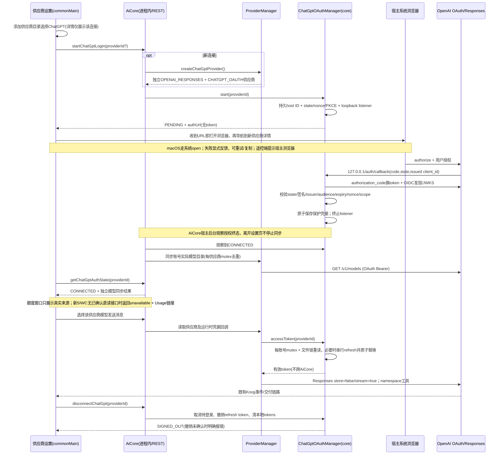

取消、超时、重新登录使用待授权实例身份检查，旧回调不能覆盖新连接或恢复已经取消的授权。退出保留账号与 issued client_id/host ID 映射，后续重新授权复用注册。授权凭据、普通 API keys 分开保存；不会修改其他供应商，也不安装/启动 Codex CLI。

## 桌面启动与 MCP 运行时引导

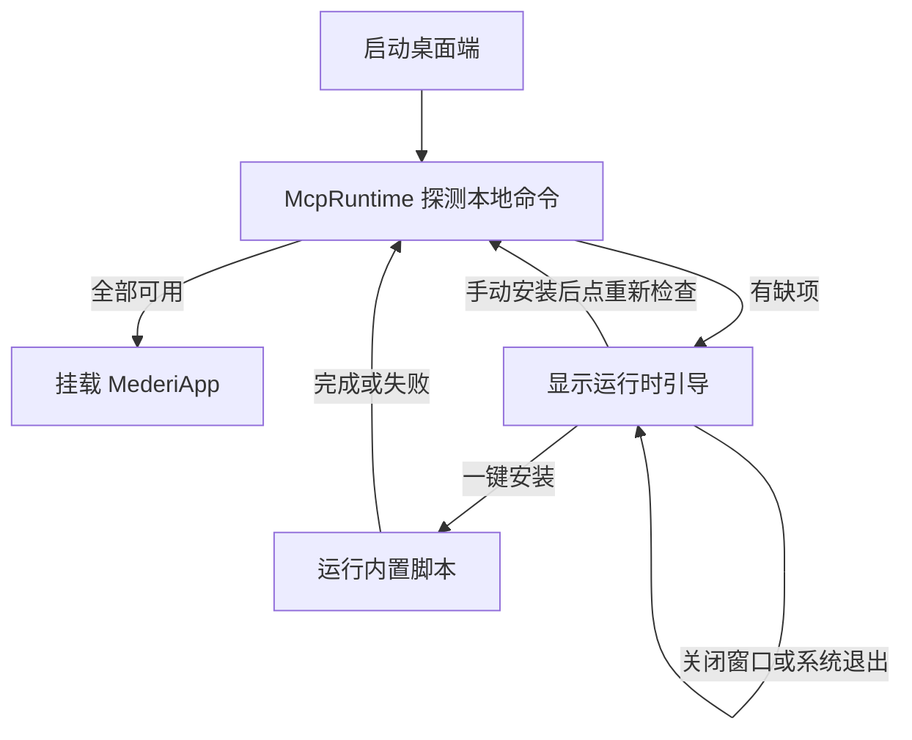

每次启动都重新探测。只有全部通过后才允许进入工作台和正常关闭窗口。安装失败时，引导页保留剩余缺项并展开当前平台的四步终端说明，复制的命令使用随应用打包的脚本。脚本把 Node.js 24 LTS、Python 3.13 和 uv 装到当前用户的 `~/.mederi/runtime`，无需管理员权限。桌面发行包已经带有 JBR。Docker、.NET 等由选择它们的 MCP 服务各自要求。

## 1. 发送消息全链路（sendMessage 端到端时序图）

```mermaid
sequenceDiagram
    autonumber
    participant UI as WorkspaceViewModel<br/>(app/shared commonMain)
    participant AC as AiCore<br/>(MederiAiCore 直调 / ServerAiCore REST)
    participant SM as SessionManagerImpl
    participant TE as TurnExecutor
    participant HS as HistoryStore (data.db)
    participant K as Koog AIAgent (turn 内)
    participant LLM as LLM 供应商
    participant EB as eventBus (SharedFlow)

    UI->>UI: guardImageSupport 剔除放行(模型不支持图片 → 剔除本次图片<br/>+ 一次性轻提示 imageStrippedNotice, 历史保留)<br/>PromptComposer.compose(主指令+粘贴文本)<br/>乐观消息入 pendingUserMessages
    UI->>AC: sendMessage(conversationId, ChatPromptInput{text, model, agent, thinkingLevel=effectiveThinkingLevel, apiKeyId=getApiKeyId(model.provider)})
    AC->>AC: MederiInputMapper.toMessageParts / toAgentConfig；记录 lastApiKeyIdByProvider（自动命名跟随用）
    AC->>SM: SessionManager.sendMessage(id, SendMessageRequest{..., apiKeyId})
    SM->>TE: TurnExecutor.sendMessage(sessionId, request)
    TE->>TE: activeApiKeyId = request.apiKeyId（本 turn 唯一真理源）
    TE->>TE: 校验 IDLE → 读 Project → PlanStore.loadBySession<br/>组装 activePlanContent/spec指针/activeTodoContent(互斥)
    TE->>TE: 系统提示词装配：静态骨架(build/forSubagent) → withSkills(继承角色) → withProjectRules(AGENTS.md 指令链,<br/>向上:git根→项目目录 + 向下:项目目录直接子目录一层, 浅→深) → dynamicSuffix(plan/todo) + EnvironmentInfoProvider(环境信息)<br/>（动态段永远在最后，保证静态前缀连续=OpenAI prefix cache 不变量）<br/>注: 仅主代理(subagentRole==null)注入 AGENTS.md；子代理(executor/researcher)跳过, 项目规则由主代理编入 spec
    TE->>TE: effectiveModel/effectiveReasoningLevel → sessionStore.updateAgentConfig
    TE->>HS: append(用户消息+durable时间戳) 【durable-first】
    TE->>EB: SESSION_UPDATED (客户端 refreshPage 即时回查, 新 turn 用户消息立即可见)
    TE->>TE: sessionStore.updateStatus(RUNNING)
    TE->>TE: scope.launch { runTurn() }
    AC-->>UI: (立即返回)
    alt 用户在 turn 运行中插话 (引导模式 Steering, 见 2.1)
        UI->>AC: steerMessage(conversationId, input)
        AC->>TE: steerMessage
        TE->>TE: sendMessage统一接纳，稳定ID落库<br/>运行中pending输入 / 空闲启动工作
    end

    rect rgb(235, 244, 255)
        note over TE,LLM: runTurn（后台协程）
        TE->>TE: ApiKeyResolver.resolve(provider, activeApiKeyId)<br/>命中轮询哨兵(API_KEY_ROTATION_ID="__rotate__")?<br/>→ listKeys 全量明文建 RotatingLLMClient(getCounter(rotationSessionId))<br/>→ retryWrapped 包 RetryableLLMClient<br/>未命中 → 单 key client + RetryableLLMClient<br/>(哨兵不校验归属: 记忆/默认 key 兜底链另见 01-core §9.1;<br/>compressOnce 同源哨兵感知, 与 runTurn 共用同一计数器)
        TE->>TE: preflightCompressionIfNeeded<br/>(contextUsedTokens > 70% 窗口 → compressOnce，带 apiKeyId)
        TE->>TE: CustomToolRegistry.buildAll() 收集 UI 层注册的自定义工具
        TE->>TE: ToolFactory.build(工具集, agentMode/role裁剪, customTools+mcpTools旁路合并)<br/>透传 AgentsSubtreeDiscovery: read/list 工具访问路径上<br/>发现未注入过的 AGENTS.md 时追加进工具返回文本(会话级去重)
        TE->>TE: buildTurnAgent: KoogClientFactory(+RetryableLLMClient)<br/>+ KoogModelBuilder + KoogParamsBuilder<br/>+ ChatMemory(HistoryStoreChatHistoryProvider)<br/>+ graphStrategy(+Compression) + EventHandler
        K->>HS: load → aiViewWindow(最后 SUMMARY 之后) → KoogMessageMapper
        K->>LLM: requestLLMStreaming(系统提示+AI视图窗口+哨兵输入)
        loop 流式帧
            LLM-->>K: StreamFrame (text/reasoning/tool_call/tool result/end)
            K-->>EB: MESSAGE_DELTA (launchStreamConsumer)
            EB-->>UI: SSE 或进程内 → SnapshotReducer 更新快照
        end
        loop 工具循环 (maxAgentIterations=3000)
            K->>K: toAssistantMessageSafe(args 坏 JSON 降级 "{}")
            K->>HS: TurnIncrementalPersister.persistAssistant（增量落库防崩丢）
            K->>K: nodeExecuteTools: 执行工具<br/>(文件写白名单/沙盒命令/office_read/office_write(pptx 只读)/<br/>list_processes/stop_process/Plan/Verify/ask_user...)
            K-->>EB: TOOL_CALLED / TOOL_RESULT 事件
            K->>K: 工具边界 (nodeSendToolResult) pre-LLM pollSteering 出队<br/>→ SteeringItem 注入工具结果消息 (引导模式插话)<br/>各 LLM 节点 post-LLM pollSteering 出队→注入并再发一轮 LLM
            alt ask_user / write_plan(APPROVAL)
                K-->>EB: QUESTION_REQUESTED / PLAN_APPROVAL_REQUESTED (工具协程挂起)
                UI-->>AC: resolveQuestion / resolvePlanApproval
                AC->>TE: resolveQuestion/resolvePlanApproval → deferred.complete
                K->>HS: persistToolResults
            end
            K->>LLM: send_tool_results → requestLLMStreaming
        end
        K->>HS: ChatMemory store → HistoryStoreChatHistoryProvider.reconcile<br/>(指纹对齐/插 SUMMARY/补诊断, 失败退回 replace)
        TE->>HS: (压缩触发时) 插入 SUMMARY 标记消息
        TE->>TE: diffTracker.captureSnapshot → diffStore.save(TurnDiff)<br/>装配 turnDiffSummary (files/additions/deletions 单轮文件变更汇总)<br/>回填最后一条 assistant 消息.turnDiffSummary (UI TurnDiffCard)
        TE->>TE: sessionStore.updateStatus(IDLE)
        TE->>EB: MESSAGE_COMPLETED (可选 warning)<br/>有文件变更时携 turnDiffSummary/diffMessageId
        TE->>TE: finally 冲刷: pendingEventMessages 补发 + pendingSteerings 残留降级新 turn<br/>(sendMessageInternal 避免 ERROR 污染, 撞 RUNNING 放回队列)
    end
    UI->>UI: SnapshotReducer.applyWithRefresh + refreshPage 回查落库对齐
```

### 消息视口：推理展开与底部跟随（2026-10）

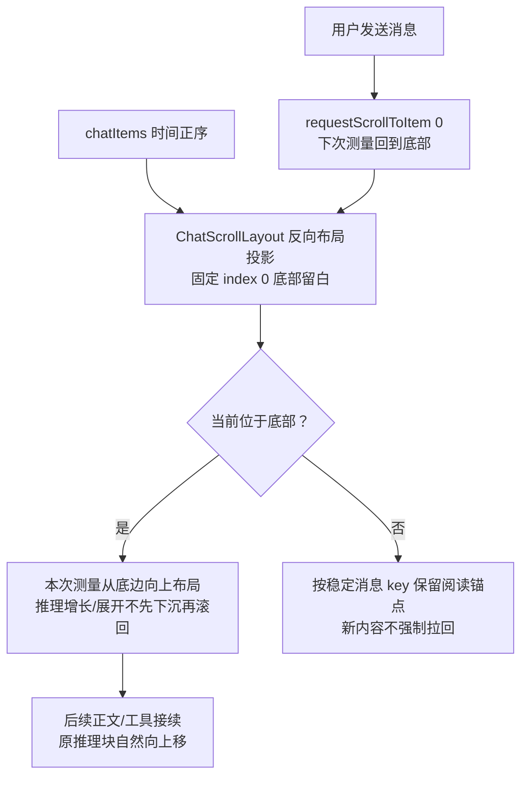

`Workspace.MessageList` 与 `SubagentConversationPanel` 共用底部锚定视口；前者按 conversationId、后者按 agentId 隔离列表状态。不再以布局变化后的异步滚底修正推理展开高度；短内容保持顶部对齐，输入区仍在消息视口外正常占位。

### 过程详情的可展开状态（2026-10）

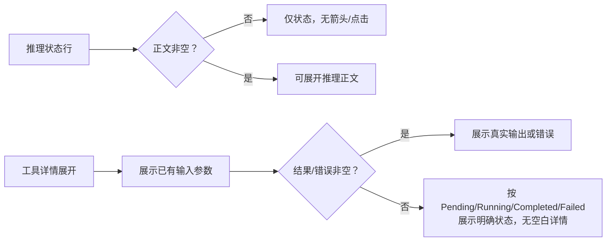

运行中子代理也允许查看输入与执行状态；报告正文为空时走通用详情，不再生成空 REPORT 折叠。ASK 保持原结构化问答展示。

### 1.1 输入框设置真理源翻转（2026-10：全局偏好 → 会话）

**语义**：输入框全部设置（模型 / Agent / API Key / 推理档位 / 草稿文本）的真理源已从"全局偏好"翻转为**会话**：

- **切换会话**（`WorkspaceViewModel.hydrateSelectionFromConversation`，在 `!selectionHydrated` 守卫内触发）：
  - 会话已绑定模型（`conv.modelId != null`）→ 调 `appState.applyConversationSettings(model, agent, apiKeyId=conv.apiKeyId, thinkingLevel=conv.thinkingLevel, hasSessionModel=true)` **按会话快照覆盖**全局内存态（只改内存、不写偏好文件）——模型、Agent、API Key（按模型供应商写入 selectedApiKeyIds，null=默认 key）、推理档位（写入 modelReasoningLevels，effectiveThinkingLevel 推导链唯一输入）四项全部恢复。
  - 全新未发送会话（`conv.modelId == null`）→ 调 `applyRecentConversationDefaults()`（新/空会话默认取最近修改会话的设置）：`appState.projects` 拍平 → 筛 `modelId != null` 的会话 → `maxByOrNull { it.updatedAt }`（跨项目最近修改会话）→ 递归复用 `hydrateSelectionFromConversation(recent)` 恢复其设置；recent == null（无任何已发送会话）→ 不填，由 AppState.hydrate first-available 兜底。
- **选择器改动统一保存到当前会话**（2026-10：统一全量覆盖写）：`selectModel` / `selectApiKey` / `selectAgent` / `selectAgentMode` / `updateThinkingLevel` 在改动 AppState 后统一调 `saveComposeState()` → 读全量当前值（`buildComposeStateInput()`）→ 同步更新快照缓存（UI 零延迟）+ 后台协程调用 `aiCore.updateConversationSettings(convId, input)` 全量覆盖写到该会话。底层 `updateComposeState` SQL 做 SET（非 COALESCE），null 直接写 null（清空语义）。`conversationId == null`（会话未建立）时跳过。
- **新会话创建继承机制**：`send()` 自动创建新会话后，在 `selectConversation(conv.id)` 触发 `attach` 之前，立即调用 `updateConversationSettings(conv.id, buildComposeStateInput())` 将当前 UI 选好的模型、Key、推理档位一次性全量写入新会话；杜绝新建空记录覆盖用户界面选择。
- **草稿文本持久化**：
  - **已绑定会话输入**：`updateInputDraft` 携带 300ms 防抖，连续打字暂停后自动触发 `saveComposeState()` 同步缓存与落库。
  - **未绑定会话输入**：`conversationId == null` 时草稿暂存 `unattachedDraft`，切换至已有会话再切回未绑定会话（`attach(null)`）时自动恢复；发送创建会话后清空。
  - **切换会话时**：`attach(newId)` 在切换前取消防抖，不再反向盲写旧 convId（用户在旧会话的修改在发生时已实时入库，切走时绝不拿当前界面设置反写旧会话，杜绝跨会话污染）。
  - **程序关闭时**：VM init 注册 `appState.registerFlushCallback { flushComposeState() }`；`main.kt` onCloseRequest 调 `runBlocking { appState.flushAll() }`（先跑 flush 回调保存 compose state，再 flushPreferences）。
- **草稿恢复**：`applySessionSettings(conv)` 在 modelId null check 之前 `inputDraft = TextFieldValue(conv.draftText ?: "")`——无模型也恢复草稿。
- **不再有全局偏好模板**：`workspace.lastModelId` / `workspace.lastModelProviderId` / `workspace.lastAgentId` / `workspace.apiKey.$provider` / `workspace.reasoningLevel.$modelId` 不再 persist/hydrate——`selectModel` / `selectAgent` / `selectApiKey` / `setModelReasoningLevel` 只改内存镜像；启动 `hydrate()` 仅保留首启 first-available 兜底（模型/Agent 列表就绪后限时 3s 填首个可用项）。导航偏好 `workspace.lastProjectId` / `workspace.lastConversationId` 保留（选中态恢复）。
- **不动项**：`effectiveThinkingLevel` 推导链（ReasoningMenu.resolve）不变——`modelReasoningLevels` 兼任"当前会话档位载体"，切换会话时按会话重填；`send`/`rollbackMessage`/`approvePlan` 仍读 appState 全局选择（此时全局已是会话镜像）；`applySnapshot` 的 `!selectionHydrated` 守卫不变（防持久化后快照再发重入 hydrate）。

### 首响应前的输入顺序对齐（2026-11-05）

桌面 `MederiEventAggregator` 与遥控 `ServerAiCore` 首次读取快照后才订阅事件，期间可能错过 `SESSION_UPDATED`。`ConversationStateReducer.applyWithRefresh` 收到尚不存在的响应 ID（MESSAGE_DELTA / TOOL_CALLED / TOOL_RESULT）时，先回查持久化输入，再发布响应状态：只补真实、已消费的用户输入，按落库消息邻接关系定位；不按时间排序，不导入可能领先事件队列的落库响应正文，也不覆盖既有流式块。已有响应后续帧不重复查询；查询失败保留现有事件处理。工作完成后的全量对齐仍保留。

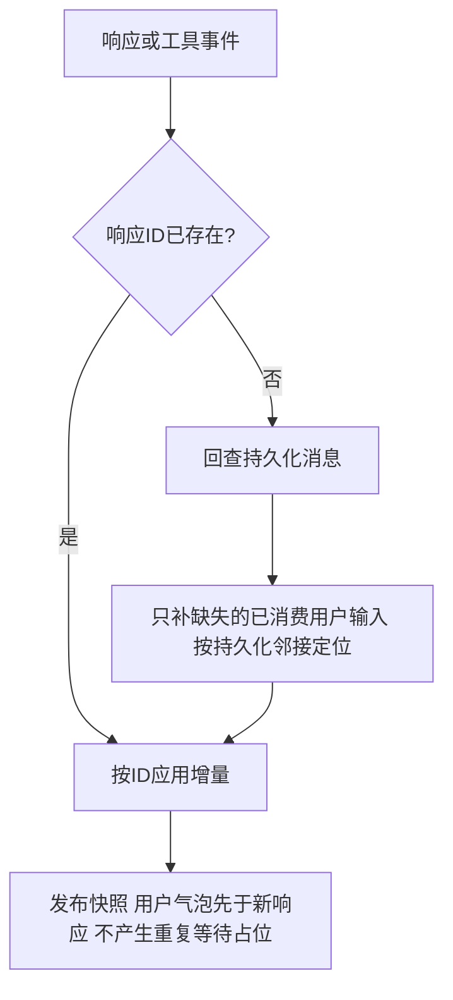

## 2. Turn 执行流程图（含错误分类）

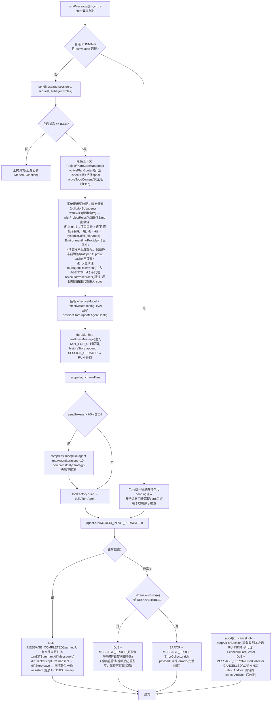

**事件流消费侧**：`eventBus` → 三路消费：① `MederiAiCore.events()`（进程内）/ `GET /v1/events`（SSE 遥控端）→ 客户端 `SnapshotReducer` 聚合快照；② `launchStreamConsumer` 把 StreamFrame 转 MESSAGE_DELTA；③ UI 层特性（SessionTitleService 等）订阅。

### 2.1 统一用户输入与安全边界消费（2026-10）

UI 与 API 只提交 `sendMessage`，不选择排队/立即发送。`steerMessage` 和旧 `/steer` 路由保留为同一入口的兼容别名。

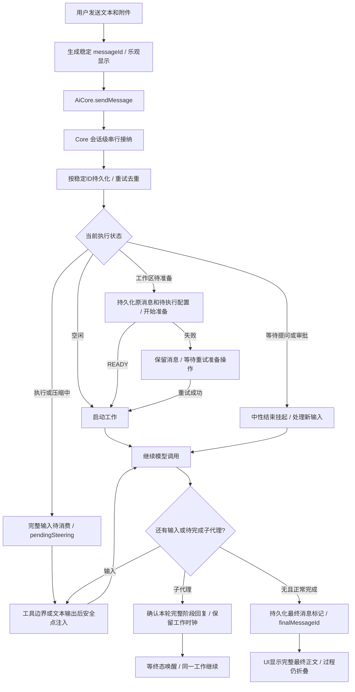

每次模型响应使用稳定消息 ID，`MESSAGE_DELTA` 的 `response_started/response_completed` 与内容增量经同一有序流传输，并携带 `turnId`。实时占位与落库消息保持同一 ID；不再把整个工具循环拼进一个占位消息。

插话在接收时即落库，消费前从 AI 视图排除；当前响应和工具结果原子插入未消费输入之前，保留历史的因果顺序。注入时使用完整 parts（含图片），消费后更新标记。若输入先到、提问/审批后挂起，Core 在挂起事件上自动处理已有输入，不让其悬空。接收确认 `SESSION_UPDATED{inputAccepted=true}` 回查不会清除挂起或未落库响应。UI 仅按 ID 移除对应乐观消息。

待准备工作区的首次发送先发出接收确认事件，随后执行准备。失败保留同一条历史记录和待执行配置，操作状态报告准备错误。桌面与服务端的重试均经 `WorkspaceApiImpl.retryWorkspacePreparation`，成功后在原会话接纳锁内恢复同一条消息。模型开始消费时清除待执行配置，重复重试不会再次调用模型。

过程进入折叠块；Core 正常收尾确认本轮完整回复，含派发子代理后等待的阶段回复。阶段回复与成功派发通知在折叠块外保留；UI 仅在 `subagent` 的 SPAWN/SPAWN_RESEARCHER 工具 Completed 且结果非 `Error:` 时生成固定通知（已启动子 Agent / 概览查看详情 / 可继续与主 AI 对话，不影响子 Agent），不依赖模型输出文字；未完成、失败及 STATUS/STOP 保留在工具过程内。通知是历史派发记录，实时状态由概览展示；只有整项工作结束才写 workCompletedAt。UI 以用户消息切分显示段，同一 turnId 不跨插话气泡合并后续推理。取消、异常和截断不确认最终交付；收尾未消费输入不能静默清掉。历史重开使用持久化标记，不依赖 UI 猜测。

## 3. 事件 → UI 状态机聚合流程

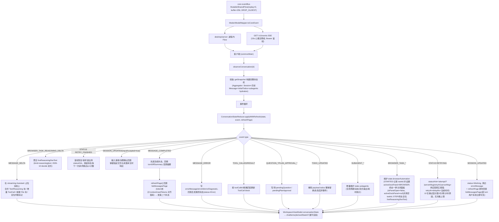

**`contextUsedTokens` 口径（与自动压缩同源）**：refreshPage 回查落库的 `contextUsedTokens` 现走 `SessionManager.contextUsedTokens`（→ `aiViewContextUsedTokens`），口径 = AI 视图窗口（首条 SUMMARY 走估算、否则最近一条 Assistant inputTokens 真值）——故手动压缩结尾的 MESSAGE_COMPLETED 触发 refreshPage 时，界面当场拿到压缩后的小值，不再滞后一轮。

**BROWSER_TASK_* 与 SUBAGENT_* 全量收敛（2026-10）**：`SUBAGENT_*` 与 `BROWSER_TASK_*` 全量收敛入 `ConversationStateReducer` 驱动 `ConversationState` 更新，彻底废除了 ViewModel 内部的旁路协程和私有缓存 Map；会话切换直接从状态机池（`sessionCache.conversationStates`）恢复，各会话的子代理列表、Dock 展开状态、浏览器自动化流程天然隔离且绝不丢失。

## 4. 通用协作与软件 Plan Loop

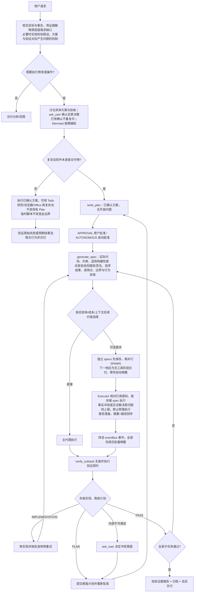

证据与因果推理是三个 turn 角色共享的提示词引导，同样适用于无 Plan 路径；不规定调查次数/工作量阈值或固定替代解释数量。Spec 派发前自检由父代理完成，基于真实来源和前序实际交付，不把猜测下发成事实。这些提示词不新增审批或执行门禁。主代理静态提示词不按浏览器可用性分支，能力由工具注册声明。

**并行执行（2026-09，2026-09-14 异步化，2026-09 并发上限硬门禁）**：工具执行节点 `nodeExecuteTools(parallel=true)`——同一条消息的多个工具调用并行执行；**子代理单会话并发受限**（设置页可配，默认 2，见下述并发门禁），同父会话内 EXECUTOR 与 RESEARCHER 同池计数，达到上限时 spawn 工具返回指导文案让模型结束 turn 等待唤醒；浏览器任务不经 SubagentManager，天然排除在外。约束：`write_plan` 单独发；`write_plan` 支持 update 路径：planId 非空时更新已有 PENDING_APPROVAL 计划（不新建，空字段保留原值）；**禁止同消息混发 generate_spec 与 subagent(SPAWN)**（并行无序，spawn 可能读到未写入的 spec）；同文件并发写已由 `FileWriteRegistry` 代码级硬拒绝（write_file/edit_file try-lock，占用即 Error，AI 下轮重试），不得重复执行同一命令仍靠 AI 自律。plan 状态写入一律走 `PlanStore.updatePlan`（原子读改写），防止并行 subagent(SPAWN)/generate_spec/verify 互相覆盖。**子代理异步化（2026-09-14）+ 主动上报（2026-09-25）**：子代理统一为单一 `subagent` 工具 action 分流（SPAWN/SPAWN_RESEARCHER/STATUS/STOP，原 6 个独立工具封装合并；`agent_status`/`stop_agent` 工具类保留但不向 AI 注册）。`subagent(SPAWN)` 支持 planId 可选：有 planId 走计划流程（spec 硬校验+IN_PROGRESS），无 planId 走 ad-hoc 路径（task+briefing 直接派 executor，跳过 spec/IN_PROGRESS）。派工异步（立即返回 agentId，后台协程跑子代理），父代理 turn 不再被阻塞，可继续对话；子代理终态经主 eventBus 发 `SUBAGENT_COMPLETED/ERROR/STOPPED` 事件（NonCancellable emit），父 TurnExecutor 订阅后 `handleSubagentTerminalEvent` 合成 `<event_message>` 入 `pendingEventMessages` 队列，父 turn 空闲时 `dispatchPendingEventMessages` 批量合并成一条内部消息自动唤起新 turn（同会话多个完成合并成一次 turn；竞态（父会话正忙）时放回队列等 turn 收尾 finally 冲刷；abortAndJoin 清空该会话队列）。agent 丢失/归档（不在内存表）时 `subagent(STATUS)` 返回 NOT_FOUND + `AgentRecoveryInfo`（retired 记录：末次状态/result/报告路径/touchedFiles 部分认知），父代理据此判断已改动文件（与 targetFiles 比对查越界）再决定重跑或接受部分成果。`wait_agent` 枚举值已删，父代理不再阻塞拉取。**轮询拦截 + 返回值增强 + 冲刷延后（2026-10）**：`subagent(STATUS)` 先查 `SubagentManager.runningCountForSession(parentSessionId)`——本会话仍有 RUNNING 子代理时返回合成引导文案（"Subagents are still running. Do NOT poll — end your turn now..."）而非实际状态，杜绝父代理 STATUS 轮询；`SPAWN/SPAWN_RESEARCHER` 成功返回在 JSON 后追加 `\nSubagent dispatched. N subagent(s) running. End your turn... Do NOT call subagent(STATUS) to poll.`（N = 派工后的 runningCount，含刚派出的这个；Error 原样透传）；`dispatchPendingEventMessages` 冲刷前查 runningCount>0 则延后派发（不加定时器/轮询——最后一个子代理终态事件触发再次冲刷，此时 runningCount=0 才真正唤醒），使同会话多个并发子代理完成只唤醒父代理一次、父代理拿到的是一次性聚合结果。**diff 合并子代理改动（2026-09-23）**：主 turn runTurn 开头 `ParentDiffRegistry.register`，子代理 turn 结束时把文件改动经 `onTurnDiff` 回调 + `ParentDiffRegistry.mergeInto` 合并进父 turn 的 `TurnDiffTracker`（`mergeChanges`），finally 里 `unregister`——修复"turn 改动摘要不含子代理改动"的 bug。子代理自身 diff 仍独立落库（其临时 InMemory store），合并只影响父 turn 的 TurnDiff 聚合。**walkthrough 自动生成（2026-09-23）**：计划全部子任务 COMPLETED 时，`PlanStore.writeWalkthrough(plan)` 自动装配 walkthrough 文档写至 `plans/{planId}/walkthrough.md`（archive 时随整个计划目录移到 `plans-done/{planId}/walkthrough.md`，内容由 `buildWalkthrough` 聚合 plan/subtask/spec/verification/changes；`verify_subtask` 全 PASS 文案亦指向该路径）。

**Plan 审批时序（APPROVAL 模式）**：

```mermaid
sequenceDiagram
    autonumber
    participant M as 主代理(工具协程)
    participant PAR as PlanApprovalRequester
    participant EB as eventBus
    participant UI as WorkspaceViewModel(SnapshotReducer)
    participant TE as TurnExecutor
    participant PS as PlanStore(.mederi/plans/)

    M->>PS: PlanStore.save(plan)
    M->>PAR: request(planId, planPath, title, summary, planContent, subtaskCount)
    PAR->>PAR: 取消当前 pending(superseded)
    PAR->>EB: PLAN_APPROVAL_REQUESTED(payload 含 planContent)
    EB-->>UI: SnapshotReducer → pendingPlanApproval + planApprovals
    UI->>TE: resolvePlanApproval(convId, planId, approved)
    TE->>PAR: resolve(planId, approved) → deferred.complete
    PAR->>EB: PLAN_APPROVAL_RESOLVED
    EB-->>UI: 清 pendingPlanApproval, 对应项 status=APPROVED/REJECTED
    PAR-->>M: PlanApprovalResult(approved, superseded=false)
    alt approved=true
        M->>M: notebook.append → 继续生成 spec/spawn
    else approved=false
        M->>M: 向用户说明, 不执行计划
    end
```

**跨 turn / 重启后批准（"批准与 turn 解耦"）**（2026-09）：
上面是同 turn 批准——requester（内存 CompletableDeferred）存活，`resolvePlanApproval` 直接唤醒挂起的 write_plan，AI 同 turn 执行。
翻历史 / 进程重启后 requester 已消亡，无法唤醒任何挂起协程，走**跨 turn 分支**（`TurnExecutor.resolvePlanApproval`）：
1. 审批仅批准技术方案，不修改会话模型与配置；拒绝（approved=false）无存活 turn 可唤醒、无状态变更，直接返回 false（计划保持 PENDING_APPROVAL）；
2. 从 PlanStore 按 planId `load` 并校验：会话匹配、非终态、PENDING_APPROVAL——不满足则跳过（作废/已完成/他会话计划不可批）；
3. `updatePlan` 置 APPROVED 落盘 → 发 `PLAN_APPROVAL_RESOLVED` 事件；
4. 以一条 **UI 隐藏内部消息**（整条文本以 `<<<NOT_FOR_UI>>>` 开头，UI 渲染 `substringBefore` 得空串 → 用户不可见、AI 可见）经 `sendMessageInternal` 启动新执行 turn，AI 读到 Active Plan 已是 APPROVED 后自行走 generate_spec → spawn → verify。

**重启/翻历史恢复待批准卡片**：`MederiAiCore.initialPlanApproval()`（MederiEventAggregator.observe 初始快照 + getSnapshot 共用）读该会话最新非终态计划投影为契约 `PlanApprovalRequest` 填入 `pendingPlanApproval`——`status` 区分：
- APPROVAL 模式 + PENDING_APPROVAL → `"PENDING"`（待用户批准）；
- 自动模式已 APPROVED / 执行中 IN_PROGRESS → `"AUTO_APPROVED"`（已自动审批，UI 可展示而非完全不展示）。
职能边界：core **只把计划状态作为数据给 UI**，不判定卡片必须在对话内/外——UI 层自决渲染位置。

**问与计划挂起时用户直接回复**（三条硬规则之一）：`sendMessageInternal` 检测到 pending 时先 `injectNeutralPlanToolResult`（补写中性 ToolResult 落库，非批准/非拒绝）再 abort 旧 turn——计划保持 PENDING_APPROVAL，AI 响应新消息，绝不反问"为什么"。计划无"拒绝"态，只有批准/作废/被无视三态。

### 4.1 子代理生命周期与事件流（spawn → 终态）

UI 提示与主对话可交互性分离：成功派发后在对话折叠块外保留固定派发记录（提示概览详情与可继续聊天）；输入框上方不再重复显示子 Agent 运行横条。概览整块子 Agent 手风琴（含折叠行头）在有 RUNNING 子代理时呼吸描边，终态自动停止；该运行标记不表示主 AI 当前轮次正在执行。Workspace 标题栏 Grid 按钮与窗口 X 共用 OverviewWindowState.visible，仅切换显示/隐藏（无最小化胶囊），隐藏保留展开项，重新显示恢复；显隐偏好写设备本地 preferences.json。

2026-10-29首批表现调整只改变展示层：助手诊断在本地按需展开、消息/文档/终态通知减重；输入仍走原send/submit回调；概览标题固定、内容限高滚动，按同一展开状态驱动箭头与内容；运行由整栏统一呼吸而非文字闪动表达。关闭/显隐/滚动不调用停止，任务、接续和交付状态流未变化。


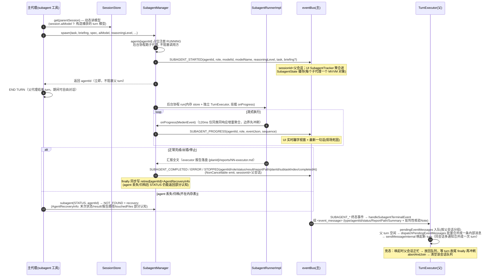

**abort 级联收割**：用户点"停止"（abort/abortAndJoin）→ cancel 父 turn job → `stopAllForSession(parentSessionId)` 杀本会话全部 RUNNING 子代理——子代理挂全局 scope 不随父 turn 取消而亡，不收割即孤儿（旧模型继续写文件，与"继续"后重 spawn 的新代理并发写同一批 targetFiles）。被杀子代理发 `SUBAGENT_STOPPED`，plan 子任务保持 IN_PROGRESS（"继续"后重 spawn 是干净路径）。

**子代理汇报取数链（2026-09）**：全量报告可随时拉取——`AiCore.getSubagentReport(agentId)` → `SessionManager.getSubagentReport` → `SubagentManager.getReport`：磁盘读报告全文（`{planId}/reports/NN-executor.md` / `research.md`），文件缺失时回退内存 result 或 `AgentRecoveryInfo`（retired）记录；遥控端对应路由 `GET /v1/subagents/{agentId}/report`。`<event_message>` 唤醒消息的 UI 通道：对话流内由 `EventMessageCard`（系统事件卡）渲染——读落盘报告全文/摘要展示，**非**仅 SubagentTracker 卡片。

**子代理状态机水合与全量收敛（2026-10 新增）**：getSnapshot 从 SubagentManager.agents 内存表读出该会话全部子代理（listForSession → 按 parentSessionId 过滤 + startedAt 排序），映射成 contract SubagentState 放入 `ConversationState.subagents`。UI 端废除散落的 `subagentStates` 私有 Map 与独立协程监听，改由 `ConversationStateReducer` 统一消费增量事件并直接写进 `state.subagents`。切换会话直接从状态机池（`sessionCache.conversationStates`）恢复，彻底根治切换会话丢失子代理或状态错位的问题。

## 5. 上下文压缩流程（自动 + 手动）与并发互斥保护

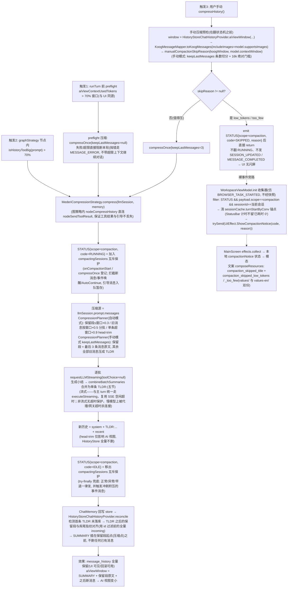

**压缩互斥与暂停保护（2026-10，防止压缩被打断或空转重入）**：
- **`compactingSessions` 排他集合**：`TurnExecutor` 维护 `compactingSessions` 集合。在 `compressOnce` 全程以及 `MederiCompressionStrategy` 执行图策略内联压缩（`onCompactionStart` / `onCompactionEnd`）期间，当前会话处于压缩保护状态；
- **全链路互斥保护**：
  1. `sendMessageInternal`：若会话在 `compactingSessions` 中，直接拒绝并提示等待压缩完成；
  2. `steerMessage`：用户插话在压缩期间直接进入 `pendingSteerings` 等待队列，不打断压缩，待压缩完成进入下一个工具边界时消费；
  3. `dispatchPendingEventMessages`：子代理/后台任务终态事件在压缩期间暂缓唤醒，压缩 finally 移出 `compactingSessions` 时自动冲刷唤醒；
  4. `WorkspaceViewModel.checkAndTriggerAutoContinue`：流式断流续跑检测到 `isCompacting` 时直接 return，严禁并发打断压缩；
- **预检压缩阻断（废除过度兜底）**：`preflightCompressionIfNeeded` 在上下文 > 70% 触发时执行 `compressOnce(keepLastMessages = null)`（自动走 token 预算规划）。若压缩失败或压缩后上下文仍超过模型窗口硬上限，**直接抛出异常阻断本轮**，由 `runTurn` 统一发射 `MESSAGE_ERROR` 并置会话 `IDLE`，严禁带着超限上下文盲目向 LLM 发送请求；
- **图策略直连**：`mederiSingleRunStrategyWithCompression` 中，`nodeCompressHistory` 直接连接 `nodeSendToolResult`，消除旧的 `nodeSendCompressedHistory` 丢失工具结果回传、持久化与引导注入的缺陷。

**手动压缩预检（2026-09，"无需压缩"提醒，触发3 专属）**：手动 `compressHistory` 在**翻状态机之前**先用 `manualCompactionSkipReason(aiViewWindow → KoogMessages, model.contextWindow)` 预检，判定口径为：
- a. `aiViewWindow` 估算总 tokens 低于 **16k 绝对门槛** → `low_tokens`（手动是"按需一次压到位"，不跟随窗口大小浮动）；
- b. 按 `keepLastMessages=3` 条数切分后 `olderBatches` 为空 → `low_tokens`；旧消息总条数 < 2 → `too_few`；
- 与 `MederiCompressionStrategy`（`keepLastMessages` 模式）共用 `planCompression` 同一口径——手动与自动的"切分/保留"逻辑同源，**但手动不再与自动共用窗口×30% 保留预算**（手动只受 16k 绝对门槛约束）；
- **自动路径仍为窗口相对口径**（70% 触发 preflight / 保留段 ≤ 窗口×0.3），不受手动改动影响。

窗口取 `HistoryStoreChatHistoryProvider.aiViewWindow`（即"最后一条 SUMMARY 及其后"，与实际压缩所见一致），图片按当前模型 `supportsImages` 能力剔除。

**SUMMARY 插入位置与 AI 视图（2026-10 修复）**：压缩回写时 SUMMARY 标记插在**保留段（recent）起点之前**——库里顺序为 `...被压掉的旧消息 | SUMMARY | 保留段原文 | 之后新消息`，AI 视图 = SUMMARY + 保留段 + 新消息，模型既看到摘要又看到压缩点前保留的最后几句原文。对齐必须用 **id 过滤前的完整 incoming**：Koog ChatMemory 在 strategy 完成时把压缩后的历史 `[TLDR, recent...]` 整体交给 store，recent 携带与库中一致的 id，若先按 id 过滤（`existingIds`）再对齐，recent 会被全部剔除、k 恒为 0，SUMMARY 会追加到历史末尾、保留段退出 AI 视图（压缩后模型只看到摘要、看不到保留原文——历史上该 bug 真实存在，修复 + 回归测试见 `CompressionSummaryPositionTest`）。

- **命中空转**（`low_tokens` / `too_few`）：只发一条机器码事实 `STATUS{scope=compaction, code=SKIPPED, reason}` 后直接 `return`——**不翻 RUNNING、不发 SESSION_UPDATED / MESSAGE_COMPLETED**，UI 完全不闪屏（老行为会 Working→Idle 闪一下再说明失败）；
- **未命中**：照旧 `compressOnce` 全流程（session RUNNING → compressOnce → IDLE）——`MederiCompressionStrategy.compress` 进入发 `STATUS{scope=compaction, code=RUNNING}`、try-finally 结束（含异常/早退）发 `code=IDLE`（三种触发的手动/自动构造均注入 eventBus+sessionId）；结尾 `MESSAGE_COMPLETED` 触发的 `refreshPage` 取到的 `contextUsedTokens` 即为压缩后窗口口径（`aiViewContextUsedTokens`），概览「上下文占用」当场下降，不用等下一轮回复。

UI 侧走**裸事件旁路**（core 只发事实，不认识模态）：`WorkspaceViewModel.init` 里仿 `BROWSER_TASK_STARTED` 的收集器直接订阅 `aiCore.events()`，按 `type==STATUS && payload["scope"]=="compaction" && sessionId==当前会话` 过滤（按会话过滤防串台）——**`code=RUNNING` → 置本地 `isCompacting=true`（压缩中 StatusBar 覆盖为"压缩中"，见下）、`code=IDLE` → `isCompacting=false`（压缩结束复位，不清 turnStart 锚点）**；命中 `SKIPPED` 时先清 `sessionCache.turnStartByConv` 里 `requestCompaction` 事先设的锚点（否则 StatusBar 计时挂着一个"已耗时 0"），再 `trySend(UiEffect.ShowCompactionNotice(code, reason))`；`MainScreen` 的 `effects.collect` 收该 effect 落成本地 `compactionNotice` 状态渲染**本地化模态**（`compaction_skipped_title` + 按 `reason` 选 `compaction_skipped_low_tokens` / `compaction_skipped_too_few`，values/ 与 values-en/ 双份），"确定"关闭是纯本地 UI 动作不走效果通道。

**快照零污染**：`SnapshotReducer` 对非 provider scope 的 STATUS 一律返回快照不变（该分支只认 `scope=provider && code=RETRYING`），故 compaction STATUS（SKIPPED 与 RUNNING/IDLE 同）既不写 `statusHint` 也不碰状态机——"core 发机器码事实 / UI 渲染"的解耦是这条链路的设计要点（core 不需要知道 UI 有没有模态；UI 不靠快照而靠裸事件旁路接事实）。

**压缩中状态栏（2026-10）**：压缩进行中（`STATUS{scope=compaction, code=RUNNING}` → `WorkspaceViewModel.isCompacting=true`）UI StatusBar 经**裸事件旁路**显示"压缩中"（`TurnStatus.Compacting`）：`WorkspaceFloatingOverlay` 渲染期 `if (viewModel.isCompacting) TurnStatus.Compacting else turnStatus` 优先覆盖派生状态，`shouldDisplayInStatusBar=true` 持续显示压缩耗时，文案 `status_compacting`（"压缩中"/"Compacting"）+ 图标 FeatherIcons.Archive——**零快照污染**（SnapshotReducer 不认 compaction STATUS，快照只随 SESSION_UPDATED 走 Working，不额外闪烁）。`isCompacting` 三重复位：IDLE 事件 / 切会话（`attach` 复位，防别的会话压缩事件串台）/ snapshot 已 Idle/Error（IDLE 事件丢失时按快照状态兜底复位）。

**SUMMARY 不渲染 + 压缩完成提示条（2026-10）**：
- **SUMMARY 不在聊天流渲染**：`computeChatItems` 遇 `ChatRole.Summary` 只切断 Assistant 轮次边界、不再生成聊天项——SUMMARY 留库（存储位置不变：压缩点之前）、AI 视图正常取用（`aiViewWindow` 不变），仅 UI 隐藏其内容；
- **压缩中输入框禁用**：`ChatInputCard` 读 `viewModel.isCompacting`——`TextField(enabled=!isCompacting)` 禁输入、`canSend` 加 `&& !isCompacting`、`isStreaming` 计算排除 `isCompacting`（按钮显示发送图标而非停止图标，压缩中不允许 abort）；
- **压缩完成浮动提示条**：`STATUS{scope=compaction, code=IDLE}` → `isCompacting=false` 的同时置 `WorkspaceViewModel.compactionCompletedNotice=true`，`WorkspaceFloatingOverlay` 渲染期读该标志显示 `StatusStrip` 提示条（`compaction_completed_notice`："已压缩会话"/"Conversation compressed"，FeatherIcons.Archive），3 秒后自动清除；`attach` 切会话一并复位。SKIPPED 路径不变（仍走 `ShowCompactionNotice` 模态）。

## 6. ask_user 问询时序

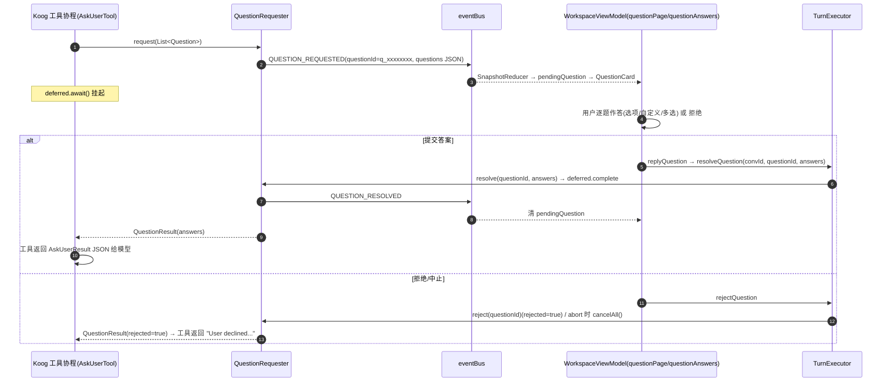

**ask_user 状态恢复与 ToolResult 补写（2026-10）**：
- **store 重建快照 hydrate pendingQuestion**：`MederiAiCore.getSnapshot` / `MederiEventAggregator.observe` 初始快照构建时，若 session 为 RUNNING 且最后 assistant 轮次有 ask_user 工具调用处于 `Pending`（无 ToolResult），则从工具入参解析 questions 构造 `QuestionRequest`（`MederiEventAggregator.hydratePendingQuestion`），并设会话状态为 `WaitingUser`。重启后 session 被 `cleanupStaleRunningSessions` 复位为 IDLE → 不触发（工具行走"未回答"显示）；用户绕过提问发消息后 session 被 `abortAndJoin` 复位 → 不触发；仅在"切走再切回"（app 仍运行、QuestionRequester 仍在内存）时恢复可交互卡片。
- **ChatItemsBuilder 对 Pending 状态渲染 QuestionCard**：ask_user 内联 `QuestionCard` 条件从 `is Running` 扩展为 `is Running || is Pending`，使 store 重建（Pending）时也能渲染卡片。
- **applySnapshot 缓存清除排除 WaitingUser**：`WaitingUser`（ask_user 挂起 / 计划待批准）是交互挂起态 ≠ turn 结束，缓存保留。
- **isStreaming 排除 pendingQuestion**：`ChatInputCard.isStreaming` 加 `&& viewModel.pendingQuestion == null`（与 `!isWaitingPlanApproval` 对称），防御性确保挂起提问时不阻塞输入。
- **用户绕过提问时补写 declined ToolResult**：`TurnExecutor.sendMessageInternal` 中 `hasPendingQuestion` 时，在 `abortAndJoin` 前调 `injectAskUserDeclinedToolResult`（与 `injectNeutralPlanToolResult` 对称），主动落库 "User declined to answer the questions." 结果，确保工具调用不留 Pending、下一轮 AI 视图有完整工具循环、UI 工具行正确显示"已拒绝回答"。
- **ToolCallsBlock 对 Pending 状态显示"未回答"**：ASK kind 加 `isAskPending` 判断（calls 有 `ToolCallState.Pending`），Pending 时显示 `tool_action_ask_unanswered`（"未回答"/"Unanswered"），覆盖重启后 session 复位 IDLE、工具调用残留 Pending 但无 pendingQuestion 的边界场景。

## 7. 子代理（subagent 工具 action 分流 / 异步管理 / 主动上报）时序

> 2026-09-14：spawn 改为**异步派工**——单一 `subagent` 工具（`ToolFactory.SUBAGENT_TOOL_NAMES`，
> action=SPAWN/SPAWN_RESEARCHER/STATUS/STOP；原 6 个独立工具 spawn_agent/spawn_researcher/agent_status/
> stop_agent/wait_agent 封装合并，内部实现类保留但不向 AI 注册）调 `SubagentManager.spawn`
> 立即返回 agentId，子代理在后台协程运行，父代理 turn 不被阻塞。
> 2026-09-25：**主动上报（eventBus 事件链）**——子代理终态经主 eventBus 发
> `SUBAGENT_COMPLETED/ERROR/STOPPED` 事件（NonCancellable emit，sessionId=父会话），父 TurnExecutor
> 订阅后组 `<event_message>` 入 `pendingEventMessages` 队列，父 turn 空闲时
> `dispatchPendingEventMessages` 批量合并成一条内部消息唤起新 turn；
> 父代理不再需要 `wait_agent`（已删），用 `subagent(STATUS)` 查询、`subagent(STOP)` 主动停止。
> 2026-10：**STATUS 轮询拦截 + SPAWN 返回值增强 + 冲刷延后**——`subagent(STATUS)` 在本会话仍有
> RUNNING 子代理时返回引导文案而非实际状态（SPAWN 返回值也带 runningCount 与 end-turn 指令，
> 提示词同步简化为"SPAWN 后下一条必须是纯文本收尾"）；`dispatchPendingEventMessages` 冲刷前查
> `runningCountForSession>0` 则延后，等全部子代理终态聚合一次唤醒父代理。
> 2026-10：**后台任务终态同样唤醒父 turn（与子代理同模式）**——`BackgroundTaskManager` 终态
> （BACKGROUND_TASK_COMPLETED/ERROR/STOPPED，Command/Timer 两种）经 eventBus 发射，TurnExecutor
> init 订阅 `handleBackgroundTaskTerminalEvent` 组 `<event_message>`（type/taskId/taskType/status/
> command?/description?/exitCode?/output?）入 `pendingEventMessages`；冲刷前同样查
> `backgroundTaskManager.runningCountForSession>0` 则延后；abort/abortAndJoin/rollbackAndJoin
> 级联 `stopAllForSession` 收割本会话 RUNNING 后台任务（COMMAND 型整组杀进程）。
> **子代理关闭来源区分（用户 vs 主 Agent）**：UI 针对运行中的子代理提供关闭按钮（`WorkspaceViewModel.stopSubagent` → `AiCore.stopSubagent(agentId)` → `SubagentManager.stop(agentId)`，不传 `operator`），默认设置 `stopReason = "被用户关闭"`；当主 Agent 通过工具调用 `subagent(action=STOP)` 时传 `operator = "MAIN_AGENT"`，设置 `stopReason = "已被主agent关闭"`。子代理退出时发射携带对应 `result`（`"被用户关闭"` 或 `"已被主agent关闭"`）的 `SUBAGENT_STOPPED` 事件，进入父会话 `pendingEventMessages` 汇报给 AI。
> agent 丢失/归档（不在内存表）后无超时卡死类通知机制（代码无该实现）——`subagent(STATUS)` 返回
> NOT_FOUND + `AgentRecoveryInfo`（retired 记录：末次状态/result/报告路径/touchedFiles 部分认知），
> AI 据此判断已改动文件、再决定重跑或接受部分成果。
> 子代理 `SPAWN` 的 planId 可选：无 planId 走 ad-hoc 路径（task+briefing 直接派 executor，
> 跳过 spec/IN_PROGRESS）；有 planId+subtaskIndex 时 spec 存在性硬校验仍成立。

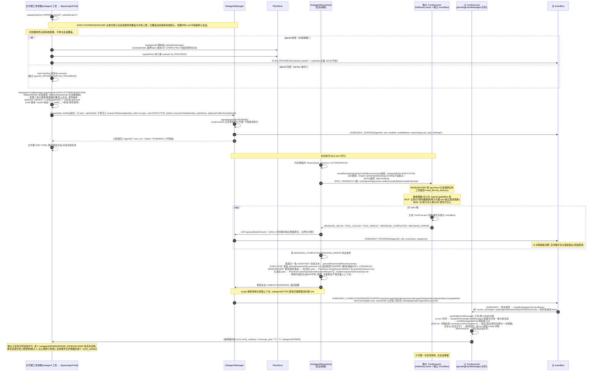

**briefing 隔离 + 报告落盘（2026-10 更新）**：SpawnAgentTool plan 路径 `briefing = null`——不传调用方 `args.briefing`，也不传 `planDetail`（planDetail 可能含处理逻辑，与 spec 产生两套要求）；spec 是唯一实现指令来源。ad-hoc 路径仍传 `task`+`briefing`。`SubagentRunnerImpl.buildExecutorInput` 纯函数组装执行器输入：plan 路径 = 只 spec（task/briefing 都不进输入）；ad-hoc 路径 = task + briefing。纪律指令（5 类 SPEC_FEEDBACK、不猜边界、编译命令由 spec 指定）全部在执行器系统提示词 `forSubagentExecutor()` 中，`buildExecutorInput` 不重复——避免两处漂移。不再注入 `researchNotes` 全文、不再注入 `appendix` 摘录（appendix 字段已删）。executor 需要调研结论时自己 `read_file .mederi/plans/{planId}/research.md`，需要原文件认知时直接 `read_file` 该路径。executor 完成时报告落盘到 `{planId}/reports/NN-executor.md`，父上下文只收尾部 1500 字符 + 路径（尾部捕获 SPEC_FEEDBACK）；researcher 报告**始终落盘**——有活跃 plan 时写 `{planId}/research.md`，无活跃 plan 时经 `PlanStore.writeStandaloneResearchReport` 写 `.mederi/research/{timestamp}.md`，两种情况父上下文都只收头部 800 字符 + 路径（全量报告不再有回灌通道；详情一律 read_file 取盘）。EXECUTOR 无 planId/planStore 或写盘失败时才回退全文回灌。子代理 TurnExecutor 透传 `onTurnDiff` 回调，结束时把文件改动经 `ParentDiffRegistry` 合并进父 turn 的 diffTracker（见 §4 diff 合并说明）。

**per-role 模型解析（2026-09）**：`SpawnAgentTool` / `SpawnResearcherTool` 派发时经 `SubagentConfigManager.resolve(role=EXECUTOR/RESEARCHER, fallbackModel=会话模型, fallbackReasoning=会话推理档)` 覆盖父会话模型——配置了独立模型/推理档则覆盖，否则继承。**apiKeyId 同策略（2026-10）**：派发时读 `SubagentConfigManager.get(role)?.apiKeyId`，非 null 则 `effectiveApiKeyId = config.apiKeyId` 覆盖父会话 apiKeyId（null=继承父），轮询哨兵 `API_KEY_ROTATION_ID`（`"__rotate__"`）原样透传；`SubagentManager.spawn(apiKeyId=effectiveApiKeyId)` → 子代理 TurnExecutor（构造传 `rotationSessionId = parentSessionId`，与父共享轮询计数器）在 resolve 后检测哨兵建 `RotatingLLMClient`（见 §1 runTurn 与 01-core §9.1）。

## 8. 回滚（rollbackMessage）流程

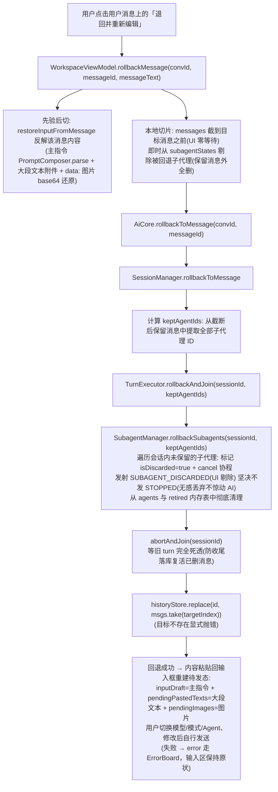

**回滚子代理无感丢弃（2026-09）**：当用户回滚到某一条消息时，若该消息时尚未创立子 Agent（即子 Agent 是在后续被回退掉的对话轮次中生成的），这些子 Agent 会被静默丢弃。`SessionManager` 从保留的历史消息中提取所有合法的 `keptAgentIds`，通知 `SubagentManager.rollbackSubagents`。未保留的子代理标记为 `isDiscarded = true` 并取消运行，发射 `SUBAGENT_DISCARDED` 事件通知 UI 即时移出缓存；**坚决不发射 `SUBAGENT_STOPPED` 事件**，不生成 `<event_message>`，绝不向 AI 汇报，真正实现无感丢弃。

## 8.1 浏览器任务（browser，2026-09-14；2026-09 合并为单一入口）

> 主代理只派发/看状态/停止，浏览器内部对主代理完全透明。BROWSER agent 在后台协程跑
> Koog AIAgent tool-calling 循环（`agent.run` 驱动 call_llm→execute_tools→send_tool_results），
> nodePerceive 当步注入 a11y 快照（axtree）、用完即丢，记忆走 update_memory 工具。
> 细节经 BROWSER_TASK_* 事件给 UI，用户自己看。
> 滚动工具有两种模式——空 refid 走页面级 `scrollPage`、非空走元素级 `scroll`。
> 主代理入口为 `browser` 工具（action=RUN/STATUS/STOP/INFO，委托原 run_browser_task 等四个工具类）。

```mermaid
sequenceDiagram
    autonumber
    participant U as 用户
    participant MA as 主代理 turn
    participant RBT as browser(RUN)→RunBrowserTaskTool
    participant BTM as BrowserTaskManager
    participant BO as BrowserOperator(手和眼)
    participant BB as BrowserBrain(大脑)
    participant BC as BrowserControl(Camoufox)
    participant EB as eventBus
    participant WV as WorkspaceViewModel

    U->>MA: "搜一下51job的Java开发工作"
    MA->>RBT: browser(action=RUN, task, browser="camoufox", recipe="job_filter")
    RBT->>BTM: runTask(task, model, projectId, sessionId, browser, recipe)
    BTM->>BTM: resolve(browser)→factory(suspend)→createBrowserControl<br/>tasks[taskId]=STARTED; scope.launch{...}
    BTM->>EB: BROWSER_TASK_STARTED(taskId, STARTED, browser="camoufox")
    RBT-->>MA: {"taskId":"bt_xxx","status":"RUNNING","browser":"camoufox"} (立即返回, 不阻塞)
    MA-->>U: 主代理继续对话(浏览器任务在后台跑)
    Note over WV: 任意 BROWSER_TASK_STARTED：UI 自动展开浏览器面板
    EB-->>WV: BROWSER_TASK_STARTED(任意 browser)
    Note over WV: openDockPanel(BROWSER)（Camoufox 任务监控）
    Note over BTM,BC: 后台执行(与主 turn 并行)
    BTM->>BC: Camoufox: BiDiBrowserControl(binary 已下载)→start()
    BTM->>BO: operator.run(task)
    loop AIAgent tool-calling 循环(每步)
        BO->>BO: agent.run → call_llm(nodePerceive 注入当步 axtree)
        BO->>BO: LLM 选 tool (judge→BrowserBrain / collect_info→BrowserCollector / update_memory)
        opt 选到 collect_info (多网站信息检索存入临时存储器)
            BO->>BO: collector.add(BrowserCollectedItem(url, siteName, content))
        end
        opt 选到 judge (需要内容判定 / ask_ai)
            BO->>BB: judge(content, instruction, recipeRules, collectedItems)
            BB-->>BO: BrainResult (参考已收集资料返回结构化判定)
        end
        BO->>BC: execute_tools(navigate/click/type/scroll/done... SimpleTool)
        BO->>BO: send_tool_results(注入新 axtree) → 循环
        BO->>BTM: onToolEvent(phase, toolName, step, results)
        BTM->>EB: BROWSER_TASK_STEP(taskId, step, thought=自动文案, results, browser, collectedCount)
        Note over BO: update_memory 工具写记忆; collect_info 暂存条目<br/>axtree 当步注入用完即丢
    end
    BO-->>BTM: BrowserTaskResult(success, rawMessage, collectedItems)
    alt 需要大脑判定 (needsBrainJudgment == true)
        BTM->>BB: generateFinalReport(taskHistory, goal, rawMessage, recipeRules, collectedItems)
        BB-->>BTM: BrainResult (结合已收集资料产出一句话简报 + reports/*.md 落盘)
        Note over BTM,BO: Brain 将判定与简报反馈给操作员，操作员统一准备汇报
    else 无需大脑判定 (直接汇报)
        Note over BTM,BO: 操作员直接采用任务执行 message 准备汇报 (含 collectedItems)
    end
    BTM->>EB: BROWSER_TASK_COMPLETED/ERROR(taskId, role="BROWSER_OPERATOR", summary, reportPath)
    EB-->>WV: 终态事件 (终态一律关闭 Dock 面板并清空 taskId)
    EB-->>MA: TurnExecutor 监听终态 → 组装 <event_message> 自动唤醒主 turn 汇报！
    Note over BTM,BC: 终态一律 withContext(NonCancellable) control.close()（JCEF 销毁会话 Tab / Camoufox 杀进程）
    BTM->>BC: control.close() 关闭底层 Tab
```

> **汇报机制与主代理自动唤醒（2026-10）**：任务结束时复用子 Agent 汇报通道：
> - **两路汇报**：无需判定内容时，操作员（`BrowserOperator`）直接向主 Agent 汇报；需判定内容时（通过 `needsBrainJudgment` 留口识别，如带 judgeRules 配方），操作员先把提取信息交给大脑（`BrowserBrain`）判定，大脑将判定/简报反馈给操作员后，由操作员统一向主 Agent 汇报。
> - **自动唤醒**：任务终态发 `BROWSER_TASK_COMPLETED/ERROR/STOPPED`（携带 `role=BROWSER_OPERATOR`），`TurnExecutor` 订阅并组装 `<event_message type="browser_task_completed">` 放入待发队列，自动唤醒主 Agent 开启新 turn 向用户汇报，无需主代理主动轮询。
> - **用户停止链路（真停）**：UI 浮条「停止」→ `WorkspaceViewModel.stopBrowserAutomation()` 读 `browserAutomationState.taskId` → `AiCore.stopBrowserTask(taskId)` → `MederiAiCore` → `SessionApi.stopBrowserTask` → `BrowserTaskManager.stopTask`：同步置 STOPPED + 发 `BROWSER_TASK_STOPPED` + `cancel(job)`，协程 `finally` 在 `NonCancellable` 上下文 `control.close()` 真正关闭浏览器。UI 不再 `abort()` 主 turn（浏览器任务与主 turn 无生命周期绑定）。
> - **生命周期（终态一律关闭）**：任务终态（完成/失败/停止）一律 `control.close()` 真正关闭浏览器（JCEF 销毁会话 Tab / Camoufox 杀进程）并折叠 UI Dock 面板；已删除基于 isTest 关键词保留现场的旧逻辑。
> 浏览器选择（2026-09）：`browser`(RUN) 的 `browser` 参数缺省 → BrowserRegistry 默认
> （defaultName 优先 → 内置 JCEF 优先 → 第一个注册的）。2026-10 起 JCEF（JcefBrowserControl）
> 重新注册为主力引擎（MederiAiCore 在 kBrowser 非空时条件注册），Camoufox（BiDiBrowserControl）
> 降级为可选 backup；headless server 无 JCEF 时默认 camoufox。
> 任意 BROWSER_TASK_STARTED 都会把浏览器面板展开为浏览器任务监控视图（jcef 任务由 UI host 上报 tab 状态）。
> 浏览器面板在所有端均可展开（遥控端/wasm 同样适用）。

> 执行模型（2026-10 重构）：BrowserOperator 遵循 4-phase 循环（perceive → decide → execute → postprocess）。
> 感知层统一走 **纯 axtree 快照**（`SnapshotMode.CLEAN` YAML，暂时不传截图），单步重建 prompt，杜绝上下文累积与 a11y 快照爆炸；采用 Koog 原生 tool-calling（原生 tool-calling 为唯一路径），页面物理工具
> 由通用工具集 `buildBrowserOperatorTools(control)` 装配（基于 BrowserControl 抽象，jcef/camoufox 后端自动适配），Core 注册内部工具
> （done/update_memory/collect_info/judge/execute_drill），删除无用工具（sleep/back/noop/close/screenshot）；
> 配备 `BrowserCollector` 临时存储器，支持在多网站查找时调用 `collect_info` 暂存 Markdown 内容（含图片链接），解耦上下文避免 Token 膨胀，并在终态由 Brain / 操作员统一汇总；
> `execute_drill` 支持 recipe 挂载脚本（空参执行），drill 定位器支持语义 getBy* 与元素级 press/check/scroll/type；
> 开启浏览器面板时，默认宽度占全屏 2/3（受 maxPanelWidth 保护）；
> 记忆自管理（滑动 stepHistory + update_memory 工具同步至 taskObj.memory），每步发射带真实
> thought、memory 与 action 结果的 BROWSER_TASK_STEP 事件。

> 浏览器子代理模型解析（2026-09-23）：browser(RUN) 派发时，RunBrowserTaskTool 直传父会话模型/推理档
> （不再按浏览器名解析）；BrowserTaskManager.runTask 后台按角色独立解析——操作者
> （SubagentRole.BROWSER_OPERATOR）与大脑（SubagentRole.BROWSER_BRAIN）经 SubagentConfigManager.resolve
> 各取配置的独立模型/推理档（设置页 Agents 面板与 Executor/Researcher 同款卡片可配模型+推理档+恢复继承），
> 配置了独立模型/推理档则覆盖父会话，否则继承；operator/brain 各建独立 llmCaller
> （BrowserLLMHelper 或注入的 llmCallerProvider），Operator 按操作者模型执行、Brain 按大脑模型执行。
> 浏览器实现（jcef 主力 + camoufox backup）仍由 browser(RUN) 的 browser 参数选择，与角色配置无关。

> 会话隔离与 Tab 自治生命周期（2026-10）：
> 1. 会话硬隔离：BrowserTaskManager.runTask 提取 taskObj.parentSessionId 传给 BrowserRegistry.resolve(browser).factory(taskId, sessionId)。桌面宿主 JcefBrowserHost 按 sessionId 维护独立 BrowserSessionState，一个会话即一个独立的浏览器容器，彼此页面与 Tab 绝对隔离；
> 2. 后台常驻与视图换绑：所有 Tab 底层 CEF KBPage 均在后台独立常驻运行。切会话时 UI 仅切换挂载对应 sessionId 的激活 Tab，不中断后台 Tab 的生命周期与自动化任务；
> 3. 子 Agent 自治生命周期：AI 浏览器操作员获取的 JcefSessionBrowserControl 严格受限在其父会话内，支持 tabs(action="NEW/SWITCH/CLOSE/LIST") 自主关闭已完成的 Tab（保留至少一个 Tab 防崩溃）；
> 4. 资源回收闭环：当用户在侧边栏删除会话或项目时，AppState 级联调用 UiBrowserHost.closeSession(sessionId)，彻底关闭对应会话下所有后台 KBPage 并释放 Chromium 资源。

## 9. 会话自动改名（SessionTitleService）

```mermaid
sequenceDiagram
    autonumber
    participant TE as TurnExecutor(durable-first 落库)
    participant EB as eventBus
    participant ST as SessionTitleService(jvmMain, 挂 MederiAiCore.initialize)
    participant MC as ModelCatalog(models.dev 价格目录)
    participant OC as OneShotCompletion(复用用户供应商 Koog 链路, 不发推理参数)
    participant SM as SessionManager.rename

    TE->>EB: SESSION_UPDATED(用户消息已落库)
    EB-->>ST: 事件
    ST->>ST: 首次处理该会话?<br/>标题=="New Session" 且恰好一条 user 消息?
    alt 条件满足
        ST->>ST: 选模型(当前供应商优先→其他已连接; 全量模型不过滤 isEnabled)<br/>① 免费(input==0&&output==0)<br/>② 小模型(flash/lite, 排除 mini)
        Note over ST: 有候选 → 逐个请求, 报错换下一个
        ST->>MC: getFor(providerKey, baseUrl, modelId) 查免费/价格
        ST->>OC: execute(provider, model, key): 候选之一<br/>key = preferredApiKeyId(provider)?.let{getKeyValue} ?: 默认<br/>(候选即当前会话供应商时用该会话最近选定 key, 其余默认)
        OC-->>ST: ≤40 字标题
        alt 全部候选失败
            ST->>OC: execute(用户发信息用的模型): 兜底
            alt 兜底也失败
                ST->>ST: session_yyyy-MM-ddTHH:mm:ss
            end
        end
        ST->>SM: rename(id, title)
    end
    Note over ST: 全程静默不重试; 每会话只处理一次
```

## 10. 遥控链路启动（desktop 内嵌 / 独立 server / wasm 密码门）

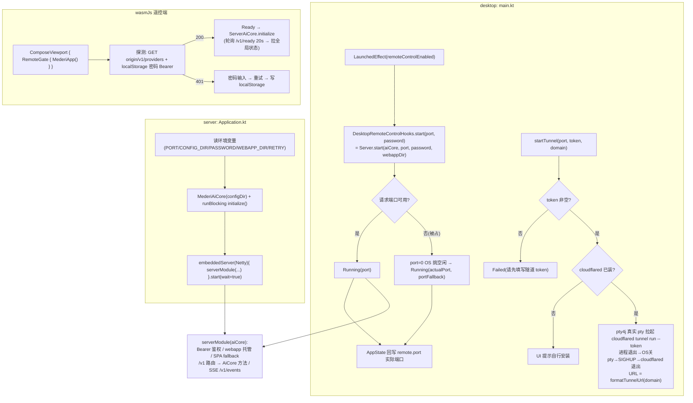

**webapp 资源托管**：desktop 内嵌 wasmJs 遥控 UI——`webappDir` 优先（环境变量 `MEDERI_WEBAPP_DIR` 或探测常见 wasm 产物路径），为空时 `Server` 回退 classpath `staticResources("/","static")`（内置 wasm 产物）；浏览器访问 desktop IP:port 即加载同源托管（SPA fallback）的遥控 UI（详见 02-app-shared.md §9）。

## 11. 初始化时序（desktop 冷启动全链）

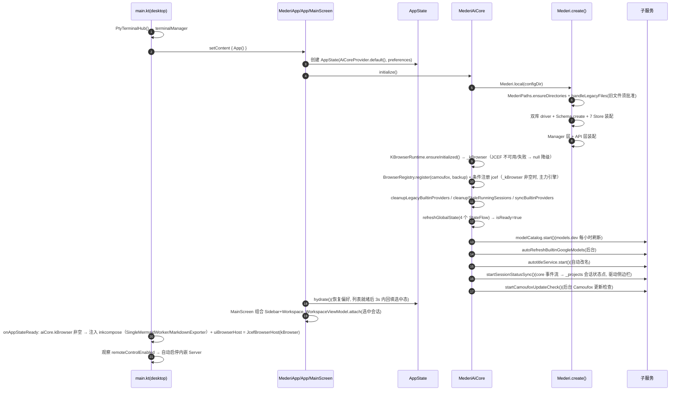

## 12. apply_patch 工具（主代理与 EXECUTOR）

```mermaid
flowchart TD
    W["每次 LLM 请求的工具声明"] --> O["官方 OpenAI Responses: custom + 固定 Lark grammar<br/>custom_tool_call_input.delta 逐片编码为 Koog JSON 参数"]
    W --> G["Chat / 兼容端点 / 其他供应商: function<br/>必填 patch 字符串 + 完整格式说明"]
    O --> P["统一 ApplyPatchArgs → PatchParser.parse"]
    G --> P
    P --> L["解析源/移动目标全部路径<br/>白名单、符号链接、canonical 冲突检查<br/>FileWriteRegistry 整体 try-lock"]
    L --> V["读取原始字节快照，严格 UTF-8 解码<br/>PatchApplier dry-run 全部计算<br/>保留 LF/CRLF/CR/混合行尾和上下文"]
    V -- "预检失败" --> F["磁盘零改动；Error 含路径/行号/缺失上下文"]
    V -- "通过" --> A["重新校验快照/路径后逐项写入或删除"]
    A -- "I/O 失败" --> R["尽力按字节快照回滚<br/>如实返回残余变化与回滚错误"]
    A -- "成功" --> D["A/M/D 摘要 + diff + onFileTouched<br/>移动源/目标独立追踪，覆盖保留原目标内容"]
    R --> T["仍有残余改动时按实际磁盘追踪"]
    D --> U["finally 释放全部路径写锁"]
    T --> U
    F --> U
    U --> H["结果经相同 call_id 回传<br/>Responses custom_tool_call_output / function_call_output"]
```

系统静态提示词在主代理和 EXECUTOR 中均说明补丁调用包装、匹配失败重读及写入失败后先核对回滚结果；RESEARCHER 不注册写工具。固定上游版本、兼容性差异与更新步骤见 `docs/apply-patch.md`。

## 13. 图片发送链路（能力门禁）

```mermaid
flowchart TD
    P1["用户粘贴/选择图片<br/>ClipboardHelper.getImage / tryAttachImage<br/>(剔除放行：模型不支持图片也允许附加，<br/>给一次性轻提示 imageStrippedNotice；附件按钮仍按模型能力显隐)"] --> G1{"guardImageSupport<br/>剔除放行(模型不支持图片时：发送不拒绝，<br/>一次性轻提示 imageStrippedNotice，图片保留在对话历史)"}
    G1 -- "模型不支持(supportsImages=false)" --> N["放行：发送继续，图片从本次 AI 上下文剔除<br/>一次性轻提示：模型不支持图片，发送信息中已剔除（历史保留）"]
    G1 -- "支持" --> A1["ImageAttachment(base64DataUrl) 入 pendingImages"]
    A1 --> SEND["send(text)"]
    SEND --> M1["MederiInputMapper.toMessageParts<br/>图片 → MessagePart.Image(base64 dataUrl)"]
    M1 --> CORE["core SendMessageRequest"]
    CORE --> H1["HistoryStoreChatHistoryProvider(includeImages = model.supportsImages).load<br/>KoogMessageMapper.toKoogMessages(window, includeImages)<br/>用户 Image part → null（AI 上下文无图，历史存储仍带图）"]
    H1 --> K1["KoogMessageMapper.toKoogPart<br/>Image → Attachment(includeImages=true 时图片仍映射为 Attachment)"]
    K1 --> CAP["KoogModelBuilder.buildCapabilities<br/>supportsImages → LLMCapability.Vision.Image<br/>缺 Image 时 Koog 会拒绝图片消息——本方案在 AI 视图层剔除，请求体无图，天然不触发"]
    CAP --> LLM["LLM 供应商"]
```

## 14. 终端（Terminal）数据流

```mermaid
flowchart LR
    TM["PtyTerminalHub(TerminalManager 实现, JVM)<br/>key→常驻 shell(pty4j, TERM=xterm-256color)"] --> |output 流| TS["PtyTerminalSession"]
    TS --> HUB2["64KB scrollback 环形缓冲<br/>(新客户端 attach 先回放再续流)"]
    HUB2 --> TVM["TerminalViewModel(多 tab 状态机: tab/未读/错误/结束)"]
    TVM --> TV["TerminalView(expect: desktop=jediterm+SwingPanel;<br/>wasm/移动端=遥控端占位)"]
    TV -- "write stdin/resize/kill" --> TS
    Note["生命周期: 会话随宿主进程;<br/>进程退出→OS 关 pty master→SIGHUP→shell 退出"]
```

## 15. 状态机汇总

**Session 状态机**：`IDLE → (sendMessage) RUNNING → (正常) IDLE`；`RUNNING → (可重试错误) IDLE(限流提示)`；`RUNNING → (致命错误) ERROR → (下次 sendMessage 前校验失败)`；`RUNNING → (abort) IDLE`。

**契约层会话状态（ConversationStatus，SnapshotReducer）**：4 值 `Idle / Working / Error / WaitingUser`——`QUESTION_REQUESTED`/`PLAN_APPROVAL_REQUESTED` → **WaitingUser**（同时把流式占位消息 isStreaming 置 false，交互挂起），对应 `QUESTION_RESOLVED`/`PLAN_APPROVAL_RESOLVED` → Working；双侧（进程内与 SSE 遥控端）经 `startSessionStatusSync` 同步驱动侧边栏状态点。**子代理延长 Working（jvm 桥 + SSE 遥控端，2026-10）**：`SUBAGENT_STARTED` → Working（agentId 记入 `runningSubagentIds`，MederiAiCore 用 core `EventType`、ServerAiCore 用契约 `CoreEventType`，逻辑一致）；子代理终态（COMPLETED/ERROR/STOPPED/DISCARDED）移出集合，集合清空且主 turn 不活跃（`mainTurnActive=false`，MESSAGE_COMPLETED/ERROR 置 false、SESSION_UPDATED 置 true）才回 Idle；**MESSAGE_COMPLETED 时子代理集合非空 → 保持 Working**（主 turn 结束但子代理仍在后台跑，侧边栏不误闪 Idle）。

**统一输入（见 §2.1）**：所有发送走 Core 单入口；执行期间输入先落库为 pending，在工具边界/文本输出后的安全点消费。收尾串行检查 pending，存在则继续；只有确认结束才提交最终消息。UI 无待发队列。

**Message 状态机**：`PROCESSING(streaming 占位) → COMPLETED / ERROR`；快照里 isStreaming 对应 PROCESSING。

**Plan 状态机**：`PENDING_APPROVAL → (批准) APPROVED → (spawn 首子任务) IN_PROGRESS → (全子任务 COMPLETED) COMPLETED → archive(plans-done/)`；`PENDING_APPROVAL/APPROVED/IN_PROGRESS → (write_plan 前置 voidActivePlans) VOIDED → .mederi/plans-voided/`；`PENDING_APPROVAL → (拒绝) 停留/用户重试`。

**Subtask 状态机**：`PENDING → (spawn) IN_PROGRESS → (verify PASS) COMPLETED`；`IN_PROGRESS → (verify FAIL/PARTIAL) FAILED → (converge_plan 追加补救 或 regenerate spec) 重执行`。

**ToolCallState（契约层）**：`Pending → Running → Completed / Failed`。

**RemoteServerUiState**：`Idle → Starting → Running(port, portFallback?) / Failed`；**TunnelUiState**：`Idle → Starting → Running(url) / Failed(reason, notInstalled)`（`url` = `formatTunnelUrl(domain)` 用户填域名拼 `https://` 的结果；`notInstalled=true` = 本机未装 cloudflared，AppState.kt L72-73）。


### 工作反馈投影（2026-10-28）

```mermaid
flowchart TD
    CORE[Core 工作开始 / workStartedAt] --> RESP[稳定响应 ID / 标准推理正文工具事件]
    RESP --> SEG[UI 按用户消息分段 / 不跨插话合并]
    RESP --> CHILD[子代理原始事件 / eventJson + sequence]
    CHILD --> REDUCE[与主代理共用 ConversationStateReducer]
    REDUCE --> SEG
    SEG --> TRACE[默认折叠 / spinner + 结构化活动摘要]
    RESP --> STAGE[正常 turn 收尾 / finalMessageId]
    STAGE --> VISIBLE[完整阶段回复外显 / 派发条与交互卡外显]
    STAGE --> CHECK{还有子任务或待唤醒事件?}
    CHECK -->|有| RESP
    CHECK -->|无| END[workCompletedAt / 冻结墙钟]
    END --> TRACE
```

SubagentManager 同步追加 progressEvents 并编号；快照重放后按序号去重，终态不被旧 RUNNING 快照覆盖，空快照成员集合有效。客户端不从普通文本猜消息类型，也不从下一工具事件推测上个工具已完成。


### 对话表现层第二批（2026-10-29）

过程折叠继续由组件本地展开态驱动，新增标准expand/collapse语义不改变Core交付/任务状态。问答仍以外部selectedAnswers为真理源，单/多选、自定义、翻页、提交、取消沿原回调；计划查看与pending批准为独立点击目标，其他状态仅显示真实标签。错误详情/恢复/关闭互不触发；StatusBar继续只读既有TurnStatus和计时锚点，背景任务不参与全局忙态。共享卡壳/动作按钮仅表达视觉，未改send/abort/接续/审批链路。


### 文件与阅读器表现层第三批（2026-10-29）

FilesPanelTabs/ArtifactTabs/DiffFilesContent仍向原VM入口转发选择/刷新；文件卡/树仍经openDocument统一路由，不另建文件打开或任务生命周期。ProjectTreeContent刷新按钮递增refreshTick并使树内容key失效→重新查询同一provider→使用既有query/expandedPaths/activePath渲染；没有把刷新理解成清空阅读位置。图片工具栏只切本地比例，文本工具栏只发复制/导出回调；导出继续原DocumentExporter与exportingNow互斥机制。多文档只减少工具栏重复标题，不修改Markdown正文，也不改变主输入焦点与异步任务接续机制。


### 辅助面板表现层第四批（2026-10-29）

共同Header关闭→原onClose/onDismiss→隐藏面板，不改任务事实；TerminalTabs关闭→原closeTab(key)→终止该shell，和隐藏终端面板分开。终端Route的bootstrap/ensureSession与session.isRunning监听保持，纯视图只显示事实和转发选择/关闭/新增/恢复意图。

子代理停止→按当前agentId持有确认表现态→用户确认且仍RUNNING→原stopSubagent(agentId)；切agentId复位确认，同目标完成也收起并清理确认，不保留过期停止操作。对话正文仍共用ChatListContent与按agentId阅读状态。

浏览器自动化Dock→直接渲染BrowserAutomationPanelContent（不依赖浮动展开）；浮动Popover→同一内容。stop/preview沿原VM入口；状态只读BrowserAutomationUiState，不从结束推导成功。全部步骤使用稳定step.id，用户在底部才跟随追加；流式推理/输出独立滚动。网页宿主BROWSER路由保持，无host显示真实说明；原生PTY/网页遮挡与focus不以组件测试替代实机验收。


### 工作台第五批：诊断与概览步骤（2026-10-29）

资源采集仍由AppState提供ProcessStats → Workspace收集 → SystemInfoBar；点击只改变View本地expanded，默认收起，不暂停/启动采样。原始消息仍由RawMessagesViewModel绑定会话、派生字段与格式化JSON，UI按会话+seq保存展开/复制呈现，复制prettyJson维持原行为；JSON独立工具栏不阻挡阅读。Todo与计划通过WorkspaceTaskStep共用图形表现，状态与数据独立；计划批准、原文、Spec仍发VM原目标，步骤展开按计划ID隔离。所有动作不改变主对话与后台任务并行生命周期。


### 工作台第六批：公共弹层（2026-10-29）

模型/Key/推理/项目选择的数据与VM写入不变，菜单仅委托共享壳/行；原生dismiss独立于选择回调。确认/输入仍由调用方决定关闭和业务操作，公共Dialog只处理布局与原平台dismiss，View本地草稿不变；关闭弹层不产生停止任务意图。Dock点击只发onSelectPanel目标，selected读activePanel，Tooltip不介入选择。Help点击/焦点/hover只控制呈现，Esc/外部点击收起。错误报告仍调用既有formatter构造，复制相同Markdown、提交Bug仍复制并打开相同预填URI，不自动发送Issue。


### 设置S1：布局与设备偏好（2026-10-29）

SettingsDialog仍默认AGENTS，七类路由保留。SettingsOverlay背景点击或显式关闭→原onClose；内容空白拦截穿透不发关闭，关闭设置不发后台任务停止。SettingsWorkspaceContent只发分类选择和关闭，宽窄导航共用同一selectedTab。GeneralSettingsPanel收集AppState.theme/language→纯Content→原setTheme/setLanguage设备本地持久化，未建立第二套配置；SystemSettingsPanel复制原完整值，沿用CopyFeedbackScope反馈。保存/服务/供应商链路无变化。


### 供应商S2a：管理/目录/凭据（2026-10-29）

```mermaid
stateDiagram-v2
    [*] --> Manage
    Manage --> Catalog: 添加供应商
    Manage --> Detail: 选已配置ID（窄屏下钻）
    Detail --> Manage: 返回列表
    Catalog --> Manage: 返回管理
    Catalog --> Preset: 未配置预设
    Catalog --> Detail: 单个已配置内置ID
    Catalog --> Manage: 多个匹配ID集合过滤
    Catalog --> Custom: 自定义端点
    Preset --> Catalog: 返回（清Key草稿、保留目录query/scroll）
    Custom --> Catalog: 返回或取消
    Preset --> Preset: 提交失败，保留Key与真实错误
    Preset --> Detail: AiCore成功，新ID选中/原自动同步
    Custom --> Detail: 原创建成功
```

宽屏Manage/Detail同为已配置列表+原详情；目录替换整供应商工作区，静态preset名单不再常驻管理侧栏。三种查询分别管理providers、presets、models；不互相覆盖。添加/保存同步置saving防重复，期间不能切添加步骤；结果失败不关闭，成功后才回Detail，字段只在Composition中不进偏好。ErrorBoard是统一错误呈现；原详情成功计时只清success，不能误清后来失败。未改变Core/REST/存储契约。


## InkCompose 文本选区与菜单（2026-10）

```mermaid
flowchart TD
    Input[鼠标按下拖动 / 触摸长按] --> Gesture[SelectionGestures]
    Gesture --> Anchor[实际文字布局坐标 → stableId + 字符偏移]
    Anchor --> Range[MarkdownSelectionController 归一化跨块选区]
    Range --> Highlight[可见文本片段高亮 / 触屏手柄]
    Range --> Edge[拖至可见区边缘 → 逐帧滚动内部或父列表 → 重算字符锚点]
    Range --> Menu[右键或触屏松手请求菜单]
    Menu --> Items[按 SelectionMenuAction 数组渲染]
    Items --> Copy[Copy → 全文逻辑索引抽取 → 平台剪贴板]
    Items --> Paste[Paste → 宿主 onPasteRequested → 可编辑目标]
    Items --> Custom[Custom → 开发者回调 + 选中文本]
    Menu --> Dismiss[关闭菜单保留选区]
```

普通触摸滑动不启动选区；正文、代码行和表格单元格共用逻辑选区；TEXT/CODE 字面量入口与 Markdown 使用同一菜单链。没有粘贴目标时 Paste 禁用，不修改只读文档。菜单默认仅 Copy/Paste，自定义数组完整决定内容和顺序，空数组无菜单。


### 供应商S2b：纯详情与表单（2026-10-30）

ProviderSettingsViewModel事实 → Route绑定ProviderDetailActions → ProviderDetailContent/ModelItemRow发原精确目标回调；模型查询/筛选/批量/刷新/自动设置/新增/删除维持原链路。UI按provider.id隔离弹窗与阅读状态，移除正在编辑的model后收起，避免旧目标兜底。同步失败使用共同ErrorBoard，只有刷新恢复动作，无假的dismiss；成功计时仍只清success。

编辑模型按现有权限分支：MANUAL完整onSave → updateModelConfig → 原AiCore；FETCHED其他字段只读、图片onSave → 已有setImageOverride → AiCore.updateProviderModel(supportsImages=...)，不发送被保护元数据。Key编辑保持原名称/端点/JSON原值，只有新Key输入才写入；空Key沿原VM变成null保留，DTO掩码不再作为请求值。Key管理仍按keyId设默认/删除，旋转哨兵不作真实Key呈现。此批没有改Core权威或REST/存储。


### Agents 设置 S3：读取、保存、失败恢复（2026-10-30）

```mermaid
flowchart TD
    Route[AgentSettingsPanel 进入] --> VM[AgentSettingsViewModel]
    VM --> R1[listSubagentConfigs]
    VM --> R2[getSubagentGlobalSettings]
    R1 --> UI[不可变快照到纯 Content]
    R2 --> UI
    UI -->|角色模型 / 推理 / 精确 Key ID| W1[updateSubagentConfig 全量三个字段]
    UI -->|并发步进| W2[updateSubagentGlobalSettings]
    W1 -->|成功，保持角色操作禁用| R1
    W2 -->|成功，保持并发操作禁用| R2
    W1 -->|失败，保留原快照| E[共同 ErrorBoard]
    W2 -->|失败，保留原快照| E
    R1 -->|失败，不作为空配置| E
    R2 -->|失败，不制造默认并发值| E
    E -->|重新读取对应区| VM
```

角色/并发是独立请求区；角色的三个字段通过现有API全量保存，写和回读结束前拒绝下一次角色写，避免旧快照覆盖。模型切换保留该模型支持的原推理值，否则送null；恢复继承提交三个null。Key null/精确ID/`API_KEY_ROTATION_ID` 原样传递Core，UI不解析运行时凭据。配置列表读取失败保留旧快照但禁用写；global读取失败置null，禁止伪装默认2。写失败可保留已确认快照继续操作。并发UI仍1–16；如果Core已有更大值，允许按原步进规则减小，不自动钳制写库。此链路仅设置表现协调，不改变子代理派发/异步工作生命周期。


### Skill/MCP 管理弹窗 P0（2026-10-30）

```mermaid
flowchart TD
    Draft[弹窗局部草稿] -->|非空提交，按原规则trim| Guard[DialogSubmissionState 同步busy去重]
    Guard --> Callback[领域回调]
    Callback --> Store[原SkillStore / McpStore]
    Store --> Core[原AiCore API]
    Core -->|Result成功| Refresh[Store按原流程刷新]
    Refresh --> Close[成功关闭弹窗]
    Core -->|Result失败| Error[保留草稿/目标，显示共同ErrorBoard]
    Error -->|再次提交| Guard
    Guard -->|在途| Disable[禁用字段/确认/取消及Escape外部关闭]
```

安装、目录保存、MCP新增/编辑保持原API与trim边界，MCP JSON内部内容原样传递Core。Skill卸载原回调忽略Result，现回传Result给共用提交协调器：成功关闭、失败留在共同危险确认内显示错误，精确技能名称由Overview原目标传入。局部提交scope随弹窗释放，取消异常不转成失败提示；没有新业务Store或服务端契约。目录挑选取消不保存；挑选期间禁用操作但不冒充正在保存。压缩跳过提示只换共同表现，原单确定/事件路由保持。


### 统一动效偏好与表现生命周期（2026-10-30）

```mermaid
flowchart TD
    Pref[设备 PreferencesStore ui.motion.reduced] --> Hydrate[AppState.hydrate]
    Choice[外观设置 标准 / 减弱] --> Set[AppState.setReducedMotion]
    Set --> Pref
    Hydrate --> Flow[reducedMotion StateFlow]
    Set --> Flow
    Flow --> App[App collect → AppTheme]
    App --> Policy[LocalWorkspaceMotion]
    Policy --> Finite[反馈120 / 展开180 / 面板200；减弱即时]
    Policy --> Loop{running 且可见面积 且非减弱}
    Bounds[布局裁剪后 boundsInWindow] --> Loop
    Loop -->|是| Animate[任务2400单色alpha / 请求1000线性旋转]
    Loop -->|否| Static[静态状态与文字/数量；不创建循环]
```

显隐/终态/设备动效偏好只控制表现，不触发停止任务/阻塞输入/切会话/改工作计时。组件移出组合释放动画；移出裁剪区停止循环，再出现重新开始视觉周期，不把视觉相位当真实进度。此链不经过AiCore/Server，两个设备连接同Core可分别选择动效。窗口失焦与系统偏好自动检测未实现；第三方/原生控件内部不宣称统一。


### 设置 S5：宿主控制与局部草稿（2026-10-30）

```mermaid
flowchart TD
    API[AiCore 项目权限API] --> Projection[AppState.ProjectPermissionStore 每项目投影]
    Projection --> VM[SandboxSettingsViewModel.bindProject]
    Projection --> Composer[输入框权限与计划图标菜单]
    VM -->|真实设置及后端能力| Sandbox[SandboxSettingsContent 两档及四组规则]
    Composer -->|切换档位| Write
    Sandbox -->|用户选择，提交后回显| Write[AiCore.updateSandboxSettings]
    Write --> Store[SandboxApi → SandboxManager → SettingsStore]
    Remote[AppState遥控/隧道流 + 宿主地址] --> Content[RemoteSettingsContent]
    Content -->|密码草稿随原开关提交| Toggle[AppState.setRemoteControl]
    Content -->|Token/domain原值即时提交| Setter[AppState原setter]
    Content -->|开始/停止/失败重试| Actions[AppState原服务/隧道动作]
    Content -->|页面隐藏/切换| None[仅释放表现，无服务动作]
```

沙盒设置已迁移AiCore，遥控端读写执行宿主，读取失败不伪造设置或乐观放权；RemoteControlHooks仍是遥控宿主能力。遥控缺LAN地址只说明，不构造假LAN；隧道没有URL但已运行时仍允许原停止动作。密码显隐不保存/重启，密码编辑仍需关闭再开启生效；Token与域名仍按原立即保存。内嵌server端口回退/密码门、cloudflared命令、服务/隧道互相依赖与真实启停规则均未改变。设置View验证使用fake AiCore/callbacks，不启动产品server。


### R03a：一次性效果路由（2026-10-30）

```mermaid
flowchart TD
    VM[WorkspaceViewModel既有UI命令入口] --> Ch[Channel UiEffect · 稳定receiveAsFlow]
    Ch --> Host[MainScreen Route唯一rememberWorkspaceEffectState]
    Host --> Settings[settingsVisible → SettingsDialog]
    Host --> Notice[compactionNotice → 原提示]
    Host --> Menu[projectMenuExpanded]
    Menu --> Workspace[Workspace三种布局]
    Workspace --> Composer[ChatInputCard欢迎/有消息分支]
    Composer --> Selector[受控ProjectSelectorMenu]
    Selector -->|打开/关闭、选择或目录入口| Local[updateProjectMenuExpanded]
    Local --> Menu
    Settings -->|关闭| Close[仅改Route本地状态，不发命令]
    Notice -->|确定/关闭| Close
```

输入框不再与MainScreen竞争receiveAsFlow，也不再用递增openRequest重开菜单。原先计数大于0的菜单关闭后，重建输入分支仍可能再次执行LaunchedEffect并重开；现在同一bool已经false，重建叶子保持关闭，只有新命令或按钮才打开。Route重组不换收集器，切会话不重播已消费命令；窗口卸载取消收集，新的未消费缓冲命令仍按原Channel语义交给下次Route。目录选择前先关闭菜单，再发原回调。Core/会话/输入/压缩业务生命周期与原生目录选择机制不变。


### R03b：后台任务查询订阅、会话与停止隔离（2026-10-30）

```mermaid
flowchart TD
    Route[Workspace Route · 概览偏好已加载且可见] --> Lease[observe租约；最后释放只暂停查询]
    Attach[WorkspaceViewModel.attach] --> Bind[Presenter.bind session]
    Lease --> Job[唯一当前poll Job]
    Bind --> Job
    Job --> Ready[等待Core ready]
    Ready --> Read[listBackgroundTasks session · 串行]
    Read --> Guard{session与generation仍有效?}
    Guard -->|否| Ignore[丢弃迟到结果]
    Guard -->|是| State[对应会话任务快照/错误]
    State --> Wait[等待2秒或合流刷新信号]
    Wait --> Read
    State --> UI[纯概览Content]
    UI -->|用户停止精确running任务| Stop[捕获session+taskId，逐ID去重]
    Stop --> Core[原AiCore.stopBackgroundTask]
    Core -->|成功| Refresh[当前仍同会话时刷新；不造终态]
    Refresh --> Wait
    Core -->|失败| Err[原会话逐ID stopErrors，直到重试成功或关闭]
    Err --> UI
```

取消查询/隐藏概览/切会话不调用Core停止。旧请求即使NonCancellable晚返回也被代际拒绝；同会话隐藏再显示也形成新代际。用户明确发出的停止不受query租约取消影响，结果只回原session；新会话不能发出旧任务ID停止。成功读取不清停止错误。查询失败保留最近成功任务快照并显示错误，不假空成功；取消不伪装失败。首次加载用共同等待指示，有快照后定期刷新静默以避免周期布局跳动。对话输入/主turn生命周期与后台任务执行不变。

### R03c：点击报告后的本地读取流（2026-10-30）

```mermaid
flowchart TD
    Event[事件卡点击，只传title] --> VM[VM按session+event构造ReportRequest]
    VM --> Kind{后台事件且无独立报告?}
    Kind -->|是| Text[按原事件正文打开Text]
    Kind -->|否| Tab[Report产物立即打开]
    Tab --> Loader[ReportLoadPresenter.select]
    Loader --> Cached{请求和来源身份匹配缓存?}
    Cached -->|是| Display[纯ReportReaderContent]
    Cached -->|否| Read[Default dispatcher宿主readTextResult]
    Read --> Guard{活动目标和Entry代际仍有效?}
    Guard -->|否| Ignore[忽略旧返回，不改标签或选择]
    Guard -->|是| Result[Content / Missing / Error]
    Result --> Display
    Display -->|显式重读| Retry[强制新代际读取]
    Retry --> Read
    Switch[换文档/隐藏面板/换会话] --> Cancel[取消读取，Loading回Idle]
    Cancel --> Guard
```

报告完成不触发文档选择，不阻塞主对话和后台任务。关闭只取消本地读取，重新打开复用缓存或原来源继续读取；旧会话标签不误用新项目根。异常与缺失明确区分，摘要单独标明来源并保留原值，不当全文；后台任务原始事件正文不经过报告缺失分支。原复制/导出流程保持。

### R02a/b阅读上下文切换（2026-10-30）

```mermaid
flowchart TD
    Intent[打开/选择文档] --> Owner{当前阅读归属}
    Owner -->|已有会话| Session[ReaderOwner.Session]
    Owner -->|新对话| Draft[ReaderOwner.Draft 当前project]
    Session --> Store[VM不可变ReaderPresentationState]
    Draft --> Store
    Store --> Projection[当前活动Text叠加Core实时投影，Report叠加读取状态]
    Projection --> View[纯ReaderPanelContent]
    View -->|选择/重读| Intent
    Switch[切会话/项目] --> Cancel[使请求序号失效，清待确认，暂停报告读取]
    Cancel --> Owner
    File[异步文件读取捕获owner与provider] --> Guard{owner与序号仍匹配?}
    Guard -->|是| Store
    Guard -->|否| Ignore[忽略，不打开文档/确认]
    First[首发创建成功且仍在原草稿] --> Promote[Draft标签移交新Session，删除旧draft条目]
    Promote --> Store
```

Core快照不参与本地文档列表/选中ID合并，因此不冲掉用户选择。明确关闭Dock不丢文档，切回恢复原会话选择，报告仅在阅读器可见时继续加载；主对话与后台工作互不阻塞。本批保留原Dock兼容归属及导出流程，不把纯View接口误称为全部Route/Screen迁移。

### R02a/b diff查询的可见性与范围（2026-10-31）

```mermaid
flowchart TD
    Open[打开全会话或指定messageId的变更] --> Dock[立即打开DIFF面板]
    Open --> Request[DiffPresenter记录session+messageId与初始文件路径]
    Dock --> Visible[setVisible true]
    Visible --> Load[Core getFileDiffs 原查询契约]
    Request --> Load
    Load --> Guard{仍为当前session/代际且可见?}
    Guard -->|否| Ignore[忽略返回，不打开Dock]
    Guard -->|是| State[成功快照/真实空结果/错误反馈]
    State --> UI[纯DiffQueryContent]
    UI -->|刷新/重试| Same[保留当前messageId与有效选择]
    Same --> Load
    Leave[关闭/其它面板/切会话] --> Cancel[取消查询并推进代际]
    Cancel --> Guard
    Return[切回同会话] --> Cache[恢复范围/选择/内容]
    Cache -->|此前未完成且面板可见| Load
```

查询完成不调用updateActiveDockPanel，避免关闭后回弹或新会话被旧结果覆盖。同范围刷新保留最近快照，新范围清旧内容；失败不当成成功空结果，取消不当失败。停止/回滚/任务执行链路不变，后台工作与主对话不受影响。主对话错误归属另批处理。

### R02a/b主对话错误与操作反馈（2026-10-31）

```mermaid
flowchart TD
    Core[会话Core快照错误事实] --> Accept[按Session接受ErrorState投影]
    Op[发送/创建/回滚的用户操作] --> Ticket[捕获原Session或Draft与sequence]
    Ticket --> Await[原Core接口照常执行]
    Await -->|失败| Guard{原目标sequence仍有效?}
    Guard -->|是| Local[仅写原目标本地错误]
    Guard -->|否| Ignore[忽略过时反馈，不取消Core结果]
    Accept --> State[当前owner只读错误投影]
    Local --> State
    State --> UI[原ErrorBoard与ErrorDetailDialog]
    UI -->|关闭| Dismiss[记录具体Core错误身份，清本地提示/详情，递增sequence]
    Dismiss --> State
    Core -->|同一错误快照| Keep[保留用户关闭]
    Core -->|不同非空错误| Fresh[新错误可见，旧票据失效，旧详情关闭]
    Fresh --> State
    Switch[切会话或新对话项目] --> Bind[换owner，关闭离开目标的详情]
    Bind --> State
```

本地失败不继承Core诊断/ID/断流“继续”能力；Core为运行错误事实唯一来源，关闭不修改Core。创建失败归原项目Draft，创建后的发送失败归新Session。回滚成功仅在原会话/输入上下文、票据、草稿文本与附件都仍匹配时恢复编辑，避免迟到结果覆盖新会话或后来输入；Core回滚本身不受UI守卫取消。发送接纳/稳定ID/对账与后台异步工作机制保持。


### Linux 命令沙盒准备与执行（2026-10-31）

```mermaid
flowchart TD
    Shell[ShellTools 前台/后台/验证命令] --> Permission[ExecutionPermissions 按当前模式授权]
    Permission -->|default 或批准network| Wrap[CommandSandbox.wrap]
    Permission -->|完全访问或批准off| Plain[有黑名单仍强制后端 否则裸跑 + 进程组包装]
    Wrap --> Version[LinuxCommandSandbox: bwrap 版本探测]
    Version --> Roots[canonical 白名单校验及精确创建缺失目录]
    Roots --> Probe[只读根/可写bind/保护ro-bind/dev/proc + 默认net namespace及seccomp完整烟测]
    Version -->|失败/超时| Error[保留原始错误；命令不执行]
    Roots -->|非法路径或创建失败| Error
    Probe -->|失败/超时| Error
    Probe -->|通过；本次后端实例缓存配置| Exec[setsid + 同一挂载配置 + shell 命令]
    Exec --> Registry[ProcessRegistry 登记与原有回收链]
    Error --> Foreground[前台返回 exitCode=-1]
    Error --> Background[后台返回启动错误；不创建任务]
```

版本探测与完整烟测各限 10 秒。Linux 不再降级裸跑，不把失败统一归因于 AppArmor；安装或修正宿主配置后，下个 turn 重新探测。macOS使用可信内联Seatbelt profile，默认无命令网络；Windows受限后端未实现，失败即停，仅显式off批准/完全访问可无沙盒运行。


### 宿主权限与并发批准（2026-11-01）

```mermaid
sequenceDiagram
    participant UI as 设置或对话UI
    participant Core as AiCore / SandboxApi
    participant M as SandboxManager
    participant T as 文件/命令/验证工具
    participant OS as OS沙盒
    UI->>Core: updateSandboxSettings(projectId, 两档/四组规则/version)
    Core->>M: 校验→SettingsStore持久化→内存与代次提交
    M-->>UI: 设置变更事件；旧待批SETTINGS_CHANGED
    T->>M: 当前配置+代次 / 必要时注册独立requestId
    M-->>UI: EXECUTION_APPROVAL_REQUESTED（子代理归父会话）
    Note over M,T: 多请求独立等待，状态锁不跨await
    UI->>Core: resolveExecutionApproval(原conversationId,requestId,approved)
    Core->>M: 校验归属/活体/代次，仅处理此ID
    M-->>UI: EXECUTION_APPROVAL_RESOLVED
    M-->>T: 唤醒原调用
    T->>T: 核对代次、canonical目标与取消状态
    T->>OS: 按已授权边界执行
    Note over M,UI: 快照取活体表；重启不从历史恢复授权
```

主turn finally仅cancelExecution自身；abort/rollback清理本会话子代理与全部待批，新用户输入仍走统一sendMessage接纳入口。后台子代理仍有待批时，主turn阶段交付/其它delta/解除另一交互都不能撤销WaitingUser或折叠审批卡。文件批准前不mkdir；补丁整体收齐源/移动目标再申请；network仅打开该命令网络，off/FULL解除默认文件沙盒，但显式项目黑名单仍禁止读写。


### 项目权限控制与窄屏输入栏（2026-11-01）

项目侧栏三点菜单或执行权限下拉 → OpenProjectSettings(projectId) → 窗口路由 ProjectSettingsPanel → SandboxSettingsViewModel.bindProject → ProjectPermissionStore.state(projectId)。输入栏用当前对话所属项目（新对话用选中项目；已有对话归属尚未加载时不回退到其它项目），共享同一投影；无需依赖打开设置页才能加载。模式/四组规则提交经 AiCore 带 version 保存，成功才回显；SANDBOX_SETTINGS_CHANGED 按 payload.projectId 回查，不会使其它项目配置或草稿失效。

桌面输入栏 FlowRow 只放“权限与计划”图标，tooltip及可访问名称包含当前两项状态；点击菜单将项目执行权限和“计划：自动/手动批准”分组列出，发送按钮独立。手机输入选项 sheet 直接展开同样两组内容，避免嵌套菜单。项目设置在窄屏占满可用区域，规则编辑器随可用宽度回流，不放到狭窄侧栏中。

执行工具先读取所属项目快照 → 路径/命令显式拒绝则失败 → default受限执行或匹配允许前缀免提升审批 → 其余network/off/越界写注册一次申请。设置变化仅取消该项目申请、递增该项目代次；启动/落盘前复核。不同项目保持独立。


### Worktree 创建、Handoff 与崩溃恢复流程（2026-11-02）

```mermaid
sequenceDiagram
    participant UI as 会话UI / Presenter
    participant Core as MederiAiCore / WorkspaceApi
    participant WM as WorkspaceManager
    participant Git as GitWorkspaceDriver
    participant DB as WorkspaceStore / DataDatabase
    participant Turn as TurnExecutor

    Note over UI,WM: 1. Durable-first 首次消息接纳
    UI->>Core: createConversation(input with WorkspaceDraftSelection)
    Core->>DB: 持久化 Session (REQUESTED) + 第一条用户消息
    DB-->>UI: 消息成功落盘（防止断线丢失用户意图）
    Core->>WM: prepareWorkspace(workspaceId, ...)
    WM->>Git: 校验baseCommit / 锁定仓库
    WM->>Git: 创建独立工作树检出 (CREATE_CHECKOUT)
    WM->>WM: 复制环境与包含文件 (COPY_CONTENT)
    WM->>WM: 执行环境 setup (SETUP，若需审批则等待审批门禁)
    WM->>DB: 原子 CAS 提交绑定 (COMMIT_BINDING)
    WM-->>Core: 工作区 READY
    Core->>Turn: 启动主模型执行 Turn

    Note over UI,WM: 2. 双向 Handoff 事务流程
    UI->>Core: previewHandoff(sessionId, targetKind, targetBranch)
    Core->>WM: 生成 HandoffPreview（含改动量、冲突、受影响会话，60s 过期）
    WM-->>UI: HandoffPreview
    UI->>Core: executeHandoff(previewToken, stopAffectedSessions)
    WM->>WM: 校验 previewToken 与 dirty 目标（脏目标硬拒绝）
    WM->>Git: 转移分支检出所有权与暂存/未跟踪状态
    WM->>DB: 原子提交新会话工作区绑定与操作记录
    WM-->>UI: 成功切换工作区

    Note over UI,WM: 3. 崩溃恢复与取消
    Core->>WM: 初始化扫描未决操作
    alt 目标工作区与后像一致
        WM->>DB: 幂等提交绑定并清理操作
    else 存在未知外部变动或损坏
        WM->>UI: 报告 RECOVERY_REQUIRED
        UI->>Core: executeRecovery(KEEP_VERIFIED_CURRENT 或 RESTORE_TO_NEW_MANAGED)
    end
```

**执行租约与操作日志（RF-04/RF-06/RF-07，2026-11-02 整改）**：
- **Turn 执行租约（RF-07）**：`TurnExecutor.runTurn` 对解析出的执行工作区 checkout 调用 `WorkspaceLeaseManager.acquireExecutionLease`，为**整个 turn 时长**持有执行租约，`finally` 中释放（不早于工具/子代理/收尾清理）；子代理 TurnExecutor 继承同一 `leaseManager`。归档/配额经 `withManagementIntent` 先设置管理意图并**等待 active 执行租约归零**后再快照——快照包含等待期间的 late writes；等待超时抛 `WORKSPACE_BUSY`（turn 正确启动失败，不静默降级）。
- **Archive 流程（持久 RUNNING 日志，任意点崩溃可恢复）**：持久化 RUNNING + `ArchivePlan`（phase=SNAPSHOT）→ `captureSnapshot`（PREIMAGE 含 ignored）→ 回填 `snapshotId`（phase=CLEAN_SOURCE）→ `git worktree remove --force` → remove 后、数据库提交 ARCHIVED 前先持久 COMPLETE 阶段日志 → 提交 `ARCHIVED`（generation+1）+ `SUCCEEDED`。崩溃恢复（`recoverSingleOperation` ARCHIVE 处理器）：checkout 已删 + snapshot → 幂等完成；checkout 仍在 + snapshot → 重试 remove；无 snapshot → 安全回滚 READY；未知态 → RECOVERY_REQUIRED。
- **Handoff 流程（持久 RUNNING 日志）**：`withManagementIntent`（QUIESCE）→ 持久化 RUNNING + 完整 `HandoffPlan`（phase=SNAPSHOT）→ 捕获源转移/源 preimage/目标 preimage 快照 → 回填三个 `snapshotId`（phase=SWITCH_TARGET）→ 物化转移快照到目标 → 核验目标后像（verifyTargetMatchesTransfer + 源清源核验）→ CLEAN_SOURCE（先持久 phase=COMMIT_BINDING 再提交绑定）→ `SUCCEEDED`。恢复：目标与 `acceptedTargetSnapshot` 完全匹配且源 clean → 幂等 COMMIT_BINDING；CLEAN_SOURCE 前中断且无外部篡改 → 双端 `rollbackCheckout` 回滚 preimage；未知外部变化 → RECOVERY_REQUIRED（保留双方快照）。
- **Restore 流程（持久 RUNNING 日志）**：持久化 RUNNING + `RestorePlan`（phase=CREATE_CHECKOUT）→ `restoreToLinkedWorktree`：在原仓库 common-dir 以 `git worktree add --detach <target> <headOid>` 注册 detached linked worktree（非 `git init` 独立仓库），再 `materializeSnapshotIntoCheckout` 物化文件/index/符号链接 → 核验原 common-dir、HEAD、暂存区和快照条目后提交 `READY`（generation+1）与 `SUCCEEDED`。重启恢复复用同一核验，失败则标记 RECOVERY_REQUIRED。用户选择从快照恢复到新副本时，在配置的受管根下注册新副本，核验后以 CAS 提交会话绑定，保留两边原目录。

工作区执行约束：
- 零隐式回退：Managed 准备失败绝不静默回退到 Local 执行。
- 稳定产物根：`.mederi/plans` 与 Notebook 等产物根独立于工作副本路径，跨工作区与 Handoff 保持稳定。
- 子代理继承：子代理会话完全继承父会话的工作区根与执行世代。
- 权限只读投影（第四轮 N01）：沙盒重映射使用纯内存投影（VerifiedWorkspaceRoot + SandboxPaths），绝不持久化污染项目 config.db 黑名单配置。
- 租约严格先于进程启动（第四轮 N02）：后台命令启动前必须 acquireExecutionLease，租约被拒绝时进程绝不启动。受租约保护的前台命令及环境脚本在返回前收割进程组。需要跨 turn 运行的命令使用显式后台任务。shell 先退出时，后台任务等待其进程组结束或超时收割，再归还租约。
- 显式管理所有权（第四轮 N02）：管理操作独占持有不可伪造的内部 ManagementPermit，常规 action 遇管理意图硬拒绝为 BUSY。
- 取消管理操作或环境脚本时，先停止并等待运行协程收尾，再重读持久日志。在管理意图内决定完成既有提交、取消或隔离；已完成终态不被旧取消请求覆盖。
- 环境动作携带当前发起会话。缺少会话且需要提升权限时返回失败，审批不会挂到虚构会话上。
- 归档先比较从已捕获内容计算的 PREIMAGE 指纹与当前磁盘状态，发布快照后、移除副本前再比较。采集期间或之后的未知修改都会阻止移除。
- 完整恢复与防写穿（第四轮 N03/N04）：归档快照前像完整覆盖 ignored/symlink/mode；安全物化统一原语防 symlink 写穿并支持类型互换；恢复扫描不重放旧成功历史，崩溃后根据写入日志判定 RECOVERY_REQUIRED，严格核验 index、墓碑与工作树注册完整性。
- 窄屏与代次安全（第四轮 N06）：320dp/280dp 触达 $\ge 44\text{dp}$，所有工作区对话框请求受代次守卫保护，失效请求绝不写入状态。


### LLM 临时故障重试（2026-11）

`TurnExecutor.retryWrapped` 统一包装主 turn、子代理与压缩请求（子代理并非无重试）：先经 `ProviderRetryPolicy.inspect` 分类（余额/消费限额、明确日配额与服务端false等停止），可重试且尚未输出首帧时无限重试。等待优先级为 `retry-after-ms` → `Retry-After` 数字秒/HTTP-date → Google `RetryInfo.retryDelay`，采用服务端下限加 0～1 秒抖动；无有效指令才每次独立均匀随机 0～30 秒（无指数退避，server 可覆盖兜底等待边界）。每次请求局部 Long 计数，从 1 开始；`STATUS{scope=provider,code=RETRYING,attempt,message,delayMs}` 不含次数总额。恢复首帧（非流式为请求返回）或异常/取消退出发 `RETRY_FINISHED`，同一跨平台 reducer 清 statusHint、收起输入框上方重试条；下次请求重新计数。停止按钮原链路取消 turn Job（含子代理级联取消），可取消 delay；零延迟循环每轮显式 ensureActive。首帧后失败、鉴权/参数等确定性错误仍直接上抛，避免重复输出与无效请求。 具体网络根因包含 cause 链中的 EOFException/ClosedChannelException，首帧前允许重试；显式HTTP永久拒绝优先于这些IO根因。首帧后不重放原请求；TurnExecutor 对 PREMATURE_CLOSE / NETWORK_ERROR（含静默缺结束标记）在已有正文或推理时最多追加一次 Continue，从保留的历史继续。恢复耗尽、长度截断及空交付均发 MESSAGE_ERROR，不能发成功完成事件。

```mermaid
flowchart TD
    H[Chat/Responses/Google HTTP失败] --> M[唯一HTTP工厂保留白名单headers/body到异常cause链]
    M --> P[统一ProviderRetryPolicy解析结构化失败]
    P -->|明确不可恢复/长期配额/x-should-retry=false| E[原异常上抛，错误面板反馈]
    P -->|可重试且未输出首帧| A{有效retry-after-ms?}
    A -->|是| W[服务端下限 + 0~1s抖动]
    A -->|否| B{有效Retry-After秒/日期?}
    B -->|是| W
    B -->|否| C{有效Google RetryInfo?}
    C -->|是| W
    C -->|否| R[独立随机0~30s]
    W --> S[STATUS RETRYING含实际delayMs]
    R --> S
    S --> D[可取消delay后重发；仍失败重新解析本次指令]
    D -->|恢复首帧/结束| F[RETRY_FINISHED清条，下一请求从1计数]
    D -->|失败| P
```

### 新会话子代理设置与首发保存（2026-11-04）

```mermaid
flowchart TD
    A[点击常驻子代理设置齿轮] --> B{已有会话ID?}
    B -->|是| C[读写会话配置 即时保存]
    B -->|否| D[读系统默认 合并内存草稿覆盖]
    D --> E[修改或恢复默认 只改草稿 不创建会话]
    E --> F[首次发送]
    F --> G[按现有流程创建会话 获得ID]
    G --> H[写入首发时捕获的子代理覆盖]
    H --> I[发送主消息 清理已移交草稿设置]
```

### 子代理错误保真传递（2026-11-04）

```mermaid
flowchart TD
    A[TurnExecutor失败] --> B[ErrorCollector ErrorRecord]
    B --> C[MESSAGE_ERROR error/errorId/fullDiagnostic]
    C --> D[Runner仅返回一行失败原因给父模型]
    C --> E[Manager记录并转发标准子事件]
    F[Runner外部异常] --> G[Manager统一收集ErrorRecord]
    G --> E
    E --> H[SubagentTracker 聚合/快照重放保留诊断]
    H --> I[子代理ErrorBoard 详细报告]
    I --> J[共用ErrorDetailDialog 完整日志与Bug反馈]
    E --> K[getReport供人读取完整诊断]
```

子代理失败的模型通道只携带简短错误类别/原因，`formatSubagentEventMessage` 不注入 errorId/fullDiagnostic/堆栈；UI 事件、快照和人的 getReport 接口保留完整诊断，通过“查看详情”展示。历史对话中的旧诊断不在此流程中自动修改。


### 工作过程显示投影（2026-11-04）

`computeChatItems` 的过程/交付归组及 Core 交付确认保持原有流程；`WorkTraceCard` 执行中默认展开显示步骤；最新响应经 Core 确认交付或无活跃步骤而等待子代理时，`computeChatItems` 将 `WorkTraceBlock.defaultExpanded` 置 false，组件重置手动选择并自动收起，运行状态、墙钟及等待摘要继续保留。用户仍可重新展开查看，主代理恢复新响应的推理/工具时重新默认展开。普通生成中的中间正文不触发交付折叠。过程正文走与交付一致的 Markdown 渲染。各推理与工具行独立默认收起；推理折叠头显示最新推理单行预览，新内容驱动末尾滚动（减弱动效时直接定位），展开可读全文。失败信息仅保留在具体工具行/详情，不提升为工作过程汇总失败状态。


### 首响应前即时反馈（2026-11-04）

发送建立本会话乐观输入 → 现有 `TurnStatus.Sending` → `computeChatItems` 在用户气泡后直接显示空步骤等待行；Core Working 已确认而尚无 assistant 时也显示。assistant 到达后由实际过程接续，不重复占位；发送失败按 ID 清除乐观输入后撤掉等待行。此投影不写入历史、不伪造 Core Working、不参与接纳或调度。等待期间使用输入提交时间，Core 提供工作起点后使用 Core 起点；空步骤栏保留加载图标，无空展开区。


### 主动取消反馈（2026-11-04）

Core 保留 MESSAGE_ERROR/CANCELLED 事件与内部审计诊断 → 公共 reducer 结束流式与计时、会话回 Idle → 清错误展示字段；不将取消投影为故障、断流继续或最终答案。JVM 最近错误快照同样过滤取消的展示字段，遥端重连/切回会话不再出现取消报告。真实故障仍通过单行 ErrorBoard 提示，详情和恢复入口在同一行。

### 推理中断恢复与失败终态（2026-11-05）

```mermaid
flowchart TD
    A[主/子 turn 推理或正文输出] --> B{网络中断或缺结束标记?}
    B -->|是| C{已有输出且本 turn 未续写?}
    C -->|是| D[保留历史并追加 Continue，最多一次]
    D --> A
    C -->|否| E[MESSAGE_ERROR 保留原始诊断]
    B -->|否| F{有完整正文交付?}
    F -->|是| G[MESSAGE_COMPLETED + finalMessageId]
    F -->|否：length/incomplete/空回复| E
    E --> H[子 Runner 返回失败摘要]
    H --> I[Manager 根据 MESSAGE_ERROR 或失败协议标记 ERROR]
    I --> J[SUBAGENT_ERROR，UI 显示失败]
```

图节点对纯推理 delta 安全重建；流抛错时先持久化已生成正文/推理再抛原异常，确保续写历史包含中断内容，不执行中断的工具调用。

Runner 兼容旧 MESSAGE_COMPLETED 中已有的 error/errorId/fullDiagnostic，不用通用“无完整响应”错误覆盖原始诊断；Manager 不仅依赖返回字符串前缀，还读取标准 MESSAGE_ERROR，禁止失败事件被普通返回文本误判为成功。

### 原始供应商错误的主/子代理传播（2026-11-05）

```mermaid
flowchart LR
    W["HTTP 成功响应 / SSE data"] --> P["错误信封预检：Chat / Responses"]
    P -->|供应商错误| E["LLMClientException + KoogHttpClientException
保留原始 errorBody 与可用错误码"]
    E --> R["既有首帧前重试判断"]
    R -->|不可重试或已输出| C["ErrorCollector
完整错误体 + 分类 + 人用诊断"]
    C --> M["MESSAGE_ERROR"]
    M --> S["子代理进度 / SUBAGENT_ERROR"]
    S --> F["父事件：摘要 + 原始供应商错误体"]
    M --> U["客户端完整诊断报告"]
```

错误帧不再作为正常 End(error) 留到 response_completion 生成抽象 STATE 错误。无供应商错误详情时保留原始失败响应并明确缺失，不推测原因。该改动不改变已消费流的重放及有限续写边界。读取/地图策略由三个 turn 角色共用系统提示词引导，按既有项目地图定位、批量读取，并在代码变更交付前增量维护相关条目；只读研究员向父代理报告待更新条目，不写盘。

### 批量读取减少模型往返（2026-11-05）

```mermaid
sequenceDiagram
    participant L as LLM
    participant B as batch
    participant T as 原有文件/命令工具
    L->>B: 一次调用，多个独立 calls
    par 独立成员
        B->>T: read_file / list_directory
    and 独立成员
        B->>T: foreground bash（原沙盒/审批）
    end
    T-->>B: 每项输出或错误
    B-->>L: 全部结果按输入顺序一次返回
    Note over L: 收齐后再发起下一轮推理
```

工具可用性取本角色及请求工具列表交集。主/子代理先列齐当前步骤的已知操作，多个受支持的独立操作集中用一次 batch，其他独立工具可在同一响应并发。子项失败仅补缺失结果，取消传播至整批。固定顺序且只检查退出码的前台命令可由一次 bash 执行，依赖结果内容的决策仍分轮。正式计划中，已就绪的独立 spec 和无资源冲突的验证分别合并到同一响应，保留单发 write_plan、先保存 spec 后派工的边界。请求执行不加入人工延迟。

本轮模型在构建静态提示词前从供应商目录解析。模型启用「按请求次数计费」时，静态提示词改用按次成本说明和更宽的批读范围，整批读取后再筛选证据。未开启的模型使用常规批读。主代理、执行器和研究员根据各自本轮模型选择策略，动态环境段不承担上下文预算注入。

### 本地空闲超时自动续写（2026-11-05）

```mermaid
flowchart TD
    IDLE["连续 90 秒无 SSE 行"] --> STOP["本地超时取消当前请求 / 清理流"]
    STOP --> ESCAPE["RetryableLLMClient 不重放原请求"]
    ESCAPE --> TURN["TurnExecutor 捕获本地超时信号"]
    TURN --> BUDGET{还有自动恢复预算?}
    BUDGET -->|是，即使尚无正文或推理| CONT["同会话持久化英文 Continue"]
    CONT --> RESUME["从历史继续，保留已完成工具结果"]
    BUDGET -->|否| ERROR["MESSAGE_ERROR / 子代理错误，保留原始诊断"]
```

与已有断流/网络恢复共享一次预算；本地等待超时不再卡在首帧前请求级重试，也不因无输出直接失败。用户取消仍原样传播，不触发 Continue；非本地超时的重试与续写条件保持既有行为。

Google 原生 SSE 正常结束却没有 End 时，适配器补充观察到的分块数和可用的响应 ID。ErrorCollector 将缺帧归为可恢复断流，TurnExecutor 即使未收到首帧也可消耗同一个一次性 Continue 预算。若 Google 已返回 promptFeedback 拦截或流内 error，直接保留原始错误体并按供应商错误处理。

### stop 但没有有效正文的恢复（2026-11-05）

```mermaid
flowchart TD
    E["模型响应结束"] --> R{"正常结束标记 stop/completed/end_turn?"}
    R -->|否| OTHER["既有截断/错误/断流处理"]
    R -->|是| B{"存在非空正文且无工具调用?"}
    B -->|是| DONE["正常确认交付"]
    B -->|否| T{"无有效正文且无工具调用?"}
    T -->|否| FAIL["不把待执行工具伪装成交付"]
    T -->|是| DIAG["记录正文/推理长度、工具数量、结束原因"]
    DIAG --> BUDGET{"统一的一次恢复预算尚可用?"}
    BUDGET -->|是| CONT["同会话追加英文 Continue，保留历史继续"]
    BUDGET -->|否| ERROR["保留具体诊断，汇报失败"]
```

不将 stop 等同于任务成功；纯推理、空响应可自动索取正文一次。恢复不依赖“供应商故意截断”的假设，不对 length、content_filter 或已提供有效正文的正常回复盲目续写。

### batch 的显示展开（2026-11-05）

Core 历史与事件仍保留一次 batch 调用及聚合 JSON 结果；客户端 commonMain 的 computeChatItems → expandBatchToolCall 将 calls 与索引化 results 对账，生成多个普通 ToolCallUi → ToolCallsBlock 按成员展示原工具行。父 batch 参数未完整到达时暂不显示外壳，运行时按父阶段显示成员；完成结果按成员映射成功/失败，保留独立输出。子代理详情复用同一条投影与渲染链。该显示展开不会触发任何工具或模型请求。

### 结构化验收闭环

```mermaid
flowchart LR
    Draft["计划草案<br/>任务用例、整体用例、固定取证文件"] --> Approval["批准计划版本"]
    Approval --> Spec["生成 Spec 并执行"]
    Spec --> Verify["取证命令与 Core 逐项比较"]
    Verify --> Log["追加运行与观测记录"]
    Log --> Report["独立验收证据报告"]
    Log -- "实现偏差" --> Spec
    Log -- "方案或验收契约需要改变" --> Draft
```

任务完成以批准用例的逐条实测为依据，整体用例等待前序任务完成。失败后可按原契约重试，替换已批准版本须经用户重新批准。报告可在进行中读取，输出按任务、用例及运行记录关联。Desktop 与 Server 共用 Core 逻辑。
