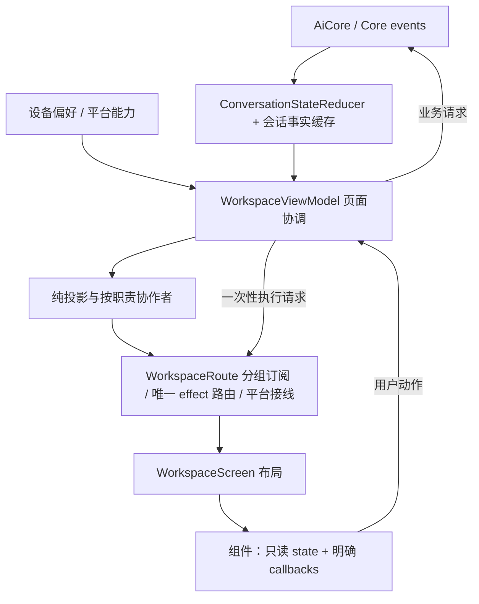

# Mederi 对话工作台整体改造计划

> 创建：2026-10-28（Asia/Shanghai）｜状态：整体计划已落盘；2026-10-29前四批表现层代码/组件验证完成；真实APP验收待环境，整体架构任务仍未完成。
> 盘点基线：Git HEAD `5cc5302` + 当天工作区未提交修改。包括已经实现的派发记录、概览显隐和整栏呼吸动效；不能把本计划的目标态当作当前实现。
> 2026-10-28计划轮次只修改文档；2026-10-29用户已授权首批“消息＋输入区＋概览”，见[首批交付](workspace-first-delivery.md)。本文是后续工作的进度、顺序与决策记录；组件盘点见 [完整清单](conversation-workspace-ui-inventory.md)。

## 0. 续做入口与当前进度

后续接手顺序：AGENTS.md → 本节 → §1–§5（理念/状态/样式）→ §7 对应任务 → 清单中的具体文件。无需凭聊天记录还原需求。

| 工作 | 状态 | 说明 |
|---|---|---|
| 对话页及关联面板盘点 | 已完成静态分析 | 代码 + 架构文档 + 现有截图；未声称完成三平台视觉验收 |
| 产品理念、架构选择、组件家族和实施顺序 | 已落盘 | 见本文 |
| 成功派发的代码级历史通知 | 已有实现 | 不依赖模型正文，在过程折叠外显示；后续迁入统一通知家族 |
| 概览显示/隐藏、Grid 选中、保留展开行 | 已有实现 | 兼容旧最小化偏好；后续迁入统一布局状态 |
| 子 Agent 整栏运行呼吸动画、移除重复底部提醒 | 已有实现 | 折叠/展开可见；多处局部动效尚未归一 |
| B1–B3 消息/输入/概览样板 | 代码与组件验证完成，APP实机待验 | 按最新用户指令优先；具体状态见首批交付文档 |
| C1–C3 过程/工具/交互卡/状态 | 代码与组件验证完成，APP实机待验 | 复用首批风格；见[第二批交付](workspace-second-delivery.md) |
| D1–D3 文件/diff/阅读器 | 代码与组件验证完成，APP实机待验 | 沿用共同导航/动作和现有路由；见[第三批交付](workspace-third-delivery.md) |
| E1–E3 终端/自动化/子代理与面板 | 代码与组件验证完成，APP实机待验 | 见[第四批交付](workspace-fourth-delivery.md) |
| F1–F3 诊断/原始消息/Todo与计划步骤 | 代码与组件验证完成，APP实机待验 | 见[第五批交付](workspace-fifth-delivery.md) |
| G1–G4 弹窗/菜单/提示/Dock与错误详情 | 代码与组件验证完成，APP实机待验 | 见[第六批交付](workspace-sixth-delivery.md) |
| R00–R14 整体重构 | 未整体实施 | 按依赖推进，不能因已有局部改动标整阶段完成 |

**当前交接点：R02a/b主对话反馈切片代码与组件验证完成（2026-10-31）。** 见[本批交付](workspace-feedback-ownership-delivery.md)。256项相关测试与wasm/JVM通过；Core错误、本地失败、关闭与详情意图分离，按Session/项目Draft归档，创建/发送/回滚反馈票据防串台，回滚不覆盖后来上下文/输入。原共享ErrorBoard/ErrorDetailDialog保持，无新视觉风格。下一批复核剩余Chrome状态及R02c契约边界，不重复已交付切片；整体R02/S6/完整实机保留，浏览器排除。

**首批之后：按范围继续R00–R14。** 以下登记表是唯一阶段进度入口（“未开始”不等于已经承诺完成视觉验收）：

| 任务 | 状态 | 关键依赖 | 实际验证/证据 |
|---|---|---|---|
| R00 规范与基线 | 未开始 | 无 | — |
| R01 场景样张 | 未开始 | R00 | — |
| R02a 状态所有权/兼容投影 | 阅读器/diff/主对话反馈切片完成，整体未完 | R01；按窄切片先行 | 256项相关回归；见三批ownership交付 |
| R02b Route/分组状态接口 | 阅读器/diff/反馈只读状态与纯Content完成，整体未完 | R02a | ReaderPanelState、DiffUiState、feedbackState及纯Content；完整分组接口未迁移 |
| R03a 效果路由 | 窄接口代码/组件验证完成，实机待验 | R02b窄接口先行，完整R02b未完 | 160项相关测试与wasm/JVM；见workspace-effect-routing-delivery.md |
| R03b 任务查询 | 窄接口代码/组件验证完成，实机待验 | R02b窄接口先行，完整R02b未完 | 176项相关回归与wasm/JVM；见workspace-background-tasks-delivery.md |
| R03c 报告加载 | 窄接口代码/组件验证完成，实机待验 | R02b窄接口先行，完整R02b未完 | 192项相关回归与wasm/JVM；见workspace-report-loading-delivery.md |
| R02c 契约表现依赖迁出 | 未开始 | R02b/R03 | — |
| R04a Token/原子 | 表现层子集已交付，未整体完成 | R01/R02c/R03 |  前六批共同原子与规范；完整任务/实机验收尚未完成 |
| R04b MotionPolicy | 自有动效代码/组件验证完成；完整实机待验 | R04a接口 | 135项相关回归；见workspace-motion-delivery.md，平台/第三方内部与OS映射明确未覆盖 |
| R05 工作台/概览 | 表现层子集已交付，未整体完成 | R02–R04 |  首批交付；完整任务/实机验收尚未完成 |
| R06 消息/正文 | 表现层子集已交付，未整体完成 | R04–R05 |  首批交付；完整任务/实机验收尚未完成 |
| R07 过程/事件 | 表现层子集已交付，未整体完成 | R03b–c/R04/R06 |  第二批交付；完整任务/实机验收尚未完成 |
| R08 输入/选择器 | 表现层子集已交付，未整体完成 | R02–R04/R06 |  首批交付；完整任务/实机验收尚未完成 |
| R09 决策/错误 | 表现层子集已交付，未整体完成 | R04/R07/R08 |  第二/六批交付；完整任务/实机验收尚未完成 |
| R10 文件/diff | 表现层子集已交付，未整体完成 | R04/R05/R06 |  第三批交付；完整任务/实机验收尚未完成 |
| R11 阅读器/导出 | 表现层子集已交付，未整体完成 | R03c/R04/R05/R10 |  第三批交付；完整任务/实机验收尚未完成 |
| R12 辅助面板 | 表现层子集已交付，未整体完成 | R04/R05/R07/R11 | 第四批交付；PTY/网页原生集成与完整实机待验 |
| R13 可访问性/诊断 | 表现层子集已交付，未整体完成 | R05–R12 | 第五/六批诊断、步骤、公共弹层；全页键盘/触控/实机仍待验 |
| R14 清理/三平台验收 | 未开始 | 前述全部 | — |

每个任务更新：状态、实际文件、验证命令/结果、截图或录屏位置、未解决项、下一步。阶段完成须同时满足行为与视觉验收；无环境证据写“未验证”，不能写完成。决策变化在 §10 追加，避免旧取舍被静默覆盖。

## 1. 产品理念：对话继续，任务并行

### 1.1 要做成什么

**中性、轻量、内容优先的跨平台工作台。** 用户在阅读和表达时，界面安静；任务派出、需要回答、需要批准或发生错误时，界面明确。Mederi 是通用 Agent 应用框架，不把所有用户都假定为程序员；代码、终端、模型诊断是按需展开的能力。

视觉上保留中性灰和 iris 紫的识别，借助布局比例、排版、信息层级和任务概览形成自己的风格。macOS/Windows/Linux 共用内部设计语言，系统窗口、字体、菜单修饰键、文件选择与平台能力遵从宿主；不仿制某个平台专属外观，不套用另一款产品的阻塞式聊天流程。

### 1.2 三个独立维度

| 维度 | 表达什么 | 不能据此推导什么 |
|---|---|---|
| 主 AI 当前交互 | 正在准备、生成、调工具、等待回答或已结束本轮 | 不能因为子任务还在跑，就宣称主 AI 一直忙或禁止输入 |
| 独立任务 | 子 Agent、后台命令、定时器各自的运行/终态 | 不能把所有活动合并成一个全局 isBusy 或一个停止按钮 |
| 交付记录 | Core 确认的完整阶段回复、派发事实、报告、后续接续回复 | 不能把阶段回复当整项工作完成，也不能被后续回复覆盖 |

### 1.3 全程保留的异步交互

1. 子 Agent/后台命令/定时器存在时，用户仍可提交文字与附件；由 Core 决定接纳、持久化和安全边界消费，UI 不新建待发队列。
2. 派发成功后生成代码级固定记录，说明“已启动 / 概览详情 / 可以继续聊”；不要求模型复述，不藏进工作过程。
3. 对话中的派发记录是历史事实；概览承载实时状态。不能把旧记录一直更新成“现在正在运行”。
4. 子任务结束可唤起主 AI 接续；接续消息遵守用户消息边界、稳定消息 ID 和 Core 交付标记。原交付全文保留，不从最后文本块猜答案。
5. 关闭面板、隐藏概览、切换会话都不代表取消任务。单任务 Stop 与“停止当前工作”是不同范围。**当前 Core 的 abort/abortAndJoin 会级联停止本会话运行中的子 Agent/后台任务**；UI 必须如实说明该范围，不能承诺只停止主响应。若未来需要主响应独立停止，须另立产品/契约任务，本次不隐式改变。
6. 问答/审批始终独立可操作；只有确实有业务约束时限制相关动作，不能因“任务在跑”禁用整个输入区。
7. 用户阅读历史或正在输入时，后台结果不得强制抢焦点、拉回底部或切换正在看的面板。新结果提供明确入口。

## 2. 现状诊断与改造范围

### 2.1 已核实的问题

| 问题 | 证据 | 后果 | 处理位置 |
|---|---|---|---|
| 标准互相冲突/落后于实现 | standard/02 仍规定问答/审批无壳 rail、文档 chip、过程600字重/italic；当前代码已不同；standard/README 仍称 tokens/GLASS 待实现 | 下一次改动会选错真理源 | R00 |
| 容器与操作强调叠加 | 文档卡的外框、图标底座、badge、元数据、CTA；阅读器多层标题栏；footer 常显诊断和多复制按钮 | 功能齐全但画面密、重 | R04/R06/R11 |
| 公共壳存在，周边样式各写各的 | ProcessRow/Accordion/Panel 已部分复用；按钮、tab、tooltip、状态摘要仍有独立尺寸和状态逻辑 | 改一处不能带动同族 | R04–R13 |
| 契约状态反向依赖 UI | contract/dto/ConversationState.kt 引用 RightDockPanel、BrowserAutomationUiState | 运行事实与设备表现混存，每个快照要保护本地面板字段 | R02 |
| 大 VM / 大视图边界混合 | WorkspaceViewModel 承担会话、输入、任务、文件和布局；WorkspaceUiState.kt 目前只有 ErrorState/DiffUiState/PendingFileOpen；组件接整个 VM | 测试困难、重组范围和维护成本扩大 | R02–R03 |
| 一次性效果消费竞争（本轮已收口） | 原MainScreen/ChatInputCard竞争同一Channel；现Route唯一消费、菜单受控 | 防吞命令与重建重播；完整原生窗口待验 | R03a，见workspace-effect-routing-delivery.md |
| 后台查询串会话/旧结果覆盖（本轮已收口） | 原叶子每2秒launch写单列表；现协作者会话keyed、串行、取消+代际拒旧结果 | 停止失败原会话/目标反馈；真实Core/HTTP端到端仍待验 | R03b，见workspace-background-tasks-delivery.md |
| 视图内仍有 I/O/编排（部分收口） | 报告读取/后台轮询已迁到协作者；其余概览Store与阅读器导出工作态仍待迁移 | 不把R03c当作整个文档/状态所有权迁移完成 | R02/R05/R11 |
| 运行/展开动效多节律 | 800/1200/1600/2400ms；spring、不同 tween、箭头瞬切并存；一任务组多重循环 | 忙乱、难维护、减弱动效无统一入口 | R04b |
| 操作含义不一致 | X 同时被用作关闭和停止；子代理概览直接停、详情弹确认；Cmd 提示硬编码 | 相同动作在不同位置有不同预期 | R04/R05/R10/R12 |
| 文档遗漏实际入口 | RightDock 的 Globe 对应 BROWSER_AUTOMATION，右面板同时有 BROWSER 与自动化流程 | 不能按旧文档把两者误删或合并 | R00/R12 |

### 2.2 范围

本轮整体改造覆盖 MainScreen/Workspace 工作台外壳、对话列表全部条目、输入区、概览九栏、右 Dock、文件树/diff、阅读器、终端/网页/自动化/子代理详情、相关弹窗与诊断入口；Sidebar 处理工作台接缝与共享控件。

供应商/遥控等设置页原本不在首轮全面重画范围。2026-10-29用户新增授权后，设置七类页面纳入后续独立阶段，见[设置页改造计划](settings-redesign-plan.md)；不回填为前六批已完成。共享token/原子组件变化仍必须回归它们。Core 任务调度、模型请求和存储 schema 不因换风格而重写。必要的 contract 解耦作为独立任务与兼容迁移处理。

## 3. 架构决定：规范化 MVVM + 单向数据流

### 3.1 为什么选 MVVM

现有系统已经有 ViewModel、AiCore 观察流、会话缓存、纯投影和一次性效果机制，适合渐进收敛。ConversationStateReducer 是 Core 事件到会话事实的投影，继续保留；它不要求整页迁成 MVI，也不意味着为每个按钮新建 Intent。

目标是**明确 Model/表现状态/视图职责**，不引入第二套任务状态机、不为每张卡创建 VM、不用一个巨型 Intent.when 替代巨型 VM。单向数据流用于限定更新方向，行为测试用于保证边界。



图中的 Route/Screen 分层及分组 UiState 为**目标结构**，不是声称当前已存在的类。

### 3.2 状态所有权

| 状态 | 唯一持有者/来源 | 不应出现的位置 |
|---|---|---|
| 消息、主轮次、任务、问答/审批、用量、错误事实 | AiCore → 既有 reducer/会话缓存 | 组件自行推测完成，或另存一份业务事实 |
| 输入草稿/附件/选择与发送可用性 | Composer 表现状态（复用 inputDraft、effectiveThinkingLevel 真理源） | View 与 VM 各留一份 draft/推理档，或 UI 待发队列 |
| 当前文档/面板/子代理详情/会话展开项 | 按 conversationId keyed 的 SessionPresentationState | 网络运行事实 DTO、跨会话全局单份列表 |
| 概览显隐、主题、减弱动效、布局尺寸偏好 | 设备级 WorkspaceChrome 表现状态 + PreferencesStore | server 配置库或会话数据库 |
| 后台任务查询加载/错误/响应版本 | 会话 keyed Activity 查询协作者，生命周期绑定 VM | 叶子组件轮询与重叠 launch |
| hover/pressed/焦点/滚动位置/动画进度/短暂复制反馈 | 可复用组件的本地 UI 状态，必要时按稳定 ID 保存 | Core、持久化业务事件、每帧更新的大 UiState |
| 打开设置/系统应用/焦点请求等一次性执行 | Route 单一 effect 消费后明确分发 | 多组件竞争收同一 Channel，或把问答当可丢 effect |
| 需持续操作的错误、问答、审批、菜单/弹窗已打开状态 | 可重建的表现状态 | 仅发一次无法恢复的通知 |

### 3.3 代码形态

- WorkspaceViewModel 作为协调者；先抽纯投影/查询/文档加载等普通 Kotlin 协作者，生命周期明确绑定它，不机械拆 extension 文件冒充解耦。
- 分组暴露 ConversationContentUiState、ComposerUiState、ActivityUiState、WorkspaceChromeUiState、FeedbackUiState（拟定名）；以稳定模型分区订阅，不把每个 token、光标、hover 放进单个巨大 StateFlow。
- Route 接 VM/平台接口；Screen、ChatListContent 与叶子组件最终只收必要只读模型和语义回调，不直接摸 AppState/Store/AiCore/文件系统。
- RawMessages/Terminal 等已有独立工作域 VM 仍由 Route 创建；小组件不用自建 VM。
- 先将本地表现状态从事实访问路径分离，再清理 contract 的 UI 字段。兼容适配只放一个明确边界，记录移除阶段，不能长期双写。
- 若删除/迁移序列化 DTO 字段影响网络：AiCore、MederiAiCore、ServerAiCore、Server/Mock 与架构文档同时校验；不以“只是 UI 重构”跳过兼容性验证。

## 4. 统一视觉语言

### 4.1 基本规则

- 先用留白、对齐、字号和灰度组织信息，再决定是否需要背景或边界。
- iris 只表达选中、焦点、链接、主要动作和活动；红/绿/琥珀仅表达相应状态。普通标签、模型名和在线状态不各自争夺品牌色。
- 普通工作区不加卡框；对象用轻 surface；待用户决策时才增加局部强调。嵌套容器不逐层描边。
- UI 控件文字以400/500为主；正文 Markdown 的 strong、标题、代码语法属于内容语义，不能全局删粗体来“减重”。
- 使用平台字体；正文中文和英文都要真实试排。等宽用于代码、路径、JSON、终端；诊断信息按需展示，不能让整个界面像日志台。
- 不引入毛玻璃、发光阴影、多色渐变和弹跳作为常态装饰；悬浮层边界/遮罩在统一 Overlay 族中裁定，不能各组件自加 shadow。

### 4.2 六个语义家族 + 两组工作台基础组件

| 家族 | 部件 | 一致的表达 |
|---|---|---|
| Message | 用户/助手正文、消息动作、诊断详情 | 助手无外壳；用户柔和中性背景；元数据次级，操作在 hover/focus/选中可发现，触控有固定更多入口 |
| Activity | 工作过程、推理、工具详情 | 统一 Disclosure/ProcessRow、导轨、状态标签、滚动规则；空内容不可假展开 |
| Notice | 派发、完成、取消、压缩结果等事实通知 | 轻量标题+说明/详情入口；状态只染图标或小标记；不靠重框保证醒目 |
| Decision | 提问、审批、可恢复错误 | 清晰标题、必要上下文和可见动作；不因轻量化藏掉确认/重试/继续 |
| Object | 文档、图片、大文本、附件、文件变更 | 一个对象入口、一组主副信息、最多一个主动作；缩小图标底座，合并冗余badge/CTA |
| Composer/Selection | 输入壳、选项、菜单、联想、发送 | 统一控件高度/圆角/焦点、选中标记与菜单行；主次设置清楚，空间不足按规则收拢 |
| Chrome | 标题栏、Sidebar接缝、Dock、面板、Toolbar、Tabs | 背景分区，少接缝线；文档Tab与导航Tab可有两个明确语义变体，不逐面板自造 |
| Shared feedback | Tooltip、CopyAction、Empty/Error/Unsupported、Dialog | 统一定位、时长、图标、重试与关闭；不支持不伪装加载 |

“统一”是同语义使用同一个可维护实现，不是让所有东西都变成同一种卡。优先演进现有 ProcessRow、MederiButtons、StatusStrip、CopyButton 等，避免旁边另建一套 V2 永久并存。

### 4.3 排版与尺寸的首轮设计基线

| 项目 | 目标基线 | 验证 |
|---|---|---|
| 正文阅读 | MessageBody 约14sp/1.6行高；与现有 InkCompose 配置通过应用主题桥接 | 中文长文、英文、表格/代码/公式不拥挤；允许在R01统一调整基线，不逐组件改 |
| UI 主文字 | Body约13sp，辅助12sp，纯诊断约11sp | 正常缩放可读；不能用低对比10sp承载必要提示 |
| 字重 | UI Regular/Medium；内容strong保留 | 深浅主题一致，标题层级不靠全屏加粗 |
| 间距 | 基于现有4/8/12/16/24dp节律，密集技术区微刻度单独命名 | 不为每张卡创造5/7/9/11一套 |
| 圆角 | 控件6dp、对象8dp、输入/消息12dp作为首轮基线 | 统一token；不会把所有控件都做成大药丸 |
| 热区 | 桌面紧凑按钮视觉可为16–20dp，热区至少28–32dp；触控至少44dp | 热区扩展不能互相重叠，hover不是唯一发现方式 |
| 边框 | 默认不描；必要分区/输入焦点/表格数据保留1dp语义细线 | 消息、对象、面板不框套框；表格网格不被无差别删掉 |

这些是待 R01 用同内容深浅色样张校准、随后在 R04 写入 token 的整套基线，不是让执行者各自做主。旧标准冲突在 R00 登记，迁移组件时同步更新 canonical 标准；不得把本文与旧标准当两套可任选方案。

## 5. 动效与交互的一致性

### 5.1 一个 MotionPolicy

统一放在主题/表现层，参数集中维护：

| 语义 | 首轮参数 | 使用场景 |
|---|---|---|
| 即时反馈 | 120ms，非弹性tween | hover/pressed/selected/focus颜色 |
| 局部显隐 | 180ms，统一缓动 | disclosure/菜单/轻提示；箭头跟随同一状态与节奏 |
| 面板过渡 | 200ms，非弹性tween | 打开/关闭面板，避免宽度反复弹跳挤正文 |
| 任务运行 | 2400ms单色呼吸 | 子Agent/后台命令的任务组；整栏含折叠头可见 |
| 无内容的请求等待 | 1000ms线性spinner | 只有真实在请求且无进度信息时；不用正文闪动表示运行 |
| 复制成功 | 1500ms静态check反馈后恢复 | 全部复制入口同源；错误明确反馈 |
| ReducedMotion | 取消持续循环/位移，保留静态状态与数量 | 能读出运行中，不依赖动画或仅靠颜色 |

同一语义任务组只保留一个主循环动效：有组级呼吸时，不再让正文呼吸、圆点另一个节拍、每行再转圈。真实加载与任务运行允许不同语义变体，但由同一 Policy 控制。倒计时仅使用真实期限数据，timer等待不伪装成CPU正在计算。

屏幕不可见/组件不在组合中时不驱动无限动画；隐藏概览只停止表现与按需查询，不停止 Core 工作。减弱动效偏好保存在设备端，能获取系统偏好则映射；无法跨平台获取时提供应用级静态模式，不能假装已支持系统设置。

### 5.2 动作与焦点

- X仅表示关闭/隐藏；任务停止使用明确Stop图标与本地化说明。子Agent/后台任务各入口采取同一确认策略：点击停止后统一确认目标，确认后仅停该任务；“停止当前工作”沿用 Core 的级联取消语义，文案与确认明确会影响本会话运行中的任务；不能标成“仅停止主回复”。
- Esc 关闭最上层菜单/弹窗，再处理面板；不作为停止任务的隐式快捷键。关闭后焦点回触发控件。
- 消息动作在hover或键盘focus时呈现；触控始终有更多入口。问答/审批/错误恢复按钮始终可见。
- 快捷键由平台映射生成：macOS Cmd，Windows/Linux Ctrl；IME组合输入中不得误提交。
- 滚动只在用户已跟随底部时跟随；历史阅读、代码输出/报告内部滚动有明确边界；新结果给跳转提示，不强滚。
- 加载、无数据、失败、不支持四种空态分别显示；停止/导出/加载失败可恢复，不仅记录 DebugLog。

## 6. 规范与文档的唯一入口

| 文档 | 职责 |
|---|---|
| AGENTS.md | 硬性规则、不变量、续做指路，不存具体视觉机制 |
| 本计划 | 目标、依赖、验收、进度与决策；不会冒充当前代码结构 |
| conversation-workspace-ui-inventory.md | 本次静态盘点与组件迁移对应表 |
| standard/README + 01/02/03/04 | 实施时收敛后的canonical设计原则、token、组件、交互规范；沿用原路径，不另起竞争标准 |
| architecture/02、04（涉及渲染再含03） | 已实现结构/调用链；每个代码阶段同步，不把未来类先写成既成事实 |
| ui-dev-workflow.md | 测试/启动工作流；冲突时遵守 AGENTS“APP/server必须idea-mcp”规则 |

每个实施阶段同时交付代码、相关标准、架构现状说明、验证结果。旧HTML原型留作历史参考，不再被当作覆盖新规范的真理源。

## 7. 实施顺序与任务契约

### 7.1 总顺序

`R00规范与基线 → R01场景样张 → R02a状态所有权 → R02b Route/状态接口 → R03a效果 / R03b任务查询 / R03c报告加载 → R02c契约解耦 → R04a原子 / R04b动效 → R05工作台+概览 → R06消息 → R07过程/事件 → R08输入 → R09决策/错误 → R10文件 → R11阅读器 → R12辅助面板 → R13可访问性/诊断收口 → R14清理与三平台验收`

先完成一个代表性纵向样板（正文＋派发记录＋输入＋概览任务），验证轻而可见，再迁移其余同族。样板阶段不提前替换全局token，避免尚未迁移的设置页突然变化。

允许的并行：R03a/R03b/R03c在R02b稳定后可各做独立文件；R04a与R04b需明确文件归属；R10→R11→R12按依赖串行，共同Panel/Tab/Toolbar及文档状态接口由前置阶段冻结。共同 Workspace/VM/Theme/标准文档不得多人同时改；单独指定整合者。

### 7.2 验证约定

下文新增 `*Test` 名称是计划交付物，**当前尚未存在**；阶段执行时先落实际测试文件再运行。现有测试路径在盘点清单 §5。所有行为阶段都须有真实状态/动作断言，不以编译或grep样式字面量代替验收。

- JVM命令统一 `./gradlew :app:shared:jvmTest --tests '*测试类名'`；期望exit0，指定suite实际执行且测试数>0、失败0、关键用例未跳过，检查JUnit报告，不能以UP-TO-DATE或无匹配测试冒充新行为通过。
- 视觉/交互阶段在idea-mcp启动的APP完成固定场景操作，记录深/浅主题截图与语义树、关键滚动/焦点/异步行为；单元测试不能代替视觉验收。
- 平台编译任务在R00通过 `./gradlew :app:shared:tasks --all` 确认并登记实际JVM/Android/iOS/wasmJs任务名；不凭记忆臆造Android任务。缺SDK/平台设备明确标未验证。
- APP/server只走idea-mcp；测试可用Gradle。当前会话缺idea-mcp，视觉证据尚不可采集；这不影响计划编写和纯逻辑测试。

### R00 规范去冲突与行为基线

- 依赖：无。范围：standard/README、01–04、architecture/02与04的差异清单；当前引用和实际入口检查。
- 交付：当前/目标明确分栏；修正过时“GLASS/tokens未实现”、旧概览/网页入口描述；记录截图场景清单与实际平台构建任务，确认需要保留的功能。
- 验证：`git diff --check`；`./gradlew :app:shared:tasks --all`；既有 `WorkTracePresentationTest / ChatScrollLayoutTest / OverviewWindowStateTest / ResponseBoundaryReducerTest / ReasoningMenuTest`。期望原有异步、交付、滚动、偏好行为不变。
- 通过标准：每一处规范冲突有唯一处理位置；未来设计与当前代码不混写。基线测试和环境缺口记录到进度表。

**验证命令**（新增suite须先按本任务实现；不是本轮已执行结果）：

```bash
./gradlew :app:shared:jvmTest --tests '*WorkTracePresentationTest' --tests '*ChatScrollLayoutTest' --tests '*OverviewWindowStateTest' --tests '*ResponseBoundaryReducerTest' --tests '*ReasoningMenuTest'
```

机器通过条件：上述suite中的行为断言全部通过、测试数大于0、失败为0、关键行为用例未跳过（与本阶段无关的平台跳过需逐项说明）；保留JUnit结果。视觉阶段还须完成本任务的真实UI验收，不能仅凭这条命令结束。

### R01 同内容样张与可复用场景夹具

- 依赖：R00。优先复用 MockAiCore；只构建预览/测试场景入口，不调用真实模型、不捏造生产数据。
- 交付：深/浅色同内容样张和交互预览，覆盖正文、用户消息、后台并行、派发/终态、问答/审批/错误、文档、输入附件、阅读器。
- 只读样张用于确定正文比例、层级和边框预算；交互预览用于确认hover/focus、开合、任务状态。不把新主题开关泄漏给生产用户。
- 验证：新增 `WorkspaceScenarioFixturesTest`（场景事实与状态组合正确、稳定ID不重复）；通过idea-mcp查看1200×800、1440×900、900×700及360dp窄屏样张，深/浅主题与中英文各留证据。
- 通过标准：确定一套视觉基线和代表性纵向样板，登记调整参数；不能各区域独立选不同方向。

**验证命令**（新增suite须先按本任务实现；不是本轮已执行结果）：

```bash
./gradlew :app:shared:jvmTest --tests '*WorkspaceScenarioFixturesTest'
```

机器通过条件：上述suite中的行为断言全部通过、测试数大于0、失败为0、关键行为用例未跳过（与本阶段无关的平台跳过需逐项说明）；保留JUnit结果。视觉阶段还须完成本任务的真实UI验收，不能仅凭这条命令结束。

### R02a 状态所有权与兼容投影

- 依赖：R01。范围：WorkspaceViewModel/WorkspaceUiState/SessionUiCache/OverviewWindowState；暂不删除网络DTO字段。
- 交付：按会话的SessionPresentationState与设备级WorkspaceChrome状态，单点所有权表及兼容投影。保留Core事实真理源，先消除本地双写；新Core delta只更新事实。
- 验证：新增 `WorkspacePresentationStateTest`，现有 `MergeLocalUiStateTest / ConversationStateAndSubagentTest / OverviewWindowStateTest`。断言Core delta不冲掉显式关闭/文档选择、切会话不串面板、概览隐藏不改变任务事实。
- 通过标准：所有权明确；兼容层只有一个写入口；不同时做Route搬迁或DTO删字段。

**验证命令**（新增suite为计划交付物，须先实现）：

```bash
./gradlew :app:shared:jvmTest --tests '*WorkspacePresentationStateTest' --tests '*MergeLocalUiStateTest' --tests '*ConversationStateAndSubagentTest' --tests '*OverviewWindowStateTest'
```

机器通过条件：相关行为断言实际执行且通过；指定suite测试数>0，无失败，关键用例不跳过。保留JUnit结果；涉及视觉另做真实UI验收。

### R02b Route/Screen与分组只读状态接口

- 依赖：R02a。范围：Workspace/MainScreen/ChatListContent/ChatInputCard的装配接口、WorkspaceViewModel的分组投影。
- 交付：Route负责订阅/平台接线，Screen与新迁移叶子只收state+callbacks；形成Composer/Conversation/Activity/Chrome/Feedback分组契约。不要求先机械拆完2400行VM，也不为每张卡建VM。
- 验证：新增 `WorkspaceStateProjectionTest`，现有 `WorkTracePresentationTest / ResponseBoundaryReducerTest / ReasoningMenuTest`。断言投影不改Core事实、草稿和档位同源、主活动与子任务活动分开、插话和阶段交付完整。
- 通过标准：可用独立场景夹具渲染代表性Screen；R03a/b/c可以通过窄接口独立修复，不被大架构迁移阻塞。

**验证命令**（新增suite为计划交付物，须先实现）：

```bash
./gradlew :app:shared:jvmTest --tests '*WorkspaceStateProjectionTest' --tests '*WorkTracePresentationTest' --tests '*ResponseBoundaryReducerTest' --tests '*ReasoningMenuTest'
```

机器通过条件：相关行为断言实际执行且通过；指定suite测试数>0，无失败，关键用例不跳过。保留JUnit结果；涉及视觉另做真实UI验收。

### R03a 一次性效果的唯一消费与路由

- 依赖：R02b。范围：UiEffect、WorkspaceViewModel、MainScreen/WorkspaceRoute、ChatInputCard。
- 交付：Route唯一消费既有effect，明确分发设置/项目选择/压缩提示；组件不订阅全局effect。菜单打开后的持续状态归相应表现层。
- 验证：新增 `WorkspaceEffectRoutingTest`，连续与交错触发三类动作、重组和切会话后每个目标正确执行一次、不会吞事件或重放；命令使用本节JVM模板。
- 通过标准：不能以换SharedFlow广播、堆计数器掩盖多消费者归属问题。

**验证命令**（新增suite须先按本任务实现；不是本轮已执行结果）：

```bash
./gradlew :app:shared:jvmTest --tests '*WorkspaceEffectRoutingTest'
```

机器通过条件：上述suite中的行为断言全部通过、测试数大于0、失败为0、关键行为用例未跳过（与本阶段无关的平台跳过需逐项说明）；保留JUnit结果。视觉阶段还须完成本任务的真实UI验收，不能仅凭这条命令结束。

### R03b 会话隔离的后台任务查询与错误

- 依赖：R02b。范围：pollBackgroundTasks/stopBackgroundTask、OverviewRunningTaskRow、Activity查询协作者。
- 交付：会话keyed查询状态、单刷新Job、取消/版本防旧响应覆盖；概览可见性仅作为订阅条件；停止失败进入统一反馈。View不调度轮询。
- 验证：新增 `BackgroundTaskPresentationTest`；人为控制延迟：A→B切换后A晚返回、同会话逆序响应、隐藏/显示、重复订阅、停止失败与取消。
- 通过标准：旧响应不覆盖当前会话，隐藏不取消Core任务，无重复轮询Job；停止失败可见，不能只写日志。

**验证命令**（新增suite为计划交付物，须先实现）：

```bash
./gradlew :app:shared:jvmTest --tests '*BackgroundTaskPresentationTest'
```

机器通过条件：相关行为断言实际执行且通过；指定suite测试数>0，无失败，关键用例不跳过。保留JUnit结果；涉及视觉另做真实UI验收。

### R03c 报告异步加载与视图I/O迁出

- 依赖：R02b；可与R03a/b在文件互斥时并行。范围：EventMessageCard与文档/报告加载协作者。
- 交付：报告读取移出Composable，提供Loading/Content/Missing/Error状态；明确任务/会话key、请求取消和缺失时的真实摘要来源。这里不改导出或阅读器外观。
- 验证：新增 `ReportLoadingPresentationTest`；控制报告读盘延迟、切文档/切会话、缺失、权限错误、取消和重复打开。
- 通过标准：UI线程不阻塞读取报告，无字符串手术修复坏数据；晚返回不覆盖新报告，失败可见。

**验证命令**（新增suite为计划交付物，须先实现）：

```bash
./gradlew :app:shared:jvmTest --tests '*ReportLoadingPresentationTest'
```

机器通过条件：相关行为断言实际执行且通过；指定suite测试数>0，无失败，关键用例不跳过。保留JUnit结果；涉及视觉另做真实UI验收。

### R02c 迁出契约的UI类型依赖

- 依赖：R02b/R03a–c稳定，单独变更集；排在视觉迁移前。范围：ConversationState/Reducer、桥接/Mock/Server序列化链与兼容适配。
- 交付：activeDockPanel/activeSubagentPanelAgentId等纯表现字段迁至R02a状态；browserAutomation区分Core任务事实和面板开合，不能把事实一并迁走。清理contract反向import UI；删除已无需要的merge保护分支。
- 验证：新增 `ConversationContractSeparationTest`、`WorkspacePresentationStateTest`及既有 `ResponseBoundaryReducerTest / ConversationStateAndSubagentTest`；真实序列化往返/兼容快照、desktop/server一致性、字段缺失/显式关闭、新delta与重连场景。
- 通过标准：不破坏旧数据/远端读取；必要时保留集中兼容读适配并登记R14移除条件，但不双写。涉及对外契约时按AGENTS同步AiCore/两桥/Server/Mock与架构；本任务不能夹带Core生命周期改动。

**验证命令**（新增suite为计划交付物，须先实现）：

```bash
./gradlew :app:shared:jvmTest --tests '*ConversationContractSeparationTest' --tests '*WorkspacePresentationStateTest' --tests '*ResponseBoundaryReducerTest' --tests '*ConversationStateAndSubagentTest'
```

机器通过条件：相关行为断言实际执行且通过；指定suite测试数>0，无失败，关键用例不跳过。保留JUnit结果；涉及视觉另做真实UI验收。

### R04a Token与共享组件家族

- 依赖：R01/R02c/R03a–c。范围：Theme/Tokens、atoms、标准01–03、主/子聊天主题桥接。
- 交付：保留既有色板语义，合并旧accentSecondary/status*/thought*的重复角色；补排版行高、控件尺寸、边界与surface变体；收敛Button/IconAction/Disclosure/Notice/ObjectRow/DecisionSurface/Menu/Toolbar/Tabs/EmptyState/Tooltip/CopyAction。
- 不把所有颜色字段一口气重命名；旧字段先单向映射，R14清理。UI字体与Markdown内容语义分开。
- 验证：新增 `DesignSystemComponentTest`，真实交互断言enabled/selected/expanded/focus、CopyAction成功/失败、菜单选择；深浅主题组件画廊验证hover/pressed/focus/disabled/长文案/缩放。
- 通过标准：同族共用实现和token；不新增永久V2组件库；共享变更回归设置页。

**验证命令**（新增suite须先按本任务实现；不是本轮已执行结果）：

```bash
./gradlew :app:shared:jvmTest --tests '*DesignSystemComponentTest'
```

机器通过条件：上述suite中的行为断言全部通过、测试数大于0、失败为0、关键行为用例未跳过（与本阶段无关的平台跳过需逐项说明）；保留JUnit结果。视觉阶段还须完成本任务的真实UI验收，不能仅凭这条命令结束。

### R04b MotionPolicy与减弱动效

- 依赖：R04a接口冻结。范围：WorkingAnimations、ExpandableRow/ProcessRow、motion token/设备偏好与资源。
- 交付：§5同源时长/缓动/循环策略；非弹性开合；任务组优先，正文不闪烁；新增减弱动效入口与静态替代。
- 验证：新增 `MotionPolicyTest`验证开启/关闭、任务状态、不可见、reducedMotion策略；组件测试时钟推进验证折叠/展开均有效、终态停止；录屏检查没有布局弹跳。
- 通过标准：无每卡自创节律、无看不到的无限动画；任务信息不依赖动效/颜色才可读。

**验证命令**（新增suite须先按本任务实现；不是本轮已执行结果）：

```bash
./gradlew :app:shared:jvmTest --tests '*MotionPolicyTest'
```

机器通过条件：上述suite中的行为断言全部通过、测试数大于0、失败为0、关键行为用例未跳过（与本阶段无关的平台跳过需逐项说明）；保留JUnit结果。视觉阶段还须完成本任务的真实UI验收，不能仅凭这条命令结束。

### R05 工作台外壳与概览九栏

- 依赖：R02–R04。范围：Workspace/Sidebar接缝/RightDock/RightExtensionPanel外壳、overview全部文件。
- 交付：统一header/toolbar/icon/Disclosure/任务列表/指标/管理行；概览无胶囊，显隐保持原语义；限高可滚动、不出视口；组级动效覆盖折叠头；X关闭与Stop停止分开；MCP/Skill组件不再自调Store。
- 验证：新增 `WorkspaceChromeInteractionTest / OverviewInteractionTest`，现有 `OverviewWindowStateTest / SidebarRevealTest`；切会话、resize、隐藏恢复、长任务/多栏/小高度、中英/触控/键盘；任务停止与关闭分别断言。
- 通过标准：选中状态与真实可见性一致；任务活动清楚但不锁聊天；打开任意面板保持对话最小可用宽；概览管理失败统一反馈。

**验证命令**（新增suite须先按本任务实现；不是本轮已执行结果）：

```bash
./gradlew :app:shared:jvmTest --tests '*WorkspaceChromeInteractionTest' --tests '*OverviewInteractionTest' --tests '*OverviewWindowStateTest' --tests '*SidebarRevealTest'
```

机器通过条件：上述suite中的行为断言全部通过、测试数大于0、失败为0、关键行为用例未跳过（与本阶段无关的平台跳过需逐项说明）；保留JUnit结果。视觉阶段还须完成本任务的真实UI验收，不能仅凭这条命令结束。

### R06 消息正文、元数据与内容主题

- 依赖：R04–R05。范围：ChatListContent/UserMessageCards/Markdown桥接与消息动作。
- 交付：用户柔和气泡、助手无壳排版、统一消息动作与按需诊断；保留完整复制、回滚入口，区分复制正文/完整内容的可发现菜单；代码/表格/图表/公式/图片不降级。
- 验证：现有 `WorkTracePresentationTest / ChatScrollLayoutTest`；新增 `MessagePresentationTest`检验完整交付、用户边界、操作目标；长中英文、表格、代码、公式、Mermaid、图片、超长路径样张。触碰inkcompose则执行 `./gradlew :inkcompose:jvmTest`。
- 通过标准：视觉减重不靠删内容/能力；读取历史时不抢滚动；必要信息可访问，内容strong仍有语义。

**验证命令**（新增suite须先按本任务实现；不是本轮已执行结果）：

```bash
./gradlew :app:shared:jvmTest --tests '*MessagePresentationTest' --tests '*WorkTracePresentationTest' --tests '*ChatScrollLayoutTest'
```

机器通过条件：上述suite中的行为断言全部通过、测试数大于0、失败为0、关键行为用例未跳过（与本阶段无关的平台跳过需逐项说明）；保留JUnit结果。视觉阶段还须完成本任务的真实UI验收，不能仅凭这条命令结束。

### R07 工作过程、工具与事件通知

- 依赖：R03b–c/R04/R06。范围：WorkTraceCard/ReasoningBlock/ToolCallsBlock/EventMessageCard/ChatItemsBuilder。
- 交付：同源折叠与导轨、减少多层独立滚动；派发/终态统一Notice家族；成功谓词在表现投影单处判定，View不重复读tool output判断业务；历史派发和实时运行分开。
- 验证：现有 `WorkTracePresentationTest / SubagentChatItemsTest / EventMessageParsingTest / SubagentTerminalKindTest`；新增 `ActivityPresentationTest`覆盖Pending/Running/Completed/Failed/Stopped/未知态、空输出、失败派发/STATUS/STOP不得误报启动；主子renderer一致。
- 通过标准：问答/审批/派发始终在折叠外；Core完整交付不被活动内容替换；未发生的完成不提前展示。

**验证命令**（新增suite须先按本任务实现；不是本轮已执行结果）：

```bash
./gradlew :app:shared:jvmTest --tests '*ActivityPresentationTest' --tests '*WorkTracePresentationTest' --tests '*SubagentChatItemsTest' --tests '*EventMessageParsingTest' --tests '*SubagentTerminalKindTest'
```

机器通过条件：上述suite中的行为断言全部通过、测试数大于0、失败为0、关键行为用例未跳过（与本阶段无关的平台跳过需逐项说明）；保留JUnit结果。视觉阶段还须完成本任务的真实UI验收，不能仅凭这条命令结束。

### R08 输入区与全部选择器

- 依赖：R02–R04/R06。范围：ChatInputCard/Controls/Selectors/Attachments、command包、ComposerUiState。
- 交付：输入壳减重；项目/模型/Key/推理/审批模式/附件统一Selection与Control；空间不足按优先级进更多菜单但不隐藏当前模型与发送目标；拆输入行为与视图，保留IME/粘贴/能力门禁。
- 验证：新增 `ComposerInteractionTest`；现有 `ReasoningMenuTest / PromptComposerTest / SlashCommandModelTest / AppLanguageResourceTest`；主AI空闲/运行、子Agent运行、后台command/timer、级联停止影响说明、仅附件、重复正文、快捷键与IME。
- 通过标准：有合法输入时统一提交Core；只有空输入且主轮次活动时呈现“停止当前工作”操作（沿用Core级联语义，不能误称仅停主回复）；后台任务不能让发送失效。草稿不丢、稳定消息ID对账、显示档位=发送档位。

**验证命令**（新增suite须先按本任务实现；不是本轮已执行结果）：

```bash
./gradlew :app:shared:jvmTest --tests '*ComposerInteractionTest' --tests '*ReasoningMenuTest' --tests '*PromptComposerTest' --tests '*SlashCommandModelTest' --tests '*AppLanguageResourceTest'
```

机器通过条件：上述suite中的行为断言全部通过、测试数大于0、失败为0、关键行为用例未跳过（与本阶段无关的平台跳过需逐项说明）；保留JUnit结果。视觉阶段还须完成本任务的真实UI验收，不能仅凭这条命令结束。

### R09 问答、审批、错误与确认

- 依赖：R04/R07/R08。范围：QuestionCard/PlanApprovalCard/ErrorBoard/ConfirmDialog/ErrorDetailDialog。
- 交付：Decision同族、清楚且始终可见的主动作；统一表单、单/多选、自定义输入、键盘操作、错误恢复。计划各终态准确，取消/拒绝不能统一叫已批准。停止确认所有入口同策略。
- 验证：现有 `PlanApprovalLayoutLogicTest / ParseAskItemsTest`；新增 `DecisionInteractionTest`覆盖多问/多选/返回修改/批准拒绝/作废/重复点击/断流继续/错误关闭；macOS与Ctrl平台修饰键。
- 通过标准：仅pending可提交，处理状态防重入；UI轻量不影响审批契约或掩盖错误；关闭与业务拒绝有清晰区别。

**验证命令**（新增suite须先按本任务实现；不是本轮已执行结果）：

```bash
./gradlew :app:shared:jvmTest --tests '*DecisionInteractionTest' --tests '*PlanApprovalLayoutLogicTest' --tests '*ParseAskItemsTest'
```

机器通过条件：上述suite中的行为断言全部通过、测试数大于0、失败为0、关键行为用例未跳过（与本阶段无关的平台跳过需逐项说明）；保留JUnit结果。视觉阶段还须完成本任务的真实UI验收，不能仅凭这条命令结束。

### R10 文件树、diff与对象入口

- 依赖：R04/R05/R06。范围：FilesPanel/TreePanelContent/DiffCards/文件打开路由。
- 交付：导航Tab/搜索/树行/变更列表/对象入口同族；去重边框和metadata，保留增删语义与可复制路径。
- 验证：现有 `FileOpeningFlowTest`；新增 `FilesPanelInteractionTest`覆盖过滤保留父路径、展开、选择、diff切换、打开确认、unsupported、失败重试。
- 通过标准：真实文件/改动数据不丢，不因样式变化改动平台文件安全路由；焦点和选择稳定。

**验证命令**（新增suite须先按本任务实现；不是本轮已执行结果）：

```bash
./gradlew :app:shared:jvmTest --tests '*FilesPanelInteractionTest' --tests '*FileOpeningFlowTest'
```

机器通过条件：上述suite中的行为断言全部通过、测试数大于0、失败为0、关键行为用例未跳过（与本阶段无关的平台跳过需逐项说明）；保留JUnit结果。视觉阶段还须完成本任务的真实UI验收，不能仅凭这条命令结束。

### R11 阅读器、文档与导出

- 依赖：R03c/R04/R05/R10。范围：DocumentArtifactCard/InfoPanels/ViewerTabs/DocumentExporter/文档表现协作者。
- 交付：轻量文档入口；收敛Header→Tabs→Toolbar→内容标题的重复层级；一组复制/导出操作，诊断元数据次级；图片和文本共享toolbar，任务态/错误统一管理。
- 验证：新增 `DocumentReaderInteractionTest`覆盖tab切换/关闭、异步加载、复制、导出互斥/失败、适应与原比例；真实长Markdown/表格/图片/代码渲染与导出检查。
- 通过标准：打开报告不抢主输入焦点，失败不伪装成功；布局无需层层重复标题；导出正文完整。

**验证命令**（新增suite须先按本任务实现；不是本轮已执行结果）：

```bash
./gradlew :app:shared:jvmTest --tests '*DocumentReaderInteractionTest'
```

机器通过条件：上述suite中的行为断言全部通过、测试数大于0、失败为0、关键行为用例未跳过（与本阶段无关的平台跳过需逐项说明）；保留JUnit结果。视觉阶段还须完成本任务的真实UI验收，不能仅凭这条命令结束。

### R12 终端、网页/自动化与子代理详情

- 依赖：R04/R05/R07/R11。范围：TerminalPanelContent/TerminalViewModel、BrowserPanel/BrowserAutomationDockPanel、SubagentConversationPanel。
- 交付：共享面板与toolbar/tab/空态；区分网页内容和自动化流程入口，不将浮动胶囊原样嵌入大面板；子代理详情沿用主消息renderer；保持JCEF/PTY平台接线。
- 验证：现有 `SubagentPanelViewModelTest / BrowserReasoningReducerTest`；新增 `ExtensionPanelInteractionTest`覆盖打开/隐藏/返回/停止目标、终端tab与focus、原生网页遮挡、无host/无PTY能力的unsupported表现。
- 通过标准：关闭面板不停止后台工作；stop只针对指定任务；desktop原生视图不穿透弹窗；遥端不假装具有本地能力。

**验证命令**（新增suite须先按本任务实现；不是本轮已执行结果）：

```bash
./gradlew :app:shared:jvmTest --tests '*ExtensionPanelInteractionTest' --tests '*SubagentPanelViewModelTest' --tests '*BrowserReasoningReducerTest'
```

机器通过条件：上述suite中的行为断言全部通过、测试数大于0、失败为0、关键行为用例未跳过（与本阶段无关的平台跳过需逐项说明）；保留JUnit结果。视觉阶段还须完成本任务的真实UI验收，不能仅凭这条命令结束。

### R13 诊断、可访问性与跨区域一致性收口

- 依赖：R05–R12。范围：SystemInfoBar/RawMessages/Todo与计划步骤共用表现、Tooltip/Menu/Dialog、全页键盘与滚动。
- 交付：资源监控弱化为可展开诊断层，状态不与任务抢眼；统一copy/错误/空态；补选中/展开/开关语义、热区、focus ring、回焦、触控更多入口与减弱动效。
- 验证：新增 `WorkspaceAccessibilityTest`；中英、dark/light、键盘Tab/Enter/Space/Esc、触控、字体125%/150%/200%、无颜色和reducedMotion；检查必要动作全可达。
- 通过标准：hover是增强而不是唯一入口；长标题与多语言不遮挡主操作；无数据明确显示缺失，Todo与计划只共用表现，不合并真理源。

**验证命令**（新增suite须先按本任务实现；不是本轮已执行结果）：

```bash
./gradlew :app:shared:jvmTest --tests '*WorkspaceAccessibilityTest'
```

机器通过条件：上述suite中的行为断言全部通过、测试数大于0、失败为0、关键行为用例未跳过（与本阶段无关的平台跳过需逐项说明）；保留JUnit结果。视觉阶段还须完成本任务的真实UI验收，不能仅凭这条命令结束。

### R14 兼容清理与三平台验收

- 依赖：全部阶段。范围：旧OverviewTabContent/旧管理卡、永久false角标、临时适配器和旧style路径；逐项实际引用检查后删除。
- 交付：无重复活跃实现的工作台、兼容清理清单、深浅主题与三桌面平台验收证据、已同步的标准/架构/进度文档；无法验证的平台逐项记录环境缺口。
- 验证：`./gradlew :app:shared:jvmTest`；R00确认的Android/iOS/wasmJs编译任务；触碰渲染则 `./gradlew :inkcompose:jvmTest`；按§8完整场景用idea-mcp/各平台测试环境验收。
- 通过标准：所有活跃组件只用同族标准，无两套同名意图主题/重复状态；三桌面平台都有证据或明确未验证，不能只看macOS截图就标三端完成；legacy迁移适配无遗留双写。同步标准/architecture/进度/决策，记录剩余环境限制。

**验证命令**（新增suite须先按本任务实现；不是本轮已执行结果）：

```bash
./gradlew :app:shared:jvmTest
```

机器通过条件：上述suite中的行为断言全部通过、测试数大于0、失败为0、关键行为用例未跳过（与本阶段无关的平台跳过需逐项说明）；保留JUnit结果。视觉阶段还须完成本任务的真实UI验收，不能仅凭这条命令结束。

## 8. 最终情景验收矩阵

| 场景 | 必须看到/操作到的行为 |
|---|---|
| 主AI空闲＋子Agent运行 | 派发记录可见、概览有活动；输入正常；不显示全页等待/全局停止 |
| 主AI生成＋子Agent/command并行 | 主轮次活动与独立任务状态各有位置；继续发消息不影响既有任务 |
| timer等待 | 以真实数据表达等待/触发，不假进度；期间可对话 |
| 多任务交错完成/失败/取消 | 各任务状态准确，单任务Stop只针对目标，“停止当前工作”明确级联影响，主AI接续不撤销早期交付 |
| 阅读历史＋后台结果返回 | 不抢滚动/焦点；有新结果入口，可主动跳转 |
| 概览隐藏/显示、展开/折叠、切会话 | 行为一致、偏好有效；隐藏不取消任务，任务列表不串会话 |
| SSE重连/快照刷新 | 恢复真实消息与任务；面板/草稿/选择不被默认null冲掉 |
| 提问/审批/断流错误 | 明确可操作，不被过程折叠埋住；恢复动作可发现 |
| 图片/大文本/模型不支持图片 | 附件与提示一致、门禁正确、正文重复不互相确认 |
| 报告/文件/diff/终端/网页 | 打开、关闭、复制、导出/重试语义一致；平台能力差异如实表达 |
| 窄屏/低高度/缩放/长中英 | 无悬浮窗越界、嵌套滚动困住、主操作被省略；阅读与输入仍可用 |
| 深浅色/键盘/触控/减弱动效 | 层级一致、状态可读、动作可达、动效不成为唯一信息源 |

桌面矩阵：macOS、Windows、Linux分别测试深/浅色、1200×800与1440×900及缩窄；共享能力矩阵另验Android/iOS/wasmJs。Linux字体与原生网页/PTY差异作为真实能力记录，不强行做macOS外观。至少一组中/英文长内容和缩放样张。

## 9. 风险、回退与进度管理

- 共享atoms/token先通过画廊与代表场景；迁移按语义家族闭环，不能一次性全局替换颜色/尺寸后逐页救火。
- 每个任务独立小提交/变更集，记录验证；失败先回退该表现变更，不动用户数据库/任务数据，不做删库修复。
- contract解耦与视觉迁移分开审核，保留可定位的序列化与desktop/server回归；不借改样式重写Core执行机制。
- 新旧组件临时并存需登记调用点和清理任务；不能无限保留V1/V2开关，不把实验样式暴露为生产偏好。
- 当前缺idea-mcp不阻止文档和纯逻辑工作；涉及真实APP验收时明确记录并等待环境，不用bash硬跑APP/server。
- 后续每次开始先更新§0当前任务；完成后填写真实结果与下一任务。未执行的测试、未采集的截图不得填通过。

## 10. 决策记录（追加，不覆盖历史）

| 日期 | 决策 | 理由/影响 |
|---|---|---|
| 2026-10-28 | MVVM + 单向数据流；保留Core事件Reducer | 渐进收敛现有基础，避免全量MVI框架迁移与第二套生命周期 |
| 2026-10-28 | 产品核心为“对话继续，任务并行” | 视觉参考可借鉴克制的信息组织，交互必须适配Mederi异步特性 |
| 2026-10-28 | 中性轻量工作台，单iris强调，系统外壳尊重平台 | 在macOS/Windows/Linux都自然，保持自身识别 |
| 2026-10-28 | 对话派发记录＋概览实时状态；不重复底部子Agent提醒 | 同时保证用户知道已开始与可以继续对话 |
| 2026-10-28 | 统一语义家族和MotionPolicy，不让所有组件长一样 | 保证维护性与一致性，同时保留内容/过程/决策的层级 |
| 2026-10-28 | 主工作停止沿用Core级联取消语义，单任务Stop才承诺单目标 | 交互文案必须如实表达范围，不借视觉重构改变取消契约 |
| 2026-10-28 | 当前只落计划，R00–R14未实施 | 避免将已有局部补丁误当整体改造完成 |

| 2026-10-29 | 优先交付消息＋输入区＋概览，功能保持原样 | 用户担心用量，明确重点为交互/样式/体验；先做独立可用表现层闭环，不强制前置全量架构改造；原有风险任务继续登记 |

| 2026-10-29 | 首批代码完成：44项相关JVM测试及wasm编译通过 | 留在独立可用的消息/输入/概览样板；生成深浅色组件预览，未声称完整APP或三平台实机验收；暂停扩展范围 |

| 2026-10-29 | 用户认可首批并授权继续，第二批复用同一规格完成过程/工具/提问/审批/错误/状态表现层 | 44项相关测试通过，含9项本批Compose测试；共同外壳和动作减少独立样式，业务状态仍由调用方持有；完整APP待验，不标R04/R07/R09整体完成 |

| 2026-10-29 | 第三批完成文件/diff/阅读器表现层，下一批推进R12辅助面板 | 共用导航和按钮，真实树刷新不丢阅读状态；44项回归（本批14项）与wasm通过，深浅组件预览检查通过。完整APP及真实导出待验，导出协作者迁移仍为后续任务 |

| 2026-10-29 | 第四批辅助面板表现完成，下一批按R13收口 | 共同Header/Icon/Empty与前三批导航/动作同源；Dock独立自动化内容，关闭/停止明确分开；48项回归（本批9项）与wasm通过，深浅组件预览检查通过，原生PTY/网页与完整APP仍待验 |

| 2026-10-29 | 第五批诊断与概览步骤表现完成 | 资源按需展开、原始JSON独立复制、Todo/计划共用表现而数据独立；50项回归（本批9项）与wasm通过，深浅组件预览检查通过。下一批通用Tooltip/Menu/Dialog，完整APP/全页键盘/ReducedMotion待验 |

| 2026-10-29 | 第六批公共弹层与Dock细节完成 | 共同Dialog/Menu/Tooltip与独立错误动作，修正帮助回焦重开及Escape路径；59项回归（本批9项）与wasm通过，深浅组件预览已检查。下一批统一MotionPolicy/ReducedMotion；原生实机与整体MVVM迁移待验 |


### 2026-10-29 用户补充：同类组件必须真实复用

用户明确要求错误提示、确定/取消弹窗不能每处各自实现。规则：同一交互语义只维护一个共享View；调用方只传文案、数据、可用/进行中状态与回调。需要特殊状态先扩展共享组件，不复制壳和按钮。错误简报统一ErrorBoard，详细报告统一ErrorDetailDialog/MederiDialog；两者用途不同但同族原子共享。确认统一ConfirmDialog/MederiDialog，输入统一InputDialog；截图Lightbox/移动底部Sheet可保留专用容器，但不另造普通确认弹窗。

复核发现：Sidebar/文件打开/子代理停止/Provider删除已走ConfirmDialog，但Skill卸载仍为独立Dialog+Card+自绘按钮；Skill安装/目录与MCP配置仍有独立壳，下一批必须先收敛这些遗漏，再推进动效。第六批是公共弹窗与已迁移调用点完成，不能宣称全部弹窗已收敛。验收增加：搜索所有直接Dialog/AlertDialog调用，逐项登记保留理由；同类确认不得存在第二套外观，busy/disabled语义仍保持。


### 2026-10-29 范围扩展：设置页

用户确认现有功能正常、设置页也需要重新设计。沿用同一canonical标准和共享View，不新建设置专属风格。详见[设置页改造计划](settings-redesign-plan.md)的实际代码盘点、MVVM边界、P0/S1–S6批次及验收目标；先P0遗漏弹窗→S1设置壳/外观/系统样板，再按页迁移。原R00–R14及统一动效/架构/实机待办仍保留；新增设置范围不能稀释或冒充原计划完成率。

| 2026-10-29 | 用户要求先设置，S1导航/外观/系统样板完成 | 七分类原路由与设备偏好保存保持；公共分组/选择/复制同源。75项回归（本批8项）与wasm通过，深浅组件预览检查通过；下一批S2供应商，P0/动效/架构/完整实机仍待后续 |


### 2026-10-29 供应商布局研究

S1后续S2分两批：S2a已配置管理与可搜索内置添加目录，S2b详情/模型/表单。用户特别要求内置数量增长仍容易选取，研究、真实契约边界和规模验收见[供应商布局方案](provider-settings-layout-plan.md)。S2a实现与验证已登记settings-provider-catalog-delivery.md，S2b仍未完成；不再把全部内置预设常驻管理侧栏。

| 2026-10-29 | 设置S2a目录/管理与截图对齐完成 | 88项回归（本批13项）与wasm通过；管理/预设/模型查询独立、添加失败原地保留；工具栏Row居中/Column适应字体、归左列而非整页悬空。深浅与横纵组件预览已检查，完整APP仍待验；下一批S2b详情/模型/表单 |

| 2026-10-30 | 设置S2b详情/模型/表单代码与组件验证完成 | 单一详情/工具栏、模型可读与动作热区、同源表单/确认/字段；落实FETCHED只读及图片覆盖、Key留空保留。103项回归（本批15项）与wasm通过，深浅组件预览已检查；下一批S3 Agents，完整实机仍待验 |

| 2026-10-30 | 设置S3 Agents代码与组件验证完成 | 同源角色设置行/菜单、共享步进/分段单选，ViewModel独立读取/保存/错误、避免陈旧快照覆盖。117项回归（本批14项）与wasm通过，深浅实际组件预览已检查；下一批S4浏览器，完整实机仍待验 |


### 2026-10-30 用户调整：浏览器交由另一位AI删除

停止本线浏览器设置和浏览器专属UI改造，不执行删除工作；历史盘点不表示仍待本线实施。剩余顺序以设置计划最新调整为准：沙盒/遥控、遗漏Skill/MCP公共弹窗、统一动效、剩余MVVM边界复核与收敛、完整APP及三平台验收。架构问题必须先对照当前源码确认，避免重复其他AI已做的工作。

| 2026-10-30 | 用户要求先做公共弹窗，P0代码/组件验证完成 | Skill/MCP同源表单与错误、卸载共同危险确认、普通压缩提示同源；124项回归（本批7）与wasm/JVM通过，深浅预览及直接Dialog审计完成。浏览器排除，完整实机待验 |

| 2026-10-30 | 用户优先统一动效，R04b自有动效交付 | 设备级减弱入口、120/180/200ms有限过渡、2400ms任务单色呼吸与1000ms请求等待统一；135项回归（本批11）与wasm/JVM通过，深浅组件预览检查通过。完整APP录屏/三平台观感仍待验 |

| 2026-10-30 | S5沙盒/遥控代码与组件验证完成 | 共享字段/复制/开关/错误/加载，沙盒查询VM、远端不伪路径、服务无假LAN/URL、页面显隐无启停副作用；152项回归（本批17）与wasm/JVM通过，深浅预览已检查。剩余MVVM/S6/实机验收 |

| 2026-10-30 | R03a一次性效果窄接口收口 | 确认旧竞争消费仍存在后修复，单Route收集/独立本地关闭/受控菜单贯穿布局；160项回归（本批8）与wasm/JVM通过。下一批R03b查询隔离，R03c/整体MVVM/实机继续保留 |

| 2026-10-30 | R03b后台任务查询窄接口收口 | 按会话缓存、Route可见性租约、串行刷新合流、迟到结果防护、逐目标停止反馈；176项相关回归（本批16）与wasm/JVM通过，实际深浅组件预览已检查。下一批R03c报告读取，整体MVVM/实机继续保留 |

| 2026-10-30 | R03c报告读取窄接口收口 | 按需异步、会话事件键与原来源、取消/代际、摘要来源/缺失/失败明确；192项相关回归（本批16）与wasm/JVM通过，深浅实际Reader预览已检查。下一批R02a/b状态所有权/分组接口复核，导出/整体MVVM/S6/完整实机保留 |

| 2026-10-30 | R02a/b阅读器状态归属与纯视图切片完成 | 标签/选中/确认单源、会话与项目隔离、首发移交、异步owner+序号guard；218项相关回归（本批11＋扩展既有15）与wasm/JVM通过。样式/动效/导出保持；下一批复核错误/diff等状态投影，整体R02/S6/实机保留 |

| 2026-10-31 | R02a/b diff查询归属与反馈切片完成 | 按session/messageId缓存、关闭不回弹、刷新保持范围和有效选择、共享等待/错误/重试；234项相关回归（本批16）与wasm/JVM通过，深浅实际组件预览已检查。下一批主对话错误与异步反馈，整体R02/S6/实机保留 |

| 2026-10-31 | R02a/b主对话错误反馈切片完成 | Core/本地/关闭/详情分离，session/draft票据防旧反馈串台，回滚不覆盖后来编辑；256项相关回归（本批15＋扩展既有7）与wasm/JVM通过。共享外观保持；下一批剩余Chrome与契约边界复核，整体R02/S6/实机保留 |
