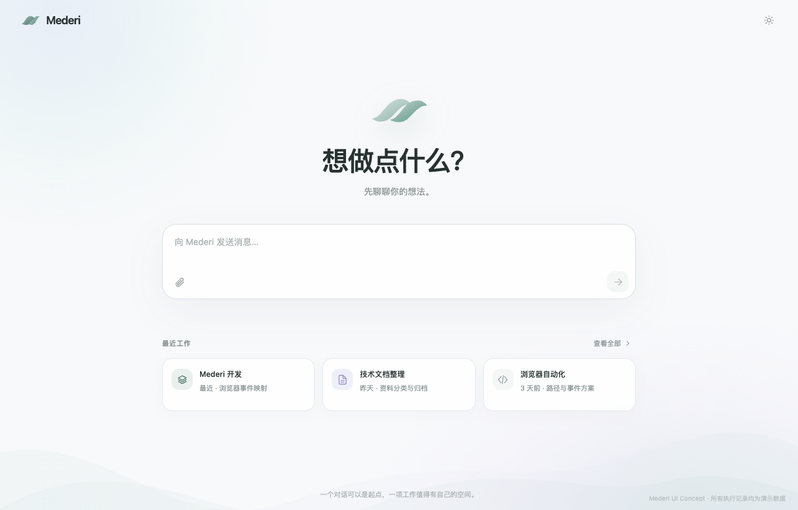
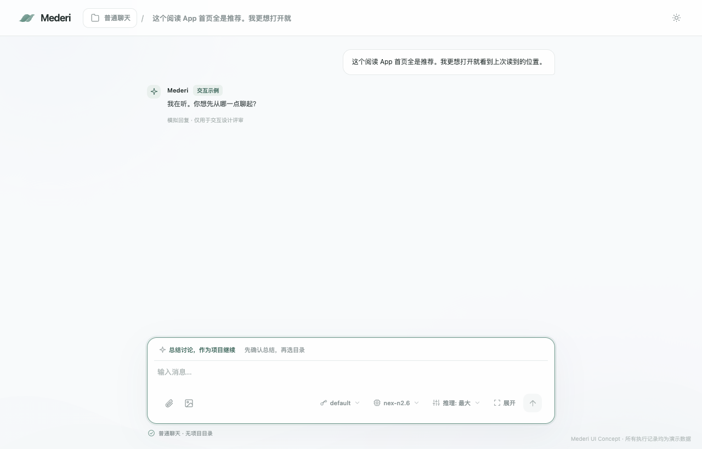
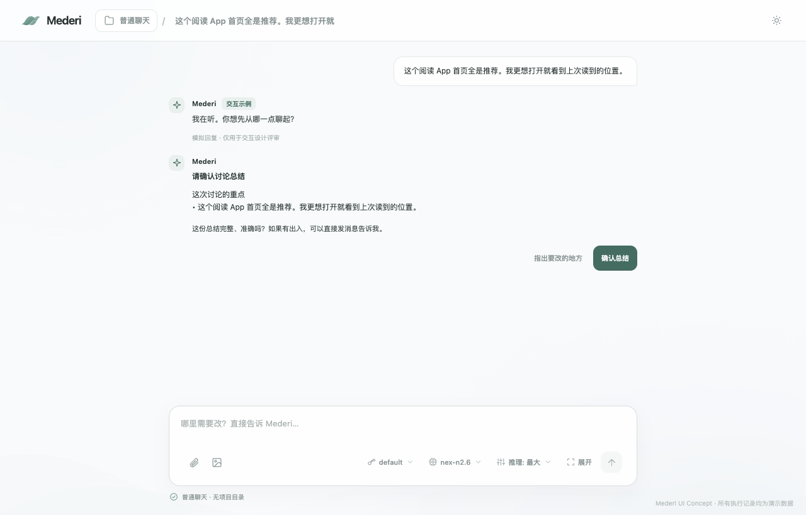
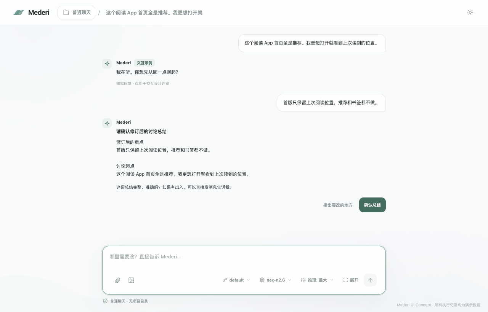
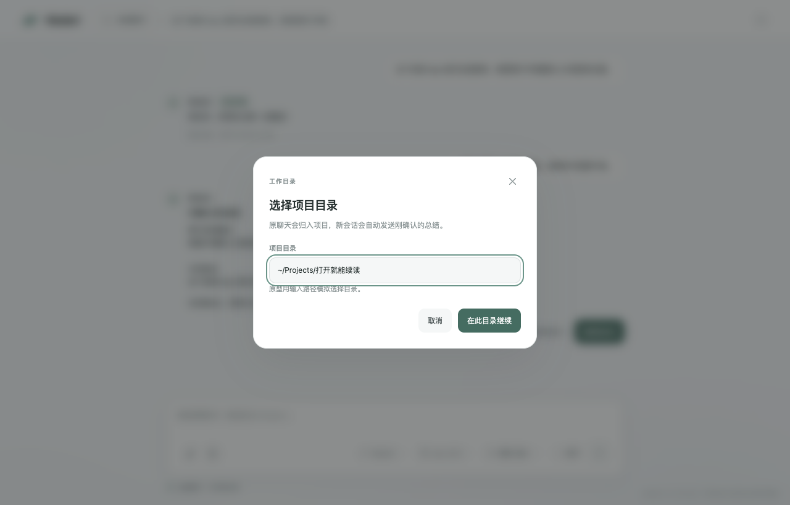
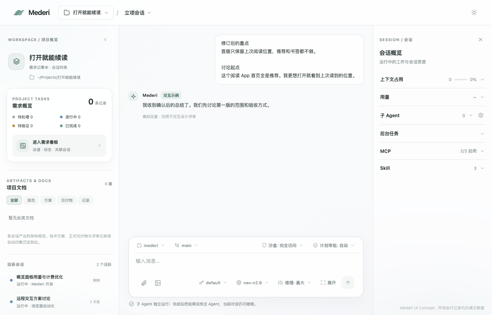
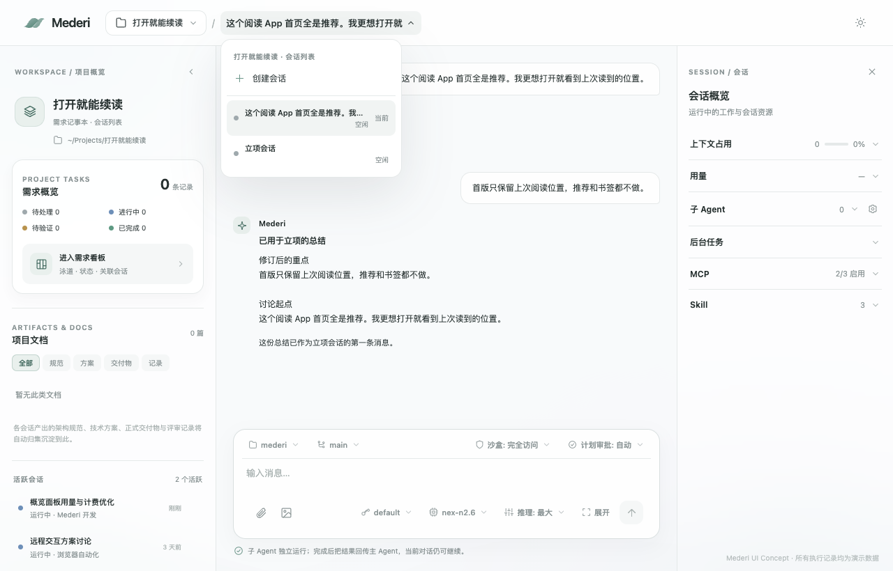

# Mederi v0.5 需求文档 · 从普通聊天到立项

**评审状态**　需求待实现  
**范围**　首页、普通聊天、Agent 总结与确认、选择目录、原聊天归入项目、立项会话首发  
**交互参考**　[工程实施计划](v05-workspace-first-ui-plan.md#41-普通聊天与立项)

本篇详述聊天立项。其它工作台模块见[工程实施计划](v05-workspace-first-ui-plan.md)。

## 1. 目标与业务口径

用户可以直接打开 Mederi 聊天。聊出一个值得继续做的想法后，用户可以把这段讨论转成项目，通过确认过的总结开启项目中的下一段会话。原聊天及其历史仍可在项目内查看。

| 名称 | 业务定义 |
|---|---|
| 普通聊天 | 一条长期保存的会话，当前没有项目归属，也没有项目工作目录。 |
| 立项总结 | Agent 根据原聊天生成的一版只读内容。用户通过聊天消息提出纠正，Agent 生成新版本。 |
| 原讨论 | 转入项目后的原聊天。身份、消息记录与附件沿用原会话，归属变为新项目。 |
| 立项会话 | 新项目中另外创建的一条会话。其第一条用户消息是最后确认的总结原文，由系统自动提交。 |
| 项目目录 | Agent 在项目模式下工作的目录。原讨论及立项会话的历史继续保存于应用数据目录中的会话数据库。 |

完整流程为 **首页发送 → 普通聊天 → 请求总结 → 确认或发消息纠正 → 选择目录 → 初始化项目与转入原讨论 → 打开立项会话并自动首发**。

## 2. 分步需求

### 01 · 首页与最近工作

- 首页输入框始终用于开始一段新的普通聊天。此前打开过的项目、当前项目选择或消息中的“写代码”“整理目录”等字样均不改变首发归属。
- 首页只有一块「最近工作」。普通聊天和项目都从这里进入。点聊天进入该聊天。点项目进入该项目原有入口。查看全部沿用同一个数据集合。
- 最近工作的排序依据实际最近活动。完成转换后，新项目进入最近工作，原讨论从其中的普通聊天条目移除。
- 空白消息无法提交。用户输入后未发送，停留在首页草稿态。

**数据变化。** 打开首页、编辑草稿、点击已有条目都不创建会话或项目。第一次成功提交非空首页消息才创建普通聊天。

### 02 · 首发进入普通聊天

- 第一次提交生成独立会话身份，把该消息写入普通聊天并进入其页面。后续发送继续写同一条会话。
- 页面沿用原工作台的消息流、输入框和视觉样式。隐藏左侧项目栏、右侧项目会话概览，以及输入框上沿的项目、分支、沙盒和计划审批控件。
- 输入框上沿显示「总结讨论，作为项目继续」，提示「先确认总结，再选目录」。普通聊天继续使用原有发送、历史、草稿和错误反馈。
- 返回首页后，可以从「最近工作」回到这段聊天。重新打开应用也能读到已保存的会话和消息。

**数据变化。** 普通聊天和消息写入应用数据目录内的会话及消息存储。此时没有项目归属，无目录选择或项目初始化操作。

### 03 · 请求 Agent 总结

- 有两种触发方式。用户点击输入框上沿的总结按钮，或明确告诉 Agent 要把讨论立项，由 Agent 调用立项工具。
- 两种方式进入同一流程。Agent 从这段聊天提炼目标、已达成的共识、首版范围和还需讨论的问题。总结应保留用户要求的关键约束，未定内容用「待讨论」表达。
- Agent 在消息流中给出**可直接阅读的完整总结**，并问用户是否完整、准确。卡片只读，一开始就有正文。
- 卡片显示「确认总结」和「指出要改的地方」。后者只聚焦日常聊天输入框。用户也可直接在输入框发消息。
- 生成期间只保留一个当前请求。生成失败时在原聊天反馈失败，可重新请求生成。只有成功返回的当前版本可确认。

**数据变化。** 保存这次总结的来源会话、版本和正文。普通聊天归属、项目列表和目录权限不变。

### 04 · 用户纠正，Agent 给出新版

- 用户在日常聊天输入框发送澄清，例如「首版只保留上次阅读位置，推荐和书签都不做。」纠正消息本身也成为聊天历史的一部分。
- Agent 根据原讨论、已有总结和用户新的说明生成一份**完整的新总结**。用户纠正的结论以最新明确表达为准。新版包含此前仍然有效的结论。
- 新版回到待确认状态。用户可以继续纠正多轮，直到确认某一版。旧版确认按钮随新版失效。用户此前已确认但取消了选目录时，发出纠正同样需要重新确认。
- 若修订失败，保留用户的纠正消息和已生成的正文以供查看。提供重新生成入口，当前纠正获得新版后才能继续确认。迟到的旧版结果不可覆盖后来生成的版本。

**数据变化。** 追加纠正消息并记录新的总结版本。用户输入的是对 Agent 的纠正，只有 Agent 生成的总结正文会成为候选立项开篇。

### 05 · 确认当前总结，选择目录

- 点击「确认总结」时锁定当前版本及其完整文本，随后打开目录选择器。确认动作绑定来源会话和总结版本。
- 目录选择界面说明选定后的两项结果。原聊天会归入项目，新会话会自动发送刚确认的总结。
- 用户取消选目录时回到原聊天，保留原历史与已确认总结，显示「继续选目录」。再次打开选择器使用同一确认版本。
- 只有用户明确选定目录并继续，才开始创建项目。目录无效、不可访问或已属于另一项目时，显示具体错误并留在可重新选择的状态。继续操作时仍使用原确认版本，除非用户提交了新纠正。

**数据变化。** 确认只记录版本和确认事实。取消、无效目录及权限拒绝都不改变原聊天的归属。真实产品使用宿主提供的系统目录选择器，图 5 中的输入路径仅为当时原型的模拟操作。

### 06 · 初始化项目，打开立项会话

- 用户提交有效目录后进入初始化状态。初始化期间同一次操作只能提交一次。
- 项目准备好后，系统把原聊天关联到该项目，同时创建一个独立的「立项会话」。原讨论继续使用原会话 ID，保持消息顺序及原有附件等关联。
- 直接打开「立项会话」。系统通过正常发送链路，把**最后确认版本的正文原样**自动提交为第一条用户消息。保留正文、段落和换行，同一操作只提交一条。原讨论全文仍在项目内的原会话。
- Agent 围绕总结继续讨论项目的目标、首版范围、细节及下一步。
- 初始化失败时原聊天维持普通聊天归属，保留确认内容并显示失败。如果项目和两个会话已经创建成功、首发未被接受，保留项目与立项会话，并在当前立项会话显示发送失败及重试入口。重试复用原会话及消息身份。

**数据变化。** 写入项目和工作目录绑定，修改原会话归属，创建唯一的新立项会话及其首条发送记录。项目目录与应用数据库各自承担工作文件与会话记录的存储职责。

### 07 · 回看原讨论

- 项目会话菜单可分别打开原讨论与立项会话。原讨论显示原始聊天记录、用户的纠正消息和最终用于立项的总结。
- 回到首页时，「最近工作」体现新项目。打开该项目后仍能在项目会话内找到这两段会话。
- 转换成功后，普通聊天入口不再列出原讨论。项目里的原讨论和立项会话继续各自保存新消息、草稿与滚动状态。

**数据变化。** 在两段会话间导航只改变当前选中项。原讨论归属、立项会话和首条已发送消息保持稳定。

## 3. 状态与恢复

| 状态 | 用户可做的事 | 系统承诺 |
|---|---|---|
| 普通聊天 | 继续聊、返回首页、请求总结 | 已发送消息持久化，会话未绑定项目。 |
| 生成总结 | 等待结果、查看原对话 | 只接受属于当前会话和请求的结果。失败可重发生成请求。 |
| 总结待确认 | 确认当前版本、通过聊天纠正 | 卡片正文只读，确认指向当前可见版本。 |
| 已确认，待选目录 | 继续选目录、取消、补充纠正 | 取消保留确认。新纠正使旧确认失效。 |
| 正在初始化 | 查看进度 | 阻止重复提交。只有项目初始化完成后，项目及会话归属才对用户展示为成功。 |
| 项目已完成，首发待处理 | 查看立项会话、失败时重试发送 | 原讨论已转入项目。首发重试复用同一条发送记录。 |
| 首发已接收 | 正常继续会话、回看原讨论 | 页面切换和刷新都不触发第二次首发。 |

**重入约束。** 重复点击确认、目录结果迟到、切走再回来时，都用来源会话、总结版本和立项操作身份核对。已进入初始化的操作依据其最终真实状态展示。任何失败的阶段都能定位到相应用户动作，保留已经提交成功的数据。

## 4. 实现边界

- **视图层。** 首页、普通聊天和项目会话按各自布局装配共享消息流和 Composer。总结使用消息卡片呈现。Compose 界面只发出确认、专注输入和继续选目录等意图。
- **状态层。** 会话 VM 管理普通聊天、草稿及当前总结。确认绑定稳定版本。宿主目录选择结果必须和发起时的会话及版本对应。
- **业务与存储层。** 普通聊天持久化与立项转换属于 AiCore。原会话归属变更与立项首发使用稳定身份，复用现有消息存储和发送链路。桌面直调与远端通过同一契约。界面保持单一真理源。
- **实现规则。** 状态与操作使用类型，界面文案使用资源，尺寸使用 token，结构化数据经序列化库。真实零值显示 0，未知状态用「-」或对应状态文案。错误以事实反馈，防御性检查负责避免异常中断与错写归属。

## 5. 验收清单

| 编号 | 验收动作 | 可观察结果 |
|---|---|---|
| AC-01 | 从已有项目返回首页，发送「想聊聊怎么改这个 App」 | 创建普通聊天。项目数未变，目录选择器未打开。 |
| AC-02 | 普通聊天发送两条消息，返回首页后重新打开，再重启客户端打开 | 始终恢复同一会话及两条消息。只有一组最近工作。 |
| AC-03 | 点「总结讨论，作为项目继续」 | 内容完整展示在只读卡片。可直接确认，卡片无可编辑字段。 |
| AC-04 | 在日常输入框发送一条纠正，再发第二条补充 | 用户消息保留。当前总结反映两次仍然有效的结论，等待再次确认。 |
| AC-05 | 确认后取消选目录，再点「继续选目录」 | 相同确认版本可继续。取消时原聊天归属和项目数未变。 |
| AC-06 | 确认后取消选目录，再发纠正 | 已确认版本失效。生成新版后重新确认，才可进入选目录。 |
| AC-07 | 选择不可访问或已绑定项目的目录，或初始化失败 | 有明确失败信息。原聊天仍能从普通聊天入口进入，确认仍可用。 |
| AC-08 | 选择有效目录并快速重复触发提交 | 创建一个项目和一个立项会话。旧会话 ID 和历史保持，归属只变更一次。 |
| AC-09 | 检查立项会话首条入站消息 | 和最后确认版本逐字一致，保留换行。无其它普通聊天历史自动复制进新会话。 |
| AC-10 | 模拟项目已创建但首发失败，用户重试并重启客户端 | 复用同一立项会话和同一首发消息身份。最终只有一条开篇消息。 |
| AC-11 | 在项目内切回原讨论，再到首页打开项目 | 原讨论可回看。首页普通聊天集合不再列出已转入项目的会话。 |
| AC-12 | 在紧凑窗口及键盘操作下走查 | 总结正文可阅读，能聚焦原输入框发纠正，确认与取消可达，焦点回到正确页面。 |

生产验收以真实 Compose 操作、会话和请求状态断言为准。截图用于设计对照。失败、重复提交和重启恢复由状态与持久化测试覆盖。

### 截图来源

图 1–7 来自已下线的交互原型在 Chromium 桌面视口 1280×820 的实拍（原型 HTML 已删除，截图仍保留于 `docs/design/reference/v05/chat-to-project/`），使用同一段「阅读 App」演示数据。目录选择、AI 总结和项目控件值均为原型模拟。截图中现有项目控件的示例分支和权限，仅用于展示它们在项目视图中的位置。
