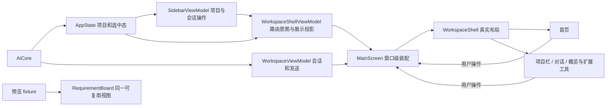

# Mederi v0.5 Workspace-First UI 实现规格

状态：待复核。旧工作台业务规则是讨论稿。普通聊天与立项以 §4.1 和 [需求文档](v05-chat-to-project-prd.md) 为准。现有文件清单和截图矩阵仍是外壳计划，普通聊天的生产接口、迁移与测试需另行拆分。

产品操作、业务规则、待决事项及完整截图的原 PD 文档与可交互原型已废弃删除，聊天立项的业务规则见[需求文档](v05-chat-to-project-prd.md)，外壳布局与规格以本文为准。

## 1. 交付范围与设计裁定

| 批次 | 交付 | 用户入口 |
|---|---|---|
| A | 真实首页、全局顶栏、响应式三栏工作台、现有会话概览迁址、跨项目活跃会话、输入栏重排 | 正常应用入口，所有共享 UI 目标 |
| B | 四列需求看板、详情抽屉、关联会话跳转、伴随对话的完整可交互原型 | Compose UI 测试及预览入口，使用隔离 fixture |
| 后续独立批次 | 真实需求存储与 Agent 工具，以及项目级自动文档归集 | 等真实数据契约和产品范围单独确定 |

**实现方式。** 基于现有 UI 做容器重构，新的组件限于外壳、首页、项目栏和看板。保留 AppState、现有业务 VM、现有发送入口、消息列表、输入组件、概览十行、Dock、扩展面板、InkCompose 与弹窗。迁出旧 Workspace 顶栏与 MainScreen 桌面边缘唤出外壳前，按 §5 迁移入口。生产项目栏本期展示项目身份与真实活跃会话。需求区、种子记录和看板入口在 B 的预览装配出现。生产包的点击路径无法进入预览。完整原型和真实需求上线分别验收。

**视觉参考。** 原型 HTML（`temp/ui_v05_requirements.html` 及其引用哈希）已废弃删除，不再作为结构或视觉对照来源。产品使用现行 iris、Light/Dark、实色 surface、现有品牌资产与字体。横向尺寸以 §6 为准，正文统一 744dp。最终皮肤以单独评审的 Compose 基线为准。

## 2. 实现硬约束

- **无魔法字符串和数字。** 可见文案、键盘提示、状态朗读、快捷动作模板及占位符使用中英 Compose Resources。路由、分栏、覆盖层、需求状态、快捷动作使用密封类型或枚举。Preferences key、语义 tag、测试场景 ID、文件名模板、环境变量名各在其所属边界集中声明。动态 tag 由命名函数根据固定前缀和实体 ID 生成。布局/字号/透明度/角度只在 token 定义点出现，动画时长只引用 WorkspaceMotionPolicy，测试阈值只从验证配置读取。计数和集合算法用 Kotlin 的 count、size、isEmpty、indices 等原生表达；数值具有产品含义时必须有命名。已有 UI 迁移代码触及的设计字面量移入所属 token。
- **结构化 JSON 唯一编解码路径。** Kotlin 侧用 `@Serializable` 与 `Json.encodeToString/decodeFromString`。参考渲染脚本用标准库 JSON 编解码。禁止字符串模板、拼接、正则、手术式提取或动态拼接 JS 源码来生成 JSON。脚本入参走结构化参数。本期 UI 状态本身无需 JSON 持久化。
- **默认展示与事实分开。** 真实空集合的计数显示本地化的 0，缺失字段显示资源 `workspace_value_missing`（`-`），输入初始为空。未知数值保持 nullable，渲染 `-`；已知为零才显示 0。任何占位符都不可写回模型、发给 Core 或当实体 ID。缺 ID 时不渲染可点击实体操作。加载、空、错误、实际内容各有状态，同屏已有真实内容按该实体当前状态展示。
- **防御性编程。** 组合前验证归属以及当前请求代次，异步完成只提交到匹配的上下文。对实际错误走现有错误路由，保留对应草稿并允许用户明确重试。取消是取消，过期是过期，错误是错误。禁止兜底造数据、默认项目/会话、猜用户意图、自动改路由、自动重试或吞失败后报成功。沿用既有发送校验与错误呈现，新增代码不自行补模型或权限。程序边界处理已知异常，重抛取消。
- **KMP 与 MVVM。** 生产变更放 commonMain。平台目录选择、IME、宿主能力、偏好读写沿用现有入口。组合体读取状态、发意图、管理测量/滚动/焦点等展示生命周期。投影、原子选中、异步状态和业务入口在 VM/AppState。禁止组合期间 IO、JSON、生成随机业务 ID 或另开会话订阅。测试的 JVM 截图写盘留在 jvmTest。

## 3. 架构与状态所有权



| 所有者 | 状态与契约 |
|---|---|
| AppState | 当前项目、当前会话、项目集合、主题、语言、设备偏好。项目/会话切换沿用 SidebarViewModel 既有入口。若现有入口无法成组切换，在该 VM 增加按归属校验的单入口 `openConversation(projectId, conversationId)`，沿用既有切换顺序和 AppState 写入口。Shell 不保留第二份当前 ID。 |
| WorkspaceViewModel | 发送、附件、模型和权限选择、会话快照、草稿、反馈、审批、对话滚动归属相关既有行为、Dock 目标。首页和看板的输入调用同一发送入口与复用的输入组件。RawMessagesViewModel、TerminalViewModel 在窗口 Route 一次创建和注入，跨布局切换保留身份。 |
| WorkspaceShellViewModel | `StateFlow<WorkspaceShellUiState>`，投影当前路由、最近工作、活跃会话、项目/会话菜单项和正在选目录或选择项目的首发意图。接收 `onIntent(WorkspaceShellIntent)`。注入现有 VM/状态来源，子状态更新走原所有者。根路由 `Home`、`Chat`、`Workspace`，看板在 B 测试装配使用 `Board`。布局档位由宽度纯函数得出。 |
| WorkspaceEffectState、OverviewWindowState | 窗口保留现有 effect 通道及设置/压缩弹窗投递。Route 持有单一 OverviewWindowState，原偏好加载、保存及兼容读取沿用。窄屏打开概览是临时覆盖层意图，独立于宽屏显隐偏好。可见性统一输入真实概览组合和轮询，切会话保留现有行重置与子 Agent 自动展开规则。 |
| 展示局部状态 | 同层浮层只允许一个，使用类型化目标。弹出菜单焦点、列表滚动、焦点请求、Kb/IME、拖拽当前坐标放展示层。需求详情的实体 ID、状态写入和拖拽提交归 B 的 VM。会话列表项使用真实 ID 作 key。 |
| B 预览 VM | `RequirementBoardViewModel` 持有预览工作区、按项目 ID 隔离的需求列表、详情目标和选择的伴随会话。数据注入自 jvmTest fixture。看板、项目栏计数和详情共读同一快照。预览中的对话使用生产视图与测试 AiCore。 |

窗口层先创建现有 VM，随后装配 Shell VM。切换 Home、Workspace、Board 或响应档位时只有一个活动 ConversationSurface、Composer、概览及工具宿主。平台原生浏览器和弹窗继续走既有 heavyweight/IME 遮挡处理。保存/恢复使用现有状态归属；当 viewport 宿主替换时，按会话 ID 或既有项目草稿键保存滚动与输入归属。页面切离不停止 turn、子代理、终端任务或压缩。

Shell 状态至少包含 `route`、`recentWork`、`workingConversations`、`projectMenuItems`、`conversationMenuItems`、`homeSubmission`。首页普通聊天首发只记录发送身份及草稿修订。立项状态和目录选择归 §4.1 的独立操作，用来源会话 ID 和总结修订 ID 校验迟到回调。弹层目标用 `ProjectPane / SessionPane / Tool(panel)`，菜单目标用 `Projects / Conversations / More`。宽屏常驻栏和选中 Dock target 从现有状态投影。打开菜单时关闭另一个菜单；菜单选项打开覆盖层时先释放菜单焦点，再将焦点交给新覆盖层。切换档位时回焦同一入口，若入口移入「更多」则焦点交给「更多」；点击实体导航后交给目标页的主标题。平台返回、Escape、点击外部均只作用于最上层。

## 4. 路由、首页与看板状态契约

### 4.1 普通聊天与立项

业务规则、逐步截图与验收用例见 [从普通聊天到立项需求文档](v05-chat-to-project-prd.md)。

原交互原型（HTML）已废弃删除。首页、普通聊天、总结确认、目录选择和项目内两段会话的交互规格以 [需求文档](v05-chat-to-project-prd.md) 的分步描述和截图为准。

| 页面或动作 | 规格 |
|---|---|
| 首页 | 中间是纯聊天输入。只有一个「最近工作」，按最近活动混合展示普通聊天与项目，以类型区分。点聊天回到原聊天，点项目进入该项目会话。移除重复的「继续上次工作」入口和首页预设快捷动作。 |
| 首页发送 | 首页草稿首次发送时创建无项目归属的普通聊天，然后沿用同一消息发送及历史链路。此前选中的项目不参与。普通聊天与已有项目会话都存应用数据目录内的同一套会话、消息记录。 |
| 普通聊天页 | 用左侧聊天历史、中央消息流、底部 Composer。窄屏历史从顶栏打开。与项目会话共享消息流、卡片、Markdown、发送与草稿逻辑，项目选择、Git 分支、项目权限和其它工作台控件由项目页面装配。 |
| 请求总结 | 普通聊天 Composer 上沿用「总结讨论，作为项目继续」与「先确认总结，再选目录」替代项目设置一行。首页和项目会话不显示此入口。Agent 根据讨论生成总结，展示在消息流的只读确认卡。用户可直接确认，或在聊天输入框发送补充与纠正。Agent 据此生成新版并再次请求确认。实际创建由用户确认和选目录触发。原型按钮模拟 Agent 工具调用。 |
| 确认总结 | 保存确认版本的精确文本和修订 ID，打开系统目录选择器。取消后原聊天、确认文本和历史保留，可继续选目录。取消选目录后若用户又发来纠正，旧确认失效。仅新版获确认后可再次选择目录。 |
| 选定目录 | 创建并初始化项目。保留原聊天 ID、消息、附件和时间，只把其归属改为项目，随后它从聊天历史移到项目会话列表。项目目录是实际工作目录，会话历史继续留在应用数据库。 |
| 初始化成功 | 打开新建的「立项会话」。用用户最后确认的总结原文作为这段新会话的第一条用户消息，自动提交一次。原讨论保留在同项目内，用户可随时返回查看。 |

**接线约束。** 现有项目首发需要项目 ID，普通聊天需独立创建入口与明确会话归属，沿用同一数据存储与发送管线。不要将仅内存的 EphemeralStores 当作普通聊天的持久化方案。立项是 AiCore 的业务操作，用户目录选择由宿主提供，原聊天转换和首条自动发送各以稳定 ID 跟踪。初始化失败时原聊天保持可见。成功后重试首发只能重投同一立项会话及同一消息身份，避免重复创建项目或会话。原讨论消息完整保留，新的首发只携带已确认的总结。

### 4.2 B 批次需求看板预览

- 模型使用 `RequirementItem(id, projectId, title, description, status, tag, linkedConversationIds)`。实体 ID 为强类型预览 ID，关联会话复用合约 ID 类型。状态枚举固定 `Backlog → InProgress → InReview → Done` 顺序，允许显式在任意两状态间移动。预览记录与项目 ID 一起注入，窗口/测试重建即重新读 fixture，界面明确标记「演示数据」。
- 项目栏展示当前项目四态计数与进入看板入口。需求列表统一在看板中。对话内已有对应需求卡时，可打开看板并定位详情。看板每列沿初始稳定顺序排列，新增进入 Backlog 末尾，跨列移动至目标列末尾。每条记录只存在一次。空列保留列头和操作区域。
- 鼠标拖拽整卡，目标列显示选中边界。释放在有效目标只提交一次 Move，释放在列外、取消、原列释放均保持数据。键盘或触屏用卡片打开抽屉，再用状态选择器执行同一 Move。新增使用明确按钮、标题与描述表单。空标题禁提交，描述允许空白并显示占位符。普通对话不会产生需求。
- 抽屉标题、描述、可选标签、状态选择、同项目关联会话按序显示。无关联显示 `-`；失效关联显示不可用语义，不提供跳转。点有效关联先关闭抽屉再进入对应会话；返回项目看板时按该项目重新解析选中需求。切换项目时清详情、拖拽和伴随对话的旧页绑定。
- 看板伴随对话采用当前明确选中的会话，使用真实对话内容组件、同一 VM 和同一发送路径。无会话时显示明确空态和会话选择入口。进入看板前记录视觉来源，回到聊天保留该会话的草稿及原聊天滚动。窄视口以单个伴随对话覆盖层呈现，关闭回看板，保持当前会话。
- 后续生产接入归 AiCore，四处同步。Core 拥有项目需求真理源并发出结构化事件。需要单独定稿数据库归属与迁移、版本冲突、归档/删除后的关联语义、写权限及 Agent 工具契约。本期不预建接口或表。

### 4.3 新版原型的操作与业务边界

| 操作 | 作用范围与真实接线 |
|---|---|
| 左栏「活跃会话」 | 汇总所有项目里状态为 `ConversationStatus.Working` 的会话。用项目和会话 ID 成对标识行，显示项目名。点击时校验归属，一次导航切换项目与会话，不影响原会话的执行。等待输入和失败会话仍可从会话菜单进入。 |
| 「需求概览」与看板 | 摘要只读当前项目，四态计数与看板共用同一来源。看板拖拽或下拉只修改需求状态，不触发执行、创建计划或确认验证。原型用字符串匹配展示跨会话关联及去重意图，生产契约需要独立定义查询、明确创建和关联操作。询问进度会不会新增关联尚待定。 |
| 「项目文档」 | 当前项目的跨会话资产。原型演示全部/规范/方案/交付物/记录、置顶展示、详情、全文复制及产出会话跳转。现有阅读器可复用，但当前会话文档投影无法充当项目目录。归集触发、分类来源、置顶写入、权限与删除归属待真实契约确定。复制成功必须来自真实剪贴板写入；原型此动作只有 toast。 |
| 输入上栏 | 工作区与分支通过现有 WorkspaceSelector 与工作区流程取得实际状态；导航选择项目、草稿选择起始分支、已有会话迁移分别走对应操作，不能用 Chip 回调替换 Git 状态。沙盒权限由项目级 ProjectPermissionStore 投影，经当前项目权限流程保存。计划审批读会话或新会话草稿的 AgentMode，独立于沙盒权限。 |
| 输入下栏 | 附件、图片、API Key、模型、推理、展开、发送/停止按原型分组排布。保留现有能力门禁、模型与 Key 归属、草稿和发送状态。真实分支、模型、Key 和推理档位来自已有状态与契约。空值展示遵循 §2，原型硬编码选项、默认 `main` 和「完全访问」均不构成产品规则。 |

## 5. 现有入口迁移清单

| 现有能力 | 新位置与验收 |
|---|---|
| 项目和会话选择、新建会话 | 顶栏级联菜单。新建仅进入项目内的未绑定草稿态，沿用首发才创建语义。项目长名/会话长名末尾省略，可访问名称包含全文。 |
| 目录选择与项目创建、重命名、删除、项目权限、会话重命名、归档/恢复、固定项及已有项目/会话管理入口 | 顶栏相应菜单内保留动作，复用 Sidebar 现有行、回调、确认/管理弹窗。用旧侧栏与顶栏的全部实际交互做迁移核对。只有新入口已接管的旧外壳代码才删除。 |
| 设置、主题、概览、项目栏 | 设置和主题在右侧顶栏。概览按钮在所有宽度都有。项目栏折叠后由同一顶栏按钮重开。旧 Pin 与边缘自动唤出属于旧外壳交互，项目栏用显式开合；旧偏好键保留兼容，v0.5 不读写它们，本期不新建项目栏折叠持久化。 |
| 概览十行 | 沿用 OverviewRowIndex 的现有顺序、条件行、统计、压缩、子 Agent 设置、后台任务、计划、文档、Todo、MCP、Skill、原始消息的回调及弹层。右栏同一时刻最多一行展开。概览关闭时组合移除并停后台查询，重开遵从已有规则。 |
| 代码变更、文件、终端和浏览器 | 宽屏保留原 Dock，工具打开时占用右侧槽、临时替代概览，关闭后恢复此前概览可见状态。紧凑/窄屏由顶栏「工具」菜单展示原 Dock 操作，目标使用现有枚举。 |
| 文档、差异、浏览器自动弹出、确认、错误、压缩提示 | 文档经 `openDocument`、差异经现有 presenter、浏览器经原事件。WorkspaceDialogs、反馈和全局设置继续走根路由现有单实例；同会话返回时验证浮层、审批、提问和断流继续动作。 |
| 窗口快捷键及 IME | 沿用当前生产入口的快捷键。菜单可用 Tab/方向键/Enter/Escape，焦点顺序为顶栏→左栏→中栏→右栏。窄屏覆盖层捕获自身焦点并关闭后还原。键盘出现时 composer 可见，其他窗口弹出层沿用现有 textarea 桥接关闭机制。 |

## 6. 布局和视觉取值

### 6.1 布局档位

窗口的**内容可用 dp**决定档位。共享 UI 只用一个 `WorkspaceShellMetrics.forWidth(width)`，测试在两条边界的两侧取样。应用安全区与 IME inset 由已有设施消费一次。

| 可用宽度 | 顶栏 | Workspace | Board 预览 |
|---|---|---|---|
| ≥1120dp | 66dp，横向边距 24dp | 左 280dp，中栏占余量且至少 420dp，右 308dp，原 Dock 46dp。三栏无额外 gutter，分隔线画在栏内。 | 看板占余量，右侧伴聊固定 300dp，抽屉覆盖右缘 |
| ≥768 且 <1120dp | 60dp，边距 16dp | 左 240dp，可折叠。中栏占余量。概览/工具作为右侧覆盖层，概览宽度取 308dp 与可用宽度的较小值。 | 看板全宽，伴聊用右侧覆盖层 |
| <768dp | 60dp，边距 12dp | 只常驻中栏。左项目栏、右概览/工具以覆盖层提供；宽度上限分别 320/308dp，受实际可用宽度限制。顶栏空间紧时用「更多」容纳设置、主题和工具。 | 看板横向滚动，伴聊/详情使用全宽覆盖层 |
| 所有宽度 | 交互触达至少 44dp，图标可更小 | 消息列/输入列外框上限统一 744dp，居中。宽/紧凑横向安全边距 24dp，窄屏 16dp；窗口自然只能提供的宽度不强制撑出。 | 四列，列最小 168dp，列间距 12dp。列区可横滚，列内独立纵滚。 |

### 6.2 组件规格

| 区域 | 尺寸、顺序、溢出行为 |
|---|---|
| 顶栏 | 品牌 18sp/24sp Medium，图标 24dp。项目→斜杠分隔→会话→弹性空位→操作。菜单最大宽 360dp，最大高度取 440dp 与可用空间较小者，载入原有共享菜单；超高时内部滚动。窄屏项目、会话各至少保留一个可访问触发点。 |
| 首页 | 内容整体可纵滚。Hero 以上内容从安全区下开始，上留白宽屏 64dp、窄屏 32dp。品牌图标宽 96dp，标题宽屏 36sp/44sp、窄屏 28sp/36sp。说明 14sp/20sp。Hero→composer 间隔 24dp。「最近工作」区上间距 32dp。近期卡片宽屏 3 列、紧凑 2 列、窄屏 1 列，间距 12dp，最小高 72dp，标题/次要信息可换行。 |
| 项目栏 | 16dp 内边距。项目名 16sp/24sp，路径 12sp/16sp，可选中或使用现有显示能力，长路径只在视觉上省略。生产为当前项目身份、目录和跨项目真实 Working 会话组。按最近活动降序；无活跃会话显示空态。看板预览在目录下加当前项目需求摘要，区间隔 24dp。项目栏整体纵滚。 |
| 对话 | 保留原消息内部字号、Markdown、代码、推理/工具/审批卡样式。仅替换容器限宽及边距。消息列表可独立滚动，Composer 固定在会话容器底部，横向边界与消息列一致，底部留白 16dp 加宿主 inset。现有浮动反馈在输入上方。 |
| 概览 | 16dp 内边距，标题 14sp/20sp。标准行视觉最小 36dp，交互最小 44dp，放大字体允许行高增长。边界使用 1dp 细分割线，行内间距 8dp，不做外包卡。展开内容可滚动，行头保留展开语义和已有行头动作。 |
| 看板与详情 | 看板内边距 20dp，卡片内边距 12dp、列内间距 10dp、圆角 12dp。卡片标题 14sp/20sp，标签与关联数 12sp/16sp。详情抽屉宽度上限 360dp、内边距 20dp，正文 14sp/20sp。标题与关闭固定，内容纵滚。伴聊窄栏内部排版复用对话组件的紧凑样式，仍可访问发送、停止和已有必要控件。 |

字号和行高使用现有相同语义 token；本表新增值统一进 `theme/WorkspaceShellTokens.kt`。组织为 `ShellSpacing`、`ShellType`、`ShellSize`、`ShellMotionGeometry`，同语义的现有值用引用，偶然同值保留独立语义。字重只用 Regular/Medium，现有平台字体。文字使用省略时保留完整语义标签，键盘可达。窄窗口 320dp、放大字体 1.6× 至少能到达每项操作，页面可滚动；看板列区是唯一允许横向溢出的主要布局。

### 6.3 主题与状态

以下为语义绑定，精确色值由 [现有 token 标准](standard/01-tokens.md) 和 MederiColors 供给。表中色值作验收锚点，代码引用语义字段。

| 元素 | 绑定 |
|---|---|
| 页面、主聊天背景 | `surfaceWorkspace`，Light #FFFFFF，Dark #111113 |
| 常驻项目栏、常驻概览、顶栏 | `surfaceSidebar`，Light #F9F9FB，Dark #111113。Dark 同色时靠留白、边界和内容分组区分 |
| 首页最近项目卡和看板卡 | `surfaceCard`，Light #FFFFFF，Dark #18181A |
| 菜单与抽屉 | 菜单沿用 `WorkspaceDropdownMenu` 的表面，抽屉用 `surfaceCard`，遮罩用 `surfaceOverlay` |
| 分隔线／焦点 | `border` 与 `accent-focus`。常态只在区块边界用 hairline，焦点环在键盘 focus-visible 可见 |
| 文字 | `text-primary` / `text-secondary`，辅助用 `text-muted`；小字号可读信息如路径、计数、状态优先 secondary。实色操作文字使用 `on-accent` |
| 选中、品牌、主动作 | Iris；实色 #5B5BD6，轻选中 `accent-bg` 加 `accent-text`。Composer 保留现有发送控件颜色语义 |
| 需求及会话状态 | 待处理/空闲用中性，进行中用 iris，待验证/等待输入用 warning，完成用 success，实际失败用 danger。均配文字或状态语义，新需求模型只有四态 |
| 动效中的颜色 | 同一主题语义的 alpha 过渡，保持文字可读。无额外紫色进度或新蓝色状态。 |

### 6.4 动效与层叠

| 动作 | 正常动效 | 减弱动效 |
|---|---|---|
| 按下/悬停/键盘 focus | 共用反馈 120ms，背景颜色过渡，焦点轮廓从获得焦点即出现 | 即时 |
| 下拉菜单 | 共用局部 180ms，内容淡入/淡出；箭头从 0° 到 180°，点击外部/Escape 立即取消交互，完成退出后移除组合 | 即时切换 |
| 项目栏、概览、工具、需求抽屉 | 共用面板 200ms。覆盖层从自身边缘水平进出，遮罩淡入；宽屏两栏开合用容器宽度变化，不缩放文字。顶部选中与可访问语义随目标状态更新 | 即时给出最终布局 |
| 首页/工作台/看板切换 | 共用面板 200ms，外壳静止，活动页面淡入。Composer/原生终端或浏览器宿主不得被动画创建两份 | 即时 |
| 概览手风琴 | 共用局部 180ms，高度展开/收起，箭头同速。新行展开时旧行立即关闭交互和语义节点 | 即时 |
| 拖拽 | 抬起采用反馈 token，目标边界语义色；释放只提交一次，卡片位置更新用局部时长。取消恢复原位置 | 状态变化即时，指针仍可拖拽 |
| 运行和请求 | 复用既有 2400ms alpha 呼吸和 1000ms 加载旋转，仅真实可见且状态允许时启用。已有真实等待用户状态保持静态 | 静态标识及文字 |

有限动画全部从 `LocalWorkspaceMotion` 的既有 policy 取值，使用既有 easing。新增旋转角度只在 geometry token 声明，并沿用当前 Accordion 指示图方向。层叠顺序为正文→工具/抽屉与遮罩→弹出菜单→现有根级模态/初始化覆盖。关闭中的组件立即退出焦点链和输入命中。尺寸切档只换布局，关闭原档位弹层并恢复合理焦点；抽屉内容的会话与项目归属保持。

## 7. 文件清单与改动边界

基线为 **31 个源文件或文档**，其中新增 19 个，修改 12 个。审批后的 Compose 基线 PNG 另计 10 个，照下表固定文件名。临时生成的 PNG、差异图和报告只放 `temp/workspace-v05/`。本计划自身为验收规格，实施文件数不含本文。文件名以本节为准，接入方案需要增加文件时先更新本节并说明具体职责。

### 7.1 生产代码与资源，共 21 个

Kotlin 路径均相对 `app/shared/src/commonMain/kotlin/xyz/mederi/`。T 表示新增，M 表示修改。

| 批次 | 操作 | 路径 | 职责 |
|---|---|---|---|
| A | T | `theme/WorkspaceShellTokens.kt` | §6 取值和档位。可用宽度纯计算与命名常量；引用现有主题颜色及动效策略。 |
| A | T | `ui/shell/WorkspaceShellState.kt` | 路由、意图、展示状态、弹层目标、语义 tag 的类型集合。保持渲染 DTO 精简。 |
| A | T | `ui/shell/WorkspaceShellViewModel.kt` | 导航与首页投递协调、归属验证、近期列表、工作会话投影。 |
| A | T | `ui/shell/WorkspaceShell.kt` | 根骨架、唯一活动内容槽、栏位/覆盖层装配、顶层语义，向下接收状态和函数。 |
| A | T | `ui/shell/WorkspaceTopBar.kt` | 品牌与导航菜单、主题/设置/概览/工具操作，复用共享弹出菜单。 |
| A | T | `ui/shell/WorkspaceHome.kt` | 首页构图、普通聊天首发输入插槽和统一「最近工作」列表。 |
| A | T | `ui/shell/WorkspaceProjectPane.kt` | 项目身份、活跃会话、B 批需求内容插槽。 |
| A | T | `ui/shell/ConversationSurface.kt` | 从 Workspace 提取现有 ChatListContent、ChatInputCard、滚动、反馈及会话动作的统一容器；Home 和 Board 用同源输入装配。 |
| A | M | `ui/MainScreen.kt` | 窗口级 VM/状态/弹窗装配、替换旧边缘与抽屉外壳。 |
| A | M | `ui/Workspace.kt` | 对话容器、工具面板、概览接线。保留 WorkspaceDialogs 等现有业务视图。 |
| A | M | `ui/Sidebar.kt` | 减少旧外壳，将已有管理动作或行提供给顶栏菜单，只抽取已复用部分。 |
| A | M | `ui/SidebarViewModel.kt` | 提供可原子选择且验证属主的项目/会话入口，复用管理命令。 |
| A | M | `ui/WorkspaceViewModel.kt` | 首页普通聊天首发接入共享发送管线。具体生产契约与测试见 §4.1。 |
| A | M | `ui/ChatLayout.kt` | 对话内容宽改从 ShellSize 定义点引用，现有卡片与 Dock 其余约束沿用。 |
| A | M | `ui/components/ChatInputCard.kt` | 重排工作区/分支与权限上栏、附件与模型类下栏。复用现有控件、能力门禁及提交回调。 |
| A | M | `ui/overview/FloatingOverviewWindow.kt` | 保留文件路径，提取可嵌入的 `SessionPane` 及行内容。原浮层调用迁完后移除旧容器，不复制十行。 |
| B | T | `ui/board/RequirementBoardViewModel.kt` | 预览用模型、状态、意图、项目隔离与纯状态迁移。运行时数据由调用者注入。 |
| B | T | `ui/board/RequirementBoard.kt` | 四列、卡片、键盘/触屏替代入口、拖拽命中、伴聊插槽；从 preview route 接入，生产没有接线。 |
| B | T | `ui/board/RequirementDrawer.kt` | 详情、状态、关联会话，复用同一文件的新增表单视图。 |
| A/B | M | `app/shared/src/commonMain/composeResources/values/strings.xml` | 只增本需求的新中文资源。 |
| A/B | M | `app/shared/src/commonMain/composeResources/values-en/strings.xml` | 英文键与占位参数逐项对应。 |

### 7.2 验证和文档，共 10 个

| 操作 | 路径 | 职责 |
|---|---|---|
| T | `app/shared/src/jvmTest/kotlin/xyz/mederi/ui/shell/WorkspaceShellStateTest.kt` | 纯状态、档位边界、导航意图、首发与迟到响应。 |
| T | `app/shared/src/jvmTest/kotlin/xyz/mederi/ui/shell/WorkspaceShellUiTest.kt` | Compose 语义、生命周期、键盘、主题和时钟交互。 |
| T | `app/shared/src/jvmTest/kotlin/xyz/mederi/ui/shell/WorkspaceShellScreenshotTest.kt` | 绑定实际生产根装配与 B 预览装配，输出全尺寸 PNG 和结构记录。 |
| T | `app/shared/src/jvmTest/kotlin/xyz/mederi/ui/shell/WorkspaceShellTestFixtures.kt` | 固定项目、会话、消息、时钟和错误注入；预览数据、内存偏好、记录命令的测试 AiCore。禁止把它移入生产 source set。 |
| T | `app/shared/src/jvmTest/kotlin/xyz/mederi/ui/board/RequirementBoardTest.kt` | Board VM 与 Compose 事件，覆盖所有状态迁移、工具替代操作及伴聊。 |
| T | `docs/design/reference/v05/workspace-first-cases.json` | 固定场景、共享锚点、差异裁定、视觉门槛、runner 标识与基线哈希。HTML 对照已随原型废弃移除，场景清单不再含参考 HTML 项。 |
| T | `scripts/verify-workspace-v05.py` | 正式回归脚本，按清单校验 Compose 截图元数据、比较锚点/像素并输出结构化报告。 |
| M | `docs/architecture/02-app-shared.md` | 已实现的视图、类、职责与入口。 |
| M | `docs/architecture/04-flows.md` | 已实现的路由、首发、覆盖层、概览与预览状态流。 |

静态像素基线共 **10 个 PNG**，目录为 `app/shared/src/jvmTest/resources/workspace-v05/baselines/`，文件名为 §8.2 场景 ID 加 `.png`。可变测试输出不提交。优先使用仓库现有 Compose UI 测试依赖。版本记录在场景清单，生产构建不引入截图验证依赖。

## 8. 可复核的验收

### 8.1 三道验证，各自独立

1. **行为与可访问语义。** 通过 Compose UI test 点击、输入、按键、拖拽、调整视口/字体比例、推进 Compose 时钟。校验选中语义、核心请求次数与真实目标、草稿归属、弹层层级和焦点。禁止仅检查目标 tag 存在或调用 VM 模拟用户点击。纯 VM 测试覆盖迟到结果和边界，生产装配级测试证明入口连上。新增视觉使用范围内需要测试项目真实空态、不可用的实体 ID 及真实失败。
2. **Compose 像素回归。** 在同一固定 runner 对同尺寸、密度、字体、语言、时钟状态的已批准 Compose PNG 做比较。先验结构、内容、动作，再批准首批基线。基线只读，普通测试永不自动更新。生成候选和批准基线是两次操作，审批人可按同一命令从干净检出复跑。基线、阈值、场景或遮罩修改属于独立评审项，报告显示基线哈希及差异。任一门失败都保留证据和退出非零。无批准基线时状态为「待视觉审批」。

原「HTML 对照」验证（固定参考 HTML 与 Compose 双渲染锚点比对）已随原型废弃删除而移除。结构对照现在由 Compose 侧语义树与 §6 规格断言承担，不再有跨渲染器比对与容差。

### 8.2 固定视觉矩阵

宽/高指被测内容视口。Compose 测试固定 density 1 和截图根 bounds。默认中文、字体缩放 1.0、固定时区与 locale。通过环境锁固定 OS、JDK、Compose/Skia 及系统字体版本；复跑时实际环境与记录不符即标记不可比较。无动画场景用现有减弱动效策略和静态 fixture。

| 场景 ID | 尺寸 | 主题 | 必须看见 |
|---|---|---|---|
| `home-wide-light` | 1440×900 | Light | 品牌、Hero、纯聊天输入、统一「最近工作」 |
| `home-compact-dark` | 960×780 | Dark | 同首页，「最近工作」两列 |
| `work-wide-light` | 1440×900 | Light | 顶栏、三栏、Dock、会话消息与输入 |
| `work-wide-dark` | 1440×900 | Dark | 同工作台，概览单行展开 |
| `work-compact-overview-dark` | 960×780 | Dark | 项目栏、对话及右侧概览覆盖层 |
| `work-phone-light` | 390×844 | Light | 中栏、可进入项目与概览、输入 |
| `work-phone-large-type` | 320×720 | Dark | 英文、字体 1.6×、顶栏和输入可达；行可折行和滚动 |
| `work-project-menu-light` | 1440×900 | Light | 项目菜单，当前项目选中，锚在项目按钮 |
| `board-wide-light` | 1440×900 | Light | 列顺序、数据、计数、伴聊 |
| `board-phone-drawer-dark` | 390×844 | Dark | 需求详情、状态选择、返回及关联会话 |

所有场景均为 Compose 场景，结构判据来自 §6 规格与语义树锚点。手机放大字验可达性、交互打开的覆盖层等场景由 Compose 直接覆盖，报告记录实际状态。测试场景名、坐标系和视口只定义在场景清单。每个场景都有 Compose 基线。

### 8.3 生成证据与防止自验偏差

- Compose 截图必须来自真实组件。复用仓库已有 `runComposeUiTest → captureToImage → toAwtImage → ImageIO.write`；先 `waitForIdle` 再捕获根区域，弹层若开在独立 Compose 根则分别捕获并记录全局 bounds。测试单独断言目标弹层实际打开。涉及独立根时采用真实层叠截取、或由明确标注的组件基线加实机全窗口证据，禁止拼图冒充窗口截图。Motion 测试另用手动时钟观察初态、过渡帧、终态以及减弱模式即时完成。保留根和关键节点的 bounds 与语义树，时钟固定并验证发生预期状态后才截图。
- 结构对照逐项记录 viewport、Topbar 高度、项目栏/中栏/概览起止与顺序、正文列视觉中心、Composer 是否在下方、看板列序、Drawer 覆盖方向。Compose 的规格值用 §6 判定，锚点从语义树与组件 tag 实测。结构同类元素相对顺序和交叠必须一致。Compose 整数 dp 在 1× 截图锚点允许 ±2px。
- Compose 同 runner 的初始像素门槛：扣除声明的测量取整后，单像素 RGB 任一通道差超过 12 计为变化；每个截图变化占比不超过 0.5%，Topbar/Composer/抽屉等关键区域分别不超过 1.0%。同时任何关键区结构断言失败即失败。首轮先在同环境独立重复渲染两次；有浮动就修时钟、字体、数据或采集方式。调整门槛必须以复跑的独立证据单独审批。默认禁止遮罩；只有经评审批准且来源无法固定的宿主绘制区域可在清单固定矩形，报告标明面积，并保留原始图供检查。
- 报告包含 Git commit 和 dirty 状态、输入基线/截图 SHA-256、命令与退出码、场景/工具版本、每个锚点和值、变化面积、逐区差异热图及原始图，另附 JUnit XML。脚本拒绝缺图、重复场景、尺寸不符、错误哈希、旧 run 产物和异常空白截图。图片比较不得重新缩放或裁掉失败区域。生产入口无演示数据还要以无种子测试独立验证。
- 审批者至少独立复跑一次，然后人工抽查宽屏与手机场景、做一次键盘导航。脚本写临时及候选输出，禁止覆盖批准基线。把样式、测试断言、容差和基线同时改动视为评审要点，不能用单张自报截图证明完成。可信度来自可复现输入、实际事件记录及独立复跑，实机覆盖另记。

### 8.4 验证输入输出约定

场景清单顶层包含 `schemaVersion`、`runner`、`thresholds`、`cases`。每个场景包含 `id`、`width`、`height`、`theme`、`locale`、`fontScale`、`comparison`、`captureTarget`、`anchors`、`baselineSha256`。锚点记录 Compose tag/语义节点、坐标类型、判据。测试 DTO 用 kotlinx.serialization 反序列化同一清单。清单内的测试 tag 必须与命名常量对应，由测试查真实语义节点并断言存在。

- `--stage candidate` 验证与导出本次的候选 Compose 原图与结构。无批准基线时，待审批退出码为 2，仍生成候选报告。
- `--stage compare` 是默认模式。通过返回 0，采集/结构/比较失败返回 1，缺批准基线返回 2。报告文件为 `report.json`，出图目录为 `compose/`、`diff/`，独立菜单根和位置信息各保留一个采集附件。用固定 schema 记录所有测量与实际状态。测试异常不容许产物被读取成新结果。
- `work-project-menu-light` 若使用独立 Popup 根，批准的 PNG 是 popup 自身，主窗口根图作为证据附件。基线清单记录捕获范围，结构判据校验 popup 的全局位置与顶栏的相对关系，IDE 截取真窗口抽查层叠。其余场景批准根图。每个场景仍只有一个批准 PNG。
- 实施审查逐个核查新增 Kotlin 的字符串、带单位数值、颜色字面量和 JSON 边界。审查表记录声明位置与引用，确认业务语义由类型表达，确认任何数值/文案占位仅在视图投影。现有行为回归测试须覆盖零值与未知值是两个状态、归属失效显示失败、取消未写入。中英语义键和格式参数逐一匹配。

## 9. 实施顺序与验收契约

Gradle 命令可走 shell。完整 App/server 必须走 idea-mcp 的 IDE 配置。测试筛选使用 §7 所列类名。若环境没有 idea-mcp 或平台设备，相应实机项标注「未验证」，组件与编译证据仍独立报告。

| 阶段 | 任务、执行顺序 | 验收条件 |
|---|---|---|
| A0 现状固定 | 先登记 §5 现有入口，提交场景清单。记录现有回归状态，固定 runner。脚本先产生候选采集与报告。 | 场景清单与 runner 固定可复现，缺图或篡改哈希的故障注入必须退出非零。 |
| A1 外壳和视觉 | 实现 token、布局算法、Topbar、WorkspaceShell。先保持现有会话接线，菜单完成键盘语义。 | `:app:shared:jvmTest --tests '*WorkspaceShellStateTest' --tests '*WorkspaceShellUiTest'`。断言 767/768/1119/1120dp 落在正确档位，项目与会话菜单可 Escape 关闭并回焦。 |
| A2 首页与首发 | 按 §4.1 接 Home 与普通聊天。 | 断言首页首发创建普通聊天，项目创建与目录选择均未触发。立项验收覆盖取消选目录、旧会话 ID 保留、确认文本逐字首发和重复提交。 |
| A3 对话、概览、扩展工具 | 抽 ConversationSurface、迁概览和全部入口，重排输入栏，统一覆盖层和动效。 | 同上加 `--tests '*OverviewWindowStateTest' --tests '*WorkspaceTaskMotionDeliveryTest'`。断言普通模式经过中间帧、减弱模式同帧稳定；两项目同时运行均可见，跨项目点击切到正确会话且旧任务继续；更改沙盒权限不改计划审批，切会话恢复本会话模型与 Key；概览隐藏停止轮询；窄屏工具、审批与提问可达。 |
| B1 看板预览 | 按 §4.2 实现 preview VM、四列、拖拽、替代操作、详情和伴聊。无生产路由。 | `:app:shared:jvmTest --tests '*RequirementBoardTest'`。拖拽跨列更新四处投影（列、左栏计数、详情、VM），取消保持原值。键盘可换状态。切项目隔离；伴聊发送恰好一次到选中会话、返回对话仍显示该消息；生产 UI 无种子及看板入口。 |
| V1 截图与独立复核 | 运行以下命令，生成完整证据后审批候选图。另跑桌面/远程平台验证矩阵。 | 所有行为报告通过、10 个截图场景有证据、结构锚点检查通过、Compose 已审批基线比较通过。做一次负向验证：替换一份输入哈希、挪动一个主锚点，各必须失败。 |
| V2 回归与架构同步 | 跑共享 JVM 全套、目标编译、检查资源；更新 02 和 04 已实现契约。 | CI 记录 JVM 及 JVM/Android/iOS/wasmJs 目标结果。IDE 用真实 App 查看选择、焦点、IME 和原生面板；Android/iOS/浏览器各验证首页→项目→会话→弹层。报告按平台区分已测、失败、未验证。 |

实施时创建的截图 CLI 合约如下。默认输出及比较输入都限制在仓库约定目录。脚本从场景清单读取阈值，以独立退出码区分缺少基线与比较失败。先生成候选、后独立批准，普通跑法如下。

```bash
./gradlew :app:shared:jvmTest
./gradlew :app:shared:assemble
MEDERI_UI_PREVIEW_DIR="$PWD/temp/workspace-v05/compose" ./gradlew :app:shared:jvmTest --tests '*WorkspaceShellScreenshotTest'
python3 scripts/verify-workspace-v05.py --manifest docs/design/reference/v05/workspace-first-cases.json --output temp/workspace-v05
```

正式采集前新建独占运行目录，以其唯一目录名作 run ID。上面的 `temp/workspace-v05` 在独立复跑时换成对应运行目录，Compose 输出和脚本共享该目录。截图测试把 ID 和捕获文件哈希写进采集记录，脚本核对记录与目录 ID 才读取 png。测试截图任务每次必须实际执行。若 Gradle 判定 UP-TO-DATE，截图采集阶段强制重跑。目标编译使用当前仓库任务清单确认覆盖项，`assemble` 没覆盖的目标在相应 runner 补跑并保留任务日志。只有完成对应层级的验收，报告才可声称该层交付。
