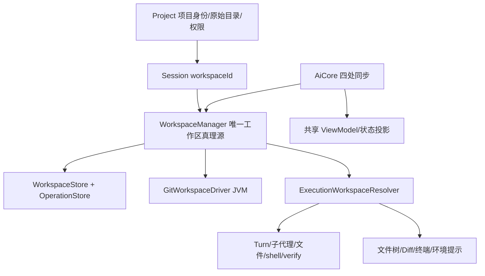

# Worktree 功能规划与 Codex 对标

状态：已有Gemini实现及GLM整改，2026-11-03第三轮审查仍未通过；当前唯一修复入口为 [第四轮整改任务](worktree-spec/ROUND4-REPAIR.md) + [实施spec](worktree-spec/round4-spec.md)。初稿2026-11-01，本轮交接2026-11-03。下文旧“当前架构”描述保留为原规划背景，不代表最新源码状态。

**实施入口：[worktree-spec/README.md](worktree-spec/README.md)，规范 WT-2026-11-02.1。** 用户指定交给 Gemini 执行时，使用该入口内的一次性交接提示词。包内含冻结契约、Git/快照/恢复算法、运行时/UI规范、18项任务、机器验收清单与脚本；本文件的“建议/拟定/待核对”不再作为实施时自由选择项。具体执行以交接包为准。本轮仅编写计划/spec/验收工具，没有操作现有用户worktree。

## 1. 目标与对标基线

目标是对齐 Codex 的完整 worktree 使用流程，包含桌面和手机遥控 UI，分期开发不等于缩减最终范围。以本次核对的官方公开行为为基线；内部算法和未公开的冲突处理不能凭推断宣称完全一致，需记录并用实机对照验收。后续官方行为变化按版本修订此对照表。

官方基线：[Git worktrees](https://learn.chatgpt.com/docs/environments/git-worktrees)、[Local environments](https://learn.chatgpt.com/docs/environments/local-environment)。摘要：从输入框选择 Local/Worktree、基线分支与环境；默认 detached HEAD，可带当前未提交修改；在工作副本继续或双向 Handoff，关联副本复用；可建分支；受管目录可配置，归档/限额清理前留快照并支持恢复；运行中/固定对话受保护；支持 `.worktreeinclude` 与忽略的 `AGENTS.override.md` 复制（跳过符号链接、不覆盖已有文件）。默认保留最近 15 个受管副本，可调整或关闭自动清理。手机控制宿主。环境配置支持初始化脚本、平台覆盖和终端常用动作。[上述官方文档]

### 完整验收范围

| 能力 | Mederi 验收目标 | 主要验收情景 |
|---|---|---|
| 新对话 Local/Worktree | 发送时由 Core 准备工作区，基线分支/commit 可核对 | 新副本不污染原目录，未准备好不启动模型 |
| 当前本地修改作为起点 | 明确展示是否携带，保留 tracked staged/unstaged 和普通 untracked 内容 | 二进制、删除、重命名、文件模式、空目录语义、路径特殊字符 |
| 默认 detached HEAD / 建分支 | 起步不制造分支；之后可显式命名分支 | 同分支占用时明确报错，不 force 绕过 Git |
| 双向 Handoff | Local 与固定关联 worktree 间迁移对话及代码 | 本地脏状态、分支占用、差异冲突、半途失败均可恢复 |
| 环境初始化 | 用户选择环境，setup 完成再接纳模型执行 | 平台覆盖、日志、超时、取消、批准、失败后重试 |
| 忽略文件复制 | `.worktreeinclude` 兼容；忽略的 `AGENTS.override.md` 对齐行为 | 不跟随符号链接、不覆盖、不绕过路径拒绝规则 |
| 工具与界面跟随 | 文件、shell、子代理、verify、AGENTS、Diff、终端对应同一工作区 | A/B 并行不串路径，重启恢复一致 |
| 归档、清理与恢复 | 先保存可验证快照再回收，历史对话保留恢复入口 | 未提交/二进制/untracked 数据不丢；快照失败不能删 |
| 管理设置 | 根目录、数量默认 15、自动清理开关、空间与错误状态 | 固定/运行中/迁移中/待批对话不可被自动清理 |
| 桌面/遥控 | 同一 AiCore API 与状态流；手机操作宿主上的 Git | 遥控重连、重复点击、宿主离线、未知结果恢复 |

上述是 worktree 功能边界。提交/推送/PR 控件若作为完整 Codex Git 工作流一并要求，应单列 Git 工作台范围和估算；不能将已有 turn 文件快照 Diff 冒充 Git staged/branch Diff。定时任务目前不是本项目的既有能力，未来接入时复用此工作区准备 API，不在本轮创造另一套调度系统。

## 2. 当前架构的关键约束

依据 `docs/architecture/01-core.md` 的 ProjectManager、Session、TurnExecutor、工具与存储节，以及 `02-app-shared.md` 的 AiCore、WorkspaceViewModel、DiffPresenter、Terminal：

- Project 单目录模型保留：它表示项目身份和原始目录。不能把每个副本变成独立 Project，否则项目权限、对话归属、设置都被拆散。
- 当前 Session 没有工作区字段，TurnExecutor 直接 `listOf(project.directory)`。必须增加会话工作区绑定和唯一解析入口，逐项替换执行路径来源。
- 当前 PlanStore/Notebook 在项目 `.mederi/`；它们不应因工作区切换就变成空数据，也不能被副本清理连带删除。
- 当前 Diff 是 turn 改动记录，不等于 Git 工作区状态；当前终端 key 偏项目级，不能在切换副本后复用旧 cwd 的 PTY。
- `.git` 指针与 common dir 已受沙盒保护；内部受信 Git 服务需独立处理 Git 元数据，不能靠放开模型 shell 修改 `.git` 来管理副本。
- 当前保护整个宿主运行时配置目录；默认工作副本若放到 `~/.mederi/worktrees`，必须精确区分控制数据和当前工作副本写根，不能把整个 `~/.mederi` 加进白名单。

## 3. 领域与持久化设计（拟定）

建议新增纯领域模型：

- `Workspace`：id、projectId、kind(LOCAL/MANAGED_WORKTREE)、canonicalPath、repositoryRoot、gitCommonDirectory、baseCommit、associatedSessionId、生命周期、snapshotId、时间戳。branch 是实时 Git 事实，不持第二份可写分支真理源。
- `Session.workspaceId: String?`：旧数据 null 明确定义为既有 Local；新的工作区绑定在 Core 完成，不允许 UI 自行写路径。
- `ExecutionWorkspace`：projectId、workspaceId、workingDirectory、artifactDirectory、repositoryRoot、gitCommonDirectory、generation。每轮/每次关键执行使用经校验的同一快照；迁移中不产生可执行快照。
- `WorkspaceOperation`：operationId、幂等键、源/目标、阶段、基线/快照引用、错误、可恢复动作。准备/交接/归档/恢复均为持久操作，而非 UI coroutine 的本地布尔值。

Workspace 与操作日志属于会话运行数据，放 data.db；会话绑定与操作阶段可同库事务提交。新增 `.sq` + 递增 DATA_DB_VERSION + 版本化迁移；不删库，不改写历史 Session 路径。根目录与保留数量等宿主配置放 config.db 的 SettingsStore，遥控端不写自己的设备偏好。

`GitWorkspaceDriver` 只执行确定性的 Git argv，捕获退出码与原始诊断，不拼 shell；机器数据用 Git 稳定的 NUL/porcelain 输出协议解析。仓库身份以 canonical git common directory 确认，不能只看 `.git` 是不是目录；支持仓库子目录项目、已有 linked worktree、空格/非 ASCII 路径。

`WorkspaceManager` 负责业务规则、仓库级操作锁、路径校验和恢复；Driver 负责 Git/I/O，Store 纯持久化。长操作不持全局锁；按仓库和工作区排他，跨项目若共享同一 common dir 也不得竞争修改引用。外部 Git 进程不服从本进程锁，执行前后都复核 HEAD/index/status。

## 4. 执行目录、产物和权限

- 对话继续属于原 projectId，继承该项目两档、黑白名单和命令规则，不创建另一套 worktree 权限。
- 默认源代码写根改为当前 workingDirectory；原始 checkout 不因“同项目”而自动变成可写根。用户显式额外授权仍生效。
- 项目内部的拒绝路径同时保护原路径和副本的对应相对路径；项目外绝对拒绝路径保持原义。界面说明“项目内黑名单随工作副本生效”。编译策略时生成有效路径集合，不偷偷改写存储的原规则。
- 宿主控制文件、数据库、快照库和其它副本保持保护；只对注册、身份已验证的当前受管 workingDirectory 给出精确写例外，显式黑名单依然优先。macOS/Linux 的路径规则和挂载顺序都需行为验收。
- 计划和 notebook 的 artifactDirectory 首期保留现有项目 `.mederi/` 语义，作为独立产物根传给对应服务；相对源代码路径永远在 workingDirectory 解析。不得把原项目整个目录重新放开来访问几个产物。
- 主对话与子代理继承相同工作区；verify 与生成 spec 中的 cwd 同源。迁移期间须停稳所有相关执行者/后台任务/待批；不在运行中改变其 cwd。
- 文件树、文件预览、AGENTS 链、Git 状态、Diff、回滚定位、环境后缀、IDE 打开路径与终端统一读取 resolver。终端 key 至少包含 workspaceId；旧终端明确保留旧工作区身份或关闭，不做假 `cd`。
- Worktree 是 Git 工作副本隔离，不替代 OS 沙盒；尤其显式 FULL_ACCESS 不承诺禁止命令访问其它副本。

## 5. 创建、交接、清理的正确性

创建：接收稳定请求 ID → 记录操作 → 校验 Git 与基线 → 捕获源修改 → 建 detached 副本 → 应用捕获修改/包含文件 → 环境 setup → 核验 → 事务绑定 Session → 才允许模型开始。失败时保留诊断和可重试操作，不能悄悄回退到 Local 执行。第一次发送由 Core 持久接纳和等待，不新增 UI 待发队列。

Handoff：先给出具体源/目标、变更摘要、冲突/占用事实 → 用户触发 → 停稳执行并撤销旧待批 → 保护源和目标的恢复快照 → 计划 Git 操作 → 按阶段执行 → 核验文件/HEAD/index → 更新绑定和代次 → 通知 UI 换工作区。目标有独立修改时不覆盖；提供明确的冲突处理入口。未满足前置条件就停在可恢复状态，不用 `reset --hard` / `clean -fd` 兜底。

快照：需保存 detached 可达提交、tracked 文件状态（含 index/工作树区别）、二进制、删除/重命名/模式和普通 untracked 文件，并验证 manifest/内容完整性。ignored 文件按包含规则处理，不声称普通 Git diff 已经备份所有文件。快照是宿主恢复数据，不提交到用户分支、不推远端。

清理：仅处理 registry 确认归属的受管副本，重验 canonicalPath、Git 注册和仓库身份；永远不删 Local、外部自建 worktree 或未知路径。先完成并验证快照、再移除 Git worktree，成功后才标记可恢复。进程崩溃可通过操作日志区分“已留快照未删”“已删未更新状态”。恢复目标被占用时报告并提供新受管位置，不覆盖现有目录。

归档对话和工作副本资源回收分别有状态；回收失败不丢聊天记录。自动清理默认保留最近 15 个，可关闭；固定/运行中/待批/迁移中排除。删除项目需展示受管副本/快照影响，不沿用现有级联删除就直接抹掉恢复资产。

## 6. UI 与交互规划

### 输入栏与计划批准

计划审批建议使用“清单勾选”图标（现有 Feather `CheckSquare` 可用），避免闪电/魔法棒暗示速度或全面放权。工具条继续只有一个“权限与计划”图标入口；菜单中计划组可以用清单图标辅助识别，选项保留“自动批准计划/手动批准计划”文字及选中态，悬停和无障碍标签包含当前状态。不要用一个看不懂的裸图标替代菜单说明。本段为视觉建议，未在本轮修改产品代码。

### Worktree 入口

新对话在现有项目/模型控制旁放一个紧凑工作区入口：GitBranch 图标 + `Local` 或 `Worktree`，不把路径、分支、环境平铺到输入栏。环境身份保留短文字，避免仅靠分支图标无法辨认实际执行位置。

展开菜单/面板显示：执行位置两选一、基线分支搜索、携带本地修改摘要、可选环境。非 Git 项目仍可 Local；Worktree 禁用并解释原因。首次发送按钮正常接纳输入，准备阶段显示进度与取消，失败给重试/修改配置，不自动改位置。

已有对话在标题栏显示工作区身份与分支/Detached HEAD；菜单提供“在 IDE 打开”“打开终端”“在此创建分支”“交接到 Local/Worktree”“管理副本”。标题不会仅因分支名变化而冒充迁移完成。Handoff 的确认只在用户明确执行迁移动作时出现，展示具体影响。

项目设置新增“工作副本与环境”分组：副本列表、关联对话、分支/commit、状态、磁盘占用、最后使用时间；包含环境配置入口。受管根/全宿主保留限额在宿主设置说明其真实作用域，避免伪装成项目独立配置。

### 窄屏

320dp 输入栏仅保留一个短位置入口；详细配置用 bottom sheet，分支选择是可搜索列表。已有对话把 Git 操作放标题菜单，文件 Diff 用全屏页；Handoff 用一列源→目标摘要，主动作固定，内容可滚动。恢复/失败/冲突都显示具体目标与可做动作。

所有共享 UI 放 commonMain，复用现有菜单、字段、错误/加载、overlay；UI 不执行 Git。中文/英文同时维护；以 320dp、280dp+1.6 倍字体、键盘导航和遥控断线重连验收。展示完整路径时可选择/复制，不靠截断路径完成危险决策。

### 环境与常用动作

环境配置采用项目内结构化配置（建议 `.mederi/environments/*.json`，`@Serializable` DTO），支持默认/macOS/Linux/Windows setup 和常用动作（名称、图标、命令及平台覆盖）。新工作副本创建时执行所选 setup；动作从标题栏动作菜单启动，输出进入关联工作区终端/任务日志。命令仍走项目执行权限、黑名单、超时和进程回收；不会为初始化悄悄使用 FULL_ACCESS。配置变化后展示实际要运行的脚本，不能沿用旧配置的批准。

遥控端通过 Core 启动并观察动作；当前没有远程 PTY 就提供真实的命令任务日志/取消接口，不能把宿主 `TerminalManager` 本地注入伪装成移动端已有能力。完整交互验收需明确动作与交互式终端的能力区别。

## 7. API 草案与事件

拟定 AiCore 能力：repositoryInfo(projectId)、listWorkspaces(projectId)、prepareConversationWorkspace(input)、getWorkspaceOperation(id)、cancelWorkspaceOperation(id)、createWorkspaceBranch(input)、previewHandoff(input)、handoffWorkspace(input)、archiveWorkspace(input)、restoreWorkspace(input)、get/updateWorktreeSettings、get/updateProjectEnvironment。

命名在实施 spec 中收敛；所有变动同步 AiCore → MederiAiCore → ServerAiCore → Server endpoint → Mock。耗时方法返回 operationId，使用既有事件/SSE 报进度，重连可查询真实快照；不靠事件一定送达才能完成操作。事件包含 projectId/sessionId/workspaceId/operationId 及结构化阶段，不把任意 stderr 当状态枚举。当前对话快照增加有效工作区只读信息和操作状态。

## 8. 实施顺序、验证和估算

以下是人工工程工作量估计，不是 AI 连续运行时长或额度承诺；不含额外完整 Git 提交/推送/PR 产品建设。

| 阶段 | 交付物 | 通过标准 | 人日 |
|---|---|---|---|
| 1. 领域与 Git 驱动 | 模型、data.db 迁移、发现/创建/枚举、锁和操作日志 | 临时真实仓库建副本，含 linked/subdir/脏工作树；迁移保留旧会话；错误恢复幂等 | 3–5 |
| 2. 运行时与 API | resolver、所有执行/观察路径、沙盒精确边界、四处契约 | 两对话并行写同名文件各自落盘；子代理/verify/Diff/终端不串；重启/遥控一致 | 3–5 |
| 3. 界面闭环 | 创建选择器、工作区身份、设置管理、窄屏与错误流程 | 320dp/大字体可独立完成新建、打开、取消、重试；状态非乐观伪成功 | 3–5 |
| 4. Handoff 与恢复 | 双向迁移、快照、建分支、归档/还原 | 含二进制/untracked 的往返内容核验；脏目标不丢数据；每阶段注入故障后可续作 | 4–6 |
| 5. 环境与清理验收 | setup、包含文件、保留策略、原生/遥控回归和文档 | setup批准/取消/失败；symlink与拒绝路径不绕过；固定/运行中不清理；快照失败不删 | 2–4 |

合计约 **15–25 人日**。阶段 1–3 可形成日常可用闭环；完成所有阶段并逐条通过对照表后，才称完整 worktree 对标完成。仅会调用 `git worktree add` 的版本不是本计划的交付目标。

每阶段在实施前拆成更小的可独立行为验证子任务，并据实际读取的文件编写精确 spec/测试命令；不把编译成功当行为验收。不需要为规划虚构尚不存在的测试命令或工具。运行 APP/server 仍必须使用 idea-mcp；自动化测试使用临时真实 Git 仓库，全部置于 repo temp，绝不拿当前用户工作树试迁移/清理。

架构同步清单：01-core 模型/Manager/Store/数据库/执行路径；02-app-shared DTO/API/路由/VM/UI/终端契约；04-flows 准备/Handoff/恢复/重连状态机；00-overview 增加装配和存储。产品实现改变后再同步 AGENTS 的单项目/会话工作区不变量。

## 9. 实施前待核对项

- 官方文档没规定的源修改转移细节、dirty 目标交互和归档失败 UI，进行实际 Codex 操作对照并记录；不写成已经验证的事实。
- `.worktreeinclude` 与 `AGENTS.override.md` 复制能力需要同时核对 Mederi 的指令加载规则；复制成功不等于已实现 override 的优先级。
- submodule、Git LFS、稀疏检出、超大仓库和特殊文件的支持矩阵需在阶段 1 给出；无法无损处理时执行前报错，不静默忽略数据。
- Windows Git 路径/进程支持与 Windows OS 沙盒是两项能力；前者可以独立规划测试，后者仍按已有决定后续实施，不能为跑 setup 默默解除权限。
