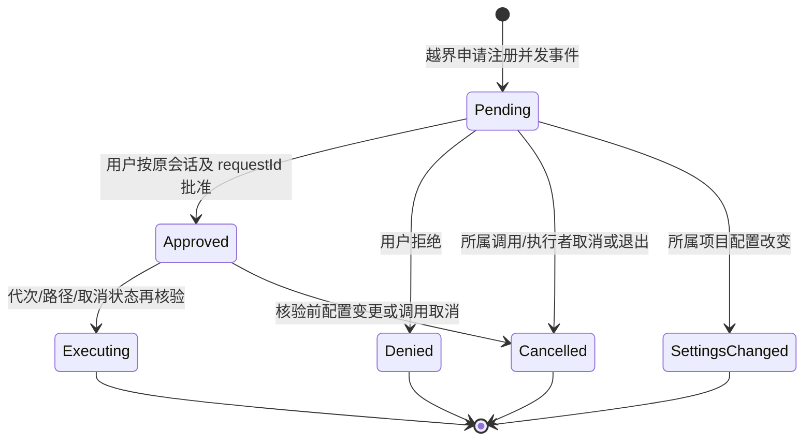

# 执行沙盒与项目权限

> 2026-11-01：本方案替代旧版“永远开/无逐操作批准/默认构建缓存可写”的决策。实现范围是 macOS/Linux 命令沙盒与全平台共享的权限契约/UI；Windows 原生命令后端另批实施。历史分析 `doc/执行沙盒与授权档位分析.md` 不是当前实现规格。

## 1. 产品语义

项目级仅两档，同一项目的会话及执行子代理使用同一真理源，desktop/server/遥控端共用 API；不同项目隔离：

| 模式 | 文件工具 | 命令 |
|---|---|---|
| 需要批准（默认） | 允许范围内直接写；越界/保护路径在任何写入前申请本次批准 | 默认受限执行；显式申请联网或解除沙盒时等待用户批准 |
| 完全访问 | 除项目黑名单外免路径审批 | 有路径黑名单仍套黑名单后端；免审批，保留超时/进程回收 |

不做 AI 自动审查，不把执行模式放进 `AgentMode`。计划批准、`ask_user` 继续独立工作。模式设置只通过用户 API，不注册为模型工具。

一次批准只覆盖不可变的那条操作（完整命令、cwd 或整份补丁的目标路径）。不把这次批准写成长久规则；长期允许/拒绝命令由用户在项目设置中显式配置。被拒绝后不得换等价命令规避。

设置变化只使该项目旧待批请求失效，不因切换完全访问而偷偷执行旧卡。已经启动的进程保留启动时边界；下一次调用读取新配置。设置页明确这一项目范围与生效时机。

项目设置入口位于侧栏项目菜单“项目设置”；输入框提供“权限与计划”图标菜单，内部分别列出执行权限和计划批准。桌面端只显示一个图标及悬停状态提示，窄屏输入选项面板直接展开这两组内容；切换项目不复用旧项目配置。AppState 下 `ProjectPermissionStore` 仅作每项目 UI 投影，读写和事件回查都通过 AiCore，不写设备偏好。

项目规则有四组：额外可写路径、拒绝读写路径、允许命令前缀、拒绝命令前缀。路径黑名单比白名单、一次批准和完全访问优先；文件/Office 读取及目录列表、AGENTS.md 注入均过滤。命令规则仅匹配静态 argv 前缀（支持引号），不分析命令效果；拒绝优先，允许前缀只免该命令的提升审批，default 仍受沙盒约束。管道、重定向、变量/命令替换不自动允许；配置拒绝命令时无法安全解析的 shell 文本拒绝执行，提示拆成静态命令。程序自身脚本或等效命令的行为不由词法规则推断。

完全访问或单次 off 仍需强制拒绝路径：macOS 用 allow-default + 显式 deny；Linux 用 bwrap 匿名不可访问挂载覆盖拒绝目标，不更改宿主文件权限/内容。Linux 对不存在拒绝目标失败即停；挂载按启动时路径快照，硬链接别名/外部重命名不等同于完整数据防泄漏系统。Windows 暂无强制后端，有路径黑名单时 off/FULL 也拒绝执行。

## 2. 架构与状态所有权

```mermaid
flowchart TD
    UI[设置/执行批准卡] --> Contract[AiCore]
    Remote[ServerAiCore REST] --> Server[Server 薄路由]
    Server --> Contract
    Contract --> Bridge[MederiAiCore]
    Bridge --> API[SandboxApi 异常转换]
    API --> Manager[SandboxManager 单一真理源]
    Manager --> Store[SettingsStore sandbox.projects.{projectId}.settings]
    Manager --> Events[现有 session eventBus]
    Events --> Snapshot[ConversationStateReducer / 活体快照]
    Snapshot --> UI
    Tools[文件/前台/后台/验证工具] --> Permission[ExecutionPermissions]
    Permission --> Manager
    Permission --> Paths[SandboxPaths]
    Permission --> Backend[CommandSandbox Seatbelt / bwrap+seccomp]
```

- 每个 `Mederi` 实例一个 manager，不能用进程可变 singleton；不同实例可注入独立 store。
- 持久化只存 `SandboxSettings(mode, extraWritablePaths, version, deniedPaths, allowedCommands, deniedCommands)`，默认是需要批准。配置损坏报错并阻止执行，不能变全开。
- 写配置先校验，再将持久化、缓存、代次更新和待批失效作为同一个不可取消的提交段；写失败不放权。
- 新项目默认需要批准；旧全局权限和设备偏好不向项目迁移或回退读取，避免隐式给全部项目授予完全访问。旧数据不删除。
- 已移除 `SandboxConfig` 与 `SandboxHooks`、AppState 白名单副本。宿主配置通过 AiCore API 管理，遥控设备不拿自己的偏好冒充宿主。
- 对外更新携带读取到的配置 version；manager 在同一临界段校验及递增，旧客户端表单不能覆盖较新的权限设置。
- 事件先同步非阻塞发送，背压时由自动排空退出的FIFO发布任务发送，取消与批准不等待订阅者；close拒绝全部待批并释放发布任务。
- DTO/事件结构统一 kotlinx.serialization；core JVM 与契约 KMP 通过显式映射分层。

## 3. 文件与保护路径

需要批准模式的可写根 = 当前项目目录 + 实际系统临时目录 + 显式额外路径。家目录构建缓存不再默认放行，不给整个 `/private/var/folders` 写权限。

`SandboxPaths` 先做 canonical 解析及合法性验证，再合并父子根。禁止把 `/`、`/proc`、`/dev`、`/sys` 及覆盖它们的路径作为普通可写根。允许的设备输出是 OS 后端内显式最小例外。

保护路径在合并前收集，包含配置根的 `.git`、`.agents`、`.codex`、`.aws`，gitfile 指向的实际目录及 linked worktree 的共用目录，以及实际宿主配置目录。后者即使落在用户放行的 home 下也不自动可写；不会把项目自己的 `.mederi` 计划目录整体锁死。

文件工具在批准前不能创建父目录；整份 apply_patch 先收集源、删除、移动目的等全部路径，再请求一次批准。批准后重新核对配置代次及 canonical 路径，落盘前加 `FileWriteRegistry`，同步工具在 mutation 前再次检查取消/代次。write/edit 禁止覆盖硬链接，不跟随叶子符号链接；apply_patch 保留既有逐组件符号链接拒绝、整体写锁、dry-run 与失败回滚。

`FileWriteRegistry` 不覆盖 shell/MCP/外部进程；文件工具的宿主路径校验也不声称等价于隔离整个 JVM。外部进程竞争修改目录仍是需要单独关注的 TOCTOU 边界，不能从单测推断完全消除所有文件系统竞争。

## 4. 命令与网络

`bash` 与 `verify_subtask` 均接受 `sandbox`：

| 参数 | 需要批准模式 | 完全访问模式 |
|---|---|---|
| default | 受限文件系统，禁止命令联网 | 保留显式路径黑名单 |
| network | 先批准这条命令，保留文件边界，只打开网络 | 保留显式路径黑名单 |
| off | 先批准这条命令，解除 OS 沙盒 | 保留显式路径黑名单 |

权限判断位于 ShellTools 公共准备入口，前台、后台与存储的验证命令共用；没有权限上下文时不能通过 nullable sandbox 自动裸跑。授权等待不计入命令运行超时。后端不可用明确报错，不自行重试裸跑；非零退出不自动判为权限问题。

macOS 使用 `sandbox-exec -p` 传可信内联 SBPL，消除可写策略缓存。默认没有 `allow network*`，回环/Unix socket 同样不默认放行；批准 network 后开放网络，文件限制保持。profile 字符串严格转义。保留 java_home 所需 sysctl 能力及 perl 进程组包装。

Linux 使用 bwrap 只读根、可写 bind、保护路径 ro-bind、独立 PID/proc/dev。默认追加网络 namespace 与 seccomp：阻止 connect/sendto/sendmsg/sendmmsg/io_uring_setup，检查 syscall ABI（x86_64/aarch64，拒绝其他 ABI），防止通过宿主 Unix socket 代理绕过。BPF 由 Kotlin 生成，经匿名管道传入 fd3，不落可篡改缓存，不占用 payload stdin。批准 network 后移除网络限制，文件挂载保持。完整配置探测失败即停，不代装 bwrap。

Windows 暂无受限后端：default/network 受限调用阻止；无显式路径黑名单且用户批准一次 off 或选择完全访问时才走裸执行。该行为不是 Windows 隔离能力已经实现。

每条命令登记 `ProcessRegistry`；macOS perl / Linux setsid 使宿主能按已登记进程组回收。取消与超时收割所启动命令，不向未登记宿主进程发信号。后台任务由原 BackgroundTaskManager 管理。

## 5. 授权生命周期



并行申请存 map，不能“新请求替换旧请求”。子代理使用父会话的 manager，但保留自己的 executionSessionId；子代理结束仅清理它自己的请求。主 turn 阶段完成不能清掉仍在运行的子代理申请。新用户输入按统一发送入口解除挂起并取消旧执行，不新增 UI 待发队列。

事件是 `EXECUTION_APPROVAL_REQUESTED(request JSON)`、`EXECUTION_APPROVAL_RESOLVED(requestId,status)`；设置变更另发 `SANDBOX_SETTINGS_CHANGED`。活体待批列表进入 `ConversationState.pendingExecutionApprovals`。首次快照/重连从 manager 获取真实活体列表；进程重启后不存在待执行授权，历史不能恢复可点击批准。

WaitingUser 根据提问、计划、多个执行请求的并集投影；解除一个请求不能撤销其他等待。UI 卡单独展示，不折进工作过程，不复用计划批准卡。提交按原会话+请求隔离，失败可见且可重试。

## 6. 独立 HTTP 调研工具

web_search/web_fetch 使用只读 `WebHttpReader`（http(s) GET、有限重定向/总超时/字节上限），不再拼 curl 或经 runCommand。引号作为数据传递。该服务连接独立于命令网络规则，不意味 bash 获得网络权限；浏览器、MCP 和连接器也不能宣称被这个命令沙盒完整覆盖。

## 7. 验证入口与未验证状态

```bash
./gradlew :core:jvmTest :app:shared:jvmTest
MEDERI_REQUIRE_MACOS_SANDBOX=1 ./gradlew :core:jvmTest --tests 'xyz.mederi.tools.sandbox.CommandSandboxTest' --rerun-tasks
MEDERI_REQUIRE_LINUX_SANDBOX=1 ./gradlew :core:jvmTest --tests 'xyz.mederi.tools.sandbox.LinuxCommandSandboxTest' --rerun-tasks
```

跨平台纯逻辑测试不替代原生隔离测试；required 模式在缺宿主/缺后端时必须失败，不能 skip 后声称验收完成。原生测试仅写仓库 temp 中自建 fixture，不碰用户数据或真实 .git。

APP/server 的实机启动按 AGENTS.md 仅用 idea-mcp；缺工具时明确保留未验证项，不能 bash 启动产品。Windows 后端实现与真机验收留后续。
