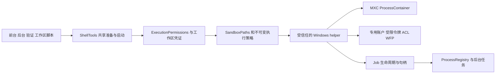

# Windows 原生命令沙盒实施规格

## 1. 产品行为

项目权限由现有 `SandboxManager` 管理，审批由 `ExecutionPermissions` 完成。Core 通过同一入口给前台、后台、verify_subtask、工作区 Setup 与自定义 Action 准备授权。管理员安装只启用宿主能力，项目模式与用户批准继续由原系统管理。

| 当前权限及本次请求 | 文件系统 | 网络 | 启动条件 |
|---|---|---|---|
| 需要批准 / default | 共享策略的可写根，保护路径只读，黑名单禁止读写 | 拒绝 | 受限后端能强制执行 |
| 需要批准 / network | 与 default 相同 | 本次开放 | 经现有授权，后端能执行相同文件边界 |
| 需要批准 / off | 按宿主权限，仍拒绝显式黑名单 | 本次开放 | 经现有授权。有黑名单时必须有能执行该策略的后端 |
| 完全访问 / 任意参数 | 按宿主权限，仍拒绝显式黑名单 | 开放 | 有黑名单时必须有能执行该策略的后端 |

- 复用现有命令前缀允许与拒绝规则。拒绝优先。一次联网批准只改变网络参数。项目配置代次或工作区凭证变化时，旧 grant 失效。已经启动的命令继续使用启动时的策略。
- 受限模式应能读取正常宿主用户有权读取的代表性本地资源，包括工作区外可读数据与开发工具。拒绝目录的内容、列目录、写入、删除、重命名及替换必须受 OS 强制。专用账户受既有系统 ACL 限制的路径允许报告明确访问错误，不能通过给宿主整个用户目录放宽 ACL 来追求读取等价。记录这一兼容边界。
- 共享规则以 [sandbox-plan.md](../sandbox-plan.md) 和实际 `SandboxPaths` 为准。Worktree 使用经过核验的 checkout、产物根和重映射黑名单，不回退到源仓库范围。Git 工作区的 `.git` 可能是文件，实际 gitdir 和 common dir 同样是保护对象。保留项目计划产物的写入。
- 显式 off 或完全访问且黑名单为空时可按宿主用户启动，仍使用整树回收。原生 helper 可以用同一启动器提供无文件/网络限制的 Job 启动。helper 缺失时只有经证明同等回收的 Windows 路径才可使用。对现有完全访问的打包迁移写明兼容表现，不引入受限命令的裸跑 fallback。
- 浏览器、外部 MCP、独立 HTTP 调研工具及可信的宿主内部 Git 操作维持其各自边界。以工具/Action 入口触发的任意用户脚本均从 ShellTools 进入本规格。不要把本功能扩展成整机沙盒或改造其他平台。

## 2. 架构和启动链

### JVM 与 native 的边界

- 在 Core JVM 沙盒包新增 Windows 后端。用现有 `CommandSandbox` 接平台选择。现有 `WrappedCommand` 只有 argv/warning/processGroupLeader，Windows 如需句柄及启动握手，增加窄的内部启动描述或启动接口，复用到前后台，POSIX 保留现有执行语义。Windows 不把裸 PID 塞进 pgid 模拟 Job。
- Native 实现用 Rust 和 Win32 bindings。新 crate 独立于 Kotlin/KMP，提交锁文件。两套后端共用一个受信任的 helper 接口和可测策略对象。特权安装与普通执行分开，优先使用一个 Windows 可执行入口按角色分流，仅在身份边界需要时拆分安装器或 broker。代码路径和调用方向以验收报告为准。
- Helper 用安装布局解析出的可信绝对路径启动。禁止用项目 cwd、PATH、项目文件、模型参数或可被沙盒身份写入的目录来发现、覆盖 helper、其 DLL、配置、凭据或测试替身。测试注入仅限内部装配。安全敏感的依赖版本、许可证、来源和校验写进发版说明。Native payload 用明确的 executable、UTF-16 参数和 cwd 启动。保持现有 bash.exe / cmd 的产品行为，PowerShell 通过正常命令调用验证。做 Windows 参数往返测试，包括尾反斜杠、空格、引号、Unicode、shell 元字符和带空参数。Core 与 helper 间不重新拼 shell 字符串。
- `probe` 无副作用、有限时间和输出。返回协议版本、后端及可落实的能力、结构化失败原因。硬能力至少区分受限工作区、OS 断网、网络已开放仍保留文件边界、黑名单封套与进程回收。安装标记、版本号和 SDK 成功 import 只说明前置条件。状态 API 可以显示宿主能力及限制。真实启动用本次策略再次检查。
- `run` 只执行一份不可变请求。至少包含协议版本、执行 ID、executable 与 args、cwd、网络模式、文件范围模式、允许写根、只读保护对象、拒绝对象、超时，以及工作区凭证在 JVM 侧生成策略时所用的身份/代次。接收限制长度的帧、字段和路径数，严格拒绝无法理解的版本或状态。Kotlin DTO 使用 kotlinx.serialization，Rust 使用有类型的解码。Native 侧复核路径与策略可实现性。项目 ID 和授权描述本身不能给 native 提权。
- 用受控匿名管道、明确继承句柄表和独立控制信道。命令 stdout/stderr 仅是数据，无法伪造握手、退出状态、ACL/策略结果或取消请求。保留 payload stdin 的原语义，控制协议与它分开。Native 进程及 Job 句柄绝不能继承给 payload。父子通信断开、超时、退出和错误均有有界收尾；输出读取持续排空并遵守现有上限。禁在 argv、stdout、日志、诊断及临时文件传播凭据或敏感环境值。
- 兼容后端需要特权时，特权入口仅用于安装、修复、卸载及必要的受控资源管理，永不执行任意 payload。若采用常驻特权服务，pipe 要拒绝远端连接并绑定实际调用身份，校验受信任启动方、安装所有者、SID 和请求类型。受控 ACL/令牌操作必须以真实请求方身份检查授权范围，不能以 SYSTEM 代写用户本来无权改 ACL 的路径。若宿主普通进程能完成所需操作，避免增设服务。
- 先完成授权并拿到已验证工作区的执行租约，再启用 payload。准备到启动的等待可被取消；在 Native 开闸前再次核对 grant 和工作区凭证。授权等待与用户命令运行超时分开，探测、启动、清理另设上限。前后台及 Action 释放租约前确认执行进程已停止，归档才能继续。

### 启动与终止

Native 在允许用户代码执行前完成身份、文件和网络准备，创建 Job 并启用 `JOB_OBJECT_LIMIT_KILL_ON_JOB_CLOSE`，关闭 breakaway。用挂起启动后分配 Job 再恢复，或用能提供等价原子保证的 SDK/进程属性。失败时清理挂起进程，返回结构化错误。MXC 运行时自带生命周期能力时也须通过相同整树验收。

启动协议分为准备、允许执行、执行结果。准备完成表示策略、Job 和受控流已就绪且用户代码尚未运行。Core 最后复核 grant/取消，允许 payload 开始。后台只有在明确收到成功启动后才向 UI 返回任务成功；后续失败通过现有任务状态和日志可见。超时、停止、会话取消、helper 崩溃和宿主进程消失都关闭对应 Job；同步退出和后台任务终态按现有语义保留输出和退出码。以 Job/进程句柄识别正在管理的执行，PID 仅用于展示和查表。另一个用户进程或重用 PID 永远不能被停掉。对 WMI、计划任务、服务、外部 COM 或 UI broker 启动的进程另做隔离测试，Job 只保证已纳入的进程。 [Microsoft Job Objects](https://learn.microsoft.com/en-us/windows/win32/procthread/job-objects)

## 3. 文件系统、身份和网络

### Windows 路径边界

JVM 复用 `SandboxPaths` 生成策略，native 用实际文件句柄校验安全敏感对象的最终路径和卷/文件身份，逐级处理重解析点。绝对路径、相对 cwd、大小写、短名、Unicode、长路径、卷边界和已存在祖先都纳入测试。首版有条件支持本地 NTFS。对不能保真的 UNC、网络盘、非 NTFS、设备命名空间、未经证明的重解析标签、大小写敏感目录、无法保证的 ADS 或路径形式，返回可定位的不可用原因。测试必须证明从允许根内部使用别名也绕不过边界。对合法长路径使用一致的 Win32 处理，拒绝含歧义的输入，禁止靠字符串 startsWith 或简单 lowercasing 当安全检查。

对允许根与保护/拒绝对象的交叠先生成完整策略，再判断后端能否强制实现。禁止用跟随 junction 的递归 ACL 命令。处理对象本身的读写/删除权限、父目录 `FILE_DELETE_CHILD`、新建/移动替换、显式和继承 ACE、ACL 所有权和重解析点替换。仅设置文件本身的拒绝 ACL 会漏掉从可写父目录删除目标的路径。保护项若不存在，要能拒绝随后创建，或明确限制为可信启动快照并在无法保持时阻止执行。拒绝目标无法表示或不存在且无法保证时，直接拦截，不自动创建目标，也不扩大拒绝范围到父目录蒙混过关。使用句柄、对象身份、必要的短生命周期目录保护和启动前复核防止把 ACL/权限落到被替换的对象上。既有硬链接别名需按对象做访问控制，或识别后阻止执行。明确报告对宿主外部进程竞争、数据副本和已经打开的句柄的边界。 [Microsoft Reparse Points](https://learn.microsoft.com/en-us/windows/win32/fileio/reparse-points) · [Microsoft DeleteFileW](https://learn.microsoft.com/en-us/windows/win32/api/fileapi/nf-fileapi-deletefilew)

### 兼容后端

1. **一次性 setup/repair/uninstall**。管理员显式触发 UAC，创建 Online/Offline 两个低权限账户，绑定本次安装及真实用户 SID。随机凭据加密并用 DACL 限制，仅受信任组件能取用。限制账户登录类型与权限，避免沙盒账户进入交互桌面或成为管理员。用事务或可恢复日志跟踪自有账户、规则、ACL 变化和安装版本。安装失败或取消不能产生可用标记，重试、升级、卸载仅清理本安装资源。多安装或多宿主用户隔离。可在受控 Windows VM 验证安装脚本，产品运行保持标准用户。
2. **每次运行**。离线命令使用 Offline SID，联网用 Online SID。用受限 token 去掉多余组/特权、检查实际用户和限制 SID。写限制由有效 token 和对象 DACL 的组合强制，专用账户的常规访问检查与限制 SID 检查都要满足。使用可隔离的 capability SID，证明多个项目并发时不能借用其他执行留下的 allow ACE。若共享专用账户导致黑名单、用户临时目录或进程间访问无法隔离，就用能够保证的隔离粒度或阻止冲突执行，写明粒度和原因。禁止复用可信宿主用户的特权或把共享账户的 broad write 当 sandbox write。专用账户 profile、可写临时路径和开发工具所需权限要经过实际验证。 [Microsoft CreateRestrictedToken](https://learn.microsoft.com/en-us/windows/win32/api/securitybaseapi/nf-securitybaseapi-createrestrictedtoken)
3. **ACL 规则与回收**。拒绝读要对有效身份产生真实拒绝。 `WRITE_RESTRICTED` 的限制 SID 仅用于写访问判断，不能拿它证明读取已拒绝。保护元数据时仍允许正常读取。所有改动只作用于沙盒身份，保留宿主既有 owner/DACL 和其他 ACE。记录对象标识及自己新增的精确条目、策略引用/并发冲突与恢复状态。先记意图，再改 ACL，核验有效访问，再启动。执行结束或崩溃恢复先回收命令，再按对象身份移除自有规则，不用旧 ACL 快照覆盖期间的用户修改。执行缺权限、遇到不可安全处理的 DACL 或残留冲突时阻止新启动，错误指向 repair。不可用的目录范围需要明确报告，不能每次命令隐式弹 UAC，也不能递归改用户整个 home。
4. **断网**。用按身份生效的 WFP/ALE 策略或经同等测试的 OS 机制约束 Offline，涵盖 IPv4/IPv6、TCP、UDP、DNS 与宿主回环。保留 Online 的正常网络权限，禁止通过临时关闭 Offline 规则来放行某条命令。只改环境变量、代理、PATH、禁 curl 或按进程名过滤均无法作为安全边界。检查规则真实绑定 SID、系统服务状态和策略是否被覆盖，缺失时 fail closed。考虑默认隔离对 DNS 客户端等代理服务的影响，通过测试验证。阻止可使 Offline 借在线身份或可信宿主出网的本地通道，测试宿主命名管道、宿主代理与桌面交互。令牌、Job 和 WFP 各有独立职责。 [Microsoft WFP ALE](https://learn.microsoft.com/en-us/windows/win32/fwp/ale-layers)
5. **完全访问附带黑名单**。单列 `DENY_ONLY` 能力。禁止用默认 workspace-write 冒充完全访问，也禁止为让专用账户达到用户全盘访问而扩大宿主 ACL。若兼容实现无法证明等价的宿主可访问范围和有效 deny，兼容后端报告该能力不可用，这类请求继续被挡。交付完整 Windows 功能需要有至少一个后端通过该档原生测试。

### MXC 后端

- 使用公开 Microsoft MXC SDK 的 Windows ProcessContainer，锁定经过原生验证的稳定 SDK/运行时版本，按其公开 schema 和 SDK 类型建策略。不要照抄旧分析里的私有运行器名称，禁止用 WSL2 或 Docker 代替 Windows 原生 payload。探测必须检查实际 Windows backend、隔离级别及本次策略能力，并用可信探针执行验证其行为。 [Microsoft MXC 平台支持](https://learn.microsoft.com/en-us/windows/apps/develop/mxc/platform-support) · [Microsoft MXC SDK 快速入门](https://learn.microsoft.com/en-us/windows/apps/develop/mxc/quickstart)
- 共享策略映射到可读、可写、保护与拒绝对象，明确默认只读面、典型工具链和所需加载路径。验证 deny 与父目录可写映射的优先级，以及 deny-only 是否可表示。不能用把权限授予整盘、然后指望 SDK 自动正确叠加 deny 的猜测通过验收。默认关闭网络和宿主回环，联网请求只改变网络策略。禁用与运行任务无关的 UI、剪贴板、输入注入。SDK/容器终止、后代清理、输出和退出状态仍遵守 §2。 [Microsoft MXC 策略文档](https://learn.microsoft.com/en-us/windows/apps/develop/mxc/policy)
- 每次启动前按策略能力选择。优先 MXC，其次已配置且支持该完整策略的兼容后端。明确未安装、功能不支持才可在选型阶段考虑兼容后端。探测异常、未知协议、策略校验失败、状态无法确认，或已经选定后端后发生启动失败，均报告错误，无自动重试换后端。未经本规格授权的执行永远不能降级为普通 shell。单次拒绝启动与普通 payload 返回非零退出码是两种结果。

## 4. 状态、安装和发布

- 先复用 `getSandboxStatus(projectId)` 给桌面及遥控显示宿主实际状态、活动后端、安装或修复提示。若现有字段足够，沿用原契约。必须新增结构化能力字段时，同步 AiCore/MederiAiCore/ServerAiCore/Server 及 Mock，给旧数据安全默认，UI 文案中英齐全。项目配置和一次批准交互保持原样。遥控可以查看状态，不能通过普通项目权限 API 触发宿主 UAC 或提权安装。
- 兼容后端提供独立管理员 setup/repair/uninstall 运维入口，文档列出可重复执行的命令、适用平台、失败后检查项和恢复方式。桌面若加安装动作，仅从本机宿主的受信任入口触发，需要用户显式操作；headless 用管理员 CLI/部署脚本。禁止从 prompt/tool、REST 或工作区脚本启动该流程。
- 首轮发布目标沿用现有 Windows x64 构建。Windows Desktop 发布产物与 server bundled、server API 产物均需按真实安装布局定位 helper 与所需运行时。检查 `.github/workflows/build_release.yml`、`build_release.sh`、`app/desktopApp/build.gradle.kts` 和 `server/build.gradle.kts`。其他平台打包不引入 Windows 依赖。Win11 x64 当前受支持镜像为必测。Windows 10/Server/ARM64 等仅在相应 Windows 原生验收后纳入支持说明。
- 记录威胁模型。针对工具触发的命令、脚本及其子进程防止未授权资源访问，可信 JVM/安装组件与已批准执行按各自边界运行。不要把命令沙盒结果等同于对管理员、内核、已有恶意宿主进程或独立工具体系的隔离。架构更新按 AGENTS.md 同步到 `01-core.md`、`04-flows.md`，以及实际涉及的契约、发布和使用文档。
